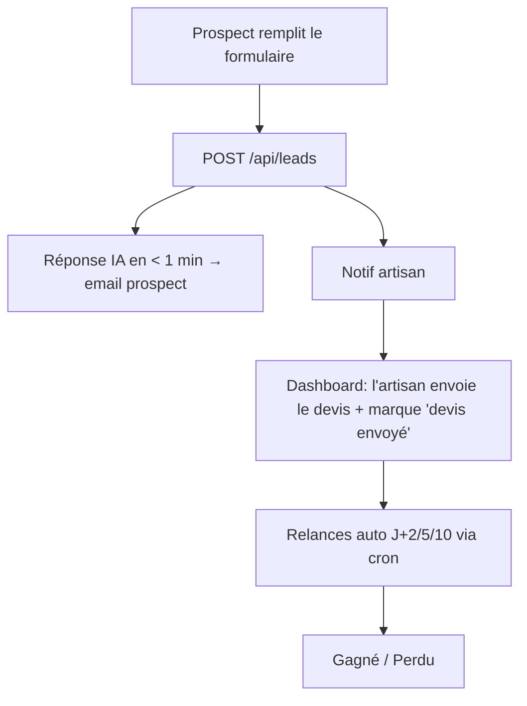

# Architecture — Presti

> ⚠️ **Document provisoire** — à construire **après/si** la validation terrain confirme le problème (interviews Alexandre). On le prépare pour être prêt, pas pour coder demain matin. Pensé pour un **build solo + IA**.

## Le produit + les 3 fonctionnalités principales
Presti = SaaS pour artisans FR qui **ne perd plus jamais un chantier**.
1. **Réponse instantanée aux demandes** — un prospect écrit → l'IA répond en < 1 min à la place de l'artisan (email d'abord, SMS en phase 2) + notifie l'artisan.
2. **Relance automatique des devis** — une fois le devis envoyé, le système relance le client (J+2, J+5, J+10) jusqu'à réponse.
3. **Génération de devis** — l'artisan décrit le chantier → l'IA produit un devis pro (PDF).

## Stack (choisie pour build solo + IA, marché FR)
- **Front + API :** Next.js (React, TypeScript) — app router.
- **Back / BDD / Auth / Cron :** Supabase (Postgres + Auth + Storage + Edge Functions).
- **IA :** API Anthropic (Claude) — réponses + génération de devis.
- **Email :** Resend (transactionnel). **SMS (phase 2) :** Twilio ou provider FR.
- **Paiement :** Stripe (abonnements). **Hébergement :** Vercel + Supabase.

## Structure des fichiers
```
presti/
├── app/
│   ├── (marketing)/page.tsx          # landing publique
│   ├── (app)/                        # espace artisan connecté
│   │   ├── dashboard/page.tsx
│   │   ├── leads/[id]/page.tsx
│   │   ├── devis/page.tsx
│   │   └── settings/page.tsx
│   ├── l/[slug]/page.tsx             # formulaire PUBLIC de capture de lead
│   └── api/
│       ├── leads/route.ts            # POST créer lead → déclenche réponse IA
│       ├── leads/[id]/route.ts       # GET / PATCH (statut)
│       ├── devis/route.ts            # POST génère un devis (IA)
│       ├── ai/respond/route.ts       # IA rédige la réponse perso
│       ├── relances/cron/route.ts    # CRON: envoie les relances dues
│       └── stripe/webhook/route.ts
├── lib/
│   ├── supabase.ts   ├── ai.ts   ├── email.ts   ├── stripe.ts   └── relances.ts
├── components/
├── supabase/
│   ├── migrations/   # schéma SQL
│   └── functions/    # edge functions / cron
└── .env.local
```

## Base de données (Postgres / Supabase)
- **artisans** : id · email · nom · metier · slug · ton_style · tel · plan · stripe_customer_id · created_at
- **leads** : id · artisan_id → · nom_prospect · contact · canal · message · **statut** (nouveau / repondu / devis_envoye / relance / gagne / perdu) · created_at
- **messages** : id · lead_id → · sens (in/out) · type (reponse_auto / relance / manuel) · contenu · sent_at
- **relances** : id · lead_id → · planifiee_le · envoyee (bool) · rang (1/2/3)
- **devis** : id · artisan_id → · lead_id (nullable) · contenu (json) · pdf_url · montant · created_at
- **subscriptions** : id · artisan_id → · stripe_subscription_id · plan · statut · current_period_end
- 🔒 **RLS activée** : chaque artisan ne voit que SES données.

## Routes API
| Méthode | Route | Rôle |
|---|---|---|
| POST | `/api/leads` | Créer un lead (formulaire public) → déclenche réponse IA + notif |
| GET | `/api/leads` | Liste des leads de l'artisan |
| PATCH | `/api/leads/[id]` | Changer le statut (ex. « devis envoyé » → planifie les relances) |
| POST | `/api/devis` | Générer un devis via l'IA |
| POST | `/api/ai/respond` | Rédiger la réponse perso au prospect |
| GET | `/api/relances/cron` | Job périodique : envoie les relances dues |
| POST | `/api/stripe/webhook` | Gérer les abonnements |

## Flux utilisateur principal (le flux qui rapporte)
1. L'artisan s'inscrit, configure **métier + ton**, récupère son lien public `presti.fr/l/son-slug`.
2. Il colle ce lien sur **Le Bon Coin / Google / Facebook**.
3. Un prospect remplit le formulaire → `POST /api/leads`.
4. Le lead est enregistré, **l'IA rédige une réponse perso**, l'email part au prospect **en < 1 min**, l'artisan reçoit une **notif**.
5. L'artisan voit le lead au **dashboard**, envoie un devis (généré par l'IA au besoin), marque « devis envoyé ».
6. Le système **planifie les relances** (J+2 / J+5 / J+10). Le cron les envoie jusqu'à réponse.
7. L'artisan marque **« gagné »** ou « perdu ».

