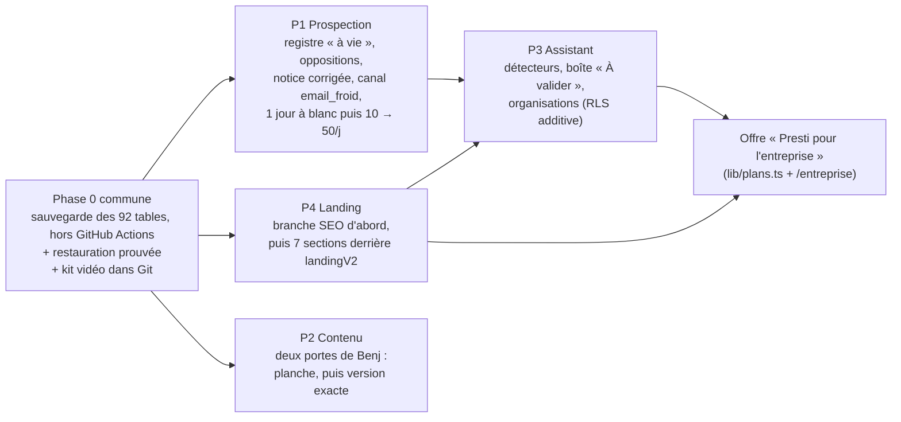

# Les quatre chantiers du 01/11 : ce qu'il faut décider

Première réponse aux quatre prompts du 01/11 : prospection, contenu, assistant et landing. Ce dossier ne contient **aucun code**. Il fait l'inventaire de l'existant, cite chaque fichier avec sa ligne, et liste les questions bloquantes avec une réponse par défaut. Tu y trouveras aussi l'architecture en Mermaid, le modèle de données, les phases et les risques.

Le détail de chaque chantier est dans son onglet. Les deux derniers onglets analysent tes 13 vidéos.

Ces inventaires sont des lectures du dépôt, de la base (SELECT agrégés seulement) et du réseau neuronal. Rien n'a été construit, migré, commité ni publié.

## Ce que j'ai déjà fait aujourd'hui (réversible d'un clic)

Quatre tâches planifiées du PC contredisaient tes règles écrites le 01/11. Je les ai **mises en pause**. Rien d'autre n'est touché.

| Tâche | Ce qu'elle faisait | Règle du 01/11 qu'elle contredit |
|---|---|---|
| `presti-ligne-editoriale` | publiait seule 2 posts par jour (juge à 8/10) | « Aucune action sortante sans Benj (publication…) » |
| `presti-contact-reseaux` | messages privés Instagram et commentaires de Page envoyés par robot | « Canal automatique : l'e-mail seul » |
| `presti-croissance-reseaux` | likes, commentaires, abonnements automatiques | « un commentaire public envoyé par robot est du spam » |
| `presti-envoi-prospection` | envoyait les e-mails en cliquant « Envoyer » dans Gmail | « jamais Claude qui clique Envoyer dans Gmail » ; « aucun message ne contredit la notice publiée » |

Rien n'a été publié aujourd'hui : la dernière ligne du registre date du 29/10.

Deux tâches répondent encore seules et restent **actives** (question G2 ci-dessous) :
- `presti-repondeur-prospection` répond aux e-mails des artisans ;
- `presti-reponses-messages` répond aux messages privés reçus.

La préparation sans envoi continue : Harvey, la chasse, la file du matin, le bilan du soir et le rangement du vault.

## Cinq constats transverses

1. **La sauvegarde protège moins qu'on ne croit.** Elle est en panne depuis le 25/10. Et même rétablie, elle ne couvre que **34 tables sur 92**, car sa liste est écrite à la main (`scripts/sauvegarde.mjs:49-60`). Le CRM, `assistant_actions` et `actions_auto` n'y sont pas. Aucune migration d'organisation ne doit partir avant une sauvegarde complète **et** une restauration prouvée.
2. **Le système vidéo est hors de Git.** `git ls-files -- videos` ne renvoie aucun fichier. Les workflows `pub-10-sur-10.js`, `post-du-jour.js` et `marketing-trio.js` ne sont pas suivis non plus, et la skill `presti-pub-10` vit hors du dépôt. Un faux geste effacerait le kit, comme le 13/09.
3. **La chaîne serveur de prospection n'a jamais envoyé d'e-mail à froid.** Elle est construite, base comprise, autour du formulaire de contact des sites :
   - code : `facteur.ts:460`, `recenseur.ts:106`, `modeles.ts:3` ;
   - base : trigger `0124:293`, CHECK `0096:175`.

   Ses 5 040 prospects n'ont aucune adresse e-mail. Les 187 envois réels sont tous partis du PC, par Gmail.
4. **La notice publique `presti-notice` contredit trois choses que tu veux faire.** Elle dit « sans relance », « jamais pris dans un annuaire » (or la liste RGE de l'ADEME a servi au moins deux fois depuis le 26/10) et « l'assistant IA se présente dès la première phrase » (or les messages sont écrits à la première personne). C'est un engagement public : il faut la corriger avant de changer le comportement.
5. **La documentation du dépôt est en retard sur le code.** `CLAUDE.md` annonce 87 routes, 21 drapeaux et 85 migrations ; le dépôt compte 224 `route.ts`, 57 drapeaux et 168 fichiers de migration (la dernière est `0181`). Les chemins de notes cités dans « Contexte cerveau » (`10 Presti/…`, `30 Prospection/…`, `40 Vidéos/…`, `50 Automatisations/…`) **n'existent pas** dans le vault. Les vraies notes sont dans `SaaS/wiki/concepts/`, `SaaS/Decisions/`, `SaaS/Prospection/` et `SaaS/Produit/`, et chaque onglet cite celles qu'il a lues.

## Ordre proposé entre les chantiers

Pourquoi cet ordre :
- **P1 d'abord**, parce que c'est le seul chantier qui fait entrer des clients, et qu'il est arrêté depuis la pause de ce matin.
- **P4 en parallèle**, parce qu'il ne touche à aucune donnée et que la page doit tenir la promesse de l'e-mail.
- **P3 après la phase 0**, parce que les organisations touchent 44 tables protégées par RLS.
- **P2 avance en même temps**, mais chaque vidéo attend ton avis sur la planche avant tout rendu complet.

## Les décisions qui débloquent tout (réponds par numéro, ou « défauts OK »)

Une ligne par question ; la réponse par défaut s'applique si tu ne dis rien. Les listes complètes sont dans chaque onglet (P1 : 15 questions, P2 : 8, P3 : 14, P4 : 11).

| # | Question | Défaut |
|---|---|---|
| **G1** | Les quatre tâches mises en pause ce matin : je les laisse arrêtées ? | Oui. Elles restent arrêtées jusqu'à ce que la chaîne serveur (P1) et la file « à valider » des posts (P2) les remplacent. |
| **G2** | Les deux tâches qui répondent encore seules : je les laisse tourner ? | `presti-repondeur-prospection` continue : répondre à un artisan qui a écrit fait partie de la prospection par e-mail. `presti-reponses-messages` passe en brouillon, parce que répondre en privé sur un réseau est un envoi sortant. |
| **P1-Q1** | Quelle boîte d'envoi utiliser pour les e-mails de prospection ? | Une **boîte Gmail dédiée**, plafonnée à 50 par jour, jamais `prestiapp.fr` ni ton Gmail personnel. Tu crées le compte et poses les variables Vercel ; je ne crée aucun compte. Le sous-domaine reste la cible quand une option gratuite sera vérifiée. |
| **P1-Q2** | Que dit l'e-mail sur sa propre automatisation ? | Signature « Benjamin Filiot, Presti », plus une phrase fixe : « Ce message est rédigé et envoyé automatiquement par le logiciel de Presti. » La notice est corrigée dans la même PR, que tu fusionnes. |
| **P1-Q3** | Peut-on utiliser les adresses de la liste RGE de l'ADEME ? | Seulement **après** la PR de notice qui les cite. D'ici là, uniquement les adresses lues sur le site de l'entreprise. |
| **P1-Q10** | Comment monter en charge ? | 10, puis 20, 35 et 50 par jour, une semaine par palier. On ne monte que si les rebonds restent sous 3 % et les STOP sous 4 pour 100. Arrêt au premier signalement de spam. |
| **P2-Q1** | Les posts automatiques ? | Préparés et déposés dans une file « à valider ». Rien ne part sans ton « oui » sur la version exacte. |
| **P2-Q2** | Quelle référence pour la prochaine pub ? | ZGdX1uxhx (déjà décortiquée en 23 plans), avec Frisson pour la finition. Les vidéos du 01/11 restent en bibliothèque tant que tu n'en désignes pas une. Les candidates de forme sont dans l'onglet « Vidéos TikTok ». |
| **P2-Q8** | Combien de tours de juges par pub ? | 2 au plus, avec un seul juge opus qui note la planche. Aujourd'hui, une pub peut coûter jusqu'à 56 appels opus, alors que tes limites hebdomadaires sont tombées le 29/10. |
| **P3-Q2** | Qui applique une migration ? | Je la prépare et je l'éprouve à sec, puis je l'applique par le connecteur **après ton « go » écrit, lot par lot**. Le fichier `_A_COLLER` reste le repli. Cela met d'accord `CLAUDE.md`, la règle du 24/09 et l'Annexe 2. |
| **P3-Q4** | Qu'est-ce qu'une organisation ? | Un compte artisan avec des membres (`organisations.id = artisans.id`). On n'ajoute aucune colonne aux 56 tables. Les nouvelles politiques s'ajoutent sans toucher aux existantes. L'invitation est réservée à « Presti pour l'entreprise ». |
| **P3-Q6** | Le SMS aux clients des artisans ? | Étape 0, gratuite : le SMS est préparé et s'ouvre sur le téléphone de l'artisan, qui l'envoie d'un geste. Étape 1 : un fournisseur, mais seulement après que tu as vu son coût unitaire vérifié. |
| **P4-Q1** | Quelles 7 sections ? | La découpe de l'Annexe 2 §3, qui garde les tarifs, la confiance et la FAQ. Sinon le bouton « Essayer » perd son contexte (7 jours ou 21 jours, sans carte). |
| **P4-Q3** | Le titre principal de la landing ? | « Votre gestion d'artisan, simplifiée par l'IA. » Les deux titres du prompt affirmaient chacun quelque chose qu'on ne peut pas prouver aujourd'hui. |
| **P4-Q10** | Que fait-on du travail SEO non commité ? | Branche `vitrine-seo-2710` : build vert, puis correction de la phrase fausse sur l'envoi seul du devis (Signature l'envoie seul), puis ton « oui », puis fusion. Tout cela **avant** la landing. |

## Tes 13 vidéos en bref (détail dans les deux derniers onglets)

**Les 10 TikTok** : aucun chiffre n'en est repris. Six d'entre elles affichent des revenus sans source.
- **Carrousel** : ghoost.000 (14 à 21 s) montre un carrousel pour artisans du BTP, sur une palette proche de la nôtre. Sa structure en 7 diapositives peut servir de gabarit, sans reprendre ses phrases.
- **Animation** : mikalianov (3 à 34 s) fait taper un champ, avance en étapes 1-2-3 dont la troisième est verrouillée, et envoie un fichier vers l'IA. Débit : 4,7 mots/s.
- **Accroche** : yova2n est le seul à ouvrir sur le produit en 3D dès la première seconde, à 5,2 mots/s.
- **Arguments** : les « agents » d'angelotturri (relance des factures échues, proposition d'entretien, chiffrage sur les prix de l'artisan) sont des choses que Presti fait déjà, et de bons arguments pour l'e-mail.
- **Candidates comme référence de forme** : mikalianov et yova2n, plus un plan de sambutlerai, une entrée d'où partent des dizaines de sorties en éventail. C'est toi qui désignes.

**Les 3 cours de Tim Chao** : ils apprennent à revendre des agents IA sous-traités à de grosses entreprises, ce qui n'est pas notre modèle. Le cours 2 est presque entièrement de la promotion. Les points utiles, tous gratuits :
- mesurer l'entonnoir par canal, avec une revue chaque semaine ;
- proposer dans le premier e-mail de préparer un livrable à son nom (« Dream 100 », cours 1, 2 h 42) ;
- une démo interactive par métier sur la landing ;
- un parrainage récompensé seulement après abonnement ;
- un script de démo en cinq temps qui reprend les mots du prospect (cours 3, 1 h 18 à 1 h 51) ;
- une courte vidéo par objection réelle ;
- un message à 30 jours avec les chiffres réels de l'artisan.

À rejeter : promesses de revenus, outils payants, LinkedIn automatisé, SMS et appels automatiques, volumes de 500 à 50 000 e-mails par jour, fausse urgence.

| # | Question née des vidéos | Défaut |
|---|---|---|
| **V1** | Filmer un **vrai** écran du produit, comme yova2n : est-ce le « ultra nul » du 19/10 ? | Non : le refus du 19/10 visait un écran **simulé**. Une vraie capture de la plateforme, en données d'exemple marquées « Exemple. », est permise. |
| **V2** | La landing annonce « 3 crédits offerts » dans le hero et « 3 devis offerts » dans l'appel final. Laquelle est juste ? | On aligne les deux sur ce que dit `lib/plans.ts`, dans la phase 1 de P4. |
| **V3** | Ajoute-t-on un parrainage entre artisans ? | Pas avant que la chaîne de prospection tourne. On le note comme piste. |

## Notes de décision proposées pour le vault (rien n'est écrit sans ton accord)

Vingt-six notes au total ; leur texte est dans chaque onglet. Les plus structurantes :

1. **La prospection e-mail est automatique, avec un seul chemin d'envoi** : le Facteur côté serveur ; le PC n'envoie plus.
2. **Un premier message à vie et une relance unique, tous canaux confondus** : un registre unique remplace la règle des 90 jours de `0124`.
3. **Deux portes de Benj sur chaque pub** : la planche avant le rendu, la version exacte avant la publication. Les notes des juges n'ouvrent plus jamais une publication.
4. **Sauvegarde hors GitHub Actions, sur une liste de tables découverte** automatiquement, jamais écrite à la main.
5. **Organisation = un compte artisan, avec des membres par rôle** ; RLS additive ; la garde de session `0138` est étendue aux membres avant la première invitation.
6. **Trois niveaux d'autonomie par type d'action**, jamais pour tout le compte.
7. **Offre « Presti pour l'entreprise »** : sur devis, sans prix public, page `/entreprise` ; aucune fonction d'équipe annoncée avant sa livraison.
8. **Landing en 7 sections, piste B « Cinéma » sobre**, avec des promesses selon l'offre.

## Ce qui n'a pas été vérifié

- Les journaux GitHub Actions (`gh` n'est pas connecté) : la cause de la panne de sauvegarde est déduite, pas lue.
- Les variables Vercel et le budget IA réel.
- L'état du compte Oracle (essai annoncé expiré le 24/10).
- Le port 25 sortant.
- Le prix d'un SMS : la recherche web était à sec.
- Aucun build ni mesure Lighthouse : le TBT de 950 / 2 900 ms du 18/10 vient d'une machine chargée et n'est pas une base fiable.
- Les suites `--live` et `rls-e2e`, non rejouées parce qu'elles tournent contre la production.
