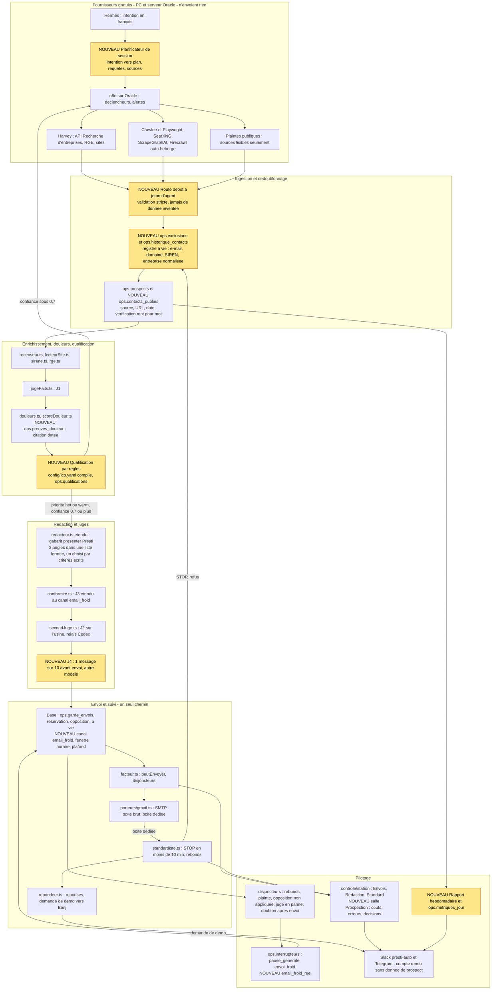

# Cadrage P1 — Prospection automatique Presti (première réponse, 01/11/2026)

Lecture seule : aucun fichier du dépôt modifié, aucune écriture en base, aucun envoi, aucun build, rien lu dans « presti secret ».
Légende : **V** = vérifié aujourd'hui (fichier lu, `SELECT` agrégé sur la base de production, commande, page publique) ; **NV** = non vérifié (repris d'une annexe ou d'une note). Aucune adresse ni aucun nom d'entreprise réel n'est recopié ici.

---

## 1. Inventaire de l'existant

### 1.0 Compréhension en dix lignes

1. Presti a déjà deux chaînes de prospection : une sur le serveur (Supabase `ops.*` + Vercel, `lib/agents/acquisition/`) et une sur le PC (`presti-ops/agents-prospection/`, pilotée par des sessions Claude Code planifiées).
2. Benj a tranché le 01/11 : la chaîne serveur fait foi, l'e-mail est le seul canal automatique, personne ne valide les lots, Benj garde un interrupteur général et reçoit des comptes rendus.
3. **La chaîne serveur ne sait pas envoyer un e-mail à froid** : elle est construite, jusque dans la base, autour du formulaire de contact du site (`modeles.ts:3-4`, `recenseur.ts:106`, `facteur.ts:460-461`, migration `0124:293`). Le Gmail du Facteur n'écrit qu'à qui a écrit d'abord.
4. Elle n'a d'ailleurs rien envoyé : 52 envois préparés, tous `formulaire_site`, aucun avec une date d'envoi.
5. Toute la prospection réellement partie (187 lignes `ENVOIS.csv`) est donc sur le PC, via Gmail, par des sessions qui cliquent « envoyer » : c'est exactement ce que la décision du 01/11 interdit.
6. La règle « un message à vie » n'est tenue nulle part de façon unique : quatre registres d'envois existent, aucun dans `ops.*`, et la base fixe aujourd'hui 90 jours (`0124:338`, `contrat.ts:845`).
7. La liste d'opposition du serveur est vide en pratique : ses 32 lignes sont toutes neutralisées (incident du 06/10). Les vraies oppositions sont dans un CSV du PC.
8. La notice publique contredit trois choses que Benj veut faire : la relance, les adresses prises dans la liste RGE de l'ADEME, et la voix du message (elle dit « l'assistant IA… se présente dès sa première phrase »).
9. Rien ne tourne de bout en bout aujourd'hui : relève Gmail refusée, second juge (« usine ») absent, tâches du PC arrêtées depuis le 28/10, aucune sauvegarde nocturne.
10. Mon rôle : brancher sur l'existant, ajouter ce qui manque (un canal `email_froid`, un registre unique, la découverte, la qualification, un troisième juge), sans raser et sans toucher à ce qui protège déjà.

### 1.1 Carte du code serveur (`lib/agents/acquisition/`, 34 fichiers, 7 850 lignes)

| Fichier (lignes) | Rôle | Constat | État |
|---|---|---|---|
| `contrat.ts` (859) | types, constantes, `TRANSITIONS` (l.690), plafonds | `Canal` n'a pas d'e-mail à froid (l.31) ; `PREMIERE_PHRASE` impose « assistant IA de Presti » (l.784) ; `PLAFONDS_DEFAUT.email_sollicite = 50` (l.796) ; `EMAIL_SOLLICITE_JOUR = 50` (l.815) ; `DELAI_RECONTACT_JOURS = 90` (l.845) ; `STOP_DELAI_MINUTES = 10` (l.853) | V |
| `recenseur.ts` (149) | candidat → recensé, lit le site | l.106 retire tout canal `email_sollicite` d'un prospect froid : aucune adresse n'est jamais gardée | V |
| `sirene.ts` (124), `rge.ts` (118) | Recherche d'entreprises (INSEE), liste RGE ADEME | `rge.ts:29` exclut les architectes ; le serveur ne garde de la liste RGE que le **site** et le métier, pas l'e-mail | V |
| `lecteurSite.ts` (297) | lecture polie (robots.txt, 1 page/s, UA `PrestiRecenseur`, `contrat.ts:755`) | formulaire, réseaux, faits du site | V |
| `jugeFaits.ts` (319) | J1 : le fait cité est-il encore vrai, mot pour mot | exigé avant tout `premier_contact` (`facteur.ts:300-316`) | V |
| `douleurs.ts` (78), `plaintes.ts` (189), `plaintesParTheme.ts` (105), `scoreDouleur.ts` (153) | bibliothèque de douleurs approuvées, citations agrégées sans auteur, score 0-100 | 497 prospects notés, de 0 à 45 : aucun n'a dépassé 45 | V |
| `modeles.ts` (194) | gabarits à emplacements ; `APPROUVES` (l.49-56) | aucun gabarit de premier contact par e-mail ; `formulaire_A/B` parlent de **maquette de site**, pas de la proposition du 21/10 « présenter Presti, démo 10 min, essai gratuit » | V |
| `gabaritsPremierContactV2.ts` (62) | variante « je vous montre d'avance votre site » | « non branché et non approuvé » (en-tête l.8) | V |
| `redacteur.ts` (367) | « la Plume » : remplit un gabarit, **sans modèle de langage** | `executerRedacteur` ne prépare que des formulaires ; dernier bilan : `plafond_atteint : 0` (le plafond formulaire est à 0) | V |
| `conformite.ts` (459) | J3 : déterministe, un message = exactement un gabarit approuvé | refuse tout chiffre non justifié (l.388), toute mention hors gabarit ; `trop_de_messages` / `deja_contacte` à 90 jours (l.404-413) ; impose la mention « assistant IA » (l.79, 242) | V |
| `secondJuge.ts` (147) | J2 : ton et promesses implicites, fermé par défaut | tourne sur « l'usine » (relais Codex) via `scripts/agents/passes-modele.mjs` ; **absent** : 10 événements `rejuge_indisponible` du 22 au 31/10 | V |
| `facteur.ts` (607) | approuve (J1+J3+J2 → `acq_envoi_approuver`) puis envoie | Gmail uniquement `email_sollicite` ; refuse sans `preuve_demande` (l.460-461) ; ne touche jamais `formulaire_site` (l.397-399) ; vérifie la notice par empreinte (l.576-588) | V |
| `disjoncteurs.ts` (48) | `peutEnvoyer` : modèle suspendu, froid fermé, canal coupé, notice périmée | `notice_perimee` ne vaut que pour le formulaire (l.17) | V |
| `jauges.ts` (139) | plafonds du jour, paliers | palier **P0 = 5 formulaires/jour** (`contrat.ts:805`) | V |
| `porteurs/gmail.ts` (387), `boiteProspection.ts` (72) | SMTP nodemailer + relève IMAP imapflow, texte brut | deux modes : boîte dédiée, ou « fil seul » sur le Gmail de Benj avec adresse `+presti` (l.1-20) | V |
| `standardiste.ts` (550), `repondeur.ts` (663) | classe les réponses (STOP, RGPD…) en code avant tout modèle ; prépare les réponses | dernier bilan du Standard : 07/10 (rien classé depuis) | V |
| `porteurFormulaire.ts` (306), `maquettesLien.ts` (131), `rendezVous.ts` (113), `entrant.ts` (115), `faq.ts`, `affirmations.ts` | formulaire, maquette privée 21 j, rendez-vous, entrants | hors périmètre e-mail à froid, à ne pas casser | V |
| `metaWebhooks.ts`, `envoiMeta.ts`, `vigieMeta.ts` | Instagram/Facebook, réponse privée | `acq-vigie-meta` inactif ; `META_PAGE_TOKEN` absent (« en_attente_meta ») | V |

Tests : 243 scripts `*-qa.mjs` ; les juges de l'acquisition (`conformite-qa`, `facteur-qa`, `garde-stop-qa`, `garde-doublon-qa`, `disjoncteurs-qa`, `ops-acquisition-qa`, `jauges-qa`, `boite-prospection-qa`, `juges-026-*`…) existent mais **aucun n'apparaît dans `scripts/tout-verifier.mjs`** (ni `SUITES` ni `HORS_LANCEUR`, recherche texte faite) : selon la règle du dépôt, personne ne les joue (le lanceur dit lui-même, l.11, qu'une suite absente est un oubli). J'ai rejoué `conformite-qa` hors ligne : 6 critères verts, code 0. Les autres : NV.

### 1.2 La base : schéma `ops.*` et chiffres (SELECT agrégés, 01/11)

31 tables dans `ops` (accords_benj, agents, annonceurs, argent_messages, code_etat, conversations, couts, curseurs, decisions, demandes, **envois (34 col.)**, etat_envoi, evenements, experiences, interrupteurs, jauges, maquettes, meta_evenements, modeles_suspendus, **opposition**, paliers, **prospects (31 col.)**, quotas_canaux, rendez_vous, **reponses (27 col.)**, reunions, signaux, station_reglages(+historique), taches, technologies). Migrations : `0096` (socle), `0097` (identité, `ops_interrupteur`), `0099` (garde des envois), `0105` (RPC `acq_*`), `0106` (échanges), `0109` (pg_cron), `0111` (disjoncteurs), `0122` (réservation avant envoi), `0123` (STOP hors fil), `0124` (automatisme sous gardes), `0131` (froid P0), `0135-0137` (score de douleur). Dernière migration du dépôt : `0181` (le « 85 » de `CLAUDE.md` est périmé : 168 fichiers hors jumeaux).

| Mesure | Valeur | Lecture |
|---|---|---|
| `ops.prospects` | **5 040** (5 023 `artisan`, 17 `marque`) ; source : 4 619 `ademe_rge`, 260 `manuel`, 161 `meta` | confirme l'annexe |
| étapes | 4 488 `rejete`, 344 `a_decider`, 110 `verifie`, 94 `sans_canal`, 4 `prepare` | 89 % rejetés |
| canaux trouvés | facebook 555, formulaire_site 225, instagram 201, **e-mail 0** ; `emails_generiques` vide sur 5 040 | le serveur ne possède **aucune adresse** |
| départements 17 / 85 / 16 / 79 / 86 | 144 / 101 / 19 / 37 / 33 | la zone prioritaire pèse 144 fiches |
| `ops.envois` | **52**, tous `formulaire_site` / `facteur_usine` / `premier_contact` : 35 `perime`, 13 `annule`, 2 `approuve`, 2 `en_cours_envoi` ; préparés du 08 au 16/10 ; **aucun `envoye_le`** | zéro envoi réel côté serveur ; les 2 `en_cours_envoi` sont orphelins depuis le 09/10 |
| `ops.opposition` | **32, toutes neutralisées** (motif `boite_personnelle_0610`, 06/10) | liste d'opposition effectivement vide |
| `ops.reponses` | **1 149, toutes neutralisées** (relève de la boîte entière par repli `IMAP_USER`, 06-07/10) ; `ops.signaux` : 122 `stop_neutralise`, 64 `gmail_refus` (06/10 → 01/11) | aucune réponse de prospect réelle en base |
| `accords_benj` / `couts` / `maquettes` | 0 / 0 / 0 | `accords_benj` n'est plus utilisé depuis `0124` (30/09) ; **aucun coût n'est journalisé** |
| `interrupteurs` | `pause_generale = false` ; `envoi_froid = true` (depuis le 07/10) | l'« interrupteur général » existe déjà |
| `quotas_canaux` (8 lignes) | `formulaire_site 0`, `email_sollicite 0`, instagram/facebook/linkedin 0, `reponse_privee 50`, `messagerie 100`, `essai_e2e 4` | aucun quota pour un e-mail à froid |
| `etat_envoi` | palier **P0** depuis le 01/11 ; `notice_verifiee_le` 31/10 18 h 59 ; `gmail_coupe` et `formulaire_coupe` jusqu'au 02/11 06 h 50 | le disjoncteur Gmail se ré-arme chaque jour |
| événements 7 j | `facteur/bilan` 679 passages (« 0 envoyé… gmail coupe, meta en_attente_meta »), `systeme/disjoncteur_gmail` 39 fois du 22/10 au 01/11, `facteur/palier_non_evalue` 10, `rejuge_indisponible` 10 | la machine tourne à vide |

`pg_cron` : 16 tâches, 15 actives. Les 11 `acq-*` (`0109:6-17`) appellent `https://prestiapp.fr/api/cron/*` avec le secret du coffre : recenseur (10 min), rge (02:15), juge-faits (:35), rédacteur (:00), facteur (15 min) et facteur-soir (18/19 h UTC), standardiste (5 min), répondeur (15 min), maquettes-purge, purge-prospects (02:40), vigie-meta (**inactif**) ; plus `presti-agents-tic` (chaque minute), `presti-crieur` et trois ménages. Vercel Hobby : seulement `/api/cron/relances` et `/api/canaux/relever` (`vercel.json`).

Routes : `app/api/cron/{recenseur,redacteur,juge-faits,facteur,standardiste,repondeur,maquettes-purge,vigie-meta}`, `app/api/usine/{facteur,porteur,standard,atelier}/…` (jetons d'agent), `app/api/prospects/entrant`, `app/api/webhooks/meta`, `app/api/controle/{station,jauges,pause,…}`. L'écran est `app/controle/station/` (salles `Envois.tsx` 106 l., `Redaction.tsx` 54 l., `Standard.tsx` 46 l., `Radar.tsx`, `Gestes.tsx` avec « ouvrir l'envoi à froid » l.433-439). Le dossier `app/api/controle/prospection/` existe mais est **vide**. `public.leads` n'est pas touché : ce sont les clients des artisans ; `ops` est fermé à l'API (`0096`).

### 1.3 La chaîne PC (`C:/Users/benja/Documents/presti-ops/agents-prospection/`)

- `MANUEL.md` (481 l.) : règles (80-130 mots l.47, « aucune suite de plus de 6 mots commune » l.49, adresse publiée seulement + exception RGE l.301). `ENVOI.md` (56 l.) : onze gardes. `outils/controles.py` (186 l.) : contrôles automatiques ; 80-130 mots (l.103), une seule question, n-grammes de 7 mots (l.152-176).
- `outils/envoi_manuel.py` : `PLAFOND_JOUR = 50` (l.62), doublon sur fichiers locaux. **L'envoi lui-même** est la tâche planifiée `presti-envoi-prospection` (`~/.claude/scheduled-tasks/…/SKILL.md`) : une session Claude Code envoie 3 messages par passage par le connecteur Gmail, du lundi au vendredi 8 h 30-18 h 30. Les 22 dossiers de tâches planifiées contiennent aussi chasse, Harvey, file du matin, répondeur, réseaux. D'après l'annexe, elles sont arrêtées depuis le 28/10 (NV : je n'ai pas relu leur état).
- **Harvey** : `C:/Users/benja/Documents/outils-ia/harvey/presti/artisans_fr.py` (API Recherche d'entreprises + liste RGE + site de l'entreprise). Première passe du 26/10 : 1 513 entreprises listées, 78 sites lus, 51 adresses, 46 confirmées mot pour mot (note `SaaS/Prospection/Harvey-source-artisans-2026-10-26.md`). Sources OSM et AFNIC : NV (annexe).
- `FEU-VERT.txt` : 4 lignes, « OUI e-mail froid », daté du 13/10, avec la mention « Relances : toujours en pause ».
- **Comptes (sans recopier de données)** : `prospection/ENVOIS.csv` = 188 lignes, soit **187 enregistrements** du 16/09 au 29/10 (176 e-mails, 5 « e-mail (réponse) », 6 WhatsApp), **180 adresses distinctes**, 181 entreprises distinctes, 7 adresses en double, **52 enregistrements depuis le 26/10** (et non 47 : l'écart s'explique peut-être par les réponses, NV). Dont 2 lignes dont la source d'adresse déclarée est la liste RGE/ADEME. `prospection/OPPOSITIONS.csv` = 11 lignes, soit **10 oppositions** (12/10 : 4, 26/10 : 4, 13/10 : 1, 27/10 : 1). `file/deja-ecrites-gmail.txt` = 166 lignes ; `file/ecartes.txt` = 10 ; `SaaS/Prospection/deja-contactes-email.txt` = 177 lignes (contenu non lu).

### 1.4 Le workflow `.claude/workflows/chasse-prospects.js` (128 l., modifié, non commité)

Boucle Annuaire → Chercher (4 sources) → Vérifier → Rédiger → Relire → Ranger. Dépend d'une session Claude Code, de chemins PC en dur (l.28-31), de Firecrawl (l.39, à sec) et cite encore « 30 par jour » (l.24) alors que le plafond est 50. Il écrit des fichiers dans `file/`, jamais dans `ops.*`. À remplacer par un fournisseur qui dépose dans `ops.*`.

### 1.5 La notice publique (`presti-notice`, lue en ligne, HTTP 200, 10 019 octets)

Source dans le dépôt : `lib/confidentialite/prospection.ts:1-30` (`noticeHtml()` l.35) ; le Facteur compare la page en ligne à cette copie par SHA-256 (`facteur.ts:576-588`). Engagements publics vérifiés dans le texte :
- « un seul message par entreprise, à vie, **sans relance** » ; « ne contient ni lien, ni pièce jointe » ;
- adresse « qu'elle publie elle-même sur son propre site (**jamais une adresse devinée ni prise dans un annuaire**) » ;
- « l'assistant IA de Presti le rédige et l'envoie ; **il se présente dès sa première phrase** » ;
- STOP appliqué « en moins de 10 minutes sur tous les canaux » ; conservation 3 ans ; « aucune donnée de prospect n'est envoyée à un service d'intelligence artificielle gratuit » ;
- sous-traitants listés : Supabase, Vercel, Google, Oracle, OpenAI (Codex), Anthropic, Firecrawl, Meta, GitHub. **Absents** : n8n, SearXNG, Crawlee, ScrapeGraphAI, Hermes (ils ne sont pas des tiers s'ils tournent sur l'Oracle déjà listé, mais **n8n cloud** `presti.app.n8n.cloud` en serait un).
- L'en-tête dit « Dernière mise à jour : 4 octobre 2026 » alors que le texte parle du 12 octobre.

### 1.6 Qui envoie, depuis quel domaine

| Voie | Expéditeur | État |
|---|---|---|
| PC (sessions planifiées) | Gmail personnel de Benj, par le connecteur Gmail | arrêtée le 28/10 (annexe) ; **interdite** par la décision du 01/11 |
| Serveur, Facteur | SMTP Gmail via `boiteProspection.ts` (boîte dédiée ou « fil seul » du Gmail de Benj) | **relève refusée** (identifiants), 6 h de repli (`app/api/cron/standardiste/route.ts:36-38`), disjoncteur 24 h |
| Resend (`lib/email.ts:16-20`) | `contact@prestiapp.fr`, transactionnel des artisans | **jamais pour le froid** ; plafond gratuit 100/jour (l.77) |
| DNS public (01/11) | `prestiapp.fr` : SPF `include:mx.ovh.com -all`, MX OVH, **aucun enregistrement `_dmarc`** ; `send.prestiapp.fr` : SPF amazonses + DKIM Resend | pas de sous-domaine d'envoi à froid ; DMARC absent |

### 1.7 Ce qui marche, ce qui est cassé, ce qui est en double

**Marche (V)** : recenseur, juge des faits, score de douleur (cron toutes les 10 min / heure, 1 008 passages en 7 jours) ; la base de garde (réservation avant envoi `0122`, immuabilité, verrous) ; J3 et J1 ; `pause_generale` ; l'écran ; `conformite-qa` ; l'import RGE/Sirene ; la purge à 3 ans ; la vérification de la notice (31/10).
**Cassé (V sauf mention)** : (1) relève Gmail refusée depuis le 06/10, ré-armée chaque jour (64 signaux) ; (2) second juge absent (usine) : le Facteur ne peut rien approuver ; (3) `acq_palier_evaluer` en échec depuis le 22/10 ; (4) 2 envois bloqués `en_cours_envoi` depuis le 09/10 ; (5) liste d'opposition serveur vide, Standard muet depuis le 07/10 ; (6) quotas formulaire et e-mail à 0 ; (7) GitHub Actions (audit, sauvegarde, qualité) en échec depuis le 25/10 et donc **aucune sauvegarde nocturne** (NV : repris de l'annexe et de `QG/ETAT.md`) ; (8) tâches du PC arrêtées (NV) ; (9) les juges d'acquisition hors lanceur.
**En double** : deux registres d'envois (+ deux autres fichiers, soit quatre), deux listes d'opposition, deux jeux de règles de message (`modeles.ts`/J3 contre `controles.py`), deux notions de plafond (`jauges`/`quotas_canaux` contre `envoi_manuel.py`), deux sources de candidats (recenseur RGE serveur sans e-mail contre `rge_ademe.py`/Harvey avec e-mail), deux Gmail.

### 1.8 Les deux chaînes, étape par étape (qui fait foi)

| Étape | Serveur | PC | Fait foi | Écart à combler |
|---|---|---|---|---|
| Trouver | RGE + Sirene (`rge.ts`, `sirene.ts`), sans e-mail | Harvey, chasse web, plaintes | serveur (écrit dans `ops.*`), fournisseurs PC/Oracle | un point d'ingestion pour les adresses publiées |
| Vérifier | J1 `jugeFaits.ts` (faits du site) | `verifier_email.py` (adresse mot pour mot) | les deux, en série | aucune vérification d'adresse côté serveur |
| Dédoublonner | clés SIREN/domaine/`cle_dedup`, 90 j | fichiers CSV/TXT, à vie | serveur, **à vie** | registre unique à importer |
| Rédiger | gabarits sans LLM, formulaire | LLM + gabarit du 21/10 | serveur (gabarits) | gabarit « présenter Presti » par e-mail |
| Juger | J1, J3, J2 (usine) | relecteur LLM + `controles.py` | serveur | J4 (échantillon), règle des 6 mots à trancher |
| Envoyer | Facteur (aucun e-mail à froid) | session + Gmail | serveur | canal `email_froid`, porteur SMTP, fenêtre horaire |
| Relever | Standard + IMAP (cassé) | session | serveur | relève réparée, DSN/rebonds |
| S'opposer | `ops.opposition` (vide) | `OPPOSITIONS.csv` (10) | serveur | import, test 10 min |

---

## 2. Questions bloquantes (chacune avec sa réponse par défaut)

Déjà tranchés le 01/11 : chaîne serveur, relance unique, outils gratuits, segment « entreprise », e-mail seul, pas de validation de lot. Ouverts du prompt : longueur, règle des 6 mots, Harvey.

| # | Question | Réponse par défaut (appliquée tant que Benj ne dit rien) | Bloque |
|---|---|---|---|
| Q1 | **Quelle boîte et quel domaine d'envoi ?** D1 du 26/10 (« on paye rien ») et l'Annexe 2 §3 (« sous-domaine dédié ») ne tiennent pas ensemble à coût zéro vérifié. Resend, Brevo, Mailforge, Instantly sont écartés (cold interdit ou payant). L'Oracle gratuit bloque en général le port 25 sortant (NV). | Une **boîte Gmail dédiée à la prospection** (mot de passe d'application, SMTP/IMAP déjà codés), plafond 50/jour, jamais `prestiapp.fr`, jamais le Gmail personnel. Le sous-domaine reste cible, reporté jusqu'à une boîte gratuite vérifiée dessus. Geste de Benj : créer la boîte et poser les variables Vercel. | P3, P8 |
| Q2 | **Voix du message et mention d'automatisation** : la notice dit « l'assistant IA… se présente dès sa première phrase » ; Benj veut « mon logiciel », pas « mon IA » ; le PC écrit à la première personne comme Benj. | Signature « Benjamin Filiot, Presti » + une phrase fixe unique « Ce message est rédigé et envoyé automatiquement par le logiciel de Presti. » ; la notice est corrigée dans la même PR (« le logiciel de Presti »). Jamais « je » sans cette phrase. | P3 |
| Q3 | **Adresses de la liste RGE de l'ADEME** : D2 (26/10) les accepte ; la notice dit « jamais prise dans un annuaire ». | Autorisées **seulement après** la PR de notice qui les cite (registre officiel sous Licence Ouverte, adresse déclarée par l'entreprise) ; d'ici là, adresses lues sur le site de l'entreprise seulement. | P3, P4 |
| Q4 | **Calendrier de la relance** : « 5 à 7 jours ouvrés », même fil (annexe) contre « 5 à 7 jours » (format du 20/10). | Un tirage entre le 5ᵉ et le 7ᵉ jour ouvré après l'envoi, `In-Reply-To` du premier message, 60 mots au plus, même sortie STOP, puis plus rien à vie ; jamais avant la mise en ligne de la notice mise à jour. | P9 |
| Q5 | **Longueur** : 100 mots (prompt d'origine), 60-110, 80-130 (`controles.py:103`), 120 (formulaire). | 80 à 130 mots, pied compris (décision du 21/10), mesurés par le code. | P7 |
| Q6 | **Règle des 6 mots** (24 messages bloqués le 27/10) : elle protège contre l'empreinte de masse, mais J3 impose un texte identique au gabarit. | La garder **sur les paragraphes libres seulement** (phrases fixes déclarées exclues, comme `controles.py` le fait déjà) ; un message bloqué est retiré avec une autre variante (2 essais), puis écarté avec le motif `similaire`, sans arrêter le lot. Un test montre ce qu'elle bloque. | P7 |
| Q7 | **Reprise de Harvey** | Harvey et la chasse deviennent des **fournisseurs** : ils écrivent dans `ops.*` par une route d'ingestion à jeton d'agent (modèle `ops.agents.jeton_hash`), n'envoient rien, ne gardent plus de fichier de file. | P4 |
| Q8 | **Qui est le juge J4** (un message sur dix, avant envoi) et où tourne-t-il sans le PC ? | Le même relais que J2 mais **un autre modèle et une autre consigne**, étalonné sur un jeu de pièges avant le réel ; sur l'Oracle si Codex y est connecté (vault : `Usine Oracle presti-usine`), sinon le lot reste en `a_relire` et rien ne part. | P7, P8 |
| Q9 | **Durée du mode à blanc** | 1 jour ouvré complet (mardi), `email_froid_reel` fermé : tout est préparé, jugé, journalisé, rien ne part. | P8 |
| Q10 | **Montée en charge** | 10, 20, 35, 50 par jour, une semaine chacun, montée automatique seulement si rebonds < 3 % et STOP < 4 pour 100 (`contrat.ts:824`) ; plaintes pour spam non mesurables sur Gmail grand public : on arrête sur le premier signalement ou avertissement Google. | P8 |
| Q11 | **Fenêtre d'envoi** | Mardi-jeudi 8 h 30-17 h 30 (Paris) à plein régime ; lundi et vendredi à demi-régime ; jamais soir, week-end, jour férié. (PC : lun-ven 8 h 30-18 h 30 ; format du 20/10 : 7 h 15.) | P8 |
| Q12 | **Importer aussi le dossier « Envoyés » de Gmail ?** | Non (règle du 07/10 : on ne lit pas les mails personnels). On importe les quatre listes existantes ; le risque résiduel est écrit en §6. | P1 |
| Q13 | **n8n : instance cloud ou Oracle ?** | Oracle uniquement pour tout ce qui touche un prospect ; l'instance cloud (0 workflow) ne reçoit aucune donnée de prospect. | P5 |
| Q14 | **Segment « entreprise »** : quelles promesses a-t-on le droit de tenir ? | Gabarit écrit, **non approuvé**, jamais envoyé avant que Benj fournisse les phrases d'offre vérifiables ; quota et rapport séparés ; démarrage en P10. | P10 |
| Q15 | **Validation des validateurs** : Pydantic/Zod imposés par le prompt ; le dépôt n'a pas Zod et les modules d'acquisition sont écrits en TypeScript « effaçable » sans dépendance (`facteur.ts:18`). | Validateurs maison (comme `standardiste.ts`), schémas dans `contrat.ts`, aucune dépendance ajoutée ; le YAML (`config/icp.yaml`) est compilé en TypeScript avec empreinte par un script, sans analyseur YAML à l'exécution. | P3, P6 |

---

## 3. Architecture (posée sur l'existant)

Principe : **un seul chemin d'envoi** (Facteur → porteur SMTP), **un seul registre** (`ops.*`), **un seul interrupteur** (`ops.interrupteurs`). Les nœuds ambrés (préfixe « NOUVEAU ») sont à construire ; tous les autres existent déjà, au moins en partie.

Choix de conception qui découlent de l'inventaire :
- **L'horloge reste `pg_cron` + routes Vercel** (déjà là, déjà en production). n8n sur l'Oracle ne porte que la découverte, les scrapers et les alertes ; il dépose dans `ops.*` par la route d'ingestion. Aucun de ces outils n'a le droit d'écrire dans `ops.envois`.
- **L'agent écrit un brouillon structuré, le code décide.** La Plume reste sans modèle de langage pour le texte envoyé : un message = un gabarit approuvé + des emplacements remplis par des faits vérifiés. La personnalisation vient de la **liste fermée d'angles** (une phrase approuvée par douleur et par métier) et du **fait vrai cité** ; un modèle ne peut que choisir, jamais écrire une phrase libre. C'est ce qui rend vrai « aucun fait inventé » et ce qui garde J3 déterministe.
- **L'interrupteur général** est déjà `ops_interrupteur('envoi_froid')` + `pause_generale` ; on ajoute `email_froid_reel` pour séparer « à blanc » de « réel ». `ops.accords_benj` et `FEU-VERT.txt` sont retirés du chemin (le premier est vide depuis `0124`).
- **Mode à blanc** : la porte et les juges tournent, `ops.envois` reçoit des lignes `statut = 'a_blanc'`, le porteur n'est pas appelé.

---

## 4. Modèle de données

### 4.1 Les 28 tables du prompt, rapprochées de l'existant

| Table du prompt | Décision | Où |
|---|---|---|
| `leads`, `companies` | **réutilisé** : `ops.prospects` (31 col.). Ne jamais créer un `leads` : `public.leads` = clients des artisans | `ops.prospects` |
| `contacts` | **ajouté** : `ops.contacts_publies` | (e-mail publié, source, preuve) |
| `lead_sources` | réutilisé : `ops.prospects.source` + `faits` ; ajout `session_id` | |
| `discovery_sessions`, `discovery_queries` | **ajouté** : une table `ops.decouvertes` (intention, plan, requêtes, sources, coût, confiance, suite conseillée) + `ops.rejets` (candidat écarté, raison, empreinte) | |
| `scraping_runs`, `scraping_results` | réutilisé : `ops.taches` (file, bail, `tentatives ≤ 3`, `echec`) + `ops.evenements` ; résultat bruts **non conservés** (minimisation) | |
| `lead_events`, `audit_log`, `message_events` | réutilisé : `ops.evenements` (ajout seul, déclencheur `0096:109`), `ops.reponses`, `ops.signaux` | |
| `pain_signals` | **ajouté** : `ops.preuves_douleur` (nom distinct de `ops.signaux`, qui sont des signaux d'envoi) | |
| `enrichment_records` | **ajouté** léger : colonnes source/date par fait dans `faits` jsonb (existe) ; table seulement si une donnée n'y tient pas | |
| `qualification_results` | **ajouté** : `ops.qualifications` | |
| `message_drafts`, `approved_messages`, `sent_messages` | réutilisé : `ops.envois` (statuts `prepare` → `approuve` → `envoye`, `verdicts` j1/j2/j3, `preuve`) ; ajout du statut `a_blanc` | |
| `sequences` | réutilisé : `ops.envois.type = 'relance'` + `fil_envoi_id` ; ajout `ops.prospects.relance_due_le` | |
| `exclusion_list` | **ajouté** : `ops.exclusions` (chaînes, concurrents, domaines interdits, clients Presti) ; les oppositions restent dans `ops.opposition` | |
| `human_reviews` | réutilisé : `ops.decisions` (options, tranchée) pour ce que Benj décide après coup | |
| `agent_runs`, `tool_calls`, `mcp_tool_invocations` | réutilisé : `ops.taches` + `ops.evenements` ; **une** table ajoutée `ops.appels_outils` seulement si n8n/Hermes l'exigent | |
| `errors`, `dead_letter_queue` | réutilisé : `ops.taches` (`echec`, 3 tentatives) | |
| `metrics_daily` | **ajouté** : vue `ops.v_metriques_jour` (puis table si lourde) | |
| `prompt_versions`, `config_versions` | **ajouté** léger : `ops.configs_actives(nom, version, empreinte, actif_le)` ; les gabarits portent déjà leur empreinte (`modeles.ts`) | |

Bilan : **7 tables nouvelles** (`contacts_publies`, `historique_contacts`, `exclusions`, `decouvertes`, `rejets`, `preuves_douleur`, `qualifications`) plus `configs_actives` et une vue ; tout le reste existe.

### 4.2 Colonnes et contraintes à changer sur l'existant (le plus risqué)

- `ops.envois.canal` : la contrainte `CHECK` (`0096:175`) n'accepte pas d'e-mail à froid ; ajouter `email_froid`. Le déclencheur `ops.garde_envois` lève `ops:froid_email_interdit` pour tout `email_sollicite` en `premier_contact` (`0124:293`) : on **ne l'assouplit pas** pour `email_sollicite`, on ouvre un canal distinct, de sorte que l'ancienne interdiction continue de protéger le reste.
- `ops.quotas_canaux` : lignes `email_froid` (premier contact, ramp) et `email_froid_relance`.
- `ops.envois` : colonne `objet` existe ; ajouter `fenetre_ok_le` (calculée par la base : heure de Paris, jour ouvré). Le déclencheur applique **la fenêtre, le plafond du jour, l'opposition et l'« à vie »** : la porte de conformité (couche 7) est donc **dans la base**, pas seulement dans le code.
- `à vie` : remplacer les 90 jours (`0124:328-338`, `conformite.ts:411`, `contrat.ts:845`) par une recherche dans `ops.historique_contacts` (e-mail haché, domaine professionnel, SIREN, entreprise normalisée) **pour le premier contact**, tous canaux ; la relance a sa règle propre (un envoi `relance` maximum, 5 à 7 jours ouvrés après, sans réponse ni opposition).
- `ops.prospects` : `segment` (`artisan` | `entreprise`, la colonne `cible` garde `marque`), `relance_due_le`, `icp_version`, `session_id`.
- `ops.opposition` : aucune colonne nouvelle ; ajouter la clé `entreprise_normalisee` et un import marqué `source = 'pc_oppositions_csv'`.
- Chaque donnée de prospect porte `source_url`, `source_type`, `releve_le`, `verifie_le` (`contacts_publies`, `preuves_douleur`).
- RLS : tables `ops` fermées à l'API comme `0096` ; accès par `service_role` et fonctions `public.acq_*` (même patron).
- Rétention : 3 ans, purge existante `acq_purger` étendue aux nouvelles tables ; l'empreinte d'opposition survit.

### 4.3 Sorties imposées (formats JSON du prompt)

Validées par des fonctions maison dans `contrat.ts` : **session** (`ops.decouvertes`), **lead normalisé** (dépôt), **détecteur de douleur** (`preuves_douleur` + score), **qualification** (`qualifications`), **rédaction** (`ops.envois` + `facts_used` dans `fait_id`/`douleur_id`). Règles codées : confiance < 0,7 → `a_creuser` ; exclu → `ecarte` ; aucun lead en rédaction sans ligne `qualifications.statut = 'valide'` ; une douleur sans preuve citée mot pour mot est supprimée **par le code**.

---

## 5. Plan en phases

Règles : une phase = un ou deux commits réversibles, un drapeau (`lib/flags.ts`, nouveau `prospectionEmailFroid`, baissé), migration collée **puis** drapeau levé, `node scripts/tout-verifier.mjs --rapide` vert avant la suivante. Je ne lance ni build ni migration sans l'accord de l'agent principal (`CLAUDE.md` §6). Chaque nouvelle suite entre dans `SUITES` et prouve qu'elle peut rougir (mutation).

| Phase | Contenu | Réversibilité | Vérification |
|---|---|---|---|
| **P0 — Réparer ce qui est cassé, sans rien envoyer** | (a) brancher les juges d'acquisition au lanceur ; (b) boîte dédiée + relève réparée (geste de Benj : compte et variables) ; (c) réconcilier les 2 envois orphelins (`acq_envoi_reconcilier`) ; (d) sauvegarde nocturne de `ops.*` hors GitHub Actions (export vers l'Oracle ou un fichier chiffré) ; (e) relire les STOP reçus depuis le 26/10 dans le fil de prospection | pur ajout | `node scripts/tout-verifier.mjs --rapide` ; `SELECT count(*) from ops.evenements where type='disjoncteur_gmail' and le>now()-interval '1 day'` = 0 ; export daté présent |
| **P1 — Registre unique « à vie »** | table `ops.historique_contacts` ; script `scripts/prospection-importer-historique.mjs` (mode à blanc d'abord) sur `ENVOIS.csv` (187), `deja-ecrites-gmail.txt` (166), `deja-contactes-email.txt` (177), `ecartes.txt` (10), WhatsApp inclus ; clés hachées ; J3 et déclencheur passent de 90 jours à « à vie » pour le premier contact | table seule réversible ; la règle est plus stricte donc sûre | `node scripts/prospection-historique-qa.mjs` : refus 6 mois après, refus par un autre canal, refus par domaine, refus après crash ; `SELECT count(*)` = nombre de lignes attendues, sans doublon |
| **P2 — Une seule liste d'opposition** | import des 10 oppositions du CSV dans `ops.opposition` (clés e-mail, domaine pro, entreprise) ; Standard remis en marche ; test chronométré | oui | `node scripts/garde-stop-qa.mjs` + nouvelle suite : STOP simulé → clés posées et envoi refusé en moins de 10 min sur horloge injectée |
| **P3 — Contrat de message et notice** | (a) gabarit « présenter Presti » `email_froid_v3` et `relance_froid_v1` dans `modeles.ts`, empreintes, approbation selon la délégation du 29/09 ; (b) PR sur `presti-notice` + `lib/confidentialite/prospection.ts` (relance, adresses ADEME, voix, outils) que Benj fusionne ; (c) migration du canal `email_froid` (CHECK, déclencheur, quotas à 0) ; (d) J3 étendu ; drapeau baissé | gabarits inertes tant que le quota est à 0 | `conformite-qa` étendu (≥ 20 conformes, ≥ 30 fautifs : avis négatif cité, interdits de l'offre, chiffre deviné, lien, « premier sur Google ») ; `node scripts/attendre-deploiement.mjs` ; notice en ligne = copie du dépôt (`facteur` soir) |
| **P4 — Contacts publiés, ingestion, déduplication** | `ops.contacts_publies`, route de dépôt à jeton d'agent, validation de l'adresse (présente mot pour mot sur la page citée, ou ligne RGE après Q3), exclusions (clients Presti, concurrents, domaines), import du stock Harvey comme fournisseur | oui (table et route nouvelles) | `prospection-ingestion-qa` : doublons par e-mail / téléphone normalisé / domaine / SIREN / empreinte, adresse non publiée refusée, panne d'API = prospect conservé en `ops.taches` |
| **P5 — Découverte** | `ops.decouvertes`/`ops.rejets` ; planificateur « intention → plan → requêtes → sources » (déterministe, modèles de plan, aucun prospect dans une requête) ; Crawlee + Playwright, SearXNG, ScrapeGraphAI sur l'Oracle (licences notées, registre des traitements) ; Hermes = interface | oui, hors ligne par défaut | `prospection-decouverte-qa` (hors ligne : fixtures Apify/Firecrawl/SERP remplacées par Crawlee/SearXNG, parsing, rejets motivés) ; `docs/registre-traitements.md` mis à jour |
| **P6 — Douleurs et qualification** | `ops.preuves_douleur`, `config/icp.yaml` compilé (`scripts/icp-compiler.mjs`, empreinte), `ops.qualifications`, priorités `hot/warm/cold/discard` par règles écrites | oui | `prospection-qualification-qa` : confiance < 0,7 → `a_creuser`, exclu → `ecarte`, douleur sans preuve supprimée, sortie LLM invalide rejetée |
| **P7 — Rédaction et juges** | Plume étendue (3 angles de la liste fermée, critères de choix écrits), J1 → J3 → J2 → **J4** (1 sur 10, tirage reproductible), règle des 6 mots révisée (Q6) | oui | `facteur-qa`, `conformite-qa`, nouvelle `juge-j4-qa` étalonnée ; mutation : un avis négatif cité doit faire rougir ; un modèle gratuit en ligne ne reçoit jamais de donnée de prospect (test d'import) |
| **P8 — Mode à blanc puis réel** | `email_froid_reel` ; porteur SMTP branché sur le canal ; fenêtre horaire ; disjoncteurs (rebonds > 3 %, plainte, opposition > 10 min, juge en panne, adresse non prouvée, doublon après envoi) ; 1 jour à blanc, puis 10/20/35/50 | l'interrupteur coupe en une action | journal du jour à blanc : N préparés, 0 envoyé ; `SELECT canal, statut, count(*) from ops.envois where canal='email_froid' group by 1,2` ; premier envoi réel seulement après P0-P7 verts, notice en ligne, interrupteur allumé |
| **P9 — Suivi, relance, rapport** | classement des réponses (intérêt, refus, hors sujet, démo) ; relance unique (après Q4 et P3b) ; `ops.v_metriques_jour` ; rapport hebdomadaire (sources, angles, faux positifs, coût) ; propositions de réglage journalisées | oui | `prospection-suivi-qa` : toute réponse annule la relance ; STOP arrête tout ; rapport généré sans donnée nominative |
| **P10 — Segment « entreprise »** | `segment`, gabarit propre, quota et rapport séparés, sources Sirene (NAF 71.11Z et 43.xx, 3 à 49 salariés) | oui | suite dédiée ; aucun envoi avant approbation du gabarit |

Ordre : P0 → P1 → P2 → P3 → P4 en séquence ; P5, P6 en parallèle de P7 ; P8 seulement quand P0-P4, P6 et P7 sont verts.

---

## 6. Risques et parades

### 6.1 Légaux

| Risque | Parade |
|---|---|
| Le message contredit la notice (relance, annuaire, voix) : engagement public, pratique trompeuse | notice modifiée **avant** le comportement (P3b), vérification d'empreinte avant chaque envoi (déjà codée pour le formulaire, étendue à `email_froid`), Benj fusionne la PR |
| Entrepreneurs individuels = personnes physiques : RGPD complet, fiches « non diffusibles » | Sirene respecté, intérêt légitime documenté (`docs/agents/analyse-interet-legitime.md` aujourd'hui limitée au formulaire : à étendre à l'e-mail), mention de la source et STOP dans chaque message ; **ce n'est pas un avis juridique** |
| Adresse nominative grand public (la moitié de la campagne du 16/09) | privilégier les adresses de l'entreprise ; adresse personnelle seulement si publiée par elle sur son site |
| Opposition non appliquée en 10 minutes (l'incident actuel : relève cassée, Standard muet depuis le 07/10) | P0/P2 avant tout envoi ; disjoncteur « opposition non appliquée » ; test chronométré |
| Données vers un modèle gratuit en ligne | route de dépôt et juges sans appel sortant vers un service gratuit ; test d'import ; `freellmapi` jamais sur les prospects |
| Registre des traitements et sous-traitants incomplets (n8n, SearXNG…) | mise à jour de `docs/registre-traitements.md` §11 et de la notice dans la même PR |
| SMS, réseaux, LinkedIn : L34-5 CPCE, API Meta, conditions de LinkedIn | non automatisés ; brouillons seulement ; Reddit : repérage sans désanonymisation |
| Un seul message à vie violé par un registre incomplet (Gmail « Envoyés » non importé) | accepté et écrit : 4 listes importées ; la base refuse tout doublon connu ; mesure du risque via les STOP « déjà reçu » |

### 6.2 Délivrabilité

| Risque | Parade |
|---|---|
| Gmail grand public : aucun retour de plaintes (pas de Postmaster Tools sur gmail.com), plafond 500/jour, blocage de compte | boîte dédiée, 50/jour au plus, montée progressive, arrêt au premier avertissement Google ; sous-domaine dédié comme cible dès qu'une boîte gratuite existe dessus (Q1) |
| Rebonds invisibles si la relève ne lit que le fil `+presti` | boîte dédiée relevée en entier ; lecture des DSN ; seuil 3 % |
| DMARC absent sur `prestiapp.fr` (constaté) | ne jamais envoyer le froid depuis ce domaine ; poser DMARC `p=none` sur `prestiapp.fr` (geste de Benj, OVH) pour protéger le transactionnel |
| Texte quasi identique envoyé en série (empreinte de masse) | liste d'angles, ordre et ouvertures variées, règle des 6 mots sur les paragraphes libres, J4 |
| Stock insuffisant pour 50/jour : Harvey a donné 46 adresses vérifiées sur 1 513 entreprises (3 %) ; le 17 compte 144 fiches `ops` | volume plafonné par le stock, pas par le quota ; élargissement départemental automatique ; ne jamais « remplir » avec des adresses non prouvées |

### 6.3 Techniques et coût

| Risque | Parade |
|---|---|
| La base refuse tout (canal CHECK, `froid_email_interdit`) : migration délicate sur des déclencheurs longs (`0122`, 1 312 lignes ; `0124`, 650 lignes) | canal distinct `email_froid` ; ne pas modifier `email_sollicite` ; essai à sec, `acq-*` en pause pendant la pose, test de comportement |
| Second juge absent | J2 sur l'Oracle ; sans avis, rien n'est approuvé (fail-closed voulu) ; événement d'alerte |
| Oracle : disque à 99 % le 11/10, essai expiré le 24/10 (`QG/ETAT.md`), Always Free NV | vérifier l'espace avant d'installer Crawlee/SearXNG ; nettoyer ollama (19 Go) si besoin |
| PC à RAM saturée, tâches planifiées arrêtées | plus rien de critique sur le PC |
| Aucune sauvegarde nocturne depuis le 25/10 | P0d avant d'ingérer 5 000 lignes de plus |
| Budget IA relevé à 1 547 € pour une alerte à 50 € (21/10, NV) | la Plume n'appelle pas de modèle ; J2/J4 plafonnés par `ops.agents.plafond_euros_jour` ; `ops.couts` enfin alimentée ; coût dans le rapport |
| Un test vert qui ne regarde rien | chaque suite a sa mutation ; `scripts/csp-smoke.mjs` n'est jamais une preuve |
| Dérive des gabarits | `empreinte` + `approbation.txt` + `CO-3` de `conformite-qa` ; une retouche change l'empreinte et suspend l'envoi |
| Faux positifs de douleur (avis d'un autre artisan, particulier) | l'avis négatif sert à trouver, jamais à écrire ; liste d'exclusion des litiges d'acompte ; échantillon J4 |

---

## 7. Notes du cerveau utilisées

`regles_pour` (tâche « prospection automatique par e-mail… ») a rendu une liste vide ; j'ai utilisé `chercher` puis `lire`. **Les chemins cités par Benj n'existent pas** (`10 Presti/…`, `30 Prospection/01 ICP`, `30 Prospection/02 Playbooks`, `50 Automatisations/04 Prompts`). Équivalences :

| Demandé | Note réelle (chemin exact) |
|---|---|
| ICP / profil | `C:/Users/benja/Documents/SaaS/wiki/concepts/Profil du prospect idéal et portes d'entrée.md` (aussi source `presti-ops/prospection/PROFIL-PROSPECT-IDEAL.md`) |
| Playbooks | `C:/Users/benja/Documents/SaaS/wiki/cartes/Carte - Prospection et relation artisan.md`, `…/concepts/Angles - demandes perdues et plainte publique.md`, `…/Conversation en quatre temps.md`, `…/Objections et réponses préparées.md`, `…/Ordre des canaux de contact.md` |
| Format d'e-mail froid | `…/concepts/Format d'e-mail froid artisan.md`, `…/Premier message - présenter Presti.md`, `…/Contrôles de relecture et ce qui fait robot.md` |
| « Un message par artisan », relances | `…/concepts/Un message par artisan puis cinq jours.md`, `…/Relances - prospection et produit.md` |
| Garde-fous d'envoi, plafond | `…/concepts/Garde-fous d'envoi e-mail et délivrabilité.md` (30/jour, antérieur à la décision du 27/10 : plafond 50 dans `SaaS/Decisions/Journal-Decisions.md`, entrée « 2026-10-29 — Décisions du 27 au 29/10 ») |
| Règles de Benj | `…/concepts/Règles de Benj — prospection et contact.md`, `…/Règles de Benj — accords et gestes interdits.md`, `…/Positionnement automatique.md`, `…/Offre exacte et interdits en prospection.md` |
| Opposition, L34-5, RGPD B2B, notice | `…/concepts/Cadre légal et notice de prospection.md`, `C:/Users/benja/Documents/SaaS/Produit/Prospection-Cadre-Legal-2026-09-27.md`, `…/Produit/Ecosysteme-Prospection-Gratuite-2026-09-24.md` (20 garde-fous, §3.1), `C:/Users/benja/Documents/presti/docs/agents/analyse-interet-legitime.md` |
| Harvey, chasse aux plaintes | `…/wiki/entities/Harvey - source de candidats.md`, `…/concepts/Chasse aux plaintes publiques - méthode.md`, `C:/Users/benja/Documents/SaaS/Prospection/Harvey-source-artisans-2026-10-26.md`, `…/Prospection/Audit-prospection-2026-10-26.md` (décisions D1-D6) |
| Prompts d'agents | pas d'équivalent « 04 Prompts » : `presti-ops/.claude/agents/prospection-{redacteur,relecteur,enqueteur,repondeur}.md`, `~/.claude/scheduled-tasks/*/SKILL.md`, `presti-ops/agents-prospection/MANUEL.md` |
| État | `C:/Users/benja/Documents/SaaS/wiki/hot.md`, `C:/Users/benja/Documents/presti-ops/QG/ETAT.md`, mémoire `ia-gratuite-produit-2910.md`, `presti/.orchestre/contexte.md` |

Le **Journal-Decisions ne contient pas encore** les décisions du 01/11 (dernière entrée : 29/10) ; elles ne sont dans le vault que par l'Annexe du prompt.

## 8. Notes de décision à proposer au vault (ne pas les écrire)

1. **« La prospection e-mail est automatique et un seul chemin d'envoi » (01/11)** — la chaîne serveur fait foi ; les sessions du PC n'envoient plus ; l'envoi passe par le Facteur et un porteur SMTP sur une boîte dédiée ; Benj garde `pause_generale` et `email_froid_reel`. Remplace les « feu vert par lot » (`FEU-VERT.txt`, `ops.accords_benj`).
2. **« Un premier message à vie, une relance unique, tous canaux » (01/11)** — le registre `ops.historique_contacts` (4 sources importées) remplace les 90 jours de `0124` ; la relance (5 à 7 jours ouvrés, même fil) ne part qu'après la PR de notice fusionnée. Conséquence : la notice et `lib/confidentialite/prospection.ts` changent avant le code.
3. **« Adresses ADEME et voix du message : notice d'abord » (01/11)** — D2 du 26/10 (liste RGE) et la phrase « logiciel » exigent une correction de la notice publique ; sans elle, ces envois contredisent un engagement public. Les deux envois déjà partis avec source RGE sont signalés.
4. **« La découverte est un fournisseur, pas un envoyeur » (01/11)** — Harvey, Crawlee, SearXNG, n8n (Oracle) déposent dans `ops.*` par une route à jeton ; aucun n'écrit dans `ops.envois`. Le n8n cloud ne reçoit aucune donnée de prospect.
5. **« Le serveur ne peut pas écrire à froid par e-mail : on ouvre un canal, on n'assouplit pas l'ancien » (01/11)** — canal `email_froid` distinct ; l'interdiction `froid_email_interdit` (`0124:293`) sur `email_sollicite` reste ; piège noté : la contrainte CHECK de `0096:175` et J3 doivent évoluer ensemble.
6. **« Les juges d'acquisition rejoignent le lanceur » (01/11)** — `facteur-qa`, `conformite-qa` et les autres suites 026 ne sont pas dans `tout-verifier.mjs` ; à ajouter, avec mutation, avant toute extension.
