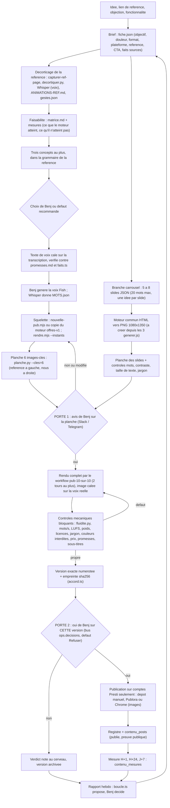

# Cadrage du PROMPT 2 — Système de contenu Presti (vidéos motion design, carrousels, posts)

Rédigé le 01/11/2026 pour préparer la première réponse à Benj. Lecture seule : aucun rendu, aucune publication, aucun commit, aucun fichier du dépôt modifié. Convention : **[V]** vérifié par moi sur disque, en base ou par le cerveau pendant cette passe ; **[NV]** non vérifié (repris d'une note, ou invérifiable d'ici). Les chemins de notes du cerveau sont à la section 8.

## 0. Ce qu'il faut retenir avant de lire le reste

1. **Presque tout ce que le prompt demande de construire existe déjà, en deux familles qui ne se parlent pas.** La famille « film » (kit `_kit-pub`, skill `presti-pub-10`, workflow `pub-10-sur-10`, moteur `offres-v1`) produit des vidéos. La famille « contenu » (migration `0114_contenu`, `lib/contenu/*`, `scripts/contenu/*`, `lib/crieur/*`) gère lignes, publications, accord de Benj sur la version exacte, mesures H+1 / H+24 / J+7, coûts. Les 17 tables du prompt doublonnent largement la seconde, **déjà appliquée en production** [V] (`list_migrations` : `0114_contenu` le 29/09, `0104_crieur` le 30/09). Construire à côté serait raser.
2. **Il y a un trou au milieu du pipeline qui explique les refus mieux que le style : le workflow ne s'arrête jamais pour demander l'avis de Benj avant le rendu complet.** `pub-10-sur-10.js` enchaîne squelette (l.93-102), production (l.179), juges (l.184), boucle jusqu'à 8 tours (l.195-221) et livre (l.224). La planche côte à côte n'apparaît qu'à la livraison (`SKILL.md:53`), alors que la règle écrite est « planche, avis de Benj, puis rendu » (cerveau, *Copier une référence*, procédure 2-4 ; Annexe 2 §6 étape 5). Le seul juge qui compte est donc consulté le plus tard possible.
3. **Une tâche planifiée publie encore seule, deux fois par jour.** `presti-ligne-editoriale` est `enabled`, dernier passage 01/11 à 11:18 UTC [V], et lance `post-du-jour.js`, dont la phase « Publier » (l.102) n'attend personne et dont le juge passe à 8/10 (l.78). C'est la décision du 26/10 (« full automatique H24 ») ; elle contredit l'Annexe 2 (« rien ne se publie sans le oui de Benj sur la version exacte »). Question bloquante n° 1.
4. **Tout le système vidéo est hors de Git.** `git ls-files -- videos` renvoie 0 fichier [V] ; `pub-10-sur-10.js`, `post-du-jour.js`, `marketing-trio.js` sont non suivis [V] ; la skill `presti-pub-10` vit dans `~/.claude/skills` ; et les sauvegardes nocturnes sont en échec depuis le 25/10 (Annexe 1 §B). Un `git restore` malheureux, comme le 13/09, effacerait le kit.

## 1. Inventaire

### 1.1 Famille « film »

| Élément | Où (fichier:ligne) | Ce que c'est | État |
|---|---|---|---|
| Kit de squelettes | `presti/videos/_kit-pub/README.md` (l.1-10 origine : moteur de la v15 « Frisson », copie de V5 @tonytuyisenge ; l.12-23 démarrage en une commande ; l.25-44 contenu ; l.46-69 les 19 gestes ; l.71-78 règles ; l.80-87 Figma ; l.89-95 essai du 28/10) | HTML → images (Playwright) → MP4 60 i/s. `moteur/rendre.mjs`, `etalonner.py`, `assembler.py` ; `lib/temps.js`, `flous.js`, `gestes.js`, `plateforme.css/js` ; `gabarit/` ; `nouvelle-pub.mjs` | Fichiers présents [V]. Essai du 28/10 « fluidité 0 hors fenêtre » : [NV], non rejoué (pas de rendu autorisé) |
| Outils de mesure | `_kit-pub/outils/` : `decortiquer.py`, `mesurer.py`, `fluidite.py` (code de sortie 1 s'il y a un saut), `planche.py` (`--cles=6` : six images-clés réf \| nous), `planche_film.py`, `gestes.py`, `capturer-ref-page.mjs`, `commun.py` | Décorticage au 1/30 s, mesures, planches | Présents [V], non exécutés |
| Skill d'entrée | `~/.claude/skills/presti-pub-10/SKILL.md` (l.34-41 ce qu'il faut garder ; l.47-53 chaîne a-f ; l.62-72 matrice ; l.79-83 juges ; l.92-97 interdits), `matrice.md`, `juges.md` (l.9 « 10 = indiscernable de la référence » ; l.11-12 rappel v16 ; l.24-26 arrêt après 3 tours sans progrès) | Orchestre sans dupliquer les skills de métier | Présente [V] |
| Workflow | `presti/.claude/workflows/pub-10-sur-10.js` (233 lignes) : `OUTILS` l.106, `controlerOutils` l.132, `mesurer` l.149, `CRITERES` l.159, `juger` l.168, règle de notation l.172, boucle l.198, `Livrer` l.224 | Décortiquer → squelette → produire → 7 juges opus → boucle (8 tours max) → livrer. Livre la **meilleure** version | Présent, **non suivi par Git** [V]. Jamais lancé par moi |
| Skills de motion | `~/.claude/skills/presti-motion-adaptation` (9 010 o ; l.55 planche avant rendu ; l.75 règle « pas de 3D quand Benj dit sans 3D »), `presti-motion-decoupe-scenes` (+ `decouper.mjs`), `presti-motion-mouvement` ; génériques `hyperframes*`, `motion-doctrine`, `cut-the-curve`, `seam-craft`, `figma`, etc. dans `presti/.claude/skills/` | Grammaire d'adaptation, découpage voix → plans, vocabulaire de mouvement chiffré | Présentes [V] ; les génériques sont **non suivies** par Git (statut initial) |
| Moteur Three.js « Les offres » v1 | `presti/videos/offres-v1/` : `core.js`, `kit.js`, `briques.js`, `objets.js`, `ecrans.js`, `map3d.js`, `main2.js` (35 Ko), `temps.mjs` (5,8 Ko, source de temps unique), `rendre.mjs`, `sons.py` | Film de 52,4 s, 17 plans, jugé « parfait » le 26/10 ; HDR, bokeh, bloom, flou par sous-images (cerveau, *Formats et moteurs*) | Fichiers présents [V]. Une copie vit dans `pub-v21-inventaire-hook/moteur-offres-v1` [V] |
| Références stockées | `presti/videos/references-2026-10-25/` (V1 rikibosso, V2 motionlovee, V3 game_on, V4 et V5 tonytuyisenge, décorticages `DECORTIQUE-*.md`) ; `presti-ops/references/` (24 dossiers dont `ref-2026-10-29-pub-presti-votre-bureau-tourne` : `ANIMATIONS-REF.md` 43 gestes, `gestes.json` 23 plans) ; `presti/videos/references-2026-11-01/` | Cahier des charges de Benj, décomposé | [V] présents. Le dossier du 01/11 contient 3 sous-titres YouTube et 10 TikTok téléchargés avec planches, **sans aucune transcription** à ce jour (le script `recuperer.sh` l.20-27 doit les écrire ; aucun `.transcription.txt` trouvé) |
| Films produits | `presti/videos/pub-v5` … `pub-v21-inventaire-hook`, `scalead-presti`, `offres-v1`, `crm-v3`, etc. (≈ 70 dossiers) | Historique complet des essais | [V] présents, tous hors Git |
| Dernier film | `pub-v21-inventaire-hook/REVIEW.md` : tableau des juges v1 6,84 → v1b 7,20 → v2 9,04 ; l.« Ce qu'il reste avant publication » : voix Fish absente, validation de Benj en attente | Copie plan par plan de la référence du 29/10 (23 plans) | `sortie/v2.mp4` présent [V] ; **aucun verdict de Benj sur la v2** |

### 1.2 Famille « contenu » (posts, carrousels, publication)

| Élément | Où | Ce que c'est | État |
|---|---|---|---|
| Schéma contenu | `supabase/migrations/0114_contenu.sql` l.105 `contenu_lignes`, l.120 `contenu_comptes`, l.129 `contenu_posts`, l.169 `contenu_mesures`, l.196 `contenu_suspensions`, l.210 `contenu_idees` ; `docs/marketing/schema-contenu.md` | Statuts `brouillon → en_attente → publiable → publie`, accord exact par empreinte sha256, mesures H+1 / H+24 / J+7 sans zéro inventé | **Appliquée en production** [V]. Contenu des tables (vide ou non) : [NV] |
| Accord sur la version exacte | `lib/contenu/accord.ts` (`empreinteVersion` l.34, `cleAccord` l.39, `preparerDemandeAccord` l.69, `verdictAccord` l.114, `accordEncoreValable` l.132) ; `docs/marketing/accord.md` | Carte « Accorder / Refuser » dans le bus `ops.decisions`, défaut Refuser, caduque dès que le texte ou le média change | Code présent [V] |
| Garde, mesure, boucle, coûts | `lib/contenu/lignes.ts` (327 l.), `mesure.ts` (241), `boucle.ts` (143), `brief.ts` (29), `couts.ts` (195, source `ops.couts`), `accroches.ts` (83), `metaPublier.ts` (282) | Pause fail-closed, chiffres contrôlés par `jev noul --provider laya`, publication Graph (jamais jouée) | Présents, suivis par Git [V] |
| Scripts | `scripts/contenu/fabriquer.mjs` (409), `publier-tiktok.mjs` (122, ne clique jamais « Publier »), `mesurer.mjs` (66), `veille.mjs` (140), `lib/` ; `app/api/cron/contenu/route.ts` (rend « en_attente_jeton », publie 0) | Fabrique de vidéos « usine » avec voix `ff_siwis`, garde TikTok | Présents [V] |
| Juges du domaine | `scripts/contenu-qa.mjs` (13 parties), `crieur-qa.mjs`, etc. | Suites de contrôle | **Absents de `scripts/tout-verifier.mjs`** (aucune occurrence de « contenu » ni « crieur » dans les 273 lignes) [V] : selon `CLAUDE.md`, personne ne les joue |
| Posts texte | `lib/crieur/composer.ts` (123), `faits.ts` (30 ; 13 faits, l.15-29, chacun avec sa preuve), `juge.ts` (175 ; chaque phrase doit être un fait cité, une phrase du gabarit ou l'aimant), `publora.ts` (66 ; dépôt en brouillon, programmation séparée à coût nul) | Posts LinkedIn / Facebook / Instagram à phrases fermées | Présents [V] |
| Carrousels | `presti-ops/publication/2026-10-27-midi`, `2026-10-29-midi`, `2026-10-30-inventaire-carrousel` : chacun un `generer.js` (20, 23, 37 Ko) + 7 PNG 1080×1350 + `legende.txt` | Rendu HTML → PNG par Playwright, **réécrit à chaque carrousel**, sans moteur partagé | [V] présents. Décomposition de la référence : `presti-ops/references/ref-2026-10-30-tiktok-carrousel-inventaire/DECOMPOSITION.md` (7 archétypes, instants, transposition Presti). Verdict de Benj sur ces carrousels : [NV], aucun consigné |
| Workflows éditoriaux | `.claude/workflows/post-du-jour.js` (119 l.), `marketing-trio.js` (282 l.) | Décider → fabriquer → juger → publier → apprendre ; recherche de hooks et audit | Non suivis par Git [V] |
| Registre | `presti-ops/publication/REGISTRE-POSTS.md` | 2 lignes : le film du 26/10 et le carrousel du 29/10 (sans lien) | [V]. `QG/ETAT.md` (29/10) : « aucune publication prouvée depuis le 26/10 » |

### 1.3 Outillage et état de publication

| Outil | Constat | |
|---|---|---|
| Blender | `C:/Program Files/Blender Foundation/5.2/` et `blender.exe` présents | [V] ; add-on interactif : [NV] |
| HyperFrames | pas de dépendance du dépôt ; `npx` en cache contient la **0.8.33** parmi cinq autres versions (0.8.140, 0.8.149, 0.8.202, 0.8.209) : piège de version si on oublie d'épingler | [V] |
| ffmpeg / yt-dlp / Playwright | ffmpeg 8.1.1 (WinGet), yt-dlp, Playwright global | [V] |
| Whisper | `faster-whisper` 1.2.1 importable | [V] |
| Kokoro | module Python `kokoro` **absent** du Python 3.12 ; `~/.cache/hyperframes/tts` existe, et la voix `ff_siwis` passe par `hyperframes tts` (cerveau, *HyperFrames*) | Partiel : contenu du cache [NV] |
| Fish Audio | site web seulement, 500 caractères par génération ; l'API est à 0 crédit ; forfait gratuit non commercial | [NV] (aucun contrôle de compte fait, et je n'ai pas à en faire) |
| Orca | binaire `…/Programs/orca/resources/bin/orca` trouvé, skill `orca-cli` présente | Installé [V] ; connexion et permissions [NV] |
| Hermes | binaire dans le PATH (`AppData/Local/hermes/bin`) | Présent [V] ; « branché sur Claude Code depuis le 01/11 » : [NV] |
| n8n | paquet global npm, Docker, tunnel Oracle `localhost:5679`, cloud `presti.app.n8n.cloud` (session du 29-30/10) | [NV] aujourd'hui |
| GPU / RAM | PC de 8 Go (kit : 3 ouvriers au plus) ; GPU : [NV] ; Oracle sans GPU, disque 89 % après nettoyage (session 29-30/10) : [NV] | |
| Publora | Starter : 15 publications par mois, 3 programmées, horizon 7 jours ; quota « de nouveau disponible au 01/11 » (Annexe 1) | [NV] |
| Comptes | TikTok `@presti.artisans`, Instagram `@prestiapp`, Page Facebook « Presti », LinkedIn Page Presti (seulement pour carrousel) | Noms repris de la mémoire ; vérification de compte [NV] — la règle du cerveau interdit de toucher tout compte non Presti |
| Planifié | `presti-ligne-editoriale` enabled, 12 h 15 et 18 h 15 ; `presti-croissance-reseaux` enabled (likes / commentaires / abonnements depuis les comptes Presti) ; `presti-apprentissage-hebdo` enabled | [V] via `list_scheduled_tasks`. L'Annexe 1 disait « les tâches du PC ne tournent plus depuis le 28/10 » : c'est faux au 01/11 |

## 2. Diagnostic : pourquoi tant de pubs refusées

Ce qui suit vient des verdicts écrits (cerveau, *Verdicts de Benj sur les films - historique*, mémoire `v13-mediocre-3d-oui-2710`, `toute-la-boite-a-outils-video-2810`, `pub-v3-horrible-lenteur-2610`, `pubs-repartir-du-moteur-offres-2610`) et des fichiers. Une inférence est signalée comme telle.

**Le chiffre.** Je ne reproduis pas « 21 » à l'identique. La mémoire dit « quatorze pubs refusées d'affilée » à la v14 (28/10) ; le tableau compte ensuite v16 (« toujours loin »), v21 v1 (« médiocrité affligeante »), V10 finale (« super médiocre »). Selon qu'on compte les versions d'un même film, on dépasse 21 depuis le 07/10. Peu importe le décompte exact : le motif est stable.

**Cause 1. Le seul juge qui compte voit le film en dernier.** Les refus ont tous suivi un rendu complet. Le workflow n'a aucune porte humaine avant la production (cf. 0, point 2). La règle « planche côte à côte avant rendu » existe depuis le 13/10 et le 19/10 (*Copier une référence*), mais elle vit dans une skill et un tableau, pas dans une condition d'arrêt du code. Chaque refus coûte donc un cycle entier : le rendu de `offres-v1` prenait environ 14 min, le gabarit du kit 338 s pour 6,6 s de film à 120 i/s [NV pour une durée de 36 s, extrapolée : de l'ordre de 30 min], et la v21 a rendu 6 773 images (`REVIEW.md` v2).

**Cause 2. Les notes des juges ne mesurent pas ce que Benj mesure, et rien ne les en empêche.** Le cerveau l'écrit lui-même : « une note de 7 ou 8 sur 10 n'a prédit aucun verdict » (v13 : 8/10 → « très médiocre » ; v14 : 7/10 → « absolument horrible » ; v16 : 7,7 → « toujours loin » ; V10 finale : 6 à 8 → « super médiocre »). Deux faits aggravants :
- l'échelle a changé sans que la documentation suive : `juges.md:9` dit « 10 = indiscernable de la référence », le workflow (l.172) dit « 10 = un spectateur jugerait ce film au niveau de la référence, une copie exacte n'est pas demandée » ;
- la v21 passe de **6,84 à 9,04 en deux tours** (`REVIEW.md`, tableau des juges), avec le même producteur et des juges de la même famille de modèles. Je ne peux pas prouver l'inflation, mais un +2,2 en deux passes sans verdict humain est exactement le signe qu'on note le travail de correction, pas le résultat. Inférence : le panel mesure l'écart à la référence **telle que les juges la lisent**, pas le goût de Benj. Il faut donc le cantonner à ce qu'il sait faire (défauts mesurables) et ne plus l'utiliser pour déclarer une pub prête. L'Annexe 2 §3 dit déjà la même chose.

**Cause 3. La référence n'est pas réellement copiée.** Verdicts mot pour mot : « elle a pas pris du tout les références » (19/10), « tu ne suis pas les vidéos pour en prendre exemple » (13/10), « t'as pas assez bien vu les 4 références » (26/10), « aucun skill ni plugins ni workflow ni connecteur et ni référence » (29/10). Trois modes d'échec se répètent : structure copiée sans le rendu (v4, 13/10) ; style copié sans la structure (« inspiré de », refusé deux fois sur trois) ; décor copié au lieu de la grammaire (v9 IKEA). Ce qui a été accepté était, à chaque fois, une copie **aux mêmes instants** (ou une reprise fidèle de la grammaire) d'une référence que le moteur savait rendre : Plateforme v5.2 et Commander mon site v2 (13/10, grammaire Scalyx), Scalead « au portrait » (publiée le 19/10), « L'argent qui dort » v5 (19/10), « Les offres » v1 (« parfait »).

**Cause 4. L'ambition dépasse l'outil, et personne ne l'a mesuré avant de commencer.** Les refus se concentrent sur les références photoréalistes ou 3D (maneo.ai, rikibosso, mikalianov, ZGdX1uxhx) exécutées en HTML / CSS 3D ou en Three.js par un modèle de langage. La seule direction jugée « bonne » sur une référence récente est la v15 : un film d'interface (V5 @tonytuyisenge), précisément ce que le kit sait faire. Inférence : il manque une étape « faisabilité » avant le brief, qui classe la référence avec la matrice **et dit à Benj ce que le moteur peut atteindre** (le résumé de `matrice.md` le fait déjà, mais seulement après que Benj a choisi).

**Cause 5. Les règles se contredisent, donc chaque agent en choisit une.**
- 3D : « toutes nos références en ont » (27/10), puis « la règle toujours 3D est dépassée, on copie la référence désignée » (28/10) ; `presti-motion-adaptation` l.75 liste encore « pas de 3D quand Benj dit sans 3D » ; la matrice dit « 3D voulue ».
- Moteur : « repartir d'`offres-v1` » (26/10) contre « n'utilise pas nos anciennes vidéos comme référence » (28/10, 0 h 15 ; précision : le moteur n'est qu'un outil de rendu).
- Vitesse de la voix : 1.2 (26/10 matin), 1.3 (26/10 soir et Annexe 1 du 01/11, qui tranche).
- Outils : le 28/10 « toute la boîte à outils » ; le 29/10 un agent unique, refusé.
Le moteur d'« Offres » est la base de plusieurs pubs refusées (assistant, soirées, automatisation v8, pub v10 et v11, d'après la note *Formats et moteurs de pub*) et de la v14 « absolument horrible » : le moteur n'est donc pas le levier, c'est ce qu'on lui fait faire.

**Cause 6. La vitesse est exigée plus fort que la rigueur.** « Dépêche-toi » revient dans presque chaque consigne ; la v10 « finale » a été confiée à un seul agent pour aller vite. La réponse structurelle n'est pas de ralentir, c'est d'avoir des étapes bon marché (planche, texte de voix) où l'erreur est corrigée **avant** le rendu coûteux.

**Ce que le diagnostic ne dit pas.** Aucun verdict de Benj n'existe sur v17, v21 v2, ni sur les trois carrousels de `presti-ops/publication`. Je ne sais donc pas si les carrousels, qui n'ont jamais eu de refus consigné, sont bons ou simplement non jugés.

## 3. Questions bloquantes (une réponse par défaut chacune)

1. **Que fait-on de la publication automatique `presti-ligne-editoriale` ?** Elle publie seule à 8/10 de juge (`post-du-jour.js:78`, phase Publier l.102) et contredit l'Annexe 2 ainsi que `docs/marketing/accord.md` (accord par vidéo et par version pour TikTok). *Défaut proposé* : l'Annexe 2 l'emporte ; la tâche s'arrête avant « Publier » et dépose le post dans une file « à valider » (action à faire par Benj ou l'agent principal, je n'y ai pas touché). Le registre garde l'historique.
2. **Quelle est la référence de la première vidéo, et celle du premier carrousel ?** L'Annexe dit « lien à demander ». Or `https://vm.tiktok.com/ZGdX1uxhx/` est déjà noté comme la nouvelle référence avec hook (mémoire `v13-mediocre-3d-oui-2710`, 29/10 nuit) et décomposée (37,63 s, 43 gestes, 23 plans) [V]. Dix TikTok et trois vidéos YouTube sont arrivés aujourd'hui dans `references-2026-11-01/`, sans transcription. *Défaut* : vidéo 30 s = ZGdX1uxhx (+ Frisson pour la finition) ; carrousel = la référence `@ghoost.000` déjà décomposée le 30/10 ; les autres références du 01/11 restent en bibliothèque tant que Benj ne les désigne pas.
3. **« Il ne copie jamais un contenu existant » (prompt, étape 2) ou « copie plan par plan » (Benj) ?** Les deux ne tiennent pas ensemble. *Défaut* : la règle de Benj, bornée : on copie la mise en scène (cadrage, instants, caméra, entrées, rythme), jamais les visuels, textes, sons ou marques du créateur ; la référence est citée dans la fiche ; la musique vient de la bibliothèque libre de TikTok Studio. À faire écrire par Benj dans une note de décision (section 9).
4. **Licence de Fish (forfait gratuit non commercial) pour des pubs publiées ?** L'Annexe dit : comptes existants, aucun achat, à garder en tête. *Défaut* : on continue avec Fish (vitesse 1.3, 500 caractères), le risque est écrit dans la fiche de chaque pub, et le format mème et les carrousels restent sans voix, ce qui supprime l'exposition sur ces formats.
5. **Nouvelles tables ou domaine existant ?** *Défaut* : réutiliser `contenu_*` (0114) et le bus `ops.decisions` ; aucune migration en phases 1 à 5 ; les fiches, versions et verdicts vivent en fichiers et dans le cerveau (Annexe 2 §6, paragraphe « Stockage »). Une colonne ou une table ne s'ajoute qu'après un besoin prouvé.
6. **Par où Benj donne-t-il son avis sur une planche ?** *Défaut* : la planche (une image) est postée dans Slack `#presti-auto` (connecté) et sur Telegram si le bot est actif ; Benj répond « oui », « non + une phrase » ou « change le plan 4 » ; la réponse est écrite dans la fiche. Pas d'interface web nouvelle.
7. **Génération d'images à la place de WaveSpeed ?** *Défaut* : aucune génération d'image par IA dans les phases 1 à 5 ; tout vient de Three.js, Blender, HTML, captures de la vraie plateforme (fixtures `@presti-test.invalid`). ComfyUI ou équivalent seulement après une mesure de mémoire et de licence, sur demande de Benj.
8. **Combien de tours de juges ?** Le plafond actuel est 8 tours × 7 juges opus, soit jusqu'à 56 appels (`pub-10-sur-10.js:26`, l.198), alors que Benj signale ses limites hebdomadaires. *Défaut* : 2 tours au plus ; les contrôles mécaniques sont des scripts (gratuits) ; un seul juge opus, sur la planche et les défauts perceptibles.

## 4. Architecture (posée sur l'existant)

Deux portes de Benj, aux deux moments où un refus coûte le moins et où une erreur coûterait le plus. Tout ce qui est en bleu clair existe déjà.

Choix notables :
- **Le workflow `pub-10-sur-10` reste le moteur de rendu** (consigne du 29/10). On lui ajoute une condition d'entrée : il refuse de démarrer sans un « oui » de Benj consigné sur la planche. Il ne devient pas un orchestrateur de plus.
- **n8n** (Oracle) ne porte que ce qui est déjà de l'automatisation simple : réception d'un brief, rappel de validation à Benj, archivage, programmation après le oui. **Hermes** est l'interface où Benj tape « une pub sur les relances, référence X » ou « où en est la pub 22 ». Orca n'est pas nécessaire en phase 1 ; son rôle (permissions, sessions) reste à établir [NV].
- **Aucun outil n'appuie sur « Publier »** : la porte 2 s'appuie sur `verdictAccord` (défaut Refuser, caduque si l'empreinte change).

## 5. Données et fichiers

### 5.1 Où vit quoi

| Objet | Emplacement | Pourquoi |
|---|---|---|
| Références (vidéo, planche, transcription, `DECOMPOSITION.md`, `ANIMATIONS-REF.md`, `gestes.json`) | `presti-ops/references/ref-AAAA-MM-JJ-<slug>/` (convention déjà utilisée par le workflow, `pub-10-sur-10.js:43`). Le lot du 01/11 y migre depuis `presti/videos/references-2026-11-01/` | Hors dépôt : lourd, vidéo d'autrui |
| Fiche d'une pub | `presti/videos/pub-vNN-<sujet>/fiche.json` | Un seul fichier par pub : brief, concepts, choix, texte de voix, références, faits sources, décisions de Benj |
| Squelette, partition, rendus | même dossier (`partition.js`, `sortie/vN.mp4`, `images/`) comme `nouvelle-pub.mjs` le crée | Convention existante |
| Planche à valider | `sortie/planche-a-valider.jpg` + `cles-vN.jpg` | Une image, une décision |
| Versions et verdicts | `REVIEW.md` du dossier (tableau tour par tour) + une ligne par événement dans `presti-ops/publication/REGISTRE-VERSIONS.jsonl` (ajout seul) | Historique durable, lisible par un script |
| Verdicts de Benj | note du cerveau *Verdicts de Benj sur les films - historique* (ajout de lignes via une note `SaaS/inbox/sessions/…` qui l'intègre) | Seule barre qui compte |
| Carrousels | `presti-ops/publication/AAAA-MM-JJ-<slug>/` (convention actuelle) avec `slides.json` + moteur commun `presti/videos/_kit-carrousel/` | Même dossier de sortie qu'aujourd'hui |
| Publications, accords, mesures | `contenu_posts`, `ops.decisions`, `contenu_mesures`, `contenu_suspensions`, `contenu_idees` | Existants, appliqués, RLS déjà posée |
| Coûts | `ops.couts` (`lib/contenu/couts.ts`) ; pour le rendu local, la durée et le coût 0 € dans le journal de rendu | « Zéro attendu » |
| Marque | `videos/DIRECTION-v5.md`, `_kit-pub/assets/` (polices Bricolage, logo), `lib/plateforme.css` | Fond `#0A0C11`, corail `#D97757`, vert `#38CD8C` seulement pour « validé », jamais de bleu ni de cyan |

### 5.2 Correspondance avec les 17 tables du prompt

| Table du prompt | Équivalent | Écart réel |
|---|---|---|
| `content_briefs` | `fiche.json` (+ `contenu_idees` pour la banque d'idées) | pas de table |
| `content_concepts`, `content_scripts`, `content_storyboards` | `fiche.json` + `partition.js` | pas de table |
| `content_assets`, `content_versions` | `sortie/vN.mp4` + `REGISTRE-VERSIONS.jsonl` + empreinte sha256 | pas de table |
| `content_reviews` | `ops.decisions` (accord) + `REVIEW.md` | existe |
| `published_content` | `contenu_posts` (statut `publie`, preuve publique) | existe |
| `content_performance` | `contenu_mesures` | existe |
| `brand_guidelines` | `DIRECTION-v5.md` + QA de couleurs | fichier |
| `reference_library` | `presti-ops/references/` + note du cerveau | fichier |
| `prompt_versions` | Git (workflows et skills, une fois versionnés) | à versionner |
| `agent_runs`, `tool_calls`, `generation_costs`, `errors`, `audit_log` | `ops.couts`, `ops.evenements`, journal de rendu JSONL | existe en partie |

### 5.3 Champs de la fiche (proposition)

`id` (pub-vNN), `type` (video / carrousel / post), `format` (9:16, 1:1, 16:9, 1080×1350), `duree_s` ou `nb_slides`, `plateforme`, `objectif`, `douleur`, `message`, `cta`, `faits` (liste de `{texte, source:fichier:ligne, date}`), `reference` (`{lien, createur, instants_copies, ce_qui_est_copie, ce_qui_ne_l_est_pas}`), `moteur`, `voix` (`{mode: fish | aucune, vitesse, fichier, mots_par_s}`), `musique` (`{piste, licence, source}`), `concepts[3]`, `choix`, `planche` (`{fichier, avis_benj, le}`), `versions[]` (`{n, fichier, empreinte, controles, avis_benj, le}`), `publication` (`{compte, lien, le}` ou vide).

## 6. Plan en phases vérifiables

Règle de chaque phase : un test qui peut rougir (mutation prouvée), entré dans `scripts/tout-verifier.mjs`, rejouable hors ligne ; une preuve = sortie de commande.

| Phase | Contenu | Preuve de fin |
|---|---|---|
| **P0. Gel et décisions** (sans code) | Réponses aux questions 1 à 4 ; suspendre la publication automatique ; inscrire `contenu-qa` et `crieur-qa` au lanceur ou dans `HORS_LANCEUR` avec raison ; **versionner** le code du système vidéo (kit sans médias, 3 workflows, copie de `presti-pub-10` et des 3 skills de motion) sur une branche, pas les rendus | `git ls-files` liste le kit et les workflows ; `list_scheduled_tasks` montre la tâche arrêtée avant « Publier » |
| **P1. Porte 1 dans le workflow** | `pub-10-sur-10.js` : arrêt obligatoire après le squelette, écriture de `planche-a-valider.jpg`, message à Benj, reprise seulement avec un « oui » consigné dans `fiche.json` ; mode à blanc (`--a-sec`) qui s'arrête là sans rendu | Test : sans `avis_benj: oui`, le workflow se termine « en attente » ; mutation : retirer la condition fait rougir le test |
| **P2. Fiche et contrôles mécaniques** | Schéma de `fiche.json` + `scripts/contenu-pub-qa.mjs` : brief valide, 20 mots par slide, 5-8 slides, jargon interdit (« workflow », « agent », « MCP », « LLM »), bleu / cyan détectés, prix d'abonnement refusé, promesse non sourcée refusée (face à `lib/crieur/faits.ts` et `plans/promesses.md`), licence CC BY-SA refusée, voix absente refusée sur une pub explicative (permise en mème et carrousel), mots par seconde < 3,3 signalé, poids > 9,5 Mo, sonie hors −26 / −19 LUFS, durée d'essai citée contre `lib/plans.ts`, publication désactivée par défaut, dry-run | Une fixture mauvaise par règle ; chaque règle rougit sur sa fixture et verdit sur la bonne |
| **P3. Moteur de carrousels** | Factoriser les trois `generer.js` en `_kit-carrousel/` : sept archétypes (accroche, face-à-face, schéma, carte chiffrée, checklist, fenêtre produit, CTA) de la décomposition ghoost.000, `slides.json` → PNG 1080×1350, mention « Exemple. » et données fictives ; planche des slides | 7 PNG rendus à partir d'un `slides.json` ; `contenu-pub-qa` vert ; planche envoyée à Benj (porte 1) |
| **P4. Voix et calage** | Procédure écrite : texte ≤ 500 caractères par prise → Benj génère sur Fish → dépôt du mp3 → Whisper `MOTS.json` (début réel du son après une pause) → `presti-motion-decoupe-scenes` ; Kokoro (`ff_siwis`) seulement pour la maquette de minutage | `MOTS.json` produit sur un mp3 d'essai ; contrôle des mots par seconde sur ce fichier |
| **P5. Première vidéo de bout en bout** | Référence ZGdX1uxhx (sous réserve de la question 2) : concepts, voix, planche, **avis de Benj**, rendu `pub-10-sur-10` avec 2 tours, contrôles | Verdict de Benj sur la version exacte, consigné dans le cerveau ; dossier `pub-vNN` complet |
| **P6. Validation et publication** | Porte 2 branchée sur `preparerDemandeAccord` / `verdictAccord` ; dépôt manuel ou Publora ; ligne dans `REGISTRE-VERSIONS.jsonl` et `contenu_posts` | Un faux accord (autre version, autre post, défaut appliqué) est refusé par le test ; une vidéo publiée a sa preuve publique |
| **P7. Mesure et boucle** | `contenu_mesures` H+1 / H+24 / J+7, rapport hebdomadaire par `boucle.ts`, propositions soumises à Benj (`brief.ts`) | Rapport généré sur données réelles ; « non mesuré » ne devient jamais zéro |
| **P8. n8n et Hermes** | Un workflow n8n (brief → rappel Slack / Telegram → archivage → programmation après oui) ; commande Hermes pour lancer et suivre | Exécution de test sur un brief fictif ; aucune publication sans oui |

Remplacement de WaveSpeed : non planifié (question 7).

## 7. Risques

1. **Théâtre de validation.** Si la porte 1 est une case que Benj ne voit pas, on retombe sur le problème actuel. *Parade* : une seule image, un message court, délai explicite, défaut = ne rien rendre.
2. **Deux systèmes en parallèle.** `post-du-jour` + `contenu_*` + le pipeline de ce prompt. *Parade* : P0 les ordonne ; le nouveau pipeline devient le seul chemin vers une publication.
3. **Perte du travail.** Kit, workflows, skills, références ne sont pas dans Git et la sauvegarde nocturne est tombée. *Parade* : P0, branche de code seulement (pas de médias).
4. **Mémoire et temps de rendu.** PC de 8 Go, 3 ouvriers au plus ; un film de 36 s à 180 i/s se compte en dizaines de minutes à plusieurs heures [NV]. *Parade* : rendu uniquement après la porte 1 ; un rendu à la fois.
5. **Juges opus et limites hebdomadaires.** Jusqu'à 56 appels par film. *Parade* : question 8.
6. **Inflation des notes.** Voir cause 2. *Parade* : aucun seuil de note ne déclenche une publication ; les notes servent à classer les défauts.
7. **Copie d'une référence et plateformes.** Reprendre une mise en scène plan par plan peut ressembler à du plagiat et TikTok a des règles contre la réutilisation. *Parade* : question 3, jamais de visuel, son ou texte d'autrui, référence citée.
8. **Licences.** Voix Fish non commerciale (question 4) ; versions de HyperFrames multiples dans le cache `npx` ; musique : licence prouvée par la bibliothèque TikTok Studio.
9. **Promesses.** Une pub ne montre pas une fonction derrière un drapeau baissé (WhatsApp, réseaux, OCR) ni un prix, ni « fuite ». *Parade* : contrôles de P2 branchés sur `lib/flags.ts` (lecture), pas sur un document.
10. **Contradictions de règles.** La 3D, la voix 1.2 / 1.3, le statut de `offres-v1`. *Parade* : une note de décision unique (section 9) puis mise à jour des skills.
11. **Dépendances externes en panne.** Firecrawl en 402, Apify invalide, Publora bloqué jusqu'au 01/11, Chrome qui refuse l'envoi de vidéo vers Facebook / Instagram / LinkedIn (dépôt manuel). *Parade* : tout le chemin critique fonctionne avec yt-dlp, Whisper, ffmpeg, Playwright, locaux.
12. **Données personnelles.** Captures de la plateforme avec fixtures fictives seulement ; aucune donnée de prospect vers un modèle gratuit en ligne.

## 8. Notes du cerveau utilisées (chemins exacts)

Le chemin cité par Benj `40 Vidéos/04 Références` **n'existe pas** dans le vault. Les vraies notes (vault `C:/Users/benja/Documents/SaaS/`) :

- `wiki/concepts/Verdicts de Benj sur les films - historique.md`
- `wiki/concepts/Copier une référence - planche et copie plan par plan.md`
- `wiki/concepts/Juges vidéo et preuves visuelles.md`
- `wiki/concepts/Formats et moteurs de pub - Three.js, écran filmé, mème.md`
- `wiki/concepts/Rythme d'une pub - mots par seconde et dynamisme.md`
- `wiki/concepts/Références de Benj et ce qu'elles enseignent.md`
- `wiki/concepts/Règles de Benj — barre de qualité vidéo et références.md`
- `wiki/concepts/Règles de publication vidéo.md`
- `wiki/concepts/Promesses dans les pubs et garde-fous.md`
- `wiki/concepts/Voix Fish - réglages et calage.md`
- `wiki/concepts/Publications réseaux - règle de vérité.md`
- `wiki/concepts/Musique et sons libres de droits.md`
- `wiki/concepts/Méthode marketing vidéo - lignes et mesure.md`
- `wiki/cartes/Carte - Vidéo et pubs.md`
- `wiki/entities/HyperFrames.md`, `Publora.md`, `TikTok.md`
- `wiki/hot.md` ; `CLAUDE.md` (racine du vault)
- `inbox/sessions/2026-11-01-12h33-b6e06ae6-avant-compression.md` (fil du 29-30/10)
- Références indexées : `presti-ops/references/ref-2026-10-30-tiktok-carrousel-inventaire/DECOMPOSITION.md`, `ref-2026-10-29-pub-presti-votre-bureau-tourne/ANIMATIONS-REF.md`

Mémoire de Claude Code (`C:/Users/benja/.claude/projects/C--Users-benja-Documents-presti/memory/`) : `v13-mediocre-3d-oui-2710.md`, `toute-la-boite-a-outils-video-2810.md`, `pubs-repartir-du-moteur-offres-2610.md`, `pub-v3-horrible-lenteur-2610.md`, `voix-fish-calage-lecons-2610.md` ; règles remontées par `regles_pour` : `memoire/benj-comptes-non-presti-intouchables.md`, `memoire/tiktok-voix-fish-avant-publication.md`, `memoire/upload-video-reseaux-impossible.md`, `memoire/tiktok-depot-automatique.md`, `memoire/journee-18-10-pubs-publications.md`.

Fichiers du dépôt lus pour confirmer : `docs/marketing/accord.md`, `docs/marketing/tiktok-publication.md`, `docs/marketing/schema-contenu.md`, `presti-ops/QG/ETAT.md`. Les vérifications de cette passe ont été faites sur disque, en lecture seule ; le MCP `cerveau` fonctionnait en mode BM25 (sans embeddings).

Je n'ai pas lu le dossier « presti secret » ni touché à aucun compte réseau.

## 9. Notes de décision à proposer (à ne pas écrire avant l'accord de Benj)

1. **Deux portes de Benj sur chaque pub.** Aucune vidéo n'est rendue en entier sans son « oui » sur la planche de six images-clés ; aucune n'est publiée sans son « oui » sur la version exacte (empreinte). Le workflow `pub-10-sur-10` refuse de démarrer sans la première. Remplace l'ancien « planche à la livraison ».
2. **Les notes des juges ne déclarent plus une pub prête.** Les contrôles mécaniques bloquent un défaut mesurable ; un seul juge perceptif sert à classer les défauts ; aucun seuil de note n'ouvre une publication. Cause : v13 (8/10), v14 (7/10), v16 (7,7), V10 finale (6-8) refusées.
3. **Le domaine `contenu_*` (0114) est la base du système de contenu.** Pas de nouvelle table tant qu'un besoin n'est pas prouvé ; fiches, versions et verdicts vivent en fichiers et dans le cerveau. Évite de dupliquer 17 tables dont 6 existent déjà.
4. **La publication automatique des posts est alignée sur l'Annexe 2.** `presti-ligne-editoriale` prépare et dépose en file « à valider » ; elle ne publie plus seule. Remplace la consigne du 26/10 « full automatique H24 » pour les posts et vidéos (à confirmer par Benj, c'est son arbitrage).
5. **Copier une référence : ce qui est permis et interdit.** On reprend cadrage, caméra, instants, entrées, rythme ; jamais les visuels, textes, sons, marques ni le décor du créateur ; la référence est citée dans la fiche. Tranche la tension entre « ne jamais copier » et « plan par plan ».
6. **Un moteur de carrousels commun.** `_kit-carrousel/` remplace les `generer.js` jetables : sept archétypes, 1080×1350, 20 mots par diapositive, « Exemple. » sur toute maquette, contrôles automatiques de lisibilité.
7. **Le code du système vidéo entre dans Git.** Kit, workflows, skills copiées ; les rendus et références restent hors dépôt. Fait suite à la perte de trois jours de travail du 13/09.
