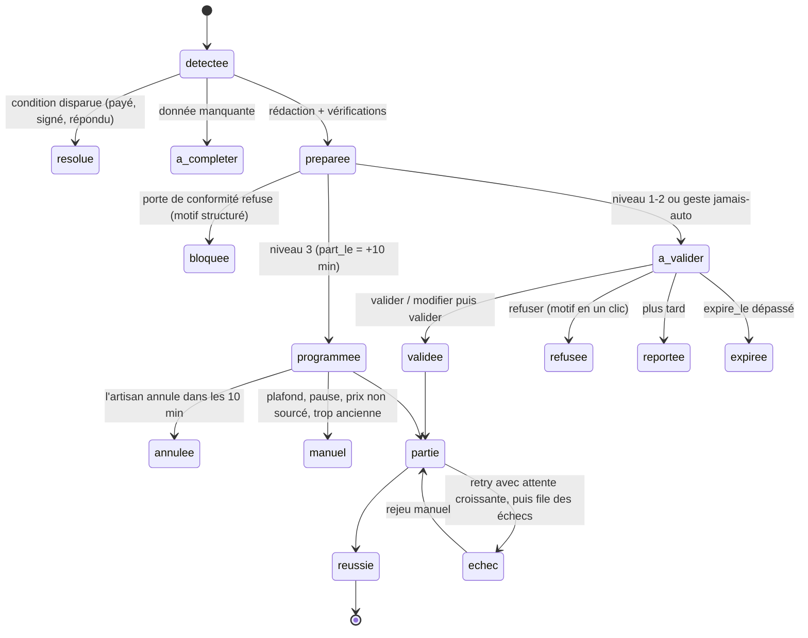

# Cadrage du PROMPT 3 — l'assistant de gestion agentique de Presti

Rédigé le 01/11/2026 (lecture seule : aucun commit, aucune migration, aucune écriture en base, aucun `next build`). Légende : **✔** = relevé dans le code, la base (catalogues et comptages seulement, aucune donnée de client lue) ou un fichier ce jour ; **⚠** = non vérifié, ou déduit.

## 0. Ce qu'il faut retenir (7 constats)

1. **La sauvegarde est pire qu'« en panne GitHub ».** Même rétablie, elle ne couvrait que **34 tables sur 92** ✔ : la liste est écrite en dur (`scripts/sauvegarde.mjs:49-60`). Le CRM entier (chantiers, équipe, rappels, pièces), `assistant_actions`, `actions_auto`, `pilote_reglages`, `commandes_fournisseur`, `relances_impayes*`, `compta_reglages`… n'y sont pas. Une sauvegarde « verte » ne protégerait donc pas ce qu'on va migrer.
2. **Les organisations sont un chantier de sécurité, pas de schéma.** Il n'y a aucune table d'organisation ✔ (0 sur 6 noms cherchés). L'identité d'un compte est `artisans.id = auth.uid()` ; la garde de session de la migration 0138 (`jeton_session_valide`, `compte_non_suspendu`) lit `artisans`/`suspensions` par `auth.uid()` : **un membre qui n'est pas dans `artisans` passerait la garde « code e-mail » à vide** (aucune ligne trouvée = condition vraie, `0138:50-70`). À corriger *avant* la première invitation.
3. **L'assistant a déjà tout le gabarit ; il lui manque l'amont.** 52 actions (32 directes, 20 à confirmer) ✔, cartes, journal, pilote avec annulation 10 min et plafond 20/j ✔. `piloterCarte` n'est appelé que par `actions-serveur.ts:1390` et `piloterProposition` que par 3 routes ✔ : aucun détecteur ne remplit la file. Quatre pièces manquent : événements, détecteurs, boîte « À valider » persistante, briefing poussé.
4. **Une carte vit 24 h** (`VALIDITE_CARTE_MS`, `lib/assistant/cartes.ts:18` ✔). Une boîte « À valider » où une relance attend trois jours ne peut pas reposer sur `assistant_actions` seule : il faut un objet amont (`opportunites`) à durée de vie propre.
5. **Le socle d'exploitation est moins noir que décrit, et différent.** Les tâches du PC tournent de nouveau (lastRunAt du 31/10 et du 01/11 ✔). La « relève de boîte en échec » est, au 01/11, un état « boîte non configurée sur cet environnement » (passage de 9 h 31 ✔), c'est-à-dire que `IMAP_USER/IMAP_PASS` ne sont plus lus : la panne a changé de nature. Seule la sauvegarde reste réellement à zéro.
6. **Les 2 « tests périmés » sont dans la partie `--live`** (`scripts/lib/assistant-qa-live.mjs:132` et `:238`) ✔ ; les parties hors ligne passent (`assistant-qa` 309/0, `assistant-tout-qa` 118/0, `pilote-qa` vert, joués ce jour). La fixture ne couvre que 10 des 20 actions à confirmer.
7. **La documentation du dépôt est en retard sur le code** : `CLAUDE.md` dit 87 routes, 21 drapeaux, 85 migrations ; le dépôt a **224 `route.ts`, 53 pages, 57 drapeaux, 168 fichiers de migration (dernière `0181`)** ✔.

---

## 1. Inventaire de l'existant (fichier:ligne)

### 1.1 Assistant de gestion

| Brique | Où | État |
|---|---|---|
| Route | `app/api/assistant/route.ts` (180 l.). Garde `gardeAssistant` (l.~75) ; limites 30 req/10 min (l.51) et 200/jour (l.54), fail-closed ; palier `routerModele`, défaut « pro » (l.111) ; `actionsOk = actionsDisponibles()` (l.120) ; outils d'action **toujours donnés** quand les tables existent | ✔ |
| Cadrage | `lib/assistant/cadrage.ts` : `cadrerDemande` l.137, `actionDemandee` l.125, **`faitToutSeul` l.160** (= demandée par l'artisan ET aucun texte de tiers lu dans le tour) ; liste de mots d'action l.92-110 ; garde-fou des chiffres `chiffresNonSources` l.275 | ✔ |
| Catalogue d'actions | `lib/assistant/outils-actions.ts` : `SPEC` l.58 ; **52 actions = 32 `direct` + 20 `confirmation`** ; `ACTIONS_CONFIRMEES` l.468 ; `ACTIONS_PAR_TOUR_MAX = 12` l.474 ; `validerAction` l.569 ; `nombresASourcer` l.717. Lectures : `lib/assistant/outils.ts` (21 entrées `name:`) | ✔ (le « ≈ 45 actions » des documents est périmé) |
| Exécution | `lib/assistant/actions-serveur.ts` (1 415 l.), `actions-tout.ts` (575 l.), `executeurs.ts` ; mise en carte + pilote l.1390 | ✔ |
| Cartes | `lib/assistant/cartes.ts` (statuts l.15, **validité 24 h l.18**), `confirmation.ts` (`confirmerAction` l.95, `refuserAction` l.126, `annulerAction` l.138) ; tables `assistant_actions`, `assistant_journal`, `assistant_conversations` | ✔ |
| Briefing | `lib/assistant/briefing.ts` : module pur, seuil « devis sans réponse » = **7 jours** (l.~45), impayés urgents à 30 j ; **produit seulement si on le demande** (outil `briefing_du_matin`) | ✔ |
| Anti-fabrication | `boucle.ts` (chiffre absent des sources → régénération puis phrase retirée), `lib/ai/antiFabrication.ts` | ✔ |
| Écran | `app/assistant/page.tsx` (chat + 3 onglets de cartes) ; l'accueil de la console est `app/dashboard/page.tsx` | ✔ |

### 1.2 Pilote automatique

`lib/pilote/regles.ts` : délai 10 min l.24, plafond 20/jour l.27, attente max 24 h l.29, 6 types l.33 (`reponse_prospect, relance_devis, relance_impaye, envoi_devis, envoi_facture, assistant_client`), table de correspondance outil→type l.50, **liste fermée des outils exécutables** l.67 (6 outils), `OUTILS_JAMAIS_AUTO` l.70 (marquer payée, créer facture, rembourser, payer, avoir, supprimer devis/tarif, augmenter tarifs), `decisionPilote` l.139, `OUTILS_CONTENU_TIERS` l.132 (un texte de tiers lu rend la carte non pilotable). Orchestrateur `lib/pilote/file.ts` (budget 20 s, reprise des lignes `en_cours` après 5 min), file en base `lib/pilote/serveur.ts` (jeton de plafond atomique l.55, clé d'idempotence `(artisan_id, cle)` l.68). Étape `pilote` du tic minute ✔ (dernier passage 01/11 11:48, `pilote: ok` ✔).

Point d'attention : `OUTILS_JAMAIS_AUTO` est une **liste noire écrite à la main** ; la sécurité réelle vient de la liste blanche `OUTILS_EXECUTABLES_PILOTE`. Un futur type de pilote ajouté à la liste blanche sans mise à jour de la liste noire serait la faille classique. À dériver du catalogue (§4).

### 1.3 Offres, drapeaux, modes

- `lib/plans.ts` : `PlanId` l.14 = `gratuit | essentiel | studio | signature | business` (**pas d'« entreprise »**) ; `STUDIO` l.56 contient `assistant` ; `SIGNATURE` l.77 ajoute `plateforme.ia.auto`, `relances.auto`, `factures.relances.auto`, `crm`, `assistant.pilote` (l.89) ; `ESSAI_JOURS` l.108 = studio 7 / signature 21 ; `peut()` l.134 ; Studio 59 €, Signature 99 € (l.~96-100) ✔.
- `lib/plateformeConfig.ts` : défaut `mode_reponse: 'assistee'` l.45 ; `iaDoitRepondre` l.151 ; **`modeEffectif` l.183** rétrograde « auto » en « assistée » avec le motif `verrou_offre` si l'offre n'a pas `plateforme.ia.auto` (donc en dessous de Signature) ✔.
- `lib/flags.ts` : **57 drapeaux** (pas 21) ; baissés : `constructeurSite`, `inventaireOcr` (l.56), `landingVideo`, `canauxWhatsapp` (l.70), `canauxReseaux` (l.72), `canauxLeboncoin`, `siteAchatPublic`, `packPub`, `packPubVente`, `aimantSite`, `ecommerce` (11). `assistant` l.161 et `piloteAutomatique` l.243 levés ✔. **`consoleV2` n'existe pas sur `main`** : il n'existe que sur la branche `refonte-1018` (`lib/flags.ts:189` de cette branche, 37 commits d'avance, drapeau « à retirer avant fusion ») ✔.

### 1.4 Modèle d'autorisation actuel (base de production, projet `gorcdvmueakcncsmrouo`)

Requêtes de catalogue du 01/11 ✔ :
- **92 tables** publiques, **92 avec RLS** ; **389 politiques** ; extensions : `plpgsql, pg_stat_statements, uuid-ossp, pgcrypto, supabase_vault, pgmq, pg_cron, pg_net` (**pas de `vector`** : pgvector n'est pas activé ; `pgmq` l'est, jamais utilisé par le code que j'ai lu ⚠).
- **328 politiques `garde_*`** = 82 tables × 4 (garde de session 0138). **10 tables à RLS n'ont pas la garde** (créées après 0138, comme l'en-tête de la migration le prévoyait) : `actions_auto, canaux_evenements, chantier_pointage, chantier_suivi, compta_alertes_envoyees, crm_agenda, crm_apres_opposition, crm_reglages, essais_gratuits, pilote_reglages`. Elles n'ont **aucune politique permissive** (fermées au navigateur, accessibles par la clé de service seulement) : pas une fuite, mais l'invariant « toute table porte la garde » est faux.
- **51 tables ont une politique métier** (61 politiques hors garde) : **37 « directes »** (`auth.uid() = artisan_id`), **6 « via parent »** (`devis_lignes, factures_lignes, lignes_achat, messages, relances, stock`), `artisans` (« soi », `auth.uid() = id`, 3 politiques), `postes_types` (lecture pour tout `authenticated`), 6 `contenu_*` (fondateur). 41 tables n'ont aucune politique métier (service seulement), dont 19 portent un `artisan_id`.
- **Fonctions** : 237 `SECURITY DEFINER`, dont **5 seulement exécutables par `authenticated`** (`compte_non_suspendu, is_founder, jeton_session_valide, sessions_de_l_artisan, slug_ancien_d_un_autre`) : la surface « fonction appelable avec un `p_artisan` forgé » est étroite (migration 0173 ✔).
- **Côté application** : 63 fichiers importent `authArtisan`, 268 utilisent `supabaseAdmin` (clé de service, qui **ignore la RLS** : le filtre `artisan_id = uid` est alors la seule barrière), 933 occurrences de `artisan_id` dans `app/` + `lib/`. Le pilote et l'assistant écrivent presque tout par la clé de service (`lib/pilote/serveur.ts:1-12`). La RLS n'est donc que la moitié du modèle ; l'autre moitié est « `uid` de session = id du compte » dans ~270 fichiers.
- **Comptes** : 7 lignes `artisans`, dont 4 `est_demo` ✔ (comptage). Le backfill d'organisations portera sur 3 comptes réels.
- **Équipe** : `equipe_membres` (id, artisan_id, nom, role, telephone, actif) et `chantier_equipe` sont des **fiches de personnes sans compte de connexion** ✔. Les compagnons n'ont pas de login ; le pointage passe par un lien public à jeton (`chantier_pointage`). Rien à réutiliser pour l'authentification des membres. Modèle de rôles existant côté fondateur : `direction_roles`, `lib/controle/droits.ts` (à lire comme inspiration, pas à réutiliser).
- **Tests d'isolation** : `scripts/rls-e2e.mjs` joue **contre la production** (`BASE=https://prestiapp.fr`, comptes créés puis supprimés), et l'audit du 05/09 ne le documentait que pour 14 tables (`presti/plans/audit-final/attaque.md`). Il est au lanceur (`tout-verifier.mjs:46`) mais il ne couvre pas 44 tables ⚠ (non relu en entier).

### 1.5 Crons et horloges

- `vercel.json` : 2 crons, `/api/cron/relances` (8 h) et `/api/canaux/relever` (7 h) ✔. Hobby : max 2, max 60 s (`maxDuration = 60`).
- `pg_cron` : **16 tâches, 15 actives** ✔ (conforme à l'annexe) ; `presti-agents-tic` chaque minute → `ops_horloge_minute()` → `/api/agents/tic` (étapes `baux, argent, pilote, balayage, veilleur`, budget 25 s, `app/api/agents/tic/route.ts:19-60`) ; le reste est la prospection (`acq-*`, une vigie désactivée).
- Les passages sont inscrits dans `passages_cron` (nom, dernier_passage, detail, reussi). Au 01/11 : `tic` OK 11:48, `relances` OK 09:31, `relances-impayes` OK (0 compte), `canaux-relever` OK 07:40 (**0 boîte** : la table `canaux` est vide ✔).

### 1.6 Sauvegardes

`.github/workflows/sauvegarde.yml` : cron `40 1 * * *`, `ubuntu-latest`, `npm ci`, secret `PRESTI_ENV_LOCAL`, `sauvegarde.mjs --fichiers`, vérification du manifeste, aller-retour (« non concluant, clé privée absente : attendu »), artefact 30 jours. **Pourquoi il échoue** : `gh` n'est pas authentifié ici ⚠ (je n'ai pas pu lire les journaux d'exécution). Ce que disent les sources : échec en 4 secondes à chaque passage depuis le 25/10 (état des lieux du 29/10), quota de minutes Actions épuisé (`qg/ETAT.md`, 90 % consommé dès le 21/10 : `qg/BILAN-2026-10-21.md`). Un échec en 4 s avant l'étape 1 est compatible avec un refus de démarrage du job (quota/paiement), pas avec un bug du script ⚠. L'arithmétique de la note `Ecosysteme-Plan-2026-09-24` (`audit.yml` + `sauvegarde.yml` ≈ 75 min/nuit ≈ 2 250 min/mois pour un quota de 2 000) explique la panne **et prédit qu'elle reviendra** si le quota se renouvelle le 01/11 sans changer les workflows. Le chiffrement est bon (AES-256-GCM + RSA-4096, clé privée dans `C:\Users\benja\coffre-presti\`, hors dépôt : `docs/sauvegardes.md`).

### 1.7 Relève de boîte e-mail

Deux choses différentes portent ce nom :
- **La boîte de l'entreprise** (celle du fondateur, `contact@…`), relevée par le passage de 8 h (`app/api/cron/relances/route.ts:337-353`, `lib/direction/courriers.ts:151-152`) via `IMAP_USER`/`IMAP_PASS`. Le 29/10 : « Identifiants refusés par le serveur » (état des lieux). Le 01/11 9 h 31 : `boite: "boîte non configurée sur cet environnement"` ✔ — l'absence de variables est classée « pas une panne » (l.341-346) et le passage est marqué réussi. **Cause probable** : mot de passe d'application Gmail révoqué/changé puis variables retirées de Vercel ⚠ (je n'ai pas le droit de lire les variables).
- **Les boîtes des artisans** (`/api/canaux/relever`, 7 h) : `canaux` contient 0 ligne ✔ ; ce cron tourne à vide et réussit. Il n'est pas « en échec ».

### 1.8 Tâches planifiées du PC

- **Planificateur de tâches Windows** ✔ : `Cerveau Presti` (Prêt, toutes les 15 min, dernier résultat 0) ; `Presti prospection` (Prêt, dernier passage 01/11 10:55, **code 3221225786 = 0xC000013A, processus interrompu par Ctrl+C/fermeture de console**) ; `Presti demons`, `instantane quotidien`, `surveillant-nuit`, `usine veille`, `veilleur-nuit` **désactivés depuis le 11/10** (pause de l'écosystème décidée par Benj, `memoire/ecosysteme-en-pause-1110.md`). Donc **plus d'instantané quotidien du code depuis le 11/10** (dernier résultat 4 = erreur).
- **Tâches Claude (`scheduled-tasks`)** ✔ : 14 actives (prospection, chasse, Harvey, posts, directeur 19 h, rangement du vault…), dernier passage le 31/10 ou le 01/11 pour la plupart. L'affirmation « ne tournent plus depuis le 28/10 » est vraie pour la fenêtre 27/10 15 h → 29/10 9 h (`qg/ETAT.md`), **plus au 01/11**.
- Aucune tâche (Windows, Claude, GitHub, n8n) ne fait de sauvegarde.

### 1.9 SMS, conformité

- **SMS** : aucun fournisseur, aucune route, aucun drapeau ✔ (recherche dans `lib/`, `app/`, `package.json`). Le mot n'apparaît que comme canal de partage d'un lien (`lib/canaux/reseaux.ts:12`) et dans `lib/agents/acquisition/plaintes.ts:43` (« Presti ne capte ni les appels ni les SMS »). Prix d'un SMS : **non vérifié** (l'API de recherche web est à sec, erreur 402).
- **Mentions bloquantes avant émission** : `lib/legalArtisan.ts:88` (nom, forme, SIRET, adresse, assurance) ; pénalités de retard et indemnité de 40 € « entre professionnels seulement » : `lib/devisPdfData.ts:37-42` ; TVA : franchise en base art. 293 B imposée au prompt IA (`lib/ai/metiers.ts:145-169`), facture « sans TVA » (commit `a51a12a`) ; numérotation atomique : migration `0180` appliquée (21/10) ; Factur-X : `lib/facturx.ts:16` reconnaît que le XML « n'est pas une facture Factur-X certifiée », et la réforme (émission obligatoire des PME le 01/09/2027) n'est pas couverte : note `Facture electronique - plateforme agreee`.
- **URSSAF** : aucune déclaration (le mot sert à classer des pièces, `lib/comptaAssistant.ts:106`). Cohérent avec « ne s'automatise jamais ». **Seuils de franchise de TVA pour l'artisan : inexistants** (les seuils codés, `lib/direction/comptable.ts`, concernent l'entreprise Presti elle-même).
- **Pas de table `paiements`** ✔ : un paiement est `factures.payee_le` seulement ; le détecteur « paiement partiel » du plan du 29/10 est impossible sans migration.

### 1.10 Tests

`assistant-qa.mjs` (1 096 l.) : **309 PASS / 0 FAIL** ; `assistant-tout-qa.mjs` (685 l.) : **118/0** ; `pilote-qa.mjs` : vert ✔ (joués ce jour, hors ligne, doublures de PostgREST). Les deux défauts connus se trouvent dans `scripts/lib/assistant-qa-live.mjs` (parties L/M, comptes de test **sur la base réelle**, que je n'ai pas jouées) :
1. l.132 attend « Studio → 403 `offre` » sur `/api/assistant` ; depuis le 25/10 Studio a la capacité `assistant` (`lib/plans.ts:56-76`) ;
2. l.238 exige que le jeu d'essai couvre « EXACTEMENT » `ACTIONS_CONFIRMEES` : il couvre 10 des 20 ; manquent `creer_facture_libre, supprimer_article, envoyer_facture, regler_relances_impayes, regler_plateforme, modifier_ma_page, relancer_commande, demander_avis, envoyer_rappel_entretien, noter_opposition_client`.
À corriger hors ligne (fixtures sur la doublure de PostgREST), puis seulement rejouer en direct sur ordre de Benj.

### 1.11 Outils annexes (Hermes, n8n, Orca, Docker, Oracle)

- **n8n** : **aucune occurrence dans `lib/`, `app/`, `scripts/` du dépôt** ✔ (les fichiers qui sortent du `grep` sont des fixtures binaires). Trois instances d'après la session du 01/11 (`vault/inbox/sessions/2026-11-01-12h33-b6e06ae6-avant-compression.md`) : Oracle (n8n 2.45.6 + bac à sable + SearXNG, joignable **seulement par un tunnel** `localhost:5679` depuis le PC), PC (Docker, `localhost:5678`, `Documents/n8n/docker-compose.yml` que je n'ai pas ouvert à cause de `cle-sandbox-oracle.txt` voisin), n8n cloud (`presti.app.n8n.cloud`, raccordé à Claude Code par MCP). ⚠ non revérifié en direct.
- **Orca** : installé **sur le PC** (`AppData/Local/Programs/orca/resources/bin/orca`) ✔ ; c'est un outil de worktrees/terminaux/agents de développement (skill `orca-cli`). Ce n'est pas un moteur d'exécution pour des actions d'artisans : il n'a pas sa place dans le chemin de production (§3 Q10).
- **Hermes** : exécutable côté PC (`AppData/Local/hermes/bin`), conteneurs sur Oracle ; « branché sur Claude Code depuis le 01/11 » (annexe) ⚠ non revérifié. Reste l'assistant du fondateur, jamais devant un artisan.
- **Serveur Oracle** : disque 95 % → 89 % après nettoyage le 01/11 (session ci-dessus). L'« essai Oracle expiré le 24/10 » (`qg/ETAT.md`) impose de vérifier que l'instance est bien en Always Free ⚠ (une instance inactive peut être reprise).
- Dépendances absentes du dépôt malgré le prompt : **Zod, Vitest, pytest, pgvector, Kokoro, WaveSpeed**. Le dépôt valide à la main et teste par `scripts/*-qa.mjs` + lanceur ; `CLAUDE.md` interdit d'ajouter des dépendances sans décision.

---

## 2. Phase 0 — réparer le socle

Ordre imposé : **0a sauvegarde → 0b mesure du coût IA → 0c boîte e-mail → 0d tâches PC → 0e Actions**. Rien de la suite (migration d'organisations) ne commence avant la clôture de 0a.

### 0a. Sauvegarde nocturne hors GitHub Actions

**Causes (deux, indépendantes)** : (1) l'exécuteur : quota Actions épuisé ⚠ ; (2) le contenu : liste de tables figée à 34 sur 92 ✔, donc incomplète même quand elle tournait. Deuxième cause : `DIRECT_URL` refusée depuis le 14/09 (mot de passe Postgres désaligné, note `essai-a-sec-migration`), d'où l'abandon de `pg_dump` pour PostgREST.

**Remède, par ordre de valeur** :
1. **Corriger la liste (code, aucune dépense).** `sauvegarde.mjs` doit découvrir les tables au lieu de les énumérer : lecture de la définition OpenAPI de PostgREST (`GET /rest/v1/` avec la clé de service) ⚠ à éprouver, ou une fonction SQL de service `sauvegarde_liste_tables()` (migration additive). Garde-fou : un test qui échoue si une table publique de la base est absente de la sauvegarde ou de `EXCLUES` (liste explicite avec raison, comme `HORS_LANCEUR`). `restaurer.mjs` : ordre des clés étrangères à lire depuis le catalogue.
2. **Exécuteur : un minuteur systemd sur Oracle** (même doctrine que la note `Routines et usine`, du 27/09 : « tout ce qui peut tourner PC éteint tourne sur l'usine ») qui lance `sauvegarde.mjs --fichiers` à 3 h 40, garde 14 jours, et **pousse le chiffré** vers (a) le PC (récupéré par le PC au réveil, `scp` en lecture) et (b) le dépôt privé de sauvegarde déjà utilisé par `instantane-quotidien.mjs` (un push git ne consomme aucune minute Actions ; limite de taille ⚠ à mesurer sur la taille d'un `.presti` réel). Le secret de service sur Oracle s'inscrit au registre des traitements (`docs/registre-traitements.md` §9 et §12) avec la région du serveur.
3. **n8n sert de chien de garde, pas d'exécuteur** : un workflow Oracle vérifie à 4 h que l'archive du jour existe, a la bonne taille et que son manifeste se relit (`--verifier`), sinon alerte Slack `#presti-auto` + Telegram (`lib/agents/telegram.ts`). Raison : l'exécution de commandes shell est désactivée par défaut dans n8n ≥ 2 et le dépôt n'est pas dans l'image ⚠.
4. **Geste de Benj (un seul)** : remettre à jour le mot de passe de la base dans Supabase → on retrouve `pg_dump` (schéma + tout `public` + `auth` en un seul fichier, sans liste) et `appliquer-migration.mjs`. Défaut si refus : PostgREST dynamique ci-dessus.
5. **Variante gratuite sans toucher aux workflows** : enregistrer l'Oracle comme *runner auto-hébergé* GitHub ; les minutes d'un runner auto-hébergé ne sont pas décomptées ⚠ (à confirmer dans la doc GitHub avant d'y compter). À écarter si le dépôt reste privé et que le runner expose le secret de service à du code de pull-request (`security.yml`, `qualite.yml` tournent sur PR).

**Preuve exigée avant toute migration** : (i) archive du jour contenant les 92 tables (compte par table égal à `select count(*)`, comparaison par `restaurer.mjs --comparer`) ; (ii) `--aller-retour` vert ; (iii) restauration d'un compte de test dans un Postgres local jetable (Docker fonctionne sur le PC depuis le 01/11) ; (iv) la clé privée ouverte une fois depuis `coffre-presti` pour prouver qu'elle existe encore ; (v) l'alerte du chien de garde déclenchée volontairement une fois.

### 0b. Budget IA (avant d'ouvrir un seul détecteur qui rédige)

L'alerte « 1 547 € pour 50 € » (QG, 21/10) n'est pas vérifiée ⚠ : c'est un chiffre de console, pas de la base. À mesurer dans la console Anthropic (geste de Benj) puis à réconcilier avec `docs/couts-et-solde.md` (coûts unitaires du 04/09 : ~0,005 € la réponse de l'assistant, ~0,01 € un devis chiffré, 0,17-0,27 € une recherche fournisseurs à froid). Règle de conception : **les détecteurs et la priorisation n'appellent jamais le modèle** ; seule la rédaction le fait, après qu'une opportunité est jugée utile, sous plafond par compte et par jour.

### 0c. Boîte e-mail

1. Constater : `passages_cron.relances.detail.boite` (« non configurée ») ✔.
2. Benj crée un **mot de passe d'application** Gmail (la 2FA doit être active) et le range avec `node scripts/ranger-env.mjs` (outil du dépôt prévu pour ne pas voir la valeur), variables `IMAP_USER`, `IMAP_PASS` côté Vercel Production. Aucun agent ne lit ni ne colle cette valeur.
3. Rendre la panne **visible** : aujourd'hui « non configurée » vaut « réussi » (`route.ts:345-353`). Proposition : « non configurée » reste neutre **seulement** en environnement non-production ; en production c'est un échec, avec le message pédagogique (« mot de passe d'application Gmail/Outlook »).
4. Test : `scripts/` n'a pas de test qui rougit si les variables disparaissent en production ⚠ ; en ajouter un (lecture de `passages_cron`).

### 0d. Tâches du PC

Distinguer trois familles : (1) **vitales** (rien) → à déplacer sur Oracle ou pg_cron (sauvegarde, chien de garde) ; (2) **dépendantes de Claude Code/Chrome** (prospection, posts, vault) → restent sur le PC, avec un *battement* : chaque tâche écrit une ligne dans `passages_cron`/Slack ; une absence de plus de 26 h alerte ; (3) **mortes depuis le 11/10** → les laisser désactivées, les documenter. Corriger `Presti prospection` (code 0xC000013A à chaque passage = fenêtre fermée) en la lançant masquée ; le PC doit rester éveillé (décision du 27/10 notée dans `Journal-Decisions`).

### 0e. GitHub Actions

Réduire la consommation avant de remettre quoi que ce soit : `audit.yml` à une fois par semaine (le chien de garde pg_cron/Oracle fait le quotidien), `qualite.yml` seulement sur PR, `sauvegarde.yml` supprimé ou en `workflow_dispatch` de secours. Vérifier le compteur après authentification de `gh` (geste de Benj ou jeton lecture seule).

---

## 3. Questions bloquantes, chacune avec son défaut

| # | Question | Défaut retenu (avance sans attendre) |
|---|---|---|
| Q1 | **Mot de passe de la base** : le remettre à jour pour retrouver `pg_dump` ? | Oui (un geste, deux minutes) ; sinon sauvegarde PostgREST dynamique. |
| Q2 | **Qui applique une migration ?** `CLAUDE.md` : « Benj colle puis on lève le drapeau » ; règle du 24/09 (`memoire/migrations-je-les-applique.md`) : « ne JAMAIS lui demander de coller » ; annexe 2 : « migration en production sans Benj : interdit ». | Je prépare, j'éprouve (essai à sec `do $essai$ … raise exception`), puis j'applique par le connecteur Supabase **seulement après un « go » écrit de Benj par lot** (M1, M2, chaque lot M3). Le jumeau `_A_COLLER` reste le repli. |
| Q3 | **Quelle offre ouvre les membres ?** | « Presti pour l'entreprise » (+ Business). Studio et Signature : l'organisation existe (1 titulaire) mais l'invitation est verrouillée (`organisation.membres`). |
| Q4 | **Une organisation = un compte artisan, ou un regroupement de plusieurs ?** | 1:1 en v1 : `organisations.id = artisans.id`, aucune colonne `organisation_id` ajoutée aux 56 tables. Le multi-comptes (architecte avec N clients) est un second pas, après preuve. |
| Q5 | **Matrice des rôles** (titulaire, associé, administratif, compagnon, invité). | Tableau du §5.3. |
| Q6 | **Financer le SMS** (« on ne paie aucun outil » 01/11 ; « SMS : oui » 01/11 ; « rien sur son compte » 26/10). | Étape 0 gratuite : SMS *préparé* (lien `sms:` ouvert sur le téléphone de l'artisan, numéro de l'artisan, un geste) ; étape 1 : API d'un fournisseur au plus bas prix **vérifié**, coût passé en crédits (comme `COUT_RECHERCHE`, `lib/plans.ts:~124`), **aucun envoi réel avant que Benj ait vu le coût unitaire** (annexe 2 §3.5). |
| Q7 | **Briefing du matin** : canal et heure. | Notification de l'app (push web et natif déjà levés), heure choisie par l'artisan (défaut 7 h 30 Paris), e-mail optionnel. |
| Q8 | **Budget IA** : plafond et coupe-circuit. | Plafond par compte et par jour (crédits), palier le moins cher, coupe-circuit global branché sur `signalerPanneIA`/`lib/agents/pause.ts` ; rédaction désactivée tant que 0b n'est pas fait. |
| Q9 | **Lexique d'escalade** (litige, sinistre, fuite, menace, avocat) : la liste actuelle déclenche « fuite » chez un plombier. | Lexique **par métier** (`lib/ai/metiers.ts`), pas global ; « fuite » est une urgence de plombier, pas une escalade. La note `wiki/hot.md` signale déjà ce piège. |
| Q10 | **Quel n8n ?** (Oracle, PC Docker, cloud). Hermes/Orca dans le chemin de production ? | Oracle seul pour tout workflow touchant des données d'artisan ou de client (annexe 2 §3.4) ; le cloud ne reçoit rien de personnel ; le PC sert de bac à essai. **n8n tire (planificateur → appelle une route Presti avec une clé de service dédiée, à droits limités), Presti n'appelle jamais n8n** (l'Oracle n'est joignable que par tunnel ⚠). Hermes et Orca : hors production artisan (outils du fondateur). |
| Q11 | **Dépendances du prompt** (Python, Vitest, Zod, pgvector, Kokoro, WaveSpeed, Docker de déploiement). | Aucune ajoutée : TypeScript, `scripts/*-qa.mjs`, validateurs maison, plein texte Postgres ; Vercel + Supabase restent le déploiement. Kokoro/WaveSpeed n'ont pas d'usage dans ce chantier. |
| Q12 | **Paiements partiels** : créer `paiements` ? | Oui, table additive (argent → conçue par la session principale), après les organisations. Sans elle, pas de détecteur « reste dû ». |
| Q13 | **Tests `--live`** | Pas rejoués. Les deux défauts sont corrigés hors ligne ; un rejeu réel est une décision de Benj. |
| Q14 | **« Envoyer un devis signé »** (liste §3.2) : sens ? | Un devis déjà signé par le client est un document engageant : jamais envoyé en automatique ; l'envoi du devis *non signé* reste pilotable avec prix sourcés (comportement actuel `envoi_devis`). |

---

## 4. Architecture cible, posée sur l'existant

```mermaid
flowchart LR
  classDef nouveau fill:#D97757,stroke:#7a3a22,color:#000;
  classDef existant fill:#2b2b2b,stroke:#888,color:#eee;
  classDef humain fill:#1f4d3a,stroke:#6c6,color:#eee;
  classDef jamais fill:#5a1f1f,stroke:#e66,color:#fff;

  subgraph SOURCES["Ce qui arrive (existant)"]
    S1["Pages publiques /p /site<br/>leads, messages"]:::existant
    S2["Devis / factures / chantiers<br/>stock / compta (écrans et API)"]:::existant
    S3["Canaux : e-mail, Telegram,<br/>notifications, liens"]:::existant
    S4["Horloge : tic minute (pg_cron)<br/>+ cron 8 h Vercel"]:::existant
  end

  S1 --> EV
  S2 --> EV
  S3 --> EV
  EV["evenements_metier<br/>clé (artisan, type, objet, version)"]:::nouveau
  S4 --> DET

  EV --> DET["Détecteurs en code, sans modèle<br/>catalogue versionné + réglages par artisan<br/>mode simulation"]:::nouveau
  DET --> OPP["opportunites<br/>constat écrit par le code + faits sourcés<br/>clé d'idempotence, expire_le"]:::nouveau
  OPP --> PRIO["Priorisation (code)<br/>urgence · argent en jeu · risque"]:::nouveau
  PRIO --> RED["Rédaction (modèle, palier bas)<br/>faits imposés · chiffres revérifiés<br/>lib/assistant/boucle.ts réutilisé"]:::existant
  RED --> PORTE["Porte de conformité (code)<br/>offre · opposition · plafonds · horaires<br/>prix sourcés · mentions · white-label<br/>escalade par métier · jamais-auto"]:::nouveau

  PORTE -->|"niveau 1"| BRIEF["Briefing du matin<br/>push app (+ e-mail) :<br/>propose, ne prépare rien"]:::nouveau
  PORTE -->|"niveau 2"| BOITE["Boîte « À valider » unique<br/>Valider · Modifier · Refuser · Plus tard<br/>cartes assistant_actions créées à l'ouverture"]:::nouveau
  PORTE -->|"niveau 3 (Signature, Entreprise)"| PIL["Pilote automatique existant<br/>actions_auto : annulation 10 min,<br/>plafond 20/j, liste fermée"]:::existant
  PORTE -->|"geste de la liste §3.2"| BOITE
  BRIEF --> BOITE
  BOITE -->|"valider"| EXE
  PIL --> EXE
  EXE["Exécution par les fonctions partagées<br/>lib/envoisServeur.ts · envoisPdfServeur.ts<br/>confirmerAction"]:::existant
  EXE --> JOUR["Journal : assistant_journal + acteur_id<br/>opportunites_decisions · tentatives · coût"]:::nouveau
  JOUR --> LEC["Boucle d'amélioration (hebdo)<br/>acceptation / modification / refus par détecteur<br/>propose, ne change rien seule"]:::nouveau
  LEC -.-> DET

  H["Artisan (chat /assistant, accueil)"]:::humain --> ASS["Assistant de gestion existant<br/>52 actions, 21 lectures"]:::existant
  ASS -->|"carte ou « fait tout seul »"| BOITE
  BOITE --> H

  N8N["n8n sur Oracle (tire, ne reçoit pas)<br/>intégrations clients Entreprise<br/>sauvegarde : chien de garde"]:::nouveau -. "clé de service dédiée, droits limités" .-> DET
  KILL["Interrupteur général + pause + disjoncteur par détecteur<br/>lib/agents/pause.ts · flags.ts"]:::existant -.-> PORTE
```

### 4.1 Les trois niveaux, par type d'action (jamais pour tout le compte)

| Type d'action | Niv. 1 propose | Niv. 2 prépare + 1 geste | Niv. 3 seul (Signature / Entreprise convenu) | Garde propre |
|---|---|---|---|---|
| Réponse à une demande entrante | oui | oui | oui (`reponse_prospect`, existe) | horaires, limite de messages, escalade par métier |
| Relance de devis (J+3/7/14) | oui | oui | oui (`relance_devis`) | stop à la moindre réponse |
| Relance d'impayé (J+3/10/21) | oui | oui (0181 `a_valider`) | oui (`relance_impaye`) | texte = ce que la facture porte déjà ; pas de menace |
| Envoi d'un devis non signé | oui | oui | oui seulement si **tous** les prix sont sourcés (`envoi_devis`) | `prixSources` |
| Envoi d'une facture **déjà émise** | oui | oui | oui (`envoi_facture`) | mentions bloquantes (`legalArtisan.ts:88`) |
| Rappel de rendez-vous / d'entretien / demande d'avis | oui | oui | oui, après exécution par route sans session (aujourd'hui hors `OUTILS_EXECUTABLES_PILOTE`) | consentement, STOP |
| SMS (rappel, devis prêt, rappel de paiement) | oui | oui | non en v1 | consentement, coût, STOP, drapeau |
| Alerte de stock → commande préparée | oui | oui | commande **proposée** seulement ; l'envoi au fournisseur reste niv. 2 (fournisseur de sa liste) | anti-fabrication fournisseur |
| Facture d'acompte / de solde (préparer) | oui | oui | **préparée** seulement ; **jamais émise seule** | numérotation atomique `0180` |
| Émettre une facture, encaisser, rembourser, avoir, supprimer, prix en lot | oui | carte | **jamais** | `OUTILS_JAMAIS_AUTO` à dériver du catalogue |
| Message juridique, litige, sinistre, menace | — | carte | **jamais** | lexique par métier |
| Déclaration URSSAF / impôts | non | non | non | hors périmètre |

Pour qu'un type bouge de niveau, on **propose** la montée (« 19 relances validées sur 20 sans modification en 3 semaines », seuil proposé dans le plan du 29/10) ; l'artisan confirme par une carte. Pour « Presti pour l'entreprise », les niveaux 3 sont des lignes `autonomie_reglages` posées par un administrateur Presti après contrat, jamais par l'artisan seul.

### 4.2 Cycle de vie d'une opportunité

---

## 5. Modèle de données et plan de migration

### 5.1 Correspondance avec les 34 tables du prompt (rien à recréer sous un autre nom)

| Prompt | Dans Presti | Action |
|---|---|---|
| `users` | `auth.users` + `artisans` (sécurité) | Ajouter `utilisateurs` (id = auth.uid, `sessions_invalides_avant`, `connexion_verifiee_le`, nom) pour les membres non titulaires. |
| `organizations`, `memberships` | — | **`organisations`, `membres`, `invitations` (neuves)** |
| `clients`, `leads`, `devis`, `devis_lignes`, `factures`, `factures_lignes`, `fournisseurs`, `chantiers` | idem | existent ✔ |
| `contacts` | — | pas de table ; non bloquant (coordonnées dans `clients`) |
| `paiements` | — | **absente** ; `factures.payee_le` seulement → création additive (Q12) |
| `produits`, `inventaire`, `mouvements_inventaire` | `materiaux`, `stock`, `mouvements_stock`, `prix_artisan` | existent |
| `commandes`, `commandes_lignes` | `commandes_fournisseur` (lignes en JSON) | existe ; lignes en table = plus tard si besoin |
| `taches` | `chantier_taches`, `crm_rappels` | existent |
| `conversations`, `messages` | `leads` (une conversation = un lead) + `messages` ; `assistant_conversations` | existent |
| `documents` | `chantier_pieces` + stockage ; pas de table de classement | à créer plus tard (Document Agent) |
| `relances` | `relances`, `relances_impayes*` | existent |
| `agent_runs`, `tool_calls` | `assistant_journal`, `passages_cron` | + `acteur_id`, + table des passages de détecteurs |
| `agent_actions`, `human_approvals` | `assistant_actions`, `actions_auto` | + `opportunites_decisions` |
| `subscription_plans` | **`lib/plans.ts` (code)** | à garder en code : « seule source de vérité » (CLAUDE.md) ; ajouter l'offre « entreprise » là |
| `permissions` | — | **matrice rôle × domaine en code** (`lib/organisations/droits.ts`) + rôle en base |
| `automation_rules` | `regles_automatisation` | existe ; s'ajoutent `detecteurs_reglages`, `autonomie_reglages` |
| `errors` | `app_errors` | existe |
| `audit_log` | `assistant_journal` + `crm_journal` + `journal_direction` | trois journaux ; ajouter `acteur_id` aux deux premiers |
| `metrics_daily` | `audience_jours` (vitrine) | **`metriques_automatisation_jour` (neuve)** |

### 5.2 Tables neuves (toutes : RLS activée dès la création, garde de session posée, `revoke` des droits `anon` ; écriture par fonctions ou clé de service)

**Organisations** : `organisations` (id = `artisans.id`, nom, `actif`, créé_le) ; `membres` (organisation_id, user_id, rôle ∈ titulaire/associé/administratif/compagnon/invité, statut, `equipe_membre_id` nullable vers `equipe_membres` pour rattacher un compagnon à ses chantiers, invité_par, dates) ; `invitations` (jeton haché, rôle, expiration courte, usage unique) ; `utilisateurs` (sécurité par personne).

**Automatisation** : `evenements_metier` ; `detecteurs_reglages` (artisan, détecteur, actif, seuils, horaires, canal) — le *catalogue* des détecteurs (nom, version, domaine, capacité d'offre) reste **en code**, comme `SPEC` ; `opportunites` (artisan, détecteur, version, objet, `cle_idempotence` unique par `(artisan_id, cle)` pour les ouvertes, constat, faits JSON, priorité, score, statut, `expire_le`, lien vers carte/ligne de pilote, tentatives, `prochaine_tentative`, motif de blocage) ; `opportunites_decisions` (acteur_id, décision, motif, hash du texte avant/après, horodatage) ; `autonomie_reglages` (artisan, type d'action, niveau 1-3, plafond/jour, plafond de coût, posé_par) — généralise `pilote_reglages` (qui reste, `types[x]=true` ⇒ niveau 3, rétro-compatible) ; `passages_detecteurs` (durée, comptes traités, opportunités, erreurs, mode simulation) ; `redactions` (prompt_version, modèle, tokens, coût, vérifications) ; `prompts_versions` ; `metriques_automatisation_jour` ; `imports` + `imports_lignes` (mise en route) ; plus tard `paiements`, `sms_envois` (artisan, client réf., fournisseur, coût, statut, consentement_ref) et la file des échecs (c'est un statut, pas une table).

Contraintes en base (pas seulement en code) : une seule opportunité ouverte par `(artisan_id, cle_idempotence)` ; aucun passage en `partie` sans carte confirmée ou ligne de pilote réclamée ; un seul passage de détecteur à la fois par artisan (bail) ; `jamais_auto` posé sur le *type* d'action dans une table de référence lue par le pilote (fin de la liste noire à la main).

### 5.3 Rôles et domaines (proposition, à valider — Q5)

| Domaine | Titulaire | Associé | Administratif | Compagnon | Invité |
|---|---|---|---|---|---|
| Abonnement, Stripe, suppression du compte, membres | écriture | — | — | — | — |
| Réglages entreprise, canaux (mots de passe de boîte), plateforme | écriture | écriture | lecture | — | — |
| Demandes et conversations, clients | écriture | écriture | écriture | — | lecture |
| Devis | écriture | écriture | écriture | — | lecture |
| Factures, relances d'impayés, compta | écriture | écriture | écriture | — | lecture (comptable) |
| Tarifs | écriture | écriture | lecture | — | — |
| Stock, commandes fournisseurs | écriture | écriture | écriture | lecture | — |
| Chantiers, tâches, pièces | écriture | écriture | écriture | **ses chantiers seulement** | lecture |
| Pointage, notes de chantier | écriture | écriture | lecture | écriture (les siens) | — |
| Assistant (chat) | complet | complet | sans actions d'argent | — | — |
| Boîte « À valider » | tout | tout | commercial + factures | ses tâches | — |
| Niveau 3 (réglages d'autonomie) | oui | non | non | non | non |

Les **secrets en colonne** ne se protègent pas par RLS (RLS filtre des lignes) : `canaux.secret` et les colonnes sensibles de `artisans` (identifiants Stripe, etc.) ⇒ pas de politique membre sur ces tables ; les membres lisent une **vue** ou une fonction de service qui renvoie les colonnes utiles.

### 5.4 Fonctions SQL

- `comptes_accessibles(domaine text, niveau text)` → `setof uuid` (STABLE, SECURITY DEFINER, `search_path = ''`) : le compte de l'utilisateur lui-même **plus** les organisations où il est membre actif avec un droit suffisant, **hors comptes suspendus pour l'écriture**. Retour d'un ensemble pour que les politiques s'écrivent `artisan_id in (select public.comptes_accessibles('devis','ecriture'))` : évalué une fois par requête (`InitPlan`), pas par ligne.
- `peut_acceder(artisan uuid, domaine text, niveau text)` → `boolean` (le nom que veut Benj) : raccourci `auth.uid() = artisan` avant tout, puis `membres`. Pour les contrôles unitaires, l'application et les tests.
- `role_de(artisan uuid)`.
- **Interrupteur** : `comptes_accessibles` lit un réglage global (`reglages_globaux`, `organisations_actives`) ; à `false` elle ne renvoie que `auth.uid()` — retour arrière instantané sans DDL.

### 5.5 Plan de migration RLS, table par table

**Principe de réversibilité** : on **n'altère aucune politique existante**. Chaque lot **ajoute** une politique permissive par table (`org_lire`, `org_ecrire`, `org_maj`, `org_sup`), qui s'additionne en OU à l'existante. Pour un titulaire, le comportement est identique par construction ; retour arrière = `drop policy`. Une seule exception de fond : les deux fonctions de garde (M2). Cette stratégie ne peut qu'élargir l'accès : le risque est donc une **fuite** si `comptes_accessibles` ment, ce que la suite d'isolation (§5.6) doit prouver et faire rougir.

| Pas | Contenu | Réversible par | Prérequis |
|---|---|---|---|
| **M0** | Sauvegarde 92 tables prouvée (0a) ; reconstruction locale de la base (rejeu des 168 migrations dans un Postgres jetable, Docker ou PGlite : `scripts/lib/sql-essai.mjs` existe ⚠ non relu) ; **essai à sec** de chaque migration en production par `do $essai$ … raise exception` (note `essai-a-sec-migration`) | — | Q1, Q2 |
| **M1** additive | Tables `organisations`, `membres`, `invitations`, `utilisateurs` ; fonctions du §5.4 ; **backfill : 1 organisation + 1 membre titulaire par ligne `artisans` (7 lignes)** ; RLS des nouvelles tables ; aucune table existante touchée | `drop` des objets neufs | M0 |
| **M2** garde | `jeton_session_valide()` et `compte_non_suspendu()` lisent `utilisateurs` en plus d'`artisans` (aujourd'hui `a` est vide pour un membre ⇒ conditions 1 et 3 vraies à vide, `0138:50-70`) ; la suspension d'une organisation bloque l'écriture de ses membres ; le TOTP (`auth.mfa_factors`) reste par utilisateur | restaurer les corps de fonctions de 0138 (conservés en tête de la migration) | M1 ; banc d'essai des 24 cas de 0138 ⚠ (il est cité sous `/mnt/project-files/…`, chemin du cloud, à recréer) |
| **M3-A** lecture seule | `assistant_actions, assistant_journal, assistant_conversations, crm_journal, acces_support_lectures, prix_observations` | drop des politiques `org_*` | M2 |
| **M3-B** CRM | `chantiers, chantier_equipe, chantier_taches, chantier_materiaux, chantier_pieces, crm_notes, crm_rappels, crm_apres_chantier, equipe_membres, vehicules` — **le compagnon n'a accès qu'aux chantiers où `chantier_equipe` pointe vers son `equipe_membre_id`** | idem | M3-A |
| **M3-C** commercial | `leads, messages (via lead), relances (via lead), clients, clients_plateforme, plateforme_config, regles_automatisation, push_abonnements` (ce dernier **reste par utilisateur** : une souscription push appartient à un appareil, pas à l'organisation) | idem | M3-B |
| **M3-D** argent | `devis, devis_lignes, factures, factures_lignes, relances_impayes, relances_impayes_arrets, relances_impayes_reglages, compta_reglages, prix_artisan, sites_commandes, packs_pubs` | idem | M3-C ; revue d'un auditeur distinct |
| **M3-E** stock | `materiaux, stock (via matériau), mouvements_stock, fournisseurs, listes_achat, lignes_achat (via liste), commandes_fournisseur` | idem | M3-D |
| **M3-F** à ne pas ouvrir | `canaux` (secrets de boîte), `artisans` (réglages sensibles), `postes_types` (déjà partagée) : membres via **vue / fonction de service** seulement | — | — |
| **M4** stockage | politiques `storage.objects` (`artisan_media_owner_delete`, lecture publique) étendues au dossier de l'organisation ; `chantier-pieces` reste privé, URL signées par le serveur | drop | M3-B |
| **M5** `acteur_id` | colonne nullable `acteur_id` ajoutée à `assistant_journal` et `crm_journal` (qui a fait quoi) ; `opportunites_decisions.acteur_id` | `drop column` | M1 |
| **M6** gardes manquantes | rejouer la boucle de 0138 (idempotente) pour les **10 tables sans garde** + un test qui échoue si une table à RLS n'a pas `garde_session` | drop | indépendant |

**Couche application (tout aussi critique)** : `authArtisan` renvoie aujourd'hui `{ uid, iat, email }` et ~270 fichiers lisent `uid` comme « l'id du compte ». Plan sans risque de fuite :
1. `resoudreCompte(session)` → `{ acteurId, compteId, role }`. Pour un titulaire, `compteId = uid` ⇒ aucun changement.
2. Par défaut, un **membre qui n'est pas titulaire est refusé (403 « route non ouverte aux membres »)** sur toute route qui ne déclare pas explicitement `{ domaine, niveau }`. Un membre sur une route non migrée ne voit donc rien (échec fermé), au lieu de lire sous un `uid` qui n'est pas le sien.
3. Les routes sont migrées par vagues alignées sur les lots M3 (commercial, puis argent, puis stock) ; chaque vague s'accompagne de l'ouverture du domaine correspondant dans la matrice.
4. Le pilote, le tic et les crons restent par `artisan_id` (inchangés) ; le journal reçoit `acteur_id` partout où un humain décide.

### 5.6 Tests d'organisation (hors ligne, capables de rougir, au lanceur)

Une suite `organisations-qa.mjs` sur Postgres local avec les 168 migrations : (a) deux organisations A et B, chacune avec titulaire, administratif, compagnon, invité : aucune lecture ni écriture croisée sur **chacune des 44 tables concernées** (liste lue dans le catalogue, pas écrite à la main) ; (b) matrice des droits : cas positifs et négatifs par rôle ; (c) compagnon : seulement ses chantiers ; (d) **mutations** : retirer la clause `membres.statut = 'actif'`, inverser `organisation_id`, supprimer la garde de suspension, passer `comptes_accessibles` à `security invoker` — chacune doit faire échouer au moins un cas ; (e) la garde 0138 appliquée à un membre sans ligne `artisans` ; (f) interrupteur à `false` ⇒ comportement identique à aujourd'hui ; (g) test de couverture : toute table à RLS a la garde et toute table avec `artisan_id` a soit une politique `org_*`, soit une raison d'exclusion déclarée.

---

## 6. Plan en phases vérifiables

Chaque phase : `npm run typecheck` ; build isolé (`PRESTI_DIST=.next-prod`) par l'agent principal seulement ; suites au lanceur (`tout-verifier.mjs`, inscrites AVANT d'être comptées) ; déploiement vérifié par SHA (`attendre-deploiement.mjs`) ; test en direct sur compte de test créé puis supprimé (`zero-demo-e2e`) ; auditeur distinct.

| Phase | Contenu | Preuve de sortie |
|---|---|---|
| **P0** Socle | 0a-0e du §2 | Archive du jour = 92 tables (compte par table), aller-retour vert, restauration locale, alerte de chien de garde déclenchée une fois ; relève de boîte lisible ; battements des tâches PC ; compteur Actions sous 50 % |
| **P1** Mesure sans effet *(en parallèle de P4a)* | `evenements_metier` émis **depuis les routes existantes** (jamais un second chemin) ; détecteurs en **mode simulation** (sans modèle, sans envoi) ; jeu de données fictif `est_demo` ; correction des 2 défauts du test `--live` hors ligne | Pour chaque détecteur : vrai / faux / limite / condition disparue ; **mutation** prouvée ; « ce que j'aurais proposé sur 30 jours » affiché pour un compte fictif |
| **P4a** Organisations — fondations | M1 + M2 + M6 + suite d'isolation sur base locale ; drapeau `organisations` baissé | Suite verte et rougissant sur les 4 mutations ; backfill = 7 organisations ; banc de la garde 0138 rejoué |
| **P2** Préparation + boîte + briefing | rédaction (palier bas, plafonds) ; porte de conformité ; `opportunites` ; boîte « À valider » (derrière un drapeau nouveau, p. ex. `boiteAValider`) ; briefing poussé (push) ; Studio : tout en validation | Sur un compte fictif rempli : **les cartes du matin existent sans qu'on ait parlé à l'assistant** ; chiffre absent des faits ⇒ rejet ; « Presti » dans le texte ⇒ rejet ; sortie invalide ⇒ rejouée une fois puis à l'artisan ; mode simulation = 0 appel au modèle |
| **P4b** Organisations — politiques et routes | M3-A→E, M4, M5 lot par lot (chaque lot : « go » de Benj, essai à sec, application, contrôle, test réel annulé, zéro trace) ; routes migrées par vagues ; écran d'équipe (inviter, changer un rôle, retirer, journal) derrière le drapeau | Deux membres d'une même organisation travaillent sur le même compte avec des droits différents ; deux organisations ne se voient jamais (test d'isolation sur les 44 tables) ; le compagnon ne voit pas la compta |
| **P3** Autonomie | `autonomie_reglages` ; détecteurs → pilote existant ; types `relance_devis`, `relance_impaye`, `envoi_facture`, `assistant_client` ; proposition de montée de niveau ; SMS étape 0 (`sms:` préparé) | Sous Signature, une relance de devis réglée au niveau 3 part seule, s'annule pendant 10 min, apparaît au journal ; sous Studio : refus `verrou_offre` ; plafond 20/j respecté ; **aucun** geste du §3.2 ne passe en automatique, y compris par un type neuf (test sur le catalogue entier) |
| **P5** Entreprise, SMS réel, n8n | offre « entreprise » dans `lib/plans.ts` (argent : session principale, `scripts/essais-gratuits-qa.mjs` + tests de grille inchangés pour Studio/Signature) ; SMS par API après accord sur le coût ; workflows n8n Oracle (tirent) | Grille Studio/Signature identique à l'octet ; aucun SMS réel avant approbation écrite du coût |
| **P6** Boucle, observabilité, documentation | rapport hebdomadaire ; `/controle` : opportunités par type, acceptation, argent recouvré, coût IA, erreurs (sans donnée de client) ; centre d'aide ; registre des traitements mis à jour ; promesses alignées (« une automatisation n'est annoncée que si un test la prouve ») | Notes de session dans le vault |

**Les 10 premiers détecteurs** (ordre = argent à récupérer le plus probable ; hypothèse : aucun compte réel n'est assez rempli pour le mesurer, le classement sera recalculé en simulation) : 1) facture échue J+3/10/21 (existe en relances, à brancher à la boîte) ; 2) chantier terminé sans facture de solde ; 3) devis signé sans facture d'acompte *(si l'artisan en demande d'habitude)* ; 4) devis envoyé sans réponse J+3/7/14 ; 5) facture émise non envoyée ; 6) demande entrante sans réponse au-delà du délai ; 7) demande qualifiée → brouillon de devis sur ses tarifs (postes sans tarif « à chiffrer ») ; 8) devis bientôt expiré ; 9) stock sous seuil pour un chantier planifié → liste d'achat / commande préparée (fournisseur de sa liste) ; 10) chantier réceptionné → demande d'avis. Les détecteurs « paiement partiel » et « seuil de franchise de TVA de l'artisan » **n'ont pas de donnée source** aujourd'hui (§1.9) : hors des dix.

---

## 7. Risques

| Risque | Gravité | Parade |
|---|---|---|
| **Fuite entre organisations / artisans** par une politique `org_*` fausse (les politiques permissives s'additionnent) | critique | politiques ajoutées, jamais modifiées ; interrupteur global ; suite d'isolation sur 44 tables avec mutations ; lots avec « go » ; auditeur distinct ; `rls-e2e` étendu |
| **Membre sans ligne `artisans` qui contourne la garde 0138** (code e-mail, révocation) | critique | M2 avant toute invitation ; test (e) ; `utilisateurs` |
| **Service key = pas de RLS** : un membre sur une route non migrée lit sous un `uid` qui n'est pas le sien, ou pire, une route migrée oublie le filtre | haute | refus par défaut des non-titulaires sur route non déclarée ; test de couverture « route de la liste → domaine » ; revue des 63 fichiers `authArtisan` |
| **Migration sans sauvegarde valable** | critique | P0a bloquant ; sauvegarde de 92 tables ; restauration prouvée |
| **Colonnes secrètes** exposées à un rôle de membre (`canaux.secret`, Stripe) | haute | pas de politique membre sur ces tables ; vues |
| **Boîte « À valider » qui se remplit de faux positifs** et lasse l'artisan | haute | simulation d'abord ; seuils réglables ; « ne plus me proposer ce type » ; mesure d'acceptation par détecteur ; disjoncteur par détecteur |
| **Coût IA** (alerte à 50 € dépassée selon le QG ⚠) | haute | détection et priorisation sans modèle ; rédaction seulement pour les opportunités retenues ; plafond par compte/jour ; coupe-circuit global |
| **SMS : coût et conformité** | haute | étape 0 sans coût ; consentement tracé ; STOP ; plage horaire ; coût vérifié par Benj avant tout envoi réel ; un SMS lié au chantier relève de la relation en cours, un SMS commercial exige le consentement (annexe 1 §F ; texte de loi **non revérifié** ici) ; règles d'alias d'expéditeur ⚠ à vérifier |
| **Conformité factures** (mentions, TVA franchise 293 B, numérotation, e-facture 2027) | haute | la porte de conformité réutilise `legalArtisan.ts:88`, `0180` ; jamais d'émission automatique ; la réforme PA est un chantier séparé (18-28 jours estimés, non sourcés) |
| **Escalade mal détectée** (litige, sinistre) ou **trop sensible** (« fuite ») | moyenne | lexique par métier ; en cas de doute : carte |
| **Doublon d'envoi** (relance + pilote + clic) | haute | clé d'idempotence unique par `(artisan, type, objet, étape)` ; réclamation atomique `a_partir → en_cours` déjà en place ; test de concurrence |
| **Carte expirée (24 h) pendant qu'une opportunité attend** | moyenne | `opportunites` a sa propre durée ; carte créée à l'ouverture de la boîte |
| **Dérive de la doc** (CLAUDE.md : 87 routes/21 drapeaux/85 migrations) | basse | régénération de `.orchestre/contexte.md` ; ne pas citer ces chiffres |
| **Dépendance à un seul PC et à Oracle** (essai expiré le 24/10, disque 89 %) | haute | battements, alertes, vérification Always Free ⚠, sauvegarde en deux lieux |
| **Données d'artisans dans n8n cloud / un modèle gratuit en ligne** | haute | Oracle seul ; registre des traitements ; interdit écrit |
| **Promesses plus fortes que la preuve** (« automatique ») | moyenne | `plans/promesses` mise à jour seulement quand un test prouve la capacité |

---

## 8. Notes du cerveau utilisées (chemins réels ; les `10 Presti/…` cités n'existent pas)

Interrogé par le MCP `cerveau` (`regles_pour` : migration/RLS/sauvegarde/SMS ; `chercher`, `lire`) et par lecture du vault `C:/Users/benja/Documents/SaaS`. Le cerveau a rendu des résultats (mode BM25) malgré la RAM basse.

- `memoire/migrations-je-les-applique.md` (24/09, règle : l'IA applique, jamais « colle-le toi-même ») ; `memoire/essai-a-sec-migration.md` (essai à sec, `DIRECT_URL` refusée depuis le 14/09).
- `vault/wiki/concepts/Sauvegardes - restaurer et garder la cle a part.md` ; `presti/docs/sauvegardes.md` ; `presti/docs/registre-traitements.md` (§9, §12, §20-24).
- `vault/wiki/concepts/Règles de Benj — accords et gestes interdits.md` ; `Offres et grille tarifaire.md` ; `Positionnement automatique.md` ; `Promesses produit et leur preuve.md` ; `Couts IA et solde API - une seule cle, une seule panne.md` ; `Routines et usine - qui tourne PC eteint.md` ; `Refonte 18-10 pistes A et B.md` ; `Facture electronique - plateforme agreee.md` ; `Cadre légal et notice de prospection.md`.
- `vault/wiki/hot.md` (29/10) ; `vault/Decisions/Journal-Decisions.md` (entrées 25-29/10) ; `vault/inbox/sessions/2026-11-01-12h33-b6e06ae6-avant-compression.md` (n8n, Docker, Oracle au 01/11).
- `memoire-ops/etat-usine-agents-1110.md`, `memoire/usine-oracle.md`, `memoire/ecosysteme-en-pause-1110.md` ; `qg/ETAT.md`, `qg/BILAN-2026-10-21.md` ; `memoire-presti/ia-caller-froid-sans-argent-2610.md` (zéro euro disponible au 26/10).
- `presti/plans/audit-final/attaque.md` (isolation 14 tables, `rls-e2e` 33/33 au 05/09) ; `presti/plans/audit-v4.md`.
- `C:/Users/benja/Documents/presti-ops/assistant-gestion/ETAT-DES-LIEUX-2026-10-29.md` et `PROMPT-AUTOMATISATION-ARTISAN.md` (lus en entier) ; `…/prompts-maitres/PROMPT-3-assistant-gestion.md` (existe, 37 014 octets, **non relu** : supposé identique au prompt reçu).
- Dépôt : `CLAUDE.md`, `AGENTS.md` (non relu), `lib/ai/README.md`, `.orchestre/contexte.md` (467 l., consulté ponctuellement).

**Contradictions entre sources, à ne pas recopier** : (1) le plan du 29/10 dit « pas de n8n, pas de Docker » et « aucun SMS par défaut » ; les décisions du 01/11 disent n8n, Docker, SMS : oui — le 01/11 prime. (2) `CLAUDE.md` : « Benj colle la migration » ; règle du 24/09 : « ne jamais lui demander » ; annexe 2 : « jamais sans Benj » (Q2). (3) `CLAUDE.md` : 21 drapeaux, 87 routes, 85 migrations ; réalité : 57, 224, 168 fichiers. (4) Annexe : « tâches du PC arrêtées depuis le 28/10 » ; réalité au 01/11 : reprises. (5) Annexe : « relève de boîte : identifiants refusés » ; réalité au 01/11 : variables absentes. (6) L'annexe parle de « sous Signature » pour le verrou `plateforme.ia.auto` : c'est *en dessous* de Signature (Studio et moins).

---

## 9. Notes de décision à proposer (à ne pas écrire sans accord)

1. **Sauvegarde hors GitHub Actions, par liste de tables dynamique** — La sauvegarde nocturne tourne sur un minuteur du serveur Oracle, copie chiffrée vers le PC et le dépôt privé, avec chien de garde n8n. La liste de tables est découverte, jamais écrite à la main (34/92 aujourd'hui). Aucune migration d'organisation sans archive de 92 tables et restauration prouvée.
2. **Organisation = un compte artisan, membres par rôle, RLS additive** — `organisations.id = artisans.id`, rôles titulaire/associé/administratif/compagnon/invité, politiques permissives ajoutées sans toucher aux existantes, interrupteur global, route non déclarée = refus pour les non-titulaires. La garde de session 0138 est étendue aux membres avant la première invitation.
3. **Trois niveaux d'autonomie par type d'action** — Niveau 1 propose, 2 prépare et l'artisan valide en un geste, 3 part seul sous limites (Signature, ou types convenus par contrat Entreprise). La liste « jamais automatique » se dérive du catalogue d'actions, pas d'une liste noire écrite à la main ; la montée de niveau est proposée sur preuve (validations sans modification), jamais imposée.
4. **Boîte « À valider » = opportunités, pas cartes** — Les détecteurs en code produisent des `opportunites` à durée de vie propre ; les cartes de 24 h ne sont créées qu'à l'ouverture. Le briefing du matin est poussé par l'app. Détecteurs et priorisation sans modèle ; le modèle ne fait que rédiger sous plafond.
5. **SMS en deux étapes** — Étape 0 : SMS préparé (`sms:`, numéro de l'artisan, un geste, coût nul). Étape 1 : API d'un fournisseur, coût passé en crédits, aucun envoi réel avant que Benj ait vu le coût unitaire vérifié. Consentement et STOP tracés ; drapeau baissé jusque-là.
6. **Offre « Presti pour l'entreprise »** — Ajoutée à `lib/plans.ts` comme offre sur devis, sans prix ni Stripe en libre-service, avec les capacités `organisation.membres` et niveau 3 convenu. Studio et Signature restent identiques à l'octet (contrôle par les suites de grille).
7. **n8n sur Oracle seulement pour les données d'artisans** — n8n tire (planifie, appelle des routes Presti avec une clé dédiée à droits limités) et ne reçoit pas ; le cloud n'a aucune donnée personnelle ; Hermes et Orca restent des outils du fondateur, hors chemin de production.
8. **Application des migrations** — Réconcilier `CLAUDE.md` et la règle du 24/09 : l'IA prépare, éprouve par essai à sec et applique par le connecteur, après un « go » écrit de Benj par lot ; le jumeau `_A_COLLER` est le repli.

---

## 10. Ce que je n'ai pas pu vérifier

- **GitHub Actions** : journaux d'exécution et compteur de minutes (`gh` non authentifié) ; donc la cause exacte de l'échec de la sauvegarde n'est qu'inférée.
- **Variables Vercel** (`IMAP_*`, `CRON_SECRET`…), budget IA réel (console Anthropic), compte Oracle (Always Free, exposition réseau, joignabilité de n8n depuis Internet), n8n cloud et PC (non rouverts), `docker-compose.yml` (non ouvert à cause d'un fichier de clé voisin).
- **Prix d'un SMS** et règles d'alias d'expéditeur : recherche web impossible (402). Aucun chiffre n'est avancé.
- **Textes de loi** (CPCE L.34-5, plage horaire, consentement B2B) : repris des notes du vault, non revérifiés.
- **Tests `--live`**, `rls-e2e` et toute suite contre la production : non jouées (interdit).
- `AGENTS.md` et le prompt maître n° 3 du dossier `prompts-maitres` : non relus.
- `pgmq` (installée, usage inconnu), `scripts/lib/sql-essai.mjs` (existence confirmée, contenu non relu), banc d'essai de la garde 0138 (chemin du cloud, absent de ce poste).
