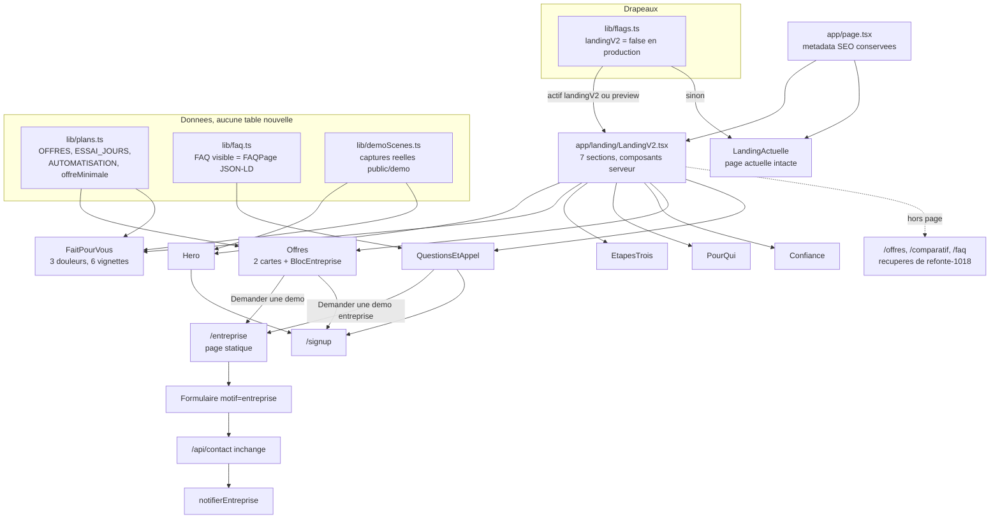

# Cadrage du PROMPT 4 — Refonte de la landing prestiapp.fr

Date : 01/11/2026. Lecture seule : aucun fichier du dépôt modifié, aucun build, aucun commit, aucun changement de branche.
Convention : **[V]** = lu au fichier:ligne pendant ce cadrage ; **[NV]** = non vérifié (déduit, ou impossible à vérifier sans build/navigateur/réseau).
Les lignes de `app/page.tsx` sont celles de l'arbre de travail (non commité) ; au commit HEAD, tout ce qui suit la ligne 26 est décalé de 8 lignes (le hero est à la l.168 dans HEAD, l.176 dans l'arbre de travail).

---

## 0. Cinq constats qui changent le plan

1. **Les « 12 fichiers non commités » sont en réalité 18, plus un fichier parasite.** `git status` : 9 fichiers suivis modifiés (hors `.orchestre/`, `.claude/`, workflows) et 9 fichiers neufs non suivis, tous datés du 27/10 (20 h 32 à 20 h 44). Ce sont deux choses mêlées : le **chantier SEO « devis »** (16 fichiers, cohérents entre eux) et **deux fichiers incidents** (`tsconfig.json`, `site-defaut.png`). Un fichier vide `!(c.lignes.length` (0 octet, 08/10) traîne à la racine : à ne jamais commiter. Détail au §1.5. Je n'ai pas pu reproduire le chiffre 12 par aucune combinaison.
2. **`landingV2` n'existe pas sur `main`.** `grep landingV2 lib/flags.ts` ne trouve rien ; il n'existe que sur la branche `refonte-1018` (`lib/flags.ts:194` de la branche), et **levé** (`true`) par un commit marqué TEMPORAIRE (`dedfd033`). La branche contient déjà une landing « Cinéma » à 10 sections, mais elle est vieille de 12 jours, mélangée à toute la console v2, et chevauche 17 fichiers que `main` a aussi modifiés depuis. Elle se **récupère fichier par fichier**, pas par fusion (§1.4).
3. **La base de performance n'est pas fiable.** Le TBT de 950 ms (ordinateur) et 2 900 ms (mobile) vient du 18/10, mesuré « machine chargée (CPU ≈ 70 %, moins de 600 Mo libres) », avec la mention « à titre indicatif » dans l'audit lui-même (`plans/refonte-1018/AUDIT.md`, §1.1). Benj a relevé 83-85 de performance mobile sur machine libre. **Aucune mesure de la page actuelle de `main` n'existe**, et la landing v2 de la branche n'a pas de TBT enregistré (seulement perf mobile 68 / ordinateur 97). La cible TBT < 200 ms doit se mesurer d'abord, sur machine au repos, avant toute promesse de gain.
4. **Le brief se contredit sur trois points** (tranchés par défaut au §3) : (a) la structure imposée du prompt (Hero, Problème, Comment, Fonctionnalités, Pour qui, Entreprise, CTA) ne laisse **aucune place aux tarifs, à la confiance ni à la FAQ**, alors que l'annexe 2 §3 propose une autre découpe de 7 qui les contient ; (b) le hero du prompt a **deux** boutons, l'annexe n'en veut **qu'un** ; (c) l'annexe 2 §4 bannit le mot « agent », mais le texte du bloc entreprise validé par Benj dit « connectons des agents IA à vos outils ».
5. **Une promesse écrite dans le travail SEO non commité est fausse pour Signature.** `app/logiciel-devis-artisan/page.tsx:36` répond « Non » à « Presti envoie-t-il les devis tout seul ? » et `public/llms.txt` dit « Le devis n'est jamais envoyé seul ». Or le Pilote automatique de Signature a un type `envoi_devis` : « Un devis préparé part seul — seulement si TOUS ses prix viennent de vos tarifs » (`lib/pilote/regles.ts:41`, garde `:154`), et `piloteAutomatique: true` (`lib/flags.ts:243`). La règle de Benj interdit « le devis envoyé seul **sous Studio** », pas sous Signature : le texte actuel sous-vend Signature et dit faux. À corriger avant de fusionner la branche SEO.

---

## 1. Inventaire

### 1.1 `app/page.tsx` : 14 balises `<section>` (15 blocs avec `BandeMots`)

Benj a raison : **14** `<section>`. Les audits du 18/10 comptent 15 parce qu'ils ajoutent `BandeMots` (composant, pas une `<section>`). Deux sont conditionnelles et toutes deux actives aujourd'hui : `confiance` sous `FLAGS.supportArtisan` (`lib/flags.ts:54`, vrai) et `maquette` sous `actif('prospectsEntrant')` (`lib/flags.ts:124`, vrai). **[V]**

| # | Bloc | Ligne (`app/page.tsx`) | Contenu | Poids mesuré à 390 px (18/10) |
|---|---|---|---|---|
| 1 | Hero | 176 | `<h1>` l.183 « Le premier qui répond décroche le chantier. », `ObjetVivant` (anneau WebGL, l.179), `HeroApp`, 3 puces | 1,22 écran |
| 2 | `BandeMots` | 207 | bande de mots (composant client) | 0,20 |
| 3 | Réassurance | 210 | Rapide, Fiable, Sécurisé, Sans carte | 0,50 |
| 4 | Preuve « 7× » | 222 | étude HBR (2 241 entreprises), source affichée | 0,55 |
| 5 | `#comment` | 235 | « La chaîne complète », 4 cartes empilées (`CHAINE`) | 3,51 |
| 6 | `#fonctionnalites` | 255 | `DemoSequence` (ou `DemoVideo` si `landingVideo`, baissé, `lib/flags.ts:66`), `DemoGestion` si assistant+CRM, `DemoSite` si `landingDemoSite` (levé, `:100`) | 3,58 |
| 7 | `#chiffres` | 266 | `DemoChiffres` | 1,36 |
| 8 | `#compta` (fond clair) | 275 | `DemoCompta` | 3,79 |
| 9 | `#pour-qui` | 285 | 4 métiers, 4 demandes types | 0,77 |
| 10 | `#confiance` (fond clair) | 303 | 4 cartes « ce qu'on s'interdit » | 0,82 |
| 11 | `#tarifs` | 322 | 2 offres (`OFFRES.map`), essai, crédits, tableau replié, bloc site 300 € | **7,71** |
| 12 | `#comparatif` | 376 | `ComparatifConcurrents` | **5,96** |
| 13 | `#maquette` | 386 | `MaquetteForm` (maquette de site, prospect entrant) | 1,55 |
| 14 | `#questions` | 403 | `FAQ.slice(0, 8)`, 8 questions | 1,20 |
| 15 | Appel final | 419 | `ObjetVivant` bis (l.420), « Essayer gratuitement » | 0,67 |

Tarifs + comparatif = 13,7 écrans sur 34,5, soit 40 % de la page sur téléphone (`AUDIT.md` §1.1). 11 liens « Essayer » vers `/signup`. **[V]** (mesures : lues dans `AUDIT.md`, non rejouées ; le 18/10 la landing comptait déjà 15 blocs).

Trois blocs JSON-LD sont dans la page : `FAQPage` sur `FAQ.slice(0, 8)` (l.130-135), `SoftwareApplication` (l.141-153), `Organization`/`WebSite` (l.162-165). **Le `FAQPage` doit rester identique aux questions visibles** (règle Google, et `scripts/geo-presti-qa.mjs`) : réduire la FAQ visible impose de réduire le balisage. **[V]**

Ancres entrantes à ne pas casser : `PublicNav.tsx:17-22` (`/#fonctionnalites`, `/#tarifs`, `/faq`, `/contact`) ; `PublicPied.tsx:18` (`fonctionnalites`, `chiffres`, `compta`, `tarifs`). Les ancres `#chiffres` et `#compta` disparaîtront avec les sections : le pied de page doit être réécrit dans le même commit. **[V]**

Client / serveur : composants `'use client'` sur la landing : `ObjetVivant`, `Motion`, `HeroApp`, `DemoSequence`, `DemoGestion`, `DemoSite`, `DemoCompta`, `BandeMots`, `MaquetteForm`, `PublicNav`. `DemoChiffres`, `Comparatif`, `OffreDetail` ne le sont pas. `Motion.tsx:63` charge GSAP en `import()` dynamique. `ObjetVivant` est un shader WebGL brut, sans bibliothèque (`ObjetVivant.tsx:1-14`) : ce n'est pas `three`, mais il tourne en `requestAnimationFrame` deux fois sur la page. **[V]** Le coût réel de chaque poste en TBT : **[NV]**.

### 1.2 Styles, nav, pied

- `app/globals.css` : 3 095 lignes, **304 règles `.lp-`** ; `app/accueil.css` : 120 lignes, 88 règles `.lp-`. La landing partage le fichier avec la console. **[V]** (comptage `grep -c`)
- Charte : fond `#0A0C11`, corail `#D97757`, vert `#38CD8C` réservé à « validé », aucun bleu ni cyan (annexe 1 §D ; skill `presti-design`). Les sections claires existantes sont `lp-clair` (`compta`, `confiance`). **[V]** pour les classes, **[NV]** pour les couleurs exactes (non relues dans le CSS).
- Le tiroir mobile de `PublicNav` vient d'être corrigé (29/10, commentaire en tête de rendu, a51a12a8) : ne pas le refaire. **[V]**

### 1.3 Offres et promesses vraies aujourd'hui (`lib/plans.ts`, `lib/plateformeConfig.ts`)

| Fait | Source | État |
|---|---|---|
| Studio 59 €/mois, 250 crédits ; Signature 99 €/mois, 600 crédits | `lib/plans.ts:98-99` | [V] |
| Essentiel hérité, **plus vendu** (comptes hérités seulement) | `lib/plans.ts:12-14`, `:97` | [V] |
| Business = interne (0 €, 100 000 crédits) | `lib/plans.ts:101` | [V] |
| Essai sans carte : **7 j Studio, 21 j Signature** | `ESSAI_JOURS`, `lib/plans.ts:108` | [V] |
| Seules `OFFRES` (Studio, Signature) alimentent les cartes | `lib/plans.ts:151` | [V] |
| `offreMinimale(capacité)` donne la plus petite offre qui a une capacité | `lib/plans.ts:139` | [V] |
| Texte d'automatisation par offre | `AUTOMATISATION`, `lib/plans.ts:205-207` | [V] |
| Mode de réponse **par défaut = assistée** | `lib/plateformeConfig.ts:45` | [V] |
| `modeEffectif` rétrograde en assistée, motif `verrou_offre`, sous Studio | `lib/plateformeConfig.ts:183-184` | [V] |
| Réponse autonome, relances de conversation et d'impayés automatiques : **Signature** | `lib/plans.ts:77-89` (`plateforme.ia.auto`, `relances.auto`, `factures.relances.auto`) | [V] |
| Assistant de gestion : **Studio** (`'assistant'`, l.75) | `lib/plans.ts:75` | [V] |
| **CRM : Signature seulement** (`'crm'`, l.86) | `lib/plans.ts:86` | [V] |
| Pilote automatique (envoi seul après 10 min d'annulation) : Signature | `lib/plans.ts:89`, `lib/pilote/regles.ts:33-41` | [V] |
| Inventaire : stock + recherche IA fournisseurs dès Studio ; **OCR baissé** | `lib/plans.ts:56-75`, `lib/flags.ts:56` (`inventaireOcr: false`) | [V] |
| WhatsApp, réseaux : baissés | `lib/flags.ts:70`, `:72` | [V] |
| Organisations multi-membres | aucune trace dans `lib/flags.ts` ni `lib/plans.ts` ; `grep` des migrations : seulement des fichiers jumeaux `_NU` sortis du motif, pas de table dédiée relevée | [NV] sur les migrations |
| « Architecte » comme métier modélisé | absent de `METIERS` (`lib/agents/acquisition/contrat.ts:712-724`, 11 métiers du bâtiment) | [V] |
| « Presti pour l'entreprise » (texte, page, drapeau) | **n'existe nulle part** dans `app/`, `lib/`, `plans/`, `docs/` (`grep`), ni dans le vault ni dans `presti-ops/QG/` | [V] |

Conséquences pour les six « fonctionnalités essentielles » du prompt : *Devis assistés par IA* (vrai, Studio+), *Factures et relances* (vrai ; relances « préparées, vous validez » en Studio, « elles partent seules » en Signature, `lib/plans.ts:226-240`), *CRM clients* (**Signature seulement**, à étiqueter), *Inventaire* (stock et recherche fournisseurs, **pas d'OCR**), *Documents centralisés* (**aucune capacité de ce nom** : voir Q5), *Assistant de gestion* (Studio+).

### 1.4 La branche `refonte-1018` : récupérable, mais pas fusionnable

- Existe en local (`git branch`), 37 commits d'avance sur la base commune `74aa7060` (19/10/2026 05 h 53) ; `main` a 19 commits d'avance sur la même base. Sa tête : `c9215381` (19/10 14 h 50). Branche sœur `refonte-1018-pages` (40 fichiers, `/offres` et `/comparatif` par Codex). **[V]**
- Contenu pour la landing (de `git diff --stat main...refonte-1018`) : `app/landing/LandingV2.tsx` (353 l.), `app/landing/landing-v2.css` (153 l.), `app/offres/page.tsx` (102 l.), `app/comparatif/page.tsx` (43 l.), `lib/demoScenes.ts` (43 l.), `components/ui/{Slides,Onglets,Carrousel,…}`, `app/faq/page.tsx` refaite, scripts de mesure `refonte-*.mjs`, et les 6 documents `plans/refonte-1018/`. Le reste (≈ 60 fichiers) est la **console v2** : hors sujet ici. **[V]**
- La landing v2 est « Cinéma » à **10 sections** (hero, preuve, comment, fonctionnalités à onglets, pour qui, confiance, tarifs, maquette, questions, final), `AVANCEMENT.md` : −55 % de hauteur en 1440, −50 % en 390 (17,2 écrans), 2 liens « Essayer », axe 0 violation, Lighthouse (avant `content-visibility`) mobile **68** / a11y 100, ordinateur **97** / a11y 100, mesure faite sur la prévisualisation Vercel en mouvement réduit. Le SEO y vaut 0 (en-tête `noindex` Vercel, attendu). **[V]**
- `/offres` et `/comparatif` de la branche se cachent en production tant que `landingV2` est baissé (`notFound()` si `!actif('landingV2') && VERCEL_ENV === 'production'`). **[V]**
- **Pièges** : (1) le commit `dedfd033` lève `landingV2` en dur « à retirer par `git revert` avant fusion » (`lib/flags.ts:192-194` de la branche) ; idem `3abfb98a` pour `consoleV2`. (2) 17 fichiers modifiés des deux côtés depuis la base, dont `app/page.tsx`, `app/globals.css`, `app/PublicNav.tsx`, `app/DemoSequence.tsx`, `lib/flags.ts`, `lib/faq.ts`. Sur ces 17, `app/page.tsx` et `app/globals.css` sont aussi dans l'arbre de travail non commité : triple chevauchement. (3) Les 10 sections de la v2 ne sont pas les 7 demandées. (4) `main` a bougé : Next 16.4.3, assistant qui agit, essai Studio à 7 jours. **[V]**
- Le dossier `C:\Users\benja\Documents\presti-refonte` (où la branche a été travaillée) et `presti-ops\refonte-1018\` (planches avant/après, captures) existent. Les prévisualisations Vercel : **[NV]** (réseau).
- **Verdict** : récupérable comme *matière* (fichiers `app/offres`, `app/comparatif`, `lib/demoScenes.ts`, les idées de `landing-v2.css` : pas de verre sur le texte, aube en CSS à la place du WebGL), pas comme *base de merge*. Un `git cherry-pick` des commits de landing rejouerait les conflits sur `page.tsx`/`globals.css`/`flags.ts` et risque d'embarquer la console v2 ou les commits TEMPORAIRES.

### 1.5 Les fichiers vitrine / SEO non commités (arbre de travail du 01/11, tout daté du 27/10)

Fichiers suivis modifiés (`git diff --stat`, 9) :

| Fichier | Diff | Ce que ça fait | Statut |
|---|---|---|---|
| `app/page.tsx` | +9/−1 | `metadata` : titre absolu « Presti — Logiciel de devis artisan, réponses préparées par l'IA », description 160 signes environ, `canonical: '/'` | SEO, garder |
| `app/Breadcrumb.tsx` | +7/−5 | prop `parents` : fil d'Ariane à 3 niveaux et `BreadcrumbList` générés | SEO, garder |
| `app/PublicPied.tsx` | +1 | nouvelle colonne « Ressources » (4 liens) | à **recomposer** avec la nouvelle landing (le pied a 5 colonnes) |
| `app/globals.css` | +1/−1 | `.lp-foot-haut` : 5 colonnes (1,5fr + 4×1fr) | suit le pied |
| `app/sitemap.ts` | +4 | ajoute `PAGES_DEVIS` et `METIERS_DEVIS` (priorité 0,9 et 0,7) | SEO, garder |
| `public/llms.txt` | +24/−5 | faits vérifiables, prix, essais, liens vers les 4 pages « devis » | SEO, **à corriger** (constat 5) |
| `scripts/geo-presti-qa.mjs` | +14 | GE-5 : `llms.txt` doit dire les prix et les essais de `lib/plans.ts` | garder ; **n'est pas au lanceur** (voir §7) |
| `tsconfig.json` | +2/−1 | ajoute `.next-prod/dev/types/**/*.ts` à `include` | incident d'environnement, hors vitrine |
| `site-defaut.png` | binaire | image régénérée | hors vitrine |

Fichiers neufs non suivis (9) : `app/SeoBlocs.tsx`, `app/ressources.css` (13 Ko), `app/generateur-devis/{page.tsx, Generateur.tsx}` (20 Ko), `app/comment-faire-un-devis/page.tsx`, `app/modele-devis/page.tsx`, `app/modele-devis/[metier]/page.tsx`, `app/logiciel-devis-artisan/page.tsx`, `lib/seoDevis.ts` (255 l.). Elles lisent bien les prix dans `lib/plans.ts` (`OFFRES`, `ESSAI_JOURS`, `PLANS`, `AUTOMATISATION`) : pas de prix en dur dans les pages (`grep`). **[V]**

Parasites à exclure de tout commit vitrine : `!(c.lignes.length` (0 octet), `.orchestre/*`, `.claude/*`, `.claude/workflows/*`, `tsconfig.json`, `site-defaut.png`, et la centaine de fichiers non suivis qui n'ont aucun rapport (`docs/`, `scripts/` d'agents, `public/promo/`, `plans/refonte-1018/` : ce dernier est un doublon non suivi de celui de la branche). **[V]**

**[NV]** : ces 16 fichiers SEO compilent-ils (`typecheck`/`build`) ? Aucun build n'est permis ici ; à faire à la phase 0.

### 1.6 Pages voisines

- `/offres`, `/comparatif` : **404 sur `main`** (n'existent que dans la branche). `/tarifs` est l'écran console « Mes tarifs » (`app/tarifs/page.tsx`), pas une page publique. **[V]**
- `/contact` (`app/contact/page.tsx` + `Formulaire.tsx`) : champs nom, email, message, piège à robots ; route `app/api/contact/route.ts` (limitation stricte, notifie `EMAIL_ENTREPRISE`). **Aucun champ « motif »**. **[V]**
- `app/maquette/[jeton]` existe : lien de maquette envoyé aux prospects, non lu. **[NV]**
- `MaquetteForm` (section `#maquette`) est branché sur le prospect entrant (route 026-145) avec mention « Une seule demande par entreprise… STOP » (`page.tsx:393`) : **ce n'est pas un formulaire de démonstration entreprise**. **[V]**

### 1.7 Mesures de performance existantes

| Date | Cible | Mesure | Conditions | Source |
|---|---|---|---|---|
| ~08-09/09 | prod, commit `8f40d0d` | mobile **90**, a11y 100 ; avant A1.8 : 78 | machine non précisée | `plans/journal-final.md:178-198` |
| 18/10 | prod, commit `8ade943` | mobile perf **42** (LCP 5,0 s, **TBT 2 900 ms**, CLS 0) ; ordinateur **62** (LCP 1,2 s, **TBT 950 ms**) ; a11y 99/96 ; BP 100 ; SEO 100 | CPU ≈ 70 %, < 600 Mo libres, « indicatif » | `plans/refonte-1018/AUDIT.md` §1.1 |
| 18/10 | idem, par Benj | mobile perf **83-85** | machine libre | idem |
| 19/10 | landing v2 (branche), prévisualisation | mobile **68** / a11y 100 ; ordinateur **97** / a11y 100 ; TBT non noté | mouvement réduit, avant `content-visibility` | `AVANCEMENT.md` de la branche |

Outils : `scripts/sonde-lighthouse.mjs [url] [--desktop]` (une passe, détail des postes) ; `lighthouse-mediane.mjs` (5 passes, médianes, barre TBT < 200 ms) **mais seulement sur un dossier statique avec `index.html`** : inutilisable tel quel sur une app Next ; `budget-perf.mjs` (poids JS des routes `/site` et `/p`, **pas de la landing**) ; `scripts/mobile-e2e.mjs` (Lighthouse mobile sur 4 pages dont `/`, exige perf ≥ 90). Pas de mesure datée de la page `main` actuelle. **[V]** pour l'existence ; mesures de ma part : aucune.

---

## 2. Les 14 sections actuelles → 7 au plus

Structure retenue par défaut (celle de l'annexe 2 §3, car c'est la seule qui contient les tarifs, la confiance et la FAQ ; le **Problème** du prompt y devient l'attaque de la section 2, et l'**Entreprise** devient un bloc distinct de la section 6). Le prompt précise « en cas de doute : la consigne ci-dessus passe avant » : la variante stricte du prompt est donnée en alternative (Q1).

| Nouvelle section | Message unique | Reprend (actuel) | Sort ou fusionne |
|---|---|---|---|
| **1. Hero** | « Votre gestion d'artisan, simplifiée par l'IA » + une phrase vraie + un seul bouton | hero, réassurance (réduite à 3 puces : sans carte, résiliable, vos données isolées) | **supprime** `BandeMots` (2), `ObjetVivant` (WebGL), les 3 puces flottantes, la version longue du chapeau |
| **2. Ce que Presti fait à votre place** | trois douleurs → ce qui est préparé pour vous (6 vignettes) | `#fonctionnalites` (démo), `#chiffres`, `#compta`, la preuve « 7× » comme unique ligne sourcée de la douleur 1 | `#chiffres` et `#compta` deviennent des vignettes ; les démos animées pleine largeur partent sur `/offres` ou sous-pages |
| **3. Comment ça marche** | trois temps | `#comment` (4 cartes empilées → 3 étapes) | la carte « Ensuite » (relances, facture, compta) passe dans la section 2 |
| **4. Pour qui** | artisans, TPE du bâtiment, multi-chantiers, architectes, entreprises | `#pour-qui` (4 métiers) | les 4 « demandes types » sortent ; architectes et entreprises renvoient vers le bloc entreprise |
| **5. Confiance** | « Vos données, votre marque devant vos clients » | `#confiance` (fond clair, 4 cartes) | texte resserré à 3 cartes ; le détail (« la porte naît fermée ») va sur `/faq` ou une page `/confiance` |
| **6. Offres + Presti pour l'entreprise** | deux offres, puis un bloc distinct sans prix | `#tarifs` : 2 cartes seulement (prix, essai, une ligne d'automatisation, 4 puces) | **sortent** : explication des crédits, tableau « qui a quoi », bloc site 300 € → `/offres` |
| **7. Questions + appel final** | 5 questions, puis « Créer mon compte » / « Demander une démo entreprise » | `#questions`, appel final | **sortent** : `#comparatif` → `/comparatif`, `#maquette` → page dédiée (la route entrante reste branchée) ; le lien « maquette » de l'appel final aussi |

Hauteur visée (hypothèse à valider par la maquette, non sourcée) : ≤ 12 écrans à 390 px (contre 34,5 ; la v2 de la branche atteignait 17,2 avec 10 sections).

Les contenus qui quittent la page restent sur le site, à adresses stables : `/offres` (grille complète, crédits, tableau, site 300 €, démos chiffres et compta), `/comparatif`, `/faq`, `/entreprise` (nouveau), `/maquette-site` ou équivalent pour `MaquetteForm` (nom à fixer ; **[NV]** l'effet SEO de déplacer `#maquette`).

---

## 3. Questions bloquantes, chacune avec sa réponse par défaut

| # | Question | Défaut (appliqué si Benj ne répond pas) |
|---|---|---|
| **Q1** | Structure : variante **stricte du prompt** (Hero, Problème, Comment, Fonctionnalités, Pour qui, Entreprise, CTA ; tarifs et FAQ renvoyés à `/offres` et `/faq`) ou variante **annexe 2 §3** (tarifs + confiance + FAQ dans les 7) ? | **Annexe 2 §3** (§2). Raison : sans prix ni FAQ sur la page, le bouton « Essayer » perd son contexte (7 jours / 21 jours, sans carte) et le balisage `FAQPage` de l'accueil disparaît. La variante stricte reste faisable en retirant la section 5 et en repliant la section 6 en un bandeau. |
| **Q2** | Hero : un bouton (annexe) ou deux (prompt) ? | Un bouton principal « Essayer gratuitement » + « Presti pour l'entreprise » en **lien texte** juste dessous (pas un bouton). Respecte « un seul appel à l'action principal » et la présence du CTA secondaire. |
| **Q3** | Promesse du H1. Les deux phrases du prompt contiennent chacune un non-vérifiable : « en quelques minutes » (aucune preuve datée ; la preuve de `plans/promesses.md` #1 est « réponse en moins d'une minute ») et « Laissez l'IA gérer les relances » (vrai en Signature ; en Studio les relances sont préparées et validées). | H1 : **« Votre gestion d'artisan, simplifiée par l'IA. »** (aucune affirmation à prouver). Sous-phrase : « Chaque demande a sa réponse prête en moins d'une minute, le devis est chiffré sur vos prix, les relances sont prévues. Vous validez d'un clic, ou Signature envoie seul. » L'ancien H1 « Le premier qui répond décroche le chantier » devient l'accroche de la douleur 1. Le mot « automatique » se dit dans la section 2 et la 6 (décision 25/10). |
| **Q4** | Tutoiement ou vouvoiement ? Le prompt tutoie dans les étapes (« Décris… Tu valides »), l'ensemble du site vouvoie. | **Vouvoiement** partout : cohérent avec la FAQ, les e-mails et le ton « professionnel » demandé. |
| **Q5** | « Documents centralisés » : aucune capacité de ce nom dans `lib/plans.ts`. Les candidats qui existent sont le dépôt de fichiers de compta (`DemoCompta`, capacité `chiffres`, Studio+) et les pièces de chantier (Signature, `PLAFOND_PIECES_CHANTIER_MO`). | Vignette **« Compta et fichiers rangés »** (dépôt de relevés, l'IA classe, les montants sont calculés), étiquetée Studio. Si Benj pense à autre chose, on l'écrit avant la maquette. |
| **Q6** | CRM et Pilote sont **Signature seulement** ; l'inventaire n'a pas d'OCR. Faut-il les montrer sans étiquette ? | Vignette CRM marquée « Signature » (étiquette lue par `offreMinimale('crm')`) ; vignette inventaire = stock + recherche fournisseurs, sans OCR. Rien d'autre derrière un drapeau baissé. |
| **Q7** | Le bloc entreprise : où mène « Demander une démo » ? Le prompt propose `/contact` ou `MaquetteForm`. `MaquetteForm` est un formulaire de prospect entrant pour une maquette de site (mentions STOP, une demande par entreprise) : inadapté. `/contact` n'a pas de motif. | Nouvelle page statique **`/entreprise`** : trois phrases, aucune fonction d'équipe annoncée, le même `Formulaire` avec un prop `motif="entreprise"` qui préfixe le message « [Démo entreprise] » (aucune migration, aucune modification de `/api/contact`). Pas de `searchParams` sur `/contact` (la rendrait dynamique). |
| **Q8** | « Agents IA » : le bloc entreprise validé le dit, l'annexe 2 §4 bannit le mot. | Phrase de Benj **gardée mot pour mot dans ce bloc seulement** (décision E du 01/11, cible : décideurs) ; le mot est interdit partout ailleurs, et le test le vérifie. C'est une promesse de service sur mesure, pas une fonction livrée : le bloc dit « nous intégrons », pas « vous pouvez ». |
| **Q9** | Aperçu avant le « oui » : `landingV2` est un drapeau **global** (constante de `lib/flags.ts`), donc la « page publique reste l'ancienne » jusqu'à un commit. Comment Benj voit-il la v2 ? | Sur la **prévisualisation Vercel de la branche**, où la v2 s'affiche d'office (`actif('landingV2') \|\| VERCEL_ENV === 'preview'`) sans commit « TEMPORAIRE » à ne pas oublier de retirer (le piège de `dedfd033`). En production, `landingV2: false` jusqu'au « oui ». |
| **Q10** | Ordre d'intégration du chantier SEO non commité. | Branche à part → build vert + corrections (constat 5) + juges → **Benj dit oui** → merge sur `main` *avant* la landing. Il change déjà le titre et la description de l'accueil : ce sont des changements publics, donc soumis à son accord. |
| **Q11** | Visuel du hero : vidéo (`landingVideo`, baissé ; `/demo/hero.mp4` existe) ou capture ? | **Pas de vidéo** (PR-8 de `promesses-qa` exige un fichier `textes.json` par vidéo ; coût de poids sur mobile). Une capture réelle de `lib/demoScenes.ts` (`public/demo/scene-*.webp`) + un mouvement CSS court (≤ 1 s, après affichage). |

Non bloquant, noté pour la maquette : preuve « 7× » (source HBR affichée, gardée en une ligne sous la douleur 1) ; aucun témoignage, aucun logo, aucun compteur ; toute maquette d'artisan fictif porte « Exemple. » ; les architectes sont nommés dans « Pour qui » et renvoyés vers `/entreprise` sans prétendre que le produit libre-service leur est adapté (« architecte » n'est pas dans les métiers modélisés).

### Trois directions créatives (pour que Benj choisisse avant le code)

- **A. « Cinéma sobre »** (recommandée : piste B de `DIRECTION.md`, choix de Benj du 19/10) : nuit chaude, titres très grands, **aube corail en dégradé CSS** qui monte au fil des sections, sections 5 et 6 en fond clair, captures réelles inclinées une seule fois dans le hero ; **sans verre** sur les cartes de texte, sans WebGL.
- **B. « Atelier clair »** : alterne sections sombres et claires à parts égales, plus proche d'un site de logiciel de gestion classique ; contraste garanti, plus lisible en plein soleil, moins distinctive.
- **C. « Film produit »** : une seule scène qui change au défilement (la demande de 22 h 14 devient le devis de 7 h 52), texte réduit à un mot par plan. Le plus fort, le plus coûteux en TBT, le plus difficile à garder vrai (chaque geste doit exister dans le code).

---

## 4. Architecture

Composants (dossier `app/landing/`, préfixe `lp2-` repris de la branche) :

- **Serveur par défaut** : toutes les sections sont des composants serveur ; aucun `'use client'` sauf `PublicNav` (existant) et un petit îlot pour une animation de hero chargée après affichage (`requestIdleCallback`, absent si `prefers-reduced-motion`).
- **Réutilisés** : `PublicNav`, `PublicPied` (recomposé), `OffreDetail` (liste des capacités d'une offre, déjà lue depuis `lib/plans.ts`), `Formulaire` (prop `motif`).
- **Nouveaux** : `Hero`, `FaitPourVous`, `EtapesTrois`, `PourQui`, `Confiance`, `Offres` + `BlocEntreprise`, `QuestionsEtAppel`, `Reveal` (CSS pur, sans GSAP). Les démos lourdes (`DemoSequence`, `DemoGestion`, `DemoSite`, `DemoCompta`) ne sont **pas** importées par la landing.
- **Aucun prix écrit à la main** : la section 6 itère sur `OFFRES` et affiche `ESSAI_JOURS[o.id]` ; les phrases d'automatisation viennent de `AUTOMATISATION` ; l'étiquette « Signature » du CRM vient de `PLANS[offreMinimale('crm')].label`. Le test (§6) interdit tout motif `\d+\s?€` en dehors de ces appels.
- **CSS** : `app/landing/landing-v2.css` chargé uniquement par `LandingV2` (la branche le fait déjà) ; les 304 règles `.lp-` de `globals.css` ne bougent pas (l'ancienne page en dépend).
- **JSON-LD** : `FAQPage` généré depuis la même liste que les questions affichées ; `SoftwareApplication` gardé ; `Organization`/`WebSite` gardés. Un seul `h1`.
- **Le bloc entreprise** : composant distinct (fond différent, sans prix, un bouton), texte de Benj tel quel.

---

## 5. Données

- **Aucune table, aucune migration, aucune route nouvelle.** `/entreprise` réutilise `/api/contact`.
- Lues dans le code : `lib/plans.ts` (prix, crédits, essais, automatisation, capacités), `lib/faq.ts`, `lib/demoScenes.ts` (récupéré de la branche), `lib/flags.ts` (lecture de `landingV2`).
- **Un seul ajout de code partagé** : le drapeau `landingV2: false` dans `lib/flags.ts` (avec son commentaire d'ordre : *colle puis lève* ne s'applique pas ici, aucune migration).
- Ce qu'on ne crée pas : compteur de clients, avis, logos, témoignages. La seule statistique est la ligne HBR déjà sourcée (`page.tsx:224-227`).
- Mesure d'audience : la landing est déjà suivie par le Poste de contrôle (suite `audience-e2e`, « liste fermée de pages ») ; ajouter `/entreprise`, `/offres`, `/comparatif` à cette liste est à vérifier **[NV]** (`scripts/audience-e2e.mjs` et la route associée non lus).

---

## 6. Plan en phases vérifiables

Règles de ce plan : sous-agents sans `next build` ni `next dev` ; build et push par l'agent principal ; chaque phase finit par une preuve (sortie de commande) ; aucune publication sans « oui » de Benj.

**Phase 0 : sauvegarder et isoler les 16 fichiers SEO (branche `vitrine-seo-2710`)**
1. Filet de sécurité hors dépôt : `git diff > <scratchpad>/vitrine.patch` + copie des 9 fichiers neufs. Preuve : taille et `sha256` des copies.
2. `git switch -c vitrine-seo-2710` (les modifications suivent, aucun conflit puisqu'on part de `main`) ; `git add` **nommé** des 16 fichiers SEO (jamais `-A`) ; `tsconfig.json`, `site-defaut.png`, `!(c.lignes.length`, `.orchestre/`, `.claude/` restent hors du commit. Preuve : `git status --short` ne montre plus que les parasites.
3. Corriger le constat 5 (« Non » → texte vrai pour Studio *et* Signature : Pilote, délai de 10 minutes, prix sourcés) dans `app/logiciel-devis-artisan/page.tsx` et `public/llms.txt`.
4. Preuves : `npm run typecheck`, `node scripts/geo-presti-qa.mjs`, `node scripts/seo-e2e.mjs`, `node scripts/promesses-qa.mjs`, puis `PRESTI_DIST=.next-prod npx next build` par l'agent principal (le pré-commit husky rejoue typecheck et `garde-commit`).
5. **Inscrire `geo-presti-qa.mjs` et `promesses-qa.mjs` au tableau `SUITES`** de `scripts/tout-verifier.mjs` (aujourd'hui `grep -i promesse|geo` n'y trouve rien : ni en `SUITES`, ni en `HORS_LANCEUR`, donc jouées par personne ; GE-5, qui garde les prix de `llms.txt`, n'a jamais tourné au lanceur). Mutation prouvée pour chaque (faire rougir exprès).
6. **Porte : Benj dit oui** → merge sur `main`, `node scripts/attendre-deploiement.mjs`, vérification en direct des 4 pages et du sitemap. Sinon la branche attend ; la phase 1 empile dessus.

**Phase 1 : socle de la landing (branche `landing-v2`, issue de `vitrine-seo-2710` ou de `main` après merge)**
1. Ajouter `landingV2: false` à `lib/flags.ts`.
2. Récupérer de `refonte-1018` **par fichier** (`git show refonte-1018:<chemin> > <chemin>`, pas de cherry-pick) : `app/offres/page.tsx`, `app/comparatif/page.tsx`, `lib/demoScenes.ts`, et lire `app/landing/landing-v2.css` comme référence (ne pas importer `LandingV2.tsx` : 10 sections, onglets, maquette).
3. Remplacer le garde-fou de ces deux pages par `actif('landingV2') || VERCEL_ENV !== 'production'` (même règle qu'en Q9).
4. Preuve : `typecheck` vert, `/offres` et `/comparatif` répondent 404 en production tant que le drapeau est baissé.

**Phase 2 : maquette et choix de direction (aucun code applicatif)**
1. Trois maquettes HTML statiques (A, B, C du §3), 1440 et 390 px, texte complet des 7 sections (titres, sous-phrases, 6 vignettes, 3 étapes, 5 questions, microcopy des boutons).
2. Contrôle mécanique : axe (contraste AA), 0 px de défilement horizontal en 390, un seul `h1`, aucun bleu ni cyan (le contrôle de `presti-design`).
3. **Porte : Benj choisit la direction** et valide les réponses par défaut du §3.

**Phase 3 : mesure de départ (avant d'écrire la landing)**
1. Sur machine au repos (RAM libérée, aucun build parallèle) : `next start` sur un build isolé (`PRESTI_DIST=.next-prod`, port dédié), `node scripts/sonde-lighthouse.mjs http://localhost:<port>/` et `--desktop`, **5 passes, médiane**, en notant l'état de la machine. C'est la première base fiable de la page actuelle.
2. Faire de même sur la prévisualisation de la v2 de la branche (matière de comparaison).
3. Preuve : un fichier daté de mesures (médianes TBT/LCP/CLS, mobile et ordinateur) commité avec le plan.

**Phase 4 : construction derrière le drapeau**
1. `app/page.tsx` : `export default function Home() { return actif('landingV2') ... ? <LandingV2 /> : <LandingActuelle /> }` (patron de la branche), `metadata` inchangées (celles de la branche SEO).
2. Sections 1 à 7 une par une, chacune commitée seule et compilable. Pied de page réécrit (ancres `chiffres` et `compta` retirées), `/entreprise` créée, `Formulaire` reçoit `motif`.
3. Aucun import de `ObjetVivant`, `Motion` (GSAP), `Demo*`, `BandeMots`, `MaquetteForm`.
4. Preuve par section : `typecheck`, build par l'agent principal, capture 390 et 1440.

**Phase 5 : tests qui rougissent, inscrits au lanceur** (`scripts/landing-v2-qa.mjs`, hors ligne, avec sabotages en mémoire)
- 7 sections au plus (comptage des `<section>` rendues, sabotage : en ajouter une) ;
- aucun prix en dur (motif `\d+\s?€` hors lecture de `lib/plans.ts` ; sabotage : « 59 € » dans le JSX) ;
- aucune promesse interdite (liste de l'annexe 1 §F : appel téléphonique, rendez-vous pris seul, notification, devis seul sous Studio, paiement encaissé par l'IA, WhatsApp, réseaux, OCR) ;
- aucun mot technique (agent hors du bloc entreprise, n8n, Supabase, MCP, ReAct, workflow, LLM) ;
- aucun bleu ni cyan dans `landing-v2.css` ;
- un seul `h1` ; chaque lien et bouton pointe vers une route existante (`/signup`, `/entreprise`, `/faq`, `/offres`, `/comparatif`, ancres présentes) ;
- `FAQPage` = questions visibles ; « Exemple. » sur toute maquette fictive ;
- avec le drapeau baissé, la page rend l'ancienne landing (sabotage : lever le drapeau dans l'arbre de test).
- **À retoucher parce qu'elles lisent `app/page.tsx`** : `maquette-formulaire-qa.mjs` (MF-1 attend `#maquette` dans `page.tsx`), `essais-gratuits-qa.mjs:497` (`data-payer-direct` dans `page.tsx`), `aide-automatique-qa.mjs:57-59` (badges), `promesses-qa.mjs` (PR-7 explore `page.tsx` sur trois niveaux d'imports : couvre la v2 si elle en est importée ; PR-9 parle des crédits « comme la landing »), `refonte-vitrine-qa.mjs` (non suivi, non inscrit, teste l'ancienne structure). Un test vert ne prouve que ce qu'il regarde : tant que ces suites lisent `LandingActuelle`, elles ne disent rien de la v2.

**Phase 6 : performance, jusqu'à l'objectif**
Cible : **TBT mobile < 200 ms**, LCP < 2,5 s, CLS < 0,1 (annexe 2 §5 ; même budget que `plans/cerveau-site.md`), mesurée comme en phase 3. Leviers par ordre d'effet probable **[NV]** (aucun profil n'a été fait) : retirer `ObjetVivant` ×2 (WebGL en `rAF`), retirer GSAP et `Motion`, ne plus hydrater les 9 composants clients, `content-visibility: auto` sous la ligne de flottaison (commit `49f7bff8` de la branche), image de hero en AVIF/WebP à dimensions fixes avec `fetchpriority="high"`, une seule police chargée en `display: swap` (Bricolage Grotesque ; Hanken et JetBrains Mono seulement si utilisées), animation CSS `transform/opacity` uniquement. Chaque levier est mesuré seul : un levier sans effet mesuré n'est pas gardé. Si l'objectif n'est pas atteint, on le dit avec la médiane obtenue.

**Phase 7 : vérification en direct sur la prévisualisation, puis audit distinct**
1. Prévisualisation Vercel de la branche : routes 200, DOM et CSS inspectés, 390 et 1440, captures avant/après (même script que `scripts/refonte-avant-landing.mjs`, déjà au dépôt, non suivi).
2. Lighthouse médiane (5 passes) ; axe ; navigation clavier ; `prefers-reduced-motion` ; `sitemap.xml` ; `curl` de `/llms.txt`.
3. **Sous-agents distincts de celui qui a écrit** : un pour les promesses (relit chaque phrase contre `lib/plans.ts`, `plans/promesses.md`, la liste d'interdits), un pour l'accessibilité et la performance, un pour le SEO (anchors, H1, JSON-LD, redirections).

**Phase 8 : mise en ligne, sur le « oui » de Benj seulement**
1. Merge sur `main` avec le drapeau **baissé**, `npm run build`, push, `node scripts/attendre-deploiement.mjs`, `/` encore ancienne en production.
2. Levée = un commit `landingV2: true` (c'est une constante : « lever le drapeau » est un déploiement), puis `attendre-deploiement`, vérification en direct, Search Console. Retour arrière = `git revert` de ce commit.
3. Notes de décision dans le vault (§9) ; ligne dans `plans/promesses.md` pour toute phrase nouvelle ; mise à jour du `contexte.md`.

---

## 7. Risques

**SEO**
- *H1 et mots-clés* : la branche SEO vise « logiciel de devis artisan » dans le `<title>` et la description (`page.tsx`, titre absolu), le H1 proposé est une promesse. Le mot-clé doit rester dans le titre, la méta, un `h2` et la section 6 ; ne pas le supprimer avec les sections.
- *Ancres et liens internes* : `#chiffres` et `#compta` disparaissent ; le pied, `llms.txt` (qui cite `/#tarifs` dans l'ancienne version) et d'éventuels liens externes doivent être mis à jour ; garder les ids `fonctionnalites`, `tarifs`, `questions`, `comment`, `pour-qui`, `confiance`.
- *`FAQPage`* : si la FAQ visible passe de 8 à 5 questions, le JSON-LD aussi (sinon contenu invisible balisé) ; `geo-presti-qa.mjs` le vérifie, mais **n'est pas au lanceur** tant que la phase 0 ne l'y met pas.
- *Contenu retiré* : moins de texte sur l'accueil, donc plus de poids pour les nouvelles pages « devis » (`/logiciel-devis-artisan`, 0,9) ; vérifier qu'elles ne cannibalisent pas l'accueil sur la même requête (titres distincts).
- *Pages déplacées* : `/offres`, `/comparatif` neuves ; sitemap à jour ; `canonical` posés (la branche le fait déjà).
- *Environnement* : `noindex` Vercel sur les prévisualisations : le SEO ne se juge que sur la production.

**Promesses non tenues**
- *Studio ≠ Signature* : toute phrase « l'IA gère / envoie / relance » est vraie en Signature seulement ; en Studio « prépare, vous validez ». La section 2 étiquette chaque vignette par l'offre minimale (CRM : Signature).
- *Faux « Non »* sur l'envoi de devis (constat 5) : dire « Studio : jamais sans vous. Signature : seulement si vous l'activez, après 10 minutes pour annuler, et jamais avec un prix estimé ».
- *« Quelques minutes »* et *« premier qui répond décroche le chantier »* : non prouvés comme chiffres propres à Presti (la seule source est HBR, étude américaine sur les prospects, citée comme telle). Ne pas les reprendre sans la source affichée.
- *Entreprise / architectes* : les organisations multi-membres ne sont pas livrées (prompt 3) ; ne pas montrer d'écran d'équipe, ne pas écrire « invitez vos collaborateurs ». « Architecte » n'est pas un métier modélisé : on ne promet pas des devis d'architecte.
- *Hors périmètre* : appels, rendez-vous, notifications, paiements encaissés par l'IA, WhatsApp, réseaux, OCR : exclus et testés.
- *Essai* : 7 jours Studio, 21 Signature, lus dans `ESSAI_JOURS`. Le registre `plans/promesses.md` dit encore 14 jours pour Studio (retard connu, `wiki/concepts/Promesses produit et leur preuve.md`) : ne jamais copier un chiffre d'un document, toujours du code.
- *Sans carte* : l'essai gratuit est sans carte ; le texte actuel « 3 crédits offerts » et la durée d'essai coexistent dans la page : choisir une seule formulation par cible, sinon deux chiffres différents sur la même page.

**Performance**
- Base non fiable (constat 3) : si on promet « TBT /10 » avant la mesure de phase 3, on promet à l'aveugle.
- *Régression par accumulation* : 9 composants clients + GSAP + WebGL sont la cause probable du TBT ; les réintroduire « pour l'animation » annule le gain. Le test de phase 5 doit lister les imports interdits.
- *Machine du PC* : RAM presque pleine, builds parallèles : une mesure faite en même temps qu'un build est invalide (c'est ce qui a rendu la base du 18/10 douteuse). Mesurer seul.
- *CSS partagé* : `globals.css` (3 095 lignes) est chargé par la console ; le CSS de la v2 doit rester isolé pour ne pas alourdir la console ni casser l'ancienne landing.
- *Pas de WebGL au chargement* (consigne) : l'aube est un dégradé CSS ; sinon `ObjetVivant` revient par la fenêtre.

**Processus**
- Le drapeau est une constante : lever = déployer ; pas d'aperçu par drapeau par visiteur sans route dynamique (Q9 le contourne par l'environnement de prévisualisation).
- GitHub Actions est à sec depuis le 25/10 (annexe 1 §B) : l'audit nocturne et `qualite.yml` ne tournent plus ; aucune garde automatique ne couvrira cette refonte, tout repose sur le lanceur local.
- Conflits : `app/page.tsx` est touché par la branche SEO, par la branche v2 et par l'arbre de travail ; la phase 0 doit passer en premier et être commitée avant d'ouvrir la phase 1.
- Doublon de matière : `plans/refonte-1018/` est présent deux fois (sur la branche, et non suivi sur `main`) : ne pas commiter le doublon.

---

## 8. Notes du cerveau utilisées

Chemins exacts (les chemins `10 Presti/…` cités par Benj **n'existent pas** : racine du vault `C:/Users/benja/Documents/SaaS`, sans dossier `10 Presti`). Recherches faites avec les outils MCP `cerveau` (`regles_pour`, `chercher`, `lire`, `quoi_de_neuf`).

| Note | Chemin réel | Sert à |
|---|---|---|
| Règles du vault, phase actuelle | `C:/Users/benja/Documents/SaaS/CLAUDE.md` (section « PRODUIT EN PRODUCTION », n° 6 : refonte, drapeaux baissés) | statut de la refonte |
| Refonte 18-10 pistes A et B | `C:/Users/benja/Documents/SaaS/wiki/concepts/Refonte 18-10 pistes A et B.md` | piste B « Cinéma » pour la landing ; avertissement : « le choix de Benj n'est pas tracé dans `plans/` » |
| Offres et grille tarifaire | `C:/Users/benja/Documents/SaaS/wiki/concepts/Offres et grille tarifaire.md` | deux offres, essai 7/21 jours, `lib/plans.ts` fait foi |
| Promesses produit et leur preuve | `C:/Users/benja/Documents/SaaS/wiki/concepts/Promesses produit et leur preuve.md` | registre `plans/promesses.md`, retard 14 j / 7 j |
| Promesses dans les pubs et garde-fous | `C:/Users/benja/Documents/SaaS/wiki/concepts/Promesses dans les pubs et garde-fous.md` | garde-fous (chiffre sourcé, pas de « dès/en un clic » sans vérifier, pas de rendez-vous ni d'appel) ; « Exemple. » |
| Positionnement automatique | `C:/Users/benja/Documents/SaaS/wiki/concepts/Positionnement automatique.md` et mémoire `C:/Users/benja/.claude/projects/C--Users-benja-Documents-presti/memory/positionnement-automatique-2510.md` | dire « automatique » avec la vérité de l'offre ; défaut = l'artisan valide |
| Profil du prospect idéal | `C:/Users/benja/Documents/SaaS/wiki/concepts/Profil du prospect idéal et portes d'entrée.md` | cible = artisans indépendants et TPE ; chaînes et plus de 20 salariés exclus (donc le bloc entreprise est une cible **nouvelle**, non prospectée) |
| Documents périmés | `C:/Users/benja/Documents/SaaS/wiki/concepts/Documents perimes et ce qui fait foi.md` | ne pas se fier à `promesses.md` pour la durée d'essai |
| Hot cache | `C:/Users/benja/Documents/SaaS/wiki/hot.md` | offres, point ouvert « inscrire deux offres + Studio 7 jours dans `QG/DECISIONS.md` » |
| Session refonte 18-19/10 | `C:/Users/benja/Documents/SaaS/Produit/Session-2026-10-18-19-Pubs-CRM-Refonte.md` ; `.../Produit/Passation-2026-10-19.md` | décisions du 19/10, chemin du code (`presti-refonte`) |
| Décisions QG | `C:/Users/benja/Documents/presti-ops/QG/DECISIONS.md` (dernière entrée du 19/10) et `ETAT.md` (29/10) | file d'attente « refonte du site vitrine » ; **aucune trace** des décisions du 01/11 (entreprise, architectes, fond) |
| Dépôt | `C:/Users/benja/Documents/presti/plans/refonte-1018/{AUDIT,DIRECTION,AVANCEMENT}.md` (lus sur la branche et en copie non suivie) ; `plans/promesses.md` ; `plans/journal-final.md:178-198` | mesures, recommandation, historique de perf |

Rien dans le cerveau ne décrit « Presti pour l'entreprise » : la troisième offre du 01/11 n'est écrite que dans le prompt de Benj.

---

## 9. Notes de décision à proposer (à ne pas écrire avant l'accord)

1. **Troisième offre « Presti pour l'entreprise » (01/11/2026).** Offre sur mesure, sur démonstration et sur devis, sans prix public, pour les entreprises à plusieurs collaborateurs et les architectes ; aucune fonction d'équipe n'est annoncée tant que les organisations multi-membres (prompt 3) ne sont pas livrées. Elle ne figure pas dans `lib/plans.ts` (elle n'a ni prix, ni capacité) : le contact passe par `/entreprise`. À inscrire dans `wiki/concepts/Offres et grille tarifaire.md` et `QG/DECISIONS.md`.
2. **Landing : 7 sections, piste B « Cinéma » sobre (01/11/2026).** Remplace les 14 sections ; fond sombre aéré avec sections claires ponctuelles ; tarifs, comparatif, chiffres, compta et maquette quittent l'accueil pour des pages à adresse stable. Confirme enfin le choix de la piste B, jusqu'ici non tracé dans `plans/` (`wiki/concepts/Refonte 18-10 pistes A et B.md`, section « Ce qui reste ouvert »).
3. **Promesses de la landing : « automatique » selon l'offre, et le devis (01/11/2026).** Studio prépare et l'artisan valide ; Signature envoie seul après 10 minutes d'annulation, sans jamais un prix estimé ni un paiement. Les textes SEO du 27/10 qui disaient « le devis n'est jamais envoyé seul » sont corrigés. À ajouter à `wiki/concepts/Promesses dans les pubs et garde-fous.md` et à `plans/promesses.md`.
4. **Chantier SEO « devis » du 27/10 intégré sur sa branche (01/11/2026).** 16 fichiers (4 pages publiques, `lib/seoDevis.ts`, titre de l'accueil, `llms.txt`, juge GE-5) gardés sur la branche `vitrine-seo-2710` ; `geo-presti-qa` et `promesses-qa` entrent au lanceur. Les deux fichiers incidents (`tsconfig.json`, `site-defaut.png`) restent hors du commit.
5. **Cible de performance mesurée, pas supposée (01/11/2026).** Le TBT de 950/2 900 ms du 18/10 vient d'une machine chargée ; la base se refait sur machine au repos, médiane de 5 passes, avant la construction ; objectif TBT mobile < 200 ms, LCP < 2,5 s, CLS < 0,1, sans WebGL au chargement. Procédure à noter dans le wiki « Mémoire du PC 8 Go - seuils et conséquences » (RAM, builds parallèles).

---

## 10. Ce que je n'ai pas pu vérifier

- Que les 16 fichiers SEO compilent et passent leurs juges (aucun `next build` autorisé) ; que la v2 de la branche est encore consultable sur sa prévisualisation Vercel (réseau).
- Le TBT de la page actuelle, de la v2 de la branche et de toute variante (pas de navigateur lancé, pas de Lighthouse ici).
- Les couleurs exactes du CSS de la landing et le coût de chaque composant client en TBT.
- Le contenu de `app/maquette/[jeton]`, de `scripts/audience-e2e.mjs`, de `scripts/refonte-lighthouse.mjs`, de `app/offres/page.tsx` au-delà de ses 60 premières lignes.
- Si les organisations multi-membres existent déjà en base (les migrations sont jumelées `_NU`; aucun terme `organisation` n'a été lu dans le code).
- Si une automatisation hors dépôt (Vercel, planificateur) joue `promesses-qa.mjs` ou `geo-presti-qa.mjs` : aucune trace dans `tout-verifier.mjs`, `package.json` ni `.github/`.
- Le chiffre « 12 fichiers » de Benj : j'en compte 18 (16 SEO + 2 incidents), plus 1 parasite.
