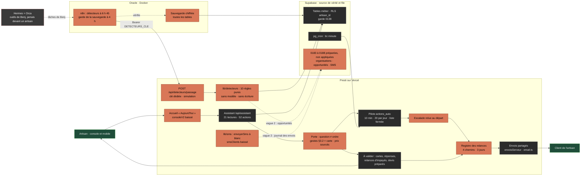

# Chantier 4 — l'assistant de gestion agentique : le plan

Rédigé le 02/11/2026 vers 3 h, sur délégation de Benj (`memoire-presti/nuit-0211-delegation-c1-c4-c2.md` : « passe automatiquement au chantier de
l'assistant de gestion… avance le plus possible »). Ce document est un plan : il ne construit rien. Par délégation, les défauts du §5 s'appliquent
aux lots de la nuit. Restent à Benj : toute migration en production (« go » écrit), toute dépense (premier SMS réel), tout réglage de compte, toute
saisie de secret.

Sources lues en entier : `prompts-benj/p3-assistant.md` (P3, annexes 1 et 2), `p3-assistant-bloc-offres-corrige-0111.md` (OFF), les rapports
de la nuit (`…/scratchpad/c4/` : R1 existant, R2 annexes, R3 vidéos, R4 écran, R5 SMS), `CLAUDE.md`, `.claude/rules/*.md`, `cadrage-p3.md` (CP3).
Réseau neuronal : `nuit-0211-delegation-c1-c4-c2`, `chantiers-0111-etat-et-branchements`, ADR-007 (« proposée »), `Journal-Decisions` (01/11),
fil `inbox/sessions/2026-11-01-12h33-b6e06ae6-…`.

Conventions : `fichier:ligne` renvoie au commit HEAD `a51a12a8`, et « (arbre) » signale un fichier modifié cette nuit, non commité. Chaque
affirmation porte sa source.

## 0. Amendements du 02/11 au matin (décisions de Benj) — ils priment sur la suite du document

1. **Règle n8n-first** (message de Benj du 02/11, `.claude/rules/architecture-outils.md`) : toute logique métier récurrente se construit dans
   n8n, jamais dans le code de l'app, qui ne sert qu'à l'interface.
   - **Les détecteurs passent dans n8n.** Le module `lib/detecteurs/**` (L3), la route `POST /api/detecteurs/passage` et la clé
     `DETECTEURS_CLE` (L4) sont abandonnés. À leur place, un workflow `presti-detecteurs` sur le n8n d'Oracle (L3 n8n) : déclencheur à
     6 h 45, une requête SQL en lecture seule par détecteur, la mise en forme dans des nœuds Code, et un bilan agrégé par détecteur. En mode
     simulation, rien n'est écrit dans Supabase, rien n'est envoyé, aucun modèle n'est appelé. Le lot L8 fusionne avec ce lot.
   - **L'accès à la base.** Le 02/11, Benj a créé dans n8n l'identifiant « Supabase account » (Supabase API) et a voulu qu'il ait
     **tous les droits** (« je veux qu'il ait tous les droits »). Les détecteurs n'y font que des lectures (`get`, `getAll`) ; les futures
     automatisations qui écrivent passent par le même identifiant, toujours à blanc d'abord. Le rôle Postgres en lecture seule
     `n8n_lecture` (migration 0189, appliquée le 02/11) reste en base, inutilisé par n8n ; il se retire par la ligne de réversion de 0189
     si Benj le veut.
   - **Les cartes que l'artisan valide** restent dans l'interface (« À valider »). Un constat devient une carte quand n8n l'écrit dans la
     table prévue (0185, vague 2), après le « go » de Benj.
   - **Le niveau par offre** reste lu dans `lib/plans.ts` : une copie figée des capacités par offre accompagne le workflow, et une suite
     compare les deux.
   - **Exceptions justifiées.** S1 à S5 (§3) corrigent des failles dans des automatisations déjà codées et en production : le cron des
     relances, le pilote, les impayés, l'acceptation d'un devis. Ces correctifs ne font que restreindre. Ces chemins migrent un par un
     dans n8n (`migration-production.md`). Le registre des relances (S4) devra être lu par chacun de ces futurs workflows.
2. **Q-S5, acompte** : l'artisan d'une offre qui porte les règles choisit. La facture d'acompte part seule (par défaut, comme avant) ou elle
   est préparée et il l'émet d'un clic (maillon `acompte_seul`). Le verrou d'offre reste.
3. **Push de L1 et L2** accordé par Benj, une fois le typecheck, le build et l'audit verts.
4. **Landing (chantier 2)** : direction A avec le hero de B, au plus simple et sans friction, en suivant la structure du prompt 4.

## 1. Résumé de compréhension

1. Presti est en production. Son assistant agit déjà : 21 lectures, 52 actions, cartes, journal, et un pilote qui laisse 10 min pour annuler, à
   20 envois par jour au plus. Il n'a pourtant jamais rien fait seul : aucun détecteur ne remplit sa file, et tout est à activer (R1 §0, R2 C4).
2. Benj veut trois niveaux d'autonomie, réglés par type d'action (P3:540-548), répartis sur trois offres. Studio prépare, Signature envoie seul,
   et Entreprise reprend le moteur de Signature avec des organisations, un CRM et des automatisations n8n sur mesure (OFF:21-36).
3. On ne rase rien. Les détecteurs sont du code pur sur les tables existantes ; n8n les déclenche par une route à clé dédiée (ADR-001, P3:565).
   Supabase reste la source et la file, et Hermes reste derrière.
4. Avant toute nouveauté, cinq brèches de la liste §3.2 se ferment en production (§3).
5. Phase 0 : la sauvegarde ne couvre que 34 tables sur environ 92, et elle ne tourne plus depuis le 25/10 ; restent aussi la boîte e-mail et les tâches (§4).
6. Les organisations multi-membres se font maintenant, par migrations additives coupables d'un interrupteur. Préalables : corriger la garde 0138,
   prouver la sauvegarde, obtenir le « go » de Benj (§10).
7. SMS : un adaptateur indépendant du fournisseur, Sweego par défaut (0,040 € HT), qui reste à blanc tant que Benj n'a pas approuvé le coût (§11).
8. L'accueil de la console devient l'assistant : piste A, avec le drapeau `consoleV2` porté sur `main` et baissé (§7).
9. Cette nuit, tout reste derrière un drapeau baissé. Les migrations sont préparées et testées, jamais appliquées. Aucun secret, aucune dépense,
   aucun compte créé.
10. Le code calcule tous les montants, et aucune donnée n'est inventée. Les tests se jouent hors ligne, prouvent qu'ils peuvent rougir et entrent
    au lanceur `scripts/tout-verifier.mjs`.

## 2. L'existant en 15 lignes (R1 §18, revérifié)

1. Route `app/api/assistant/route.ts` (180 l.) : garde à la l.66 ; outils d'action toujours donnés (l.155). Le « fait tout seul » ne teste
   aucune offre (`autonome: () => faitToutSeul(cadrage, etatTour)`, l.128).
2. Boucle `lib/assistant/boucle.ts` : 8 appels (`cadrage.ts:16`) en 45 s (`:18`), journal avant le résultat (l.247), garde des chiffres (l.291-309).
3. 21 lectures (`outils.ts:70-72`) et 52 actions, dont 20 à confirmer (`outils-actions.ts:58-459`, `ACTIONS_CONFIRMEES` l.468), et non 45.
4. Cartes `assistant_actions` (`0157:31-51`) : `conversation_id` et `tour` obligatoires (l.34-35), valables 24 h (`cartes.ts:18`). Journal
   `assistant_journal` (`0150:52`), sans texte libre.
5. Cadrage : `actionDemandee` (`cadrage.ts:146`) choisit le mode, et `faitToutSeul` (l.160-162) est exécuté par `proposee`
   (`actions-serveur.ts:1365-1379`). Sept questions de lecture sur dix le déclenchent (sonde de R1, annexe A).
6. Briefing pur (`briefing.ts:44`) : un devis sans réponse ressort à 7 jours (l.35), un impayé devient urgent à 30 jours (l.37). Il n'est
   calculé que si on le demande.
7. Pilote `lib/pilote/regles.ts` : 10 min (l.24), 20 par jour (l.27), 24 h (l.29), 6 types (l.33), 6 outils exécutables (l.67), jamais
   automatiques (l.70-73), `prixSources` (l.105), tiers lus (l.132). Tables `pilote_reglages` et `actions_auto` (`0174:21-44`).
8. File remplie seulement par `piloterCarte` (`actions-serveur.ts:1390`) et `piloterProposition` (3 appels), vidée par le tic (`0101:164`).
   Aucun détecteur.
9. `lib/plans.ts` : `PlanId` sans « entreprise » (l.14). Studio à 59 € avec `assistant` (l.75, l.98). Signature à 99 € (l.99) ajoute
   `plateforme.ia.auto`, `relances.auto`, `factures.relances.auto` (l.80), `crm` (l.86) et `assistant.pilote` (l.89). Essais de 7 et 21 jours
   (l.108). Verrou `peut()` (l.134).
10. Réponse aux demandes : « assistée » par défaut (`plateformeConfig.ts:45`), `verrou_offre` sans `plateforme.ia.auto` (l.183-186). Mots
    d'escalade par défaut : urgence, fuite, dégât des eaux, inondation, gaz, assurance (l.56).
11. Drapeaux (57) : `assistant` (l.161), `crm` (l.172), `relancesImpayes` (l.179) et `piloteAutomatique` (l.243) levés ; `inventaireOcr` (l.56),
    `canauxWhatsapp` (l.70) et `canauxReseaux` (l.72) baissés ; `ESSAI = {}` (l.323) ; `consoleV2` n'existe que sur `refonte-1018`.
12. Relances sans registre commun : conversation J+2/5/10 (`relances.ts:23`) ; impayés J+3/10/21, sur activation (`relancesImpayes.ts:31`, `:36`) ;
    CRM (`app/api/crm/relances/envoyer/route.ts`) ; assistant (`actions-serveur.ts:855`, `:933`).
13. Tables : `devis` (0002:36), `factures` (0006:10), `relances` (0010:30), stock (0040), CRM (0141), `commandes_fournisseur` (0158:29). Dernière
    migration : 0181. Ni organisations, ni événements, ni paiements, ni SMS.
14. Isolation : RLS par `artisan_id` et garde `jeton_session_valide()` (`0138:35-74`), qui laisse passer un utilisateur sans ligne `artisans`
    (CTE l.44-47, l.55-56, l.66). `rls-e2e` couvre 14 tables (`tout-verifier.mjs:46`).
15. E-mail au nom de l'artisan (`email.ts:6-11`) ; seul Telegram est pilotable (`canaux/regles.ts:42`). Aucune occurrence de SMS, n8n, Hermes
    ni Orca dans `lib/` ou `app/`. La sauvegarde couvre 34 tables (`scripts/sauvegarde.mjs:49-59`).

## 3. Sécurité d'abord : cinq brèches à fermer en production

**État à l'heure de la rédaction (02/11 vers 3 h).** S1, S2 et S3 sont en cours dans l'arbre, non commités (`lib/assistant/{cadrage,actions-serveur}.ts`,
`lib/pilote/{regles,file,executeur}.ts`, `lib/reglesServeur.ts`) ; leur suite annoncée, `scripts/securite-assistant-0211-qa.mjs`, n'existe pas encore.
S4 et S5 ne sont pas commencées. Le lot L1 (§14) reprend cet arbre tel quel, sans le refaire.

**S1 — Le « fait tout seul » exécute des gestes §3.2, et il part sur une simple question.**
- Constat : `faitToutSeul = actionDemandee && !contenuTiersLu` (`cadrage.ts:160-162`), et `actionDemandee` se lève sur « paye », « regle »,
  « signe » ou « relanc » (`MOTS_ACTION`, l.98-115). `proposee` exécute alors toute action à confirmer, y compris encaissement, émission,
  suppression et lot de prix (`actions-serveur.ts:1362-1379`).
- Correctif, défaut retenu (en cours dans l'arbre) : `estQuestion(message)` (« ? » final, ou mot interrogatif en tête après un salut) remplit le champ
  `question`, et `faitToutSeul` exige `question === false` ; devant une question, la consigne dit « réponds d'abord, rien ne s'exécute d'office ».
  `proposee` ignore `autonome()` pour un geste de `OUTILS_JAMAIS_AUTO` (`jamaisAutomatique`, `raisonJamaisAuto`), liste commune au pilote et à
  l'assistant, qui gagne `creer_facture_libre` et `supprimer_article`. Reste à faire : la suite de tests, et une règle de plus. Un ordre `envoyer_devis` dont une
  ligne n'est pas sourcée devient une carte (`prixSources`, promesse de `lib/plans.ts:207`).
- Effet : un ordre garde le « fait tout seul » du 29/10 (devis, relance, envoi, stock). Encaisser, émettre une facture, supprimer ou changer les prix
  en lot donne une carte préremplie, validée d'un clic. Cela vaut aussi pour deux essais de Benj du 01/11 : la facture sans devis, et la hausse de
  5 % des tarifs de pose (fil `2026-11-01-12h33`). Le choix du 29/10 est donc défait en partie (R1 du §5).
- Test qui doit rougir (`securite-assistant-0211-qa.mjs`) :
  - les 10 questions de la sonde rendent `faitToutSeul` faux ; 10 ordres, et « oui » après « Voulez-vous que je… ? », le rendent vrai ;
  - avec `autonome()` vrai, chaque outil de `OUTILS_JAMAIS_AUTO` donne une carte `en_attente`, et un espion prouve que son réalisateur n'est
    jamais appelé ; `relancer_devis`, demandé par un ordre, s'exécute bien ;
  - tout nom de `SPEC` en `supprimer_*`, `marquer_facture_payee`, `creer_facture*` ou `augmenter_tarifs` est dans la liste, et hors de `OUTILS_EXECUTABLES_PILOTE` ;
  - mutations : `question === false` retiré, `!jamaisSeul` retiré, un nom ôté de la liste. `assistant-qa.mjs` (309 vérifications) doit rester vert.

**S2 — La règle « Tout auto » envoie un devis aux prix estimés.**
- Constat : avant `statut: 'envoye'`, seules les mentions légales sont contrôlées (`reglesServeur.ts:53-62`). Or le chiffrage écrit
  `source_prix: "estimation"` pour un prix du marché (`lib/ai.ts:986-997`), un devis que le pilote refuserait (`lib/pilote/regles.ts:154`).
- Correctif (en cours dans l'arbre) : relire les lignes du devis créé (`lignesDuDevis`, `lib/pilote/serveur.ts:58-66`) et exiger `prixSources`. Sinon, le
  devis reste en brouillon, et la notification dit « une ligne a un prix estimé ». Les tests remplacent `DependancesRegles`.
- Test (même suite) : rien ne part avec une ligne estimée, à 0 €, sans provenance ou illisible ; tout sourcé, avec les mentions, part.
  Mutation : retirer la condition `prixNonSource`.

**S3 — Le pilote ne relit pas l'escalade au moment d'envoyer.**
- Constat : l'état de la conversation n'est relu que pour `reponse_prospect` (`file.ts:90-96`), et seulement la prise en main, la limite et
  l'horaire (`executeur.ts:184-193`). La liste par défaut n'a ni litige, ni avocat, ni menace, ni sinistre (`plateformeConfig.ts:56`).
- Correctif (en cours dans l'arbre) : `MOTS_ESCALADE_TOUJOURS` et `sujetEscalade` (`regles.ts`). Pour toute ligne rattachée à une conversation,
  `escalade(l, leadId)` relit les 10 derniers messages entrants : conversation de la carte, du devis, ou du devis de la facture
  (`conversationDeLaCarte`, `executeur.ts`). Un mot trouvé renvoie la ligne à la main (motif `escalade`) ; une lecture impossible vaut un échec.
- Le plancher de l'arbre compte aussi « fuite », « urgence », « gaz » et « assurance ». C'est le côté sûr pour un envoi sans humain, mais un
  plombier en Signature verra ses réponses « fuite » revenir à la main. Le lexique par métier (Q9 de CP3) viendra en vague 2. Limite : une réponse
  arrivée dans la boîte de l'artisan (Reply-To) n'est pas lue par Presti.
- Test (`scripts/pilote-qa.mjs`, lanceur l.157) : « avocat » renvoie la relance à la main sans appeler `executer` ; « litige » aussi, même avec
  `escalade_mots: []`. Une lecture qui lève donne un échec ; sans mot, la ligne part. Mutation : l'appel retiré.

**S4 — Quatre chemins de relance, aucun registre commun (à faire).**
- Constat : l'anti-doublon de l'assistant et du pilote ne lit que `assistant_actions` (`actions-serveur.ts:861`, `:941` ; `executeur.ts:62-65`),
  et une lecture en erreur y vaut « jamais relancé » (`.catch(() => null)`). Les trois autres chemins écrivent ailleurs : le CRM dans
  `crm_rappels.envoye_le` (`app/api/crm/relances/envoyer/route.ts:56-63`), les impayés dans `relances_impayes` (0159), la conversation dans
  `messages.type = 'relance'` (`app/api/cron/relances/route.ts:209-214`).
- Correctif, dans `lib/relancesRegistre.ts` :
  - `historiqueRelances(artisanId, { type, id })` lit les quatre traces, plus les cartes en attente du même objet. Une erreur de lecture refuse
    (fail-closed) ; une table absente est ignorée, et c'est signalé. La fonction pure `relanceRecente(historique, maintenant, RELANCE_DELAI_JOURS)`
    tranche, à 3 jours (`actions-serveur.ts:63`).
  - Elle est appelée avant chaque envoi : `P.relancer_devis`, `P.relancer_facture`, `dejaRelance` du pilote, la route du CRM, `decider` des impayés
    (`relancesImpayes.ts:192`, raison `deja_relancee_ailleurs`). Aussi la relance de conversation d'un lead qui porte un devis
    (`cron/relances/route.ts:159-208`) : elle reste due et repart le lendemain.
- Test (`scripts/relances-registre-qa.mjs`) : pour chacune des 6 paires de chemins, la seconde relance est refusée dans les 3 jours, permise
  au-delà. Une lecture en erreur refuse. Le source prouve que les 6 appelants passent par `historiqueRelances(`. Mutations : un appel ôté, `<`
  devenu `<=`. `relances-impayes-qa.mjs` gagne le cas `deja_relancee_ailleurs`.

**S5 — L'acompte est émis seul à l'acceptation, sans verrou d'offre (trouvée en vérifiant, à faire).**
- Constat : `acompteApresAcceptation` (`reglesServeur.ts:80-83`) lit la règle sans tester l'offre ; `creerFacture` émet et scelle alors la facture
  d'acompte (`app/api/conversation/devis/route.ts:93-99`). La règle s'écrit depuis le navigateur (`reglesServeur.ts:29-31`) : un compte Studio
  l'obtient. Or émettre une facture ne se fait jamais seul (`cadrage-p3.md:221`).
- Correctif : (a) cette nuit, le verrou de `declencherRegles` (`peut(plan, 'plateforme.regles')`, `reglesServeur.ts:33`) ; (b) défaut par délégation,
  l'acompte est préparé, pas émis : la notification dit « facture d'acompte de N % à émettre d'un clic », avec le lien vers le devis (bouton
  « Facturer », `app/devis/[id]/page.tsx:249`). Les phrases des préréglages sont réécrites (`lib/regles.ts:51`, `:56`, `:89`). Question Q-S5 au §5.
- Test (même suite) : avec « Tout auto », Studio n'a aucun acompte ; Signature n'émet aucune facture et reçoit une notification. Mutation qui doit rougir.

**Mise en production de L1.**
- La session principale passe `npm run typecheck`, `npm run build` et les suites hors ligne, une à une ; un sous-agent distinct audite
  (`presti-audit-attaque`, lecture seule). Commit des seuls fichiers du lot, puis push si la délégation le couvre (le lot ne fait que restreindre),
  sinon au réveil. Ensuite `attendre-deploiement.mjs` et `deploiement-etat.mjs`. Retour arrière : `git revert`, sans migration.
- Pas de vérification en direct cette nuit : il faudrait créer un compte, ce qui est exclu. Le rejeu `--live` revient à Benj (Q13).

## 4. Phase 0 — le socle

**4.1 Sauvegarde.**
- Constat : la liste figée couvre 34 tables (`scripts/sauvegarde.mjs:49-59`) sur environ 92 (`cadrage-p3.md:108`). Il y manque `assistant_actions`,
  `actions_auto`, le CRM et les impayés. GitHub Actions échoue depuis le 25/10 (quota, `.github/workflows/sauvegarde.yml:17-18`). La dernière archive
  locale date du 05/09 (`sauvegardes/2026-09-05T13-34-08-905Z.presti`), et `pg_dump` ne marche plus : le mot de passe est désaligné depuis le 14/09.
- Cette nuit, sans secret ni dépense (lot L9) :
  1. `sauvegarde.mjs` découvre les tables par la définition OpenAPI de PostgREST ; `EXCLUES` donne la raison de chaque table écartée, comme `HORS_LANCEUR` ;
     la restauration suit l'ordre des clés étrangères ; le tout est testé hors ligne par `scripts/sauvegarde-qa.mjs` ;
  2. un passage réel par la session principale, `node scripts/sauvegarde.mjs --dossier D:/presti-travail/sauvegardes/base`, puis `--verifier`.
     L'archive est chiffrée par `cle-sauvegarde.pub.pem`, et seule la clé privée la relit ;
  3. une unité systemd prête pour Oracle (`ops/sauvegarde/`, 3 h 40, 14 jours gardés), et le brief d'un chien de garde n8n. À 4 h, il vérifie
     l'archive, sa taille et son manifeste ; sinon, il alerte `#presti-auto` et le Telegram du fondateur.
- Attend Benj : poser la clé de service sur Oracle et activer le minuteur, ou remettre à jour le mot de passe Postgres (Q1) ; ouvrir une fois la
  clé privée (`coffre-presti`) pour l'aller-retour ; lire le compteur d'Actions.
- Preuve exigée avant toute migration (`cadrage-p3.md:117`) : toutes les tables dans l'archive du jour, avec des comptes égaux ; aller-retour
  vert ; un compte fictif restauré dans un Postgres jetable ; l'alerte déclenchée une fois.

**4.2 Boîte e-mail.**
- Constat : le passage de 8 h UTC voit une « boîte non configurée » et se déclare pourtant réussi (`cron/relances/route.ts:341-353`). Les variables
  `IMAP_*` sont absentes (`cadrage-p3.md:69`), et la table `canaux` des artisans est vide (l.70).
- Cette nuit, rien ne change. Benj crée un mot de passe d'application Gmail et le range par `node scripts/ranger-env.mjs`. Ensuite seulement,
  « non configurée » deviendra un échec en production (3 lignes, `route.ts:345-353`, vague 2).

**4.3 Tâches et coût.**
- Constat : 14 tâches Claude sont actives ; les tâches Windows de l'écosystème sont coupées depuis le 11/10 (`cadrage-p3.md:74-75`) ; six tâches sont
  en pause depuis le 01/11, et l'injection du réseau neuronal est réparée (`chantiers-0111-etat-et-branchements`). Cette nuit : un inventaire en
  lecture seule, et aucune tâche relancée (la prospection relève du chantier 3). Le brief n8n de L8 spécifie le battement : plus de 26 h sans signe déclenche une alerte.
- Coût : aucun détecteur ne rédige de texte cette nuit. Les 1 547 € annoncés restent à vérifier dans la console (`cadrage-p3.md:121`).

## 5. Questions bloquantes : les défauts appliqués cette nuit

| Question | Défaut appliqué par délégation (tout se défait) |
|---|---|
| Fournisseur de SMS (P3:621) | Sweego, 0,040 € HT, pack de 20 €, plusieurs expéditeurs par API (R5 §3-4). Brevo en second, sur un compte distinct de la prospection. Aucun compte créé, aucun envoi réel. |
| SMS au niveau 3 (ADR-007 contre `cadrage-p3.md:219`) | Niveau 2 pour toutes les offres en v1. Le niveau 3 s'ouvre sous Signature après deux semaines réelles sans incident. |
| Notification du briefing (P3:621, Q7) | Notification de l'app (push levés, `flags.ts:26`, `:29`), à 7 h 30 heure de Paris, e-mail en option. Le type `briefing` est à créer (`lib/notificationsTypes.ts:5`). |
| Contenu de l'offre Entreprise (OFF:21-36) | L'autonomie de Signature, plus organisations, CRM et automatisations n8n sur mesure par contrat. Prix sur devis, aucun Stripe en libre-service, bouton « Demander une démo » (chantier 2). |
| « `plateforme.ia.auto` à partir de Studio » (OFF:12) | Le code ne change pas (`plans.ts:63`, `:80`). La ligne vient de l'ancien `CLAUDE.md` (OFF:40-44). |
| R1 : « fait tout seul » et gestes §3.2 | §3, S1 : une carte préremplie, validée d'un clic, jamais déclenchée par une question. Défait en partie le choix du 29/10. |
| R2 : l'offre Entreprise dans le code | `PlanId` `entreprise` = SIGNATURE + `organisation.membres`, sans prix Stripe ni essai (§12). |
| R3 : Hermes dans le produit ? | Il reste derrière : il orchestre les tâches de Benj, jamais une réponse à un artisan (marque blanche, PC à 8 Go, crédit partagé, `architecture-outils.md`). |
| R4 : où vivent les détecteurs | En code pur, testés et sous RLS ; n8n Oracle les déclenche par une route à clé. Le tic garde le pilote pendant la transition. |
| R5 : volume d'e-mails | Plafond de la plateforme : 80 par jour (`email.ts:88-94`), à mesurer d'abord. Clients sur Resend, prospection sur Brevo. Toute hausse est une dépense : décision de Benj. |
| R6 : adresse d'expédition | `contact@prestiapp.fr` par défaut (`email.ts:18-20`). Benj vérifie `EMAIL_EXPEDITEUR_ARTISAN` en production. |
| R7 : tout automatique par défaut ? | Les détecteurs proposent et préparent, pour tous. En Signature, les relances de devis et d'impayés passent au niveau 3 à la fin de la mise en route, coupables d'un geste. Rien n'est activé cette nuit. |
| R8 : détecteur 5 sans donnée | Colonne `factures.envoyee_le` (0187, préparée). Le détecteur reste coupé d'ici là. |
| R9 : détecteur 7 | Le verrou reste : un devis né d'une demande ne dépasse jamais le niveau 2 (`regles.ts:132`). |
| R10 : détecteurs CRM en Studio | Une variante sans chantier : « devis accepté sans facture de solde ». |
| R11 : « systèmes n8n inclus » sur la grille | Non, pas avant un workflow métier prouvé (`plans.ts:5-7`). |
| R12 : clé d'idempotence | (artisan, type, objet, étape), et non « jour » (P3:597 contre `cadrage-p3.md:379`). |
| Q-S5 : acompte de la règle à l'acceptation | Préparé et notifié, émis d'un clic (§3, S5). Benj peut rétablir l'émission seule en Signature. |
| Calendrier fiscal (vidéo yova2n, R3 C6) | Hors périmètre : rien vers l'URSSAF ni les impôts (P3:553). |
| CP3, Q1 à Q14 | Défauts du cadrage gardés (`cadrage-p3.md:144-157`), sauf Q10, que remplacent R3 et R4 (ADR-001). |

## 6. L'architecture, posée sur l'existant (en corail : ce qui s'ajoute)



- n8n déclenche, et Presti ne l'appelle jamais (`cadrage-p3.md:153`). Les données d'artisans restent sur Oracle (P3:570), et n8n ne voit que des
  agrégats. Supabase porte la vérité et les files (P3:564).
- Les dix « agents » du prompt deviennent des familles d'outils et de détecteurs de l'assistant (P3:568) : l'artisan ne voit qu'un assistant. La
  mémoire tient dans des tables et la recherche plein texte, sans pgvector (P3:569), et aucune dépendance n'est ajoutée (Q11). Le tic garde le
  pilote ; chaque automatisation passera dans n8n une à une, en cinq pas (`migration-production.md`).

## 7. L'interface : mobile d'abord, piste A « Instrument » (R4)

```text
/dashboard « Aujourd'hui »   (drapeau consoleV2 ; menu de la coque v2 : Aujourd'hui · Clients · Atelier · Ma présence · Pilotage)
├─ 1 Bonjour <nom> · « 3 à valider · 1 part seul dans 7 min · 4 faites pour vous »        (chiffres en mono)
├─ 2 Demander à l'assistant → feuille plein écran au téléphone ; ligne « fait » sous chaque réponse ; solde de crédits
├─ 3 Le point du jour : 3 priorités calculées par le code (0 appel au modèle, 0 crédit) · « Tout le point du jour » replié
├─ 4 À valider, l'argent d'abord : réponses préparées · relances d'impayés · cartes de l'assistant · devis préparés (Relire)
├─ 5 Part tout seul (Signature) : « Partira dans 7 min » + règle graduée + Annuler · Tout arrêter · onglet Fait pour vous
├─ 6 Vos chiffres du mois (capacité chiffres) : 4 tuiles et 6 barres
├─ 7 Ce que l'assistant fait seul : un réglage par type d'action (Je valide | Part seul après 10 min)
├─ 8 Découvrir (textes selon l'offre)       └─ 9 Votre lien de contact [Copier]
Barre du bas au téléphone : Aujourd'hui · Messages · Devis · Factures · Plus
```

- **Données** (R4 §6.1) : la section 4 réunit quatre sources sans en réécrire aucune. Ce sont les cartes (`POST /api/assistant/actions`), les
  réponses (`POST /api/messages`), les relances `a_valider` (0181) et les devis préparés (`lib/devisAuto.ts:80-82`). La section 5 lit
  `/api/pilote/file` et `/api/pilote/reglages`. La section 3 vient de `composerBriefing` (`briefing.ts:44`), sans nom d'outil ni `a_savoir`.
- **Route** : `GET /api/aujourdhui` de la branche, étendue à une réponse par section, chacune avec son état (`ok`, `indisponible`, `hors offre`). Une
  panne n'efface pas tout l'écran, et ne s'affiche jamais en zéros (`refonte-1018:app/api/aujourdhui/route.ts:59-62`).
- **Mobile d'abord** : base de 390 px, cibles d'au moins 44 px, un seul bouton principal (la première carte, sinon « + Devis »). Conversation en
  feuille, sans effet de verre ; mouvement réduit respecté ; 5 lignes par liste au téléphone.
- **Vocabulaire** : jamais agent, workflow, n8n, MCP, prompt, LLM, détecteur, opportunité, file, modèle, Hermes ni Orca. On écrit « Partira dans 7 min »,
  jamais « Envoyé, annulable » (`lib/pilote/regles.ts:172-177`).
- **Drapeau `consoleV2`** (R4 §10) : porté sur `main` et baissé, sans les commits temporaires `3abfb98a` et `dedfd033`. Il s'ouvre ensuite en essai au
  compte fondateur et au compte de démonstration (`lib/essais.ts:7`), une fois `scripts/assistant-qa.mjs:1018` adapté. Les drapeaux déjà levés
  gardent leur rôle à l'intérieur. À sa levée, l'arrivée après connexion passe de `/outils` (`app/login/page.tsx:34`, `lib/suiteSure.ts:5`) à `/dashboard`.
- **Plus tard** : la colonne « Repéré », les boutons Modifier, Plus tard et « Ne plus me proposer », et la validation par lot arrivent avec les
  opportunités (0185, P5). Pas de trombone avant l'import par la conversation.

## 8. Modèle de données

**8.1 Le prompt face à l'existant** (`cadrage-p3.md:257-279`, revérifié). `artisan_id` reste la clé de rattachement (P3:559), les identifiants
restent en français (`CLAUDE.md`), et aucun `organization_id` n'entre dans une table existante.

| Tables du prompt | Dans Presti | Ce qu'on fait |
|---|---|---|
| `users`, `organizations`, `memberships` | `auth.users`, `artisans` | `utilisateurs`, `organisations`, `membres`, `invitations` (0183) |
| `clients`, `leads`, `devis(_lignes)`, `factures(_lignes)`, `fournisseurs`, `chantiers` | 0002, 0010, 0006, 0048, 0141 | rien |
| `produits`, `inventaire`, `mouvements_inventaire`, `commandes(_lignes)`, `taches` | `materiaux`, `stock`, `mouvements_stock`, `prix_artisan`, `commandes_fournisseur`, `chantier_taches`, `crm_rappels` | rien |
| `conversations`, `messages`, `relances` | `leads`, `messages`, `relances`, `relances_impayes*` | un registre en code (S4) |
| `paiements` | seulement `factures.payee_le` (0140:18) | une table, après les organisations (Q12, argent) |
| `documents` | `chantier_pieces` et le stockage | le classement viendra plus tard |
| `agent_runs`, `tool_calls`, `agent_actions`, `human_approvals` | `assistant_journal`, `passages_cron`, `assistant_actions`, `actions_auto` | `passages_detecteurs`, `opportunites`, `opportunites_decisions` (0185) ; `acteur_id` (M5) |
| `automation_rules`, `permissions`, `subscription_plans` | `regles_automatisation` ; rien ; `lib/plans.ts` | `detecteurs_reglages`, `autonomie_reglages` (0185) ; `droits_roles` (0183) ; offre `entreprise` (§12) |
| `errors`, `audit_log`, `metrics_daily` | `app_errors` ; `assistant_journal` et `crm_journal` ; rien | `metriques_automatisation_jour` (P8) |
| (neuf) événements, envois de SMS | rien | `evenements_metier` (0185) ; `sms_envois`, `sms_oppositions`, `sms_expediteurs` (0186) |

**8.2 Les migrations à préparer.** Le numéro 0182 est réservé par le worktree `comptes-fournisseurs-0a934e` (R1, annexe B). Chaque table neuve a la
RLS dès sa création, sa garde de session et ses droits `anon` retirés. On y écrit par fonction ou par la clé de service, et ses colonnes ont des
noms français (`cree_le`, `maj_le`, `acteur_id`).
- **0183_organisations** (M1) :
  - `organisations` (id = `artisans.id`), et `membres` : rôle titulaire, associé, administratif, compagnon ou invité ; statut invité, actif ou retiré ;
    `equipe_membre_id` vers `equipe_membres` ; unique par (organisation, utilisateur).
  - `invitations` (empreinte du jeton, 7 jours au plus, usage unique), et `utilisateurs` (id = `auth.uid`, `sessions_invalides_avant`,
    `connexion_verifiee_le`).
  - `droits_roles`, remplie par la matrice de R2 §5.5, et les fonctions `comptes_accessibles`, `peut_acceder`, `role_de`. L'interrupteur
    `organisations_ouvertes` va dans `ops.interrupteurs` (`0096_ops_socle.sql:237-243`) : faux par défaut, posé par un fondateur seulement
    (`0097:313-352`). Chaque artisan reçoit une organisation, dont il est le titulaire.
- **0184_garde_session_membres** (M2) : de nouveaux corps pour `jeton_session_valide()` et `compte_non_suspendu()` (§10). Les corps de 0138 sont
  recopiés en tête, pour le retour arrière.
- **0185_automatisation** : `evenements_metier` (unique par (artisan_id, cle), faits sans texte libre) ; `detecteurs_reglages` et `autonomie_reglages`
  (niveau 1 à 3, plafond par jour, `pose_par`), `pilote_reglages` restant en place ; `opportunites_decisions` et `passages_detecteurs`. `opportunites`
  suit le cycle de `cadrage-p3.md:230-251`, avec `montant_centimes` calculé par le code, `expire_le` et un lien vers la carte ou la ligne de
  pilote ; un index unique partiel sur (artisan_id, cle) la garde unique tant qu'elle est ouverte.
- **0186_sms_clients** : `sms_envois` (clé unique, état, segments, coût HT, source du tarif), `sms_oppositions`, `sms_expediteurs`,
  `clients.tel_source` et `tel_source_le`, et l'interrupteur `sms_arret`.
- **0187_factures_envoyee_le** : la colonne qui manque au détecteur 5.
- **0188_garde_session_rejouee** (M6) : la boucle idempotente de 0138 (l.99-119), rejouée pour que chaque table à RLS ait ses quatre gardes.

**8.3 Comment elles sont préparées.**
- En tête de chaque fichier : « NON APPLIQUÉE, préparée le 02/11, attend le go écrit de Benj », et le retour arrière écrit.
- Le jumeau `_A_COLLER_sql_editor_018N_NU.sql` est fabriqué par `scripts/sql-nu.mjs` et vérifié par `migrations-jumelles-e2e.mjs` (lanceur l.30).
- Les tests sont au §10. La session principale seule fait l'essai à sec, par un bloc `do … raise exception` (`scripts/lib/sql-essai.mjs`) :
  rien ne reste, et les verrous ne durent que quelques millisecondes.
- Application : au connecteur, lot par lot, après un « go » écrit (Q2), le jumeau restant le repli. On colle la migration, PUIS on lève le drapeau.
  Rien de ce qui part cette nuit n'en a besoin.

## 9. Les 10 premiers détecteurs, classés par argent récupéré (R2 §4)

L'ordre est estimé : aucun compte réel n'est assez rempli pour le mesurer (EDL:22), et la simulation le recalculera. La priorité suit P3:584 :
d'abord l'argent qui dort, puis les clients qui attendent. Tous passent par le nouveau drapeau `detecteurs`. Le niveau 3 exige en plus le drapeau
`piloteAutomatique` et la capacité `assistant.pilote` (`plans.ts:89`).

| # | Détecteur | Déclencheur (colonnes réelles) | Proposition (outil existant) | Studio · Signature · Entreprise | Drapeaux en plus |
|---|---|---|---|---|---|
| 1 | Facture échue à J+3, J+10, J+21 | `factures.statut='emise'`, `date_echeance` (0006:17, :19), `payee_le` vide (0140:18) ; règle `decider` (`relancesImpayes.ts:192`) | `relancer_facture` (`outils-actions.ts:141`), textes fixes | 1-2 (`a_valider`, 0181) · 3 (`relance_impaye`) · comme Signature | `relancesImpayes` |
| 2 | Chantier terminé sans facture de solde | `chantiers.statut='termine'`, `etape='a_facturer'` (`crm/alertes.ts:51-60`) ; en Studio, devis `accepte` sans facture `standard` ni `solde` (0176:44) | carte `creer_facture` de type `solde` (`outils-actions.ts:110-121`) | 1-2 partout (jamais émise seule) | `crm`, `facturesSituation` |
| 3 | Devis signé sans facture d'acompte | `devis.statut='accepte'` (0002:42), `accepte_le` (0033:4), `acompte_pct > 0` (0002:46), aucune facture `acompte` liée (0006:13, 0176:44) | carte `creer_facture` de type `acompte` | 1-2 partout | `facturesSituation` |
| 4 | Devis envoyé sans réponse à J+3, J+7, J+14 | `statut='envoye'`, `envoye_le` (0055:35), encore valable (`validite_jours`, 0002:44) ; registre S4 | `relancer_devis` (`outils-actions.ts:104`) | 1-2 · 3 (`relance_devis`) · comme Signature | — |
| 5 | Facture émise jamais envoyée | aucune donnée : l'envoi n'écrit rien (`envoisPdfServeur.ts:101-138`) | `envoyer_facture` (`outils-actions.ts:340`) | coupé jusqu'à 0187 | — |
| 6 | Demande restée sans réponse | `leads.statut='nouveau'` (0010:10) depuis trop longtemps, dans les horaires (`plateformeConfig.ts:137`) | réponse préparée, puis `valider_reponse_proposee` (`piloterProposition`) | 1-2 (`verrou_offre`) · 3 en mode « auto » · comme Signature | — |
| 7 | Demande qualifiée : brouillon de devis sur ses tarifs | lead sans devis (`devis.lead_id`, 0033:3), `qualifyLead` déterministe (`lib/ai.ts:290-294`), `prix_artisan` (0038:8) | `creer_devis` en brouillon, puis carte `envoyer_devis` | 2 au plus partout (tiers lu, `regles.ts:132`) | — |
| 8 | Devis bientôt expiré | `envoye_le` + `validite_jours` − X jours (`devisDepasse`, `devisExpiration.ts:19`) | `relancer_devis` (texte « expire le » en vague 2) | comme le n° 4 | — |
| 9 | Stock sous le seuil pour un chantier | réservation `chantier_materiaux` (0141:121) sous le seuil ou insuffisante, sans commande (`crm/alertes.ts:109-125`) ; en Studio, `seuil_alerte` (0040:19) | `preparer_liste_achat` (`outils-actions.ts:220`), `enregistrer_commande` | 1-2 partout (commande proposée) | `crm` |
| 10 | Chantier terminé : demande d'avis | `statut='termine'` depuis `DELAI_AVIS_JOURS` (2 jours, `apresChantier.ts:23`), sans opposition (0171) | `demander_avis` (`outils-actions.ts:440`) | 1-2 partout (pas exécutable sans session, `regles.ts:62-67`) | `crm`, `crmApresChantier` |

**La simulation, sans aucune table nouvelle (lots L3 et L4).**
- Lecture : `lib/detecteurs/lecture.ts` fait par compte environ neuf lectures bornées, par la clé de service filtrée sur `artisan_id`, comme
  `realisateursPilote` (`executeur.ts:46-61`). Elles portent sur les devis, factures, leads, chantiers et réservations, le stock, `relances_impayes`,
  `crm_rappels`, les cartes et la file récentes, et `plateforme_config`. Le texte d'une demande ne passe que par `qualifyLead`, puis il est oublié.
- Constats : `simulerCompte` rend le détecteur, la clé par étape (`devis_sans_reponse:<id>:j7`), l'objet, le montant en centimes, les jours, le
  niveau proposé selon l'offre et l'outil existant. Jamais un nom, une adresse ni un texte.
- Route `POST /api/detecteurs/passage` :
  - mode `simulation` seulement, et réponse 404 tant que le drapeau est baissé (sauf comptes en essai) ;
  - clé `DETECTEURS_CLE` comparée en temps constant (`bearerEgal`, `lib/secretEgal.ts:18`), réponse 401 sans elle ;
  - lots par curseur, dans un budget de 25 s ;
  - réponse en agrégats par détecteur, et une seule ligne écrite, dans `passages_cron` (`0057:12`, `enregistrerPassage`, `lib/alertes.ts:213`) :
    aucune autre écriture, aucun envoi, aucun appel au modèle.

## 10. Les organisations multi-membres (P3:555-561, R2 §5)

**Préalable : la faille de 0138.**
- La CTE `a` lit `artisans` par `auth.uid()` (`0138:44-47`). Pour qui n'y figure pas, la révocation (l.55-56) et le code par e-mail (l.66) sont
  vrais à vide.
- M2 lit ces champs dans `utilisateurs` pour un non-artisan, et refuse un membre actif non titulaire sans ligne. Un compte neuf reste permis :
  il écrit sa ligne `artisans` à l'inscription, sous la RLS (`app/onboarding/page.tsx:62-67`, politique `artisan_insert_own`, 0001:22). Un test
  de non-régression le prouve.
- La suspension d'une organisation atteint ses membres par `comptes_accessibles`, qui exclut en écriture les comptes suspendus.

**Matrice** (R2 §5.5) : le titulaire seul gère l'abonnement, les membres et le niveau 3. Le compagnon voit ses chantiers (`chantier_equipe` et
`equipe_membre_id`) et son pointage, jamais la compta. L'invité lit. Un test vérifie que `lib/organisations/droits.ts` et `droits_roles` disent la
même chose.

**Les pas, dans l'ordre.** On ajoute des politiques permissives `org_*` ; aucune politique existante n'est jamais modifiée.

| Pas | Contenu | Retour arrière | Préalable |
|---|---|---|---|
| M0 | Sauvegarde de toutes les tables prouvée (§4.1) ; essai à sec de chaque migration | — | Benj : clé privée, minuteur |
| M1 (0183) | Tables, fonctions, `droits_roles`, interrupteur faux ; une organisation et un titulaire par artisan | `drop` des objets neufs | M0, « go » |
| M2 (0184) | Garde de session étendue aux membres | corps de 0138 recopiés en tête | M1, banc de 0138 rejoué |
| M6 (0188) | Gardes reposées sur les tables qui n'en ont pas | `drop` | indépendant |
| M3-A, M3-B | Lecture seule (`assistant_*`, `crm_journal`, `prix_observations`), puis le CRM (`chantiers`, `chantier_*`, `crm_*`, `equipe_membres`, `vehicules`), où le compagnon voit ses chantiers | `drop` des `org_*` | M2 |
| M3-C, M3-D | Commercial (`leads`, `messages`, `relances`, `clients*`, `plateforme_config`), puis l'argent (`devis*`, `factures*`, `relances_impayes*`, `prix_artisan`) | idem | lot précédent ; auditeur distinct pour M3-D |
| M3-E, M3-F, M4, M5 | Stock ; tables fermées lues par une vue (`canaux`, `artisans`) ; stockage ; `acteur_id` | `drop` | lot précédent |

- **Retour arrière global**, à tout moment : `organisations_ouvertes` remis à faux, sans DDL ; `comptes_accessibles` ne rend plus que `auth.uid()`.
- **Côté routes** (P4b) : `resoudreCompte(session)` rend `{ acteurId, compteId, role }`. Un non-titulaire reçoit 403 sur toute route qui ne déclare
  pas `{ domaine, niveau }`. C'est aussi critique que la RLS : 268 fichiers passent par la clé de service (`cadrage-p3.md:51`).
- **Tests** (`scripts/organisations-qa.mjs`) :
  - partie statique, toujours jouée : RLS, garde, `revoke`, interrupteur, retour arrière ;
  - partie PGlite (`PGLITE_DIR`, comme `assistant-qa.mjs:1023-1027`) : deux organisations à quatre rôles, étanches ; matrice dans les deux sens ;
    compagnon ; membre sans ligne `artisans` ; inscription non régressée ; interrupteur. Sans PGlite : code 2, « en attente », jamais un faux vert ;
  - 4 mutations qui doivent rougir : `statut='actif'` retiré, `organisation_id` inversé, garde de suspension retirée, `security invoker`.
- **Cette nuit** : M1, M2 et M6 sont écrites, avec leurs jumeaux et leurs tests ; rien n'est appliqué.

## 11. SMS (R5)

- **L'adaptateur** `envoyerSms` ne dépend d'aucun fournisseur (contrat de R5 §7.2). Il vit dans `lib/sms/` : `contrat.ts`, `encodage.ts`,
  `expediteur.ts`, `numero.ts`, `plage.ts`, `lien.ts`, `envoyer.ts`, `fournisseurs/factice.ts`, et `fournisseurs/sweego.ts`, qu'aucun test n'appelle.
  La session principale écrit `tarifs.ts` : tarifs sourcés et datés, `SMS_COUT_APPROUVE = null`.
- **Trois types**, en liste fermée : `rappel_rdv`, `devis_pret`, `rappel_paiement`, en GSM-7 pur, un segment, sans montant ni menace. Aucun SMS
  commercial : le consentement n'est pas recueilli, et la loi n° 2025-594 l'interdit pour la rénovation énergétique.
- **À blanc par défaut** : `mode: 'blanc'` rend `simule` avec une estimation (segments, coût calculé par le code). Un `fetch` qui lève prouve que
  rien ne sort.
- **Étape 0, gratuite** : `lien.ts` prépare un lien `sms:` (RFC 5724), que l'artisan envoie lui-même depuis son téléphone.
- **Les portes, dans l'ordre** (R5 §7.3) :
  1. drapeau `smsClients`, interrupteur `sms_arret`, type, pause générale (`lib/agents/sortie.ts:12-20`) ;
  2. offre : en v1, `peut(plan, 'assistant')` et un geste de l'artisan (niveau 2). La capacité `sms.envoi` arrive avec le premier envoi réel,
     pour ne pas toucher la grille ;
  3. mobile de métropole, sans opposition, avec un numéro donné pour ce chantier (`tel_source`, 0186) ;
  4. expéditeur : le nom de l'artisan, validé. Jamais « Presti », jamais le numéro court du fournisseur ;
  5. pas de lien, deux segments au plus, du lundi au samedi de 8 h à 20 h heure de Paris, hors jours fériés ;
  6. en réel, coût approuvé ; idempotence ; plafonds en fail-closed, 10 par artisan et 100 en tout par jour (8 € HT au plus) ; disjoncteur.
     Un envoi `incertain` n'est jamais renvoyé.
- **Tests** : `scripts/sms-qa.mjs` joue les 13 cas hors ligne de R5 §9. Le 14e, la RLS de `sms_envois`, est dans `automatisation-schema-qa.mjs`.
- **Attend Benj** : le fournisseur, son compte et le « go » écrit sur le prix d'un segment ; les plafonds, et qui paie (défaut : Presti en v1) ;
  les questions au support de Sweego (R5 S8), le registre des traitements et le DPA ; la migration 0186.

## 12. L'offre Entreprise dans `lib/plans.ts` (session principale : c'est de l'argent)

```ts
export type PlanId = 'gratuit' | 'essentiel' | 'studio' | 'signature' | 'entreprise' | 'business'   // PlanPayant ne bouge pas
| 'organisation.membres'                                    // + Capacite : inviter des membres (§10)
const ENTREPRISE: Capacite[] = [...SIGNATURE, 'organisation.membres']   // même autonomie que Signature (OFF:28-36)
entreprise: { label: 'Presti pour l’entreprise', accroche: 'Sur mesure : votre équipe, vos outils, vos automatisations. Sur démonstration et sur devis.',
              creditsMois: 600, prixMois: 0, surDevis: true, tiers: ['standard', 'pro', 'expert'], siteMax: 3, capacites: ENTREPRISE },
business: { …, capacites: ENTREPRISE }                      // le compte fondateur essaie l'écran d'équipe
PLAFOND_IMAGES_MO.entreprise = 1024 · PLAFOND_PHOTOS_CLIENTS_MO.entreprise = 500 · PLAFOND_PIECES_CHANTIER_MO.entreprise = 2048   // = Signature
offreDeReference(plan)   // 'signature' pour signature, business, entreprise ; aUneOffreAuDessus(plan) en découle
messageVerrou('organisation.membres')   // « Disponible avec Presti pour l’entreprise, sur démonstration. »
```

- **Ce qui ne bouge pas** : `OFFRES`, `ESSAI_JOURS` et les cellules de la grille restent des `Record<PlanPayant, …>` (l.108, l.151-152, l.184). Donc ni
  Checkout, ni essai, ni colonne publique. Benj crée l'abonnement à la main chez Stripe, avec `metadata.plan = entreprise`. Le typage signale tout
  `Record<PlanId, …>` oublié.
- **Les tests d'offre en dur, à corriger** : `lib/abonnementSync.ts:61` lit le montant avant `metadata.plan`, si bien qu'un contrat à 99 € serait pris
  pour Signature ; `entreprise` doit l'emporter, et `planDepuisMontant` écarte déjà un prix à 0 (l.22). `lib/quotaMedia.ts:85-87` et
  `app/parametres/SectionAbonnement.tsx:22` passent par `offreDeReference` ; à la l.107, un prix à 0 € affiche « Essai gratuit, sans carte », il
  faut « Contrat sur mesure ». Reste `lib/plans.ts:139-147`.
- **Inchangés, mais testés** : `app/api/subscribe/route.ts:42-43` (seulement `OFFRES`), `lib/direction/stripe-actions.ts:26-30` (refuse un prix
  nul ou négatif), `app/controle/Fiche.tsx:31` et `:148`, `app/assistant/page.tsx:176`.
- **Tests qui doivent rougir.** `scripts/offres-affichage-qa.mjs` : l'étape 2 (l.55-58) compte `PLANS.entreprise`. Une empreinte SHA-256 de
  `PLANS.studio`, `PLANS.signature`, `OFFRES`, `ESSAI_JOURS`, `AUTOMATISATION` et `GRILLE_COMPLETE`, relevée avant le changement, prouve que Studio et
  Signature n'ont pas bougé d'un octet. Entreprise vaut exactement SIGNATURE plus `organisation.membres`, hors `OFFRES` et `ESSAI_JOURS`. Mutations :
  Entreprise ajoutée à `OFFRES`, une capacité ôtée à Studio. `scripts/essais-gratuits-qa.mjs` (EG-3) : à 99 € avec `metadata.plan = entreprise`, le
  plan est `entreprise` ; un Checkout `entreprise` répond 400 ; l'essai dure 0 jour. Mutation (EG-5) : l'ordre de lecture inversé.

## 13. Ce qui ne s'automatise jamais (§3.2, P3:553), et où c'est garanti

| Geste | Garde dans le code | Après la nuit | Test |
|---|---|---|---|
| Envoyer un devis signé | refusé par l'assistant (`actions-serveur.ts:320-323`, `:830-833`) et par le pilote (`executeur.ts:76`) | inchangé | `securite-assistant-0211-qa` |
| Un prix sans source | `prixSources` (`regles.ts:105`, `:154`) ; garde des chiffres (`boucle.ts:212-224`, `:291-309`) | + règle « Tout auto » (S2) ; + « fait tout seul » (S1) | idem |
| Encaisser, rembourser, payer | `marquer_facture_payee` jamais piloté (`regles.ts:70-73`) ; aucun outil `rembourser`, `payer` ni `creer_avoir` | plus exécuté par le « fait tout seul » (S1) | idem |
| Émettre une facture | `creer_facture` jamais piloté | + `creer_facture_libre` (arbre) ; acompte d'une règle préparé, pas émis (S5) | idem |
| Supprimer des données | `supprimer_devis_brouillon`, `supprimer_tarif` jamais pilotés | + `supprimer_article` (arbre) ; plus de suppression par le « fait tout seul » | idem |
| Changer les prix en lot | `augmenter_tarifs` jamais piloté | plus appliqué par le « fait tout seul » | idem |
| Escalade : litige, sinistre, fuite, menace, avocat | playbook réclamation (`lib/ai/playbooks.ts:41-49`) ; mot relu avant la réponse seule (`plateformeConfig.ts:157-161`) | relue aussi au départ du pilote (S3) | `pilote-qa` |
| URSSAF, impôts | aucune fonction (`cadrage-p3.md:82`) | — | `double-chemin-qa` : aucune action de ce domaine |
| Créneau, délai, fournisseur ou prix inventés | consignes (`cadrage.ts:206-212`, `lib/ai.ts`) ; garde finale des chiffres | — | `assistant-qa` |
| Téléphoner, prendre un rendez-vous seul (P3:576) | aucune fonction d'appel ; un créneau vient de l'agenda | — | — |

Une seule liste fait foi : `OUTILS_JAMAIS_AUTO` (`lib/pilote/regles.ts:70-73`, élargie dans l'arbre), lue par le pilote et par `proposee`. Un type
de pilote neuf n'entre que si la suite a parcouru tout le catalogue (P3:603).

## 14. Les phases, puis CETTE NUIT

| Phase | Contenu | Preuve de sortie | Attend Benj |
|---|---|---|---|
| P0 Socle | Sauvegarde complète, minuteur Oracle, chien de garde ; boîte e-mail ; battements | Archive vérifiée, aller-retour, alerte déclenchée une fois | Clé sur Oracle, clé privée, IMAP |
| P1 Sécurité | S1 à S5 | Suites vertes, mutations, audit distinct, déploiement vérifié par SHA | Push, si la délégation ne le couvre pas |
| P2 Mesure | Détecteurs en simulation, appelés par n8n | Deux semaines de passages, faux positifs comptés par détecteur | Clé, workflow activé |
| P3 Accueil | `consoleV2` en essai, puis levé | Jury en 390 et 1440 px, zéro mot interdit, états dégradés | Levée |
| P4a Organisations | 0183, 0184, 0188, `droits.ts` | `organisations-qa`, essai à sec, application | « go » par lot |
| P5 Boîte et briefing | 0185 ; opportunités changées en cartes ; Modifier, Plus tard, lot ; briefing poussé à 7 h 30 | Sur un compte fictif, les cartes du matin naissent seules (P3:625) | « go » pour 0185 |
| P4b Équipes | M3 à M5, routes, écran d'équipe | Deux membres aux droits différents ; organisations étanches sur 44 tables | « go » par lot |
| P6 Autonomie | `autonomie_reglages` ; des détecteurs vers le pilote | Sous Signature, une relance de devis au niveau 3 part seule, s'annule 10 min, apparaît au journal (P3:626) | — |
| P7 Entreprise, SMS réel, mise en route | Contrat ; SMS par API ; imports guidés en 5 questions au plus | Coût approuvé ; un compte importé | Coût, comptes |
| P8 Boucle | Mesures hebdomadaires par détecteur, `/controle`, documentation, vault | Notes au vault | — |

**Les règles de la nuit.**
- **Ordre** : la session principale fait L0, L1, L2, L4, L6 puis L11.
- **Vagues de sous-agents**, deux à la fois au plus, car le PC n'a que 600 Mo de RAM libre (note du 01/11) : L3 et L9 pendant L1 ; L5 et L10
  pendant L2 et L4 ; L7 et L8 pendant L6.
- **Si la nuit ne suffit pas**, on coupe dans cet ordre : L10, L8, L7, puis 0185 à 0187. Jamais L1.
- **Chaque lot** devient une tâche `.orchestre/file/032-0NN.md`, dont l'en-tête YAML porte `id, type, objectif, perimetre, interdit, verifier,
  budget, preuve`. `interdit` liste les autres périmètres, `verifier` lance la suite du lot, et le verdict vient de
  `node scripts/orchestre.mjs verifier <id>`. Un lot encore rouge au bout de son budget passe « bloqué », avec une question à options.
- **Le prompt de chaque sous-agent** (`sonnet`) lui redit les règles, car il ne les reçoit pas seul. Il lit d'abord `regles_pour` et les notes nommées pour
  son lot. Il ne fait ni build, ni `next dev`, ni commit, ni push, ni migration, ni suite contre la production (`securite.md`). Identifiants en
  français, aucun secret, données fictives, mutation prouvée. Un autre agent l'audite, jamais lui-même.
- **Le lanceur** ne tourne jamais en entier cette nuit : certaines de ses suites créent des comptes sur la base réelle (`rls-e2e.mjs` l.46,
  `regles-verrou-e2e.mjs` l.64). On joue les suites hors ligne une à une.
- **Commits et push** : un commit par lot, aux chemins nommés. `scripts/tout-verifier.mjs` porte déjà deux ajouts du chantier 1 : seuls les hunks
  du lot y entrent. Push : L1 seulement, si la délégation le couvre.
- **Hermes** ne reçoit aucune tâche : son crédit est celui du produit, et le complexe revient à Claude Code (règle du 01/11 au soir).

| Lot | Qui l'écrit | Périmètre exclusif | Objectif | Suite au lanceur (mutation prouvée) | Budget |
|---|---|---|---|---|---|
| L0 Ouverture | principal | `lib/flags.ts` ; `.orchestre/file/032-*.md` | 4 drapeaux baissés (`consoleV2`, `detecteurs`, `organisations`, `smsClients`) ; tâches ; état du déploiement de HEAD | typecheck ; `assistant-qa`, `offres-affichage-qa` verts | 20 min |
| L1 Sécurité S1-S5 | principal (reprend l'arbre) | `lib/assistant/{cadrage,actions-serveur}.ts`, `lib/pilote/{regles,file,executeur}.ts`, `lib/reglesServeur.ts`, `lib/regles.ts`, `lib/relancesRegistre.ts`, `lib/relancesImpayes.ts`, `lib/relancesImpayesTour.ts`, `app/api/crm/relances/envoyer/route.ts`, `app/api/cron/relances/route.ts`, `app/api/conversation/devis/route.ts`, `scripts/{securite-assistant-0211,relances-registre,pilote,relances-impayes,assistant}-qa.mjs` | §3 | `securite-assistant-0211-qa` (S1, S2, S5), `pilote-qa` (S3), `relances-registre-qa` (S4) ; mutations du §3 | 2 h 30 |
| L2 Argent | principal | `lib/plans.ts`, `lib/abonnementSync.ts`, `lib/quotaMedia.ts`, `app/parametres/SectionAbonnement.tsx`, `lib/sms/tarifs.ts`, `scripts/offres-affichage-qa.mjs`, `scripts/essais-gratuits-qa.mjs` | Offre Entreprise (§12) ; porte du coût SMS (`SMS_COUT_APPROUVE = null`, tarifs de R5 §3 datés du 02/11) | empreinte de Studio et Signature ; webhook `metadata.plan` ; Checkout refusé | 1 h |
| L3 Détecteurs purs | sous-agent | `lib/detecteurs/**`, `scripts/detecteurs-qa.mjs` | Les 10 règles, catalogue, priorité, lecture injectée, `simulerCompte` (§9) | déclenche, se tait, à la limite, après disparition de la condition ; clé par étape ; Studio ; n° 5 coupé ; n° 7 jamais au niveau 3 ; toute écriture ou `fetch` lève ; un comparateur inversé dans une copie | 2 h |
| L4 Route | principal, après L3 | `app/api/detecteurs/passage/route.ts`, `scripts/detecteurs-route-qa.mjs` | La route du §9 | 404 drapeau baissé ; 401 sans clé ou avec une fausse ; 400 en mode réel ; aucune écriture hors `passages_cron` ; aucune chaîne qui ressemble à un nom ou un e-mail ; comparaison de la clé retirée | 45 min |
| L5 Accueil | sous-agent, avec `presti-design` | matière portée de `refonte-1018` (`components/ui/**`, `app/console/**`, `lib/consoleV2Client.ts`, `app/dashboard/Aujourdhui.tsx`, `aujourdhui.css`, `app/api/aujourdhui/**`, `app/api/console/**`) ; `app/dashboard/page.tsx`, `app/AppShell.tsx`, `app/base.css`, `lib/assistant/briefing.ts`, `scripts/accueil-qa.mjs` | §7 | 4 sources en cartes triées par argent ; pas de doublon avec le point du jour ; mots interdits ; Studio sans « Part seul » actif ; jamais « Envoyé » ; une panne sans zéros | 2 h 30 |
| L6 Migrations | principal | `supabase/migrations/0183` à `0188` et leurs 6 jumeaux, `lib/organisations/droits.ts`, `scripts/organisations-qa.mjs`, `scripts/automatisation-schema-qa.mjs` | §8 et §10 ; essais à sec | partie statique ; partie PGlite (code 2 sans elle) ; `migrations-jumelles-e2e` ; 4 mutations | 2 h |
| L7 SMS à blanc | sous-agent, après L2 | `lib/sms/**` sauf `tarifs.ts`, `scripts/sms-qa.mjs` | §11 | les 13 cas de R5 §9 | 1 h 30 |
| L8 n8n | sous-agent, relu par le principal | `plans/011-cadrage-01-11/briefs/c4-n8n-{detecteurs-matin,garde-sauvegarde}.{md,workflow.json}`, `scripts/n8n-specs-qa.mjs` | Déclencheur à 6 h 45 (Europe/Paris), `POST` vers L4 avec la clé de service que Benj collera, erreur vers Slack et Telegram ; garde de la sauvegarde et battements à 4 h | JSON lisible, `active: false`, aucun secret, hôte `prestiapp.fr`, `mode: simulation`, branche d'erreur ; `active: true` doit rougir | 45 min |
| L9 Sauvegarde | sous-agent ; passage réel par le principal | `scripts/sauvegarde.mjs`, `scripts/restaurer.mjs`, `docs/sauvegardes.md`, `ops/sauvegarde/**`, `scripts/sauvegarde-qa.mjs` | §4.1 | découverte sur une fausse définition OpenAPI ; chaque table des migrations est sauvegardée, ou dans `EXCLUES` avec sa raison ; ordre des clés étrangères ; une table retirée doit rougir | 1 h 30 |
| L10 Double chemin | sous-agent | `scripts/double-chemin-qa.mjs` | Règle B2 des vidéos : chaque action de `SPEC` a son écran ou sa route manuelle (`plans/016-assistant.md:32-34`) | table action → fichier existant ; une entrée retirée doit rougir | 45 min |
| L11 Intégration | principal | `scripts/tout-verifier.mjs` (inscrire les suites), `lib/flags.ts` (`ESSAI = { consoleV2: true }` si L5 est audité), `scripts/assistant-qa.mjs:1018`, `.orchestre/contexte.md`, vault (tâche de périmètre `SaaS/…`) | Build ; suites une à une ; audits distincts (`presti-audit-attaque` sur L1, L4, L6 ; `presti-audit-conformite` sur L2, L7 ; `presti-anim-accessibilite` et `presti-anim-marque` sur L5) ; commits ; sauvegarde réelle ; captures en 390 et 1440 px sur l'atelier d'exemple ; rapport du matin | — | 1 h 30 |

## 15. Ce qui attend Benj au réveil

1. Lire ce plan et l'approuver, ou corriger un défaut du §5 (R1 et Q-S5 défont en partie des choix du 29/10).
2. Donner le « go » du push de L1, s'il n'a pas eu lieu cette nuit.
3. Pour la sauvegarde : poser la clé de service sur Oracle et activer le minuteur, ou remettre à jour le mot de passe Postgres (Q1).
4. Ouvrir une fois la clé privée de sauvegarde (`coffre-presti`), pour prouver la restauration.
5. Pour la boîte e-mail : créer un mot de passe d'application Gmail et le ranger (`node scripts/ranger-env.mjs`).
6. Générer `DETECTEURS_CLE`, la coller dans Vercel Production et dans l'identifiant n8n, puis activer le workflow, livré inactif.
7. Pour les migrations 0183 à 0188 : un « go » écrit, lot par lot, une fois la sauvegarde vérifiée.
8. Permettre l'installation de PGlite hors du dépôt (paquet npm `@electric-sql/pglite`, un téléchargement), pour des tests SQL réels.
9. Pour le SMS : choisir le fournisseur (Sweego par défaut), créer le compte, approuver le prix d'un segment, fixer les plafonds.
10. Confirmer le contenu de l'offre Entreprise. Le premier abonnement se crée à la main chez Stripe (`metadata.plan = entreprise`).
11. Lire `EMAIL_EXPEDITEUR_ARTISAN` en production (R6), et le compteur GitHub Actions.
12. Tâches `029-001` et `029-002` : leur exécutant est interdit depuis le 01/11, et rejouer `--live` coûte des crédits (Q13). À trancher.
13. Les heures actives de Windows laissent un redémarrage possible entre 1 h et 9 h (note de délégation).

## 16. Les 26 règles des vidéos (R3 §4)

| Règle | Lot, ou raison du report |
|---|---|
| A1 Une question à la fois, seulement si une donnée manque | L1 : la consigne `cadrage.ts:172` est gardée, et une question ne vaut plus un ordre. Cas « demande floue » au harnais IA : reporté (crédits, Q13) |
| A2 Montrer le travail fait ; barre d'avancement | L5 : ligne `libelleOutil` (`app/assistant/page.tsx:278`) sous chaque réponse. Barre : reportée, aucun état d'étape côté serveur |
| A3 Devis par étapes ; montants par le code ; prix sourcés | L1 (S1, S2) ; les étapes en P7, dessin à valider |
| A4 Consigne en langage naturel, échantillon, exclusions | P5 : validation des opportunités par lot. La lecture existe déjà (`lire_devis`) |
| A5 Fichier dans la conversation | P7 (mise en route) : aucun champ fichier dans `app/assistant` ; le circuit de `/chiffres` est à reprendre |
| A6 « Décrire mon entreprise » | P7 : migration nécessaire (`crm_reglages` ne porte que `validation_auto`, 0172:34-36) |
| A7 Marge estimée sur les matériaux | Vague 2 : outil de lecture (`lib/assistant/crm.ts:111`) et cas d'évaluation ; le seuil d'alerte revient à Benj |
| A8 Solde de crédits visible | L5 : en tête de la feuille de conversation |
| A9 Connaissance métier ; la production ne lit jamais le vault | Principe tenu (§6) ; contenu en P8 |
| B1 Un geste par action ; échantillon si plusieurs clients | L5 (À valider) ; l'échantillon en P5 |
| B2 Double chemin prouvé sur `SPEC` | L10 |
| B3 Repéré, Préparé, À valider | L5 pour « À valider » ; les trois colonnes avec 0185 (P5) |
| B4 « N à valider + 3 priorités » ; briefing en 3 lignes, qui ne déclenche jamais le pilote | L5 : la barre et les priorités, sans modèle. Briefing poussé : P5 (type de notification, clé) |
| B5 Une proposition écartée ne revient pas | P5 : `opportunites_decisions` (0185) garde le refus ; une clé refusée n'est plus proposée |
| C1 Ni nouvelle boucle ni nouvelle mémoire ; n8n appelle Presti par une clé | L3, L4, L8 |
| C2 Compétences : un dossier par geste | P8 (prompts et harnais IA) : les 5 notes « Geste » du vault, copiées dans `lib/ai/cerveaux/` |
| C3 Demandes sans réponse | L3 : détecteur 6, en simulation |
| C4 Impayés relancés jusqu'au paiement ou au motif | L3 : détecteur 1, avec les textes existants ; classement du motif reporté (migration et modèle) |
| C5 Après le chantier : entretien, suivi | L3 : détecteur 10 ; l'entretien suit le même modèle en vague 2 (`envoyer_rappel_entretien`) |
| C6 Calendrier fiscal | §5 : hors périmètre |
| C7 Petit modèle pour le simple ; alerte si un workflow échoue | `routerModele` existe ; l'alerte est la branche d'erreur de L8 |
| D1 Mise en route courte, par étapes | P7 (5 questions au plus, P3:581) |
| D2 Accueil sur 48 h ; point à 14 ou 30 jours | P7 : e-mails Brevo, chantier 3 |
| E1 Isolation entre locataires prouvée | L6 (`organisations-qa`) ; extension de `rls-e2e` reportée : elle tourne contre la production |
| E2 Ni appel, ni rendez-vous seul, ni prix d'un ancien chantier, ni résultat garanti | §13 (gardes existantes) et L1 (prix sourcés) |
| E3 Aucun mot technique, aucune marque à l'écran | L5 : `accueil-qa` vérifie la liste des mots interdits |

## Traçabilité : exigence du prompt → section du plan → lot

| Exigence (numéros de R2 §1) | Section | Lot |
|---|---|---|
| E01, E07, E34 : l'assistant d'abord, l'accueil | §7 | L5 |
| E02 : fichier, photo, lien | §16 (A5) | P7 |
| E03, E14, C14 : pile technique | §6 (aucune dépendance ajoutée, Q11) | — |
| E04 : principes non négociables | §3, §6, §13 | L1, L6 |
| E05, E27, E61, C3, C4 : autonomie par offre et par type d'action | §5, §9, §12, §13 | L1, L2, L3 (P6) |
| E06, E09, E54, C28 : architecture, agents changés en familles d'outils | §6 | L3, L4, L8 |
| E08 : écrans 2 à 7 | §7 (ils existent, et restent) | — |
| E10, E53, C13 : modèle de données | §8 | L6 |
| E11, E30, E39 : sécurité, organisations, isolation | §10 | L6 (P4a, P4b) |
| E12, E35, E55, C20 : fiabilité, idempotence | §3 (S4), §9, §11 | L1, L3, L7 |
| E13, E26, E36, E56 : tests | §3, §14 | tous |
| E15, E39, E59 : définition du fini | §14 (phases) | P1 à P8 |
| E16, E38, E60 : première réponse attendue | §1 à §10 | — |
| E17 : mémoire, réseau neuronal | en-tête, §14 | L11 (vault) |
| E18, E23 : outils gratuits seulement | §4, §11 | L9, L7 |
| E19 : ne rien raser, drapeaux, `lib/plans.ts` | §7, §12 | L0, L2, L5 |
| E20 : interdits, SMS, sauvegarde avant les organisations | §4, §10, §11, §13 | L9, L6, L7 |
| E21, E68, C8, C9, C24, C25 : inventaire, constat du 29/10 | §2 | — |
| E22, E24, E64 : rien d'irréversible sans Benj, défauts, secrets | §5, §15 | — |
| E25 : une preuve est une sortie de commande | §14 | L11 |
| E28, E65, C2, C7 : offre Entreprise | §5, §12 | L2 |
| E29, E49, C19 : ce qui ne s'automatise jamais | §3, §13 | L1 |
| E31, E62, E66, C5, C6 : n8n, Hermes, Supabase source et file | §5, §6, §9 | L4, L8 |
| E32, C27 : canaux, SMS | §11 | L7, L6 (0186) |
| E33, E40 à E48 : couches 0 à 9 | §4, §9, §14 | L3, L9 (P2 à P8) |
| E44 : événements métier | §8 | L6 (0185) |
| E45, C10, C11, C12 : détecteurs | §5, §9 | L3 |
| E50, E51, C18 : boîte unique, briefing poussé, exécution | §7, §14 | L5 (P5, P6) |
| E52, E57, E58 : boucle d'amélioration, livrables | §14 | P8 |
| E63, E67, C29 : rôles des agents, budget de temps, ordre des chantiers | §14 (règles de la nuit) | — |
| E69 : « l'assistant doit tout faire » | §3 (S1 garde le « fait tout seul » hors §3.2) | L1 |
| E70 : comptes fournisseurs | §8.2 (0182 réservée au worktree) | — |
| E71, P3:621 : consigne de la nuit, questions ouvertes | en-tête, §5 | — |
| C21 : « fuite », urgence ou escalade | §3 (S3), §5 (Q9) | L1 (vague 2) |
| C22, C23 : volume d'e-mails, adresse d'expédition | §5 (R5, R6) | — |
