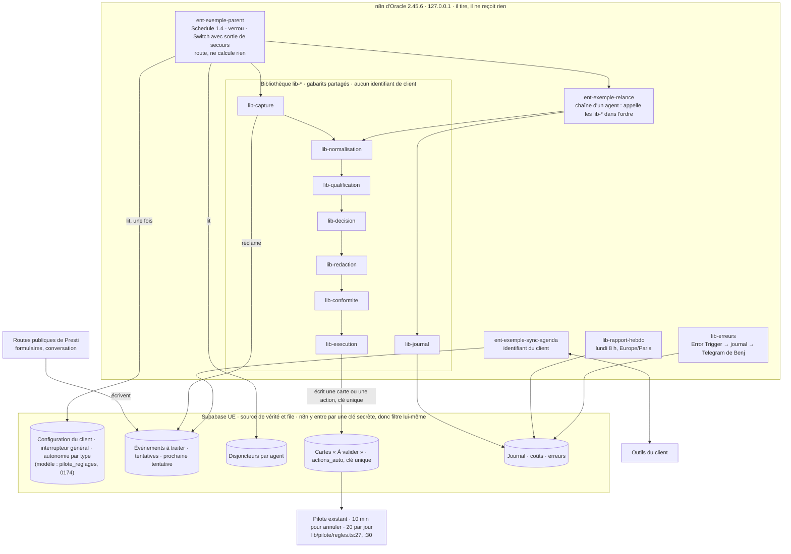

# Fiche — la méthode n8n pour les gros workflows (prompt 5, « Presti pour l'entreprise »)

> **Mode A** : aucun client n'est signé ; rien n'est construit. Ce fichier est le seul écrit. Toute donnée d'exemple porte « Exemple. ».
> Écrit le 02/11/2026 par un sous-agent Claude Code, pour la section « Méthode n8n — gros workflows » du prompt 5
> (`plans/011-cadrage-01-11/prompts-benj/p5-entreprise-sur-mesure.md:154-166`).
> Lecture seule : docs.n8n.io et GitHub par WebFetch ; MCP `n8n-oracle` en lecture (bonnes pratiques, référence du SDK,
> recherche et types de nœuds) ; réseau neuronal par le MCP `cerveau`. Aucun workflow, aucune migration, aucun code,
> aucun commit, aucune écriture dans le vault. Ce qu'on retient ici revient au vault par une tâche de périmètre `SaaS/…`.

**Comment les sources ont été lues.** WebFetch fait passer chaque page par un petit modèle qui la résume : les faits
ci-dessous sont des reformulations. Chaque chiffre qui décide d'un choix a été recoupé, quand c'était possible, avec les types
de nœuds que sert le n8n d'Oracle (`get_node_types`) ou avec le code source de l'étiquette `n8n@2.45.6`. Un réglage par défaut
tiré de la doc s'écrit « défaut documenté » : ce n'est pas un relevé d'Oracle.

---

## Ce qu'il faut retenir (10 points)

1. **Oracle tourne en n8n 2.45.6** (`.claude/rules/architecture-outils.md:69`, non revérifié aujourd'hui) : release stable du
   29/10/2026. La ligne stable est passée en **2.45.7 le 30/10** (dont un correctif d'autorisation sur la lecture des données
   d'exécution), et **3.0** est annoncée au 27/10 avec des changements cassants. On construit dès maintenant « compatible 3.0 ».
2. **En production, un parent appelle la version PUBLIÉE de l'enfant** ; sans version publiée : « Workflow is not active and
   cannot be executed. » En exécution manuelle, c'est le brouillon (code de 2.45.6). Publier, c'est déployer : enfants d'abord,
   parent ensuite, et l'export versionné est celui de la version publiée.
3. **Le contrat d'entrée natif est mince** : six types (any, string, number, boolean, array, object), ni champ obligatoire, ni
   énumération. Le nœud Code de validation du prompt (p5:159) est donc indispensable. Et la sortie doit tenir en **un seul nœud
   final** : par défaut, les éléments de toutes les passes du nœud final sont concaténés.
4. **Retry On Fail ne fait pas d'attente croissante** : 2 à 5 essais, 5 s au plus, délai fixe (code de 2.45.6). Les reprises
   croissantes, le disjoncteur et l'interrupteur se construisent dans Supabase, sur le modèle déjà en production du pilote
   (`pilote_reglages`, `actions_auto` : `supabase/migrations/0174_pilote_automatique.sql:8-13`).
5. **Le workflow d'erreur commun existe** (Error Trigger), mais il se pose dans les réglages de **chaque** workflow et ne part
   **jamais** sur une exécution manuelle. L'export de `presti-detecteurs` (02/11) n'en a pas ; relu à 19:20 UTC
   par le MCP, après le lot L12 (032-019), ses réglages n'en désignent toujours aucun : sa « branche d'erreur sans envoi » est interne.
6. **L'idempotence n'est pas native pour une action** : la garantie, c'est la clé unique en base (`actions_auto`,
   `unique (artisan_id, cle)`, 0174:13, :42). Remove Duplicates (historique gardé dans n8n) et l'en-tête `Idempotency-Key` de l'API
   de n8n (2.45.0, appels à n8n seulement) ne sont que des compléments.
7. **Édition Community : ni projets, ni partage, ni variables `$vars`, ni Git, ni secrets externes**, historique des versions
   visible 24 h. La configuration d'un client vit dans Supabase ; le versionnage, c'est l'export JSON plus un juge hors ligne
   (modèle : `scripts/detecteurs-n8n-qa.mjs`), qui doit entrer dans `SUITES` (il y est depuis le 02/11 à 19 h 06, l.196, commit `49d22f09`).
8. **L'identifiant « Supabase account » contourne la RLS** (d'après la doc de Supabase, une clé secrète passe outre toutes les
   politiques RLS) :
   l'isolation entre clients dans n8n tient au filtre organisation de chaque requête, prouvé hors ligne. Et un identifiant se
   choisit dans le nœud : tout ce qui touche un outil du client vit dans `ent-<client>-*`, jamais dans un `lib-*` partagé.
9. **n8n garde par défaut les données de chaque exécution** (purge à 14 jours ou au-delà de 10 000 exécutions) : c'est contraire
   à « n8n les lit et les écrit, ne les garde pas » (p5:95) tant qu'on ne coupe pas la sauvegarde des succès et qu'on ne masque pas
   les données de production des workflows `ent-*`.
10. **Tout ce qui attend un humain dans n8n suppose n8n joignable** (approbations « send and wait », Wait sur webhook,
    formulaires) ; le n8n d'Oracle écoute sur 127.0.0.1. La validation reste dans les cartes « À valider » de Presti. Et la licence
    de n8n interdit au client d'accéder à l'instance : à faire confirmer pour l'offre (question 8).

---

## 1. La version de n8n d'Oracle et ce qui en dépend

| Fait | Source (lue le 2026-11-02) |
|---|---|
| Oracle : n8n 2.45.6 en Docker (`/opt/n8n-complet`), exécuteurs de code et bac à sable, lié à `127.0.0.1:5678`, joint par tunnel SSH | `.claude/rules/architecture-outils.md:69-70` ; ADR-001 (installation du 01/11). **Non revérifié aujourd'hui** : pas d'accès SSH dans ce périmètre |
| `n8n@2.45.6` : release **stable**, publiée le 2026-10-29 à 08:30 UTC ; deux correctifs (temps économisé en mode file d'attente, icônes de la barre latérale) | api.github.com, release `n8n@2.45.6` |
| `n8n@2.45.7` et l'étiquette `stable` : 2026-10-30 ; correctifs dont « exiger la permission `execution:read` pour les routes qui lisent les données d'exécution d'un workflow » | api.github.com, liste des releases (lue jusqu'au caractère 100 000 sur 119 018) |
| `n8n@2.46.x` : préversions (étiquette `beta` du 2026-11-02) ; la ligne 1.123 est encore maintenue (1.123.92 du 2026-11-02) | idem |
| n8n 3.0 : « publiée le 2026-10-27 » selon les notes de version ; « accès anticipé » selon la page des changements cassants ; aucune étiquette 3.x parmi les releases lues | docs.n8n.io, `changelog/release-notes.md`, `changelog/v30-breaking-changes.md` |
| Nœuds servis par Oracle : Execute Sub-workflow 1.4, Execute Workflow Trigger 1.3, Error Trigger 1, Stop and Error 1, Data table 1.1, AI Agent 3.1, AI Agent Tool 3, Structured Output Parser 1.3, Guardrails 2, Anthropic Chat Model 1.6, Postgres 2.8, Supabase 1, Postgres Chat Memory 1.4, Remove Duplicates 2, Schedule Trigger 1.4, Wait 1.1, Code 2, Telegram 1.2, Evaluation 4.8 | MCP `n8n-oracle`, `search_nodes` et `get_node_types` |

**Ce que 2.45.6 rend disponible** (version d'apparition citée par la doc) : `N8N_WEBHOOK_URL` (2.30.0) ; délestage des grosses
réponses webhook (2.34.0) ; en-tête `Idempotency-Key` de l'API publique (2.45.0) ; outils MCP `get_workflow_history` (2.29.0),
`get_workflow_versions_diff` (2.36.0), `test_workflow` (2.15.0), `publish_workflow` (2.12.0) ; option « Force Tool Call on First
Iteration » de l'AI Agent (2.40) ; variables de projet (1.118.0, mais réservées aux licences Business et Enterprise).

**Ce que 2.45.6 n'a pas** : le mode « instance protégée » du serveur MCP (2.47.0), qui bloquerait toute écriture sauf l'exécution
de production. La lecture seule de Hermes sur `n8n-oracle` (`.claude/rules/architecture-outils.md:84`) repose donc sur les
permissions accordées à sa connexion et sur ses interdits, pas sur un verrou de l'instance.

**Ce que 3.0 casse et qu'on évite dès maintenant** (page des changements cassants) : sources « Local File » et « URL » du nœud
Execute Sub-workflow supprimées ; AI Agent v1 supprimé ; nœuds Function, Workflow Trigger, HTML Extract, LangChain Code, AI
Transform supprimés ; délai des tâches du nœud Code ramené de 300 à 60 s ; Always Output Data modifié sur If et Switch ; en mode
file d'attente, exécutions manuelles toujours sur les workers ; rotation de la clé de chiffrement activée par défaut (sauvegarder
la base avant) ; npm abandonné (Docker seul : Oracle y est déjà).

**Règle de construction qui en découle** : seulement des nœuds et des versions qui survivent à 3.0 (Execute Sub-workflow en source
`database`, AI Agent 3.x, aucun nœud retiré, des nœuds Code qui finissent en moins de 60 s), et le « rapport de migration »
(Settings > Migration Report, cité dans les notes de 2.45) avant toute montée. La montée en 2.45.7 est un geste d'infrastructure :
question 3.

---

## 2. Fiches de lecture (format du prompt 5)

### Fiche 1 — Sous-workflows

```text
Source : n8n GmbH, « Break workflows into smaller parts » (https://docs.n8n.io/build/flow-logic/break-workflows-into-smaller-parts.md),
         « Execute Sub-workflow » (https://docs.n8n.io/integrations/builtin/core-nodes/n8n-nodes-base.executeworkflow.md),
         « Execute Sub-workflow Trigger » (https://docs.n8n.io/integrations/builtin/core-nodes/n8n-nodes-base.executeworkflowtrigger.md)
         · date de publication non indiquée · lue le 2026-11-02 · intégralement : oui (trois pages)
         · recoupée par get_node_types sur Oracle et par le code de n8n@2.45.6 (fiche 9)
```

**Ce qu'elle montre**
- Un parent appelle un enfant par Execute Sub-workflow ; l'enfant commence par Execute Sub-workflow Trigger, que peut aussi appeler
  l'outil d'agent Call n8n Workflow Tool.
- Trois modes d'entrée : champs déclarés, exemple JSON, tout accepter. Sur Oracle (déclencheur 1.3) : `workflowInputs`, `jsonExample`,
  `passthrough`, et six types.
- Côté parent (1.4) : source `database` ou `parameter` ; « attendre la fin du sous-workflow », vrai par défaut ; un champ retiré arrive à `null`.
- Le parent reçoit les données du dernier nœud de l'enfant ; « View sub-execution » relie les deux exécutions.
- Un enfant qui contient des erreurs ne peut pas être déclenché ; « This workflow can be called by » dit qui peut l'appeler.

**Principes et patterns réutilisables**
- Découper un gros workflow en enfants « façon microservices » ; un même enfant sert plusieurs parents (exemple de la doc : un
  workflow de rapport partagé).
- Déclarer les entrées par champs, que le parent reçoit d'office, plutôt que « tout accepter ».
- Garder « attendre la fin » dès que le parent doit savoir si l'enfant a réussi.
- « Une fois par élément » pour isoler l'échec d'un objet ; « une fois avec tous » pour un agrégat (rapport).

**Erreurs à éviter**
- « Accept all data » : l'enfant doit alors tout valider lui-même.
- Laisser « Attempt to convert types » maquiller un type faux (le comportement sans conversion n'est pas documenté : à tester).
- La source `parameter` : le code de 2.45.6 exécute un JSON collé tel quel, sans contrôle de publication ni historique.
- Lire « dernier nœud » comme « dernière passe » : par défaut, toutes les passes du nœud final reviennent (fiche 9).

**Ce qui s'applique à Presti / à ce client**
- Le parent `ent-<client>-parent` et la bibliothèque `lib-*` (p5:156-158) se construisent ainsi : un enfant par couche (§3.2).
- Les six types natifs ne font pas un contrat : nœud Code « Contrat d'entrée » en tête de chaque `lib-*` (p5:159, §3.3).
- Politique d'appel « liste » (`workflowsFromAList`) pour qu'un `lib-*` n'accepte que les parents déclarés (fiche 9).

**Ce qui ne s'applique pas, et pourquoi**
- « Les sous-workflows ne comptent pas dans les quotas » : notion de forfait cloud ; Oracle est auto-hébergé.
- Sources « Local File » et « URL » listées par la doc : absentes de la version 1.4 d'Oracle, supprimées en 3.0.
- « Charger les données d'exécutions précédentes » pour construire : il faut sauver les exécutions de production réussies, donc
  des données réelles dans n8n ; en mode A, on épingle des données fictives.

**Licence (dépôt)** : n8n-docs, Apache 2.0 avec la « Commons Clause » (`LICENSE.md`, api.github.com) ; réutilisable : oui pour
s'en inspirer, aucun texte recopié.

**Chiffres annoncés** : aucun.

**Détail de la lecture** (relevé complet, sorti de « Ce qu'elle montre » le 02/11 pour tenir les 3 à 8 lignes de p5:75 ; tâche 032-027) :
- Un parent appelle un enfant par le nœud Execute Sub-workflow ; l'enfant commence par Execute Sub-workflow Trigger (« When
  Executed by Another Workflow »), que peut aussi appeler l'outil d'agent Call n8n Workflow Tool.
- Trois modes d'entrée : champs déclarés (nom et type), exemple JSON, tout accepter. Sur Oracle (déclencheur 1.3) :
  `workflowInputs` (défaut), `jsonExample`, `passthrough`, et six types : any, string, number, boolean, array, object.
- Côté parent (1.4 sur Oracle) : source `database` (liste ou ID) ou `parameter` (JSON collé) ; mode « une fois avec tous les
  éléments » ou « une fois par élément » ; option « attendre la fin du sous-workflow », vraie par défaut ; option « Attempt to
  convert types » ; un champ retiré arrive à `null`.
- Le parent reçoit les données du dernier nœud de l'enfant ; un lien « View sub-execution » relie les deux exécutions.
- Un enfant qui contient des erreurs ne peut pas être déclenché. Le réglage « This workflow can be called by » dit qui peut l'appeler.

### Fiche 2 — Gestion d'erreur

```text
Source : n8n GmbH, « Handle errors gracefully » (https://docs.n8n.io/build/flow-logic/handle-errors-gracefully.md),
         « Error Trigger » (https://docs.n8n.io/integrations/builtin/core-nodes/n8n-nodes-base.errortrigger.md),
         « Stop And Error » (https://docs.n8n.io/integrations/builtin/core-nodes/n8n-nodes-base.stopanderror.md),
         « Configure workflow settings » (https://docs.n8n.io/build/manage-workflows/configure-workflow-settings.md),
         « Work with nodes » (https://docs.n8n.io/build/understand-workflows/workflow-components/work-with-nodes.md)
         · non datées · lues le 2026-11-02 · intégralement : oui pour les quatre premières ; la cinquième, pour ses seuls réglages de nœud
         · recoupées par packages/core/src/execution-engine/workflow-execute.ts et
           packages/cli/src/execution-lifecycle/execute-error-workflow.ts de n8n@2.45.6
```

**Ce qu'elle montre**
- Un workflow d'erreur commence par Error Trigger, se choisit dans les réglages de chaque workflow, sert à plusieurs et n'a pas à être publié.
- Il ne part que sur l'échec d'une **exécution automatique**, jamais d'une exécution manuelle : il ne se teste pas à la main.
- Il reçoit `execution` (id, url, message, dernier nœud, mode) et `workflow` (id, nom) ; un objet `trigger` si le déclencheur a échoué.
- Stop and Error fait échouer une exécution exprès. On Error : arrêter, continuer, ou continuer par la sortie d'erreur.
- Code de 2.45.6 : 2 à 5 essais (3 par défaut), 0 à 5 000 ms d'attente ; **même délai à chaque essai, aucune attente croissante**.
- Réglages de workflow : ordre v1, workflow d'erreur, politique d'appel, fuseau (New York par défaut), sauvegarde et masquage des
  exécutions, délai maximal, « temps estimé économisé ».

**Principes et patterns réutilisables**
- Un seul workflow d'erreur pour toute la flotte, posé dans chaque workflow.
- Stop and Error pour changer une règle violée en échec visible, quand une alerte s'impose.
- « Continue (using error output) » sur chaque appel externe : l'échec part vers le journal et le disjoncteur au lieu de tout arrêter.
- Un délai maximal d'exécution sur chaque enfant, pour couper une exécution qui s'emballe.

**Erreurs à éviter**
- Compter sur Retry On Fail pour une reprise croissante : il n'en fait pas.
- « Continue » (sortie normale) sur un contrôle : la dernière donnée valide passe, et une vérification ratée ressemble à un succès.
- Tester le workflow d'erreur à la main : il ne part pas.
- Laisser le fuseau vide (New York).
- Recopier le message d'erreur brut dans une alerte : il peut porter une donnée du client.

**Ce qui s'applique à Presti / à ce client**
- `lib-erreurs` : Error Trigger → mise en forme sans donnée personnelle → ligne au journal Supabase → Telegram de Benj (p5:162 ;
  nœud Telegram 1.2 sur Oracle, une sortie HTTPS, rien à exposer).
- À poser dans les réglages de chaque `ent-*` et `lib-*`. L'export de `presti-detecteurs` (02/11, 16 h 07) n'a ni workflow
  d'erreur (réglages : `executionOrder: v1`, `availableInMCP: true`, `timezone: Europe/Paris`), ni reprise, ni sortie d'erreur sur
  ses 34 nœuds (inspection de `.orchestre/preuves/032-003/presti-detecteurs.workflow.json`, 02/11). Depuis 18:46 UTC (L12, 032-019),
  il porte 41 nœuds et une branche d'erreur sans envoi (sa description) ; ses réglages, relus par le MCP à 19:20 UTC, ne désignent
  toujours aucun workflow d'erreur.
- « Reprises bornées avec attente croissante » (p5:162) : compteur et date de la prochaine tentative dans la file Supabase (§3.6).
- Masquage des données de production et non-sauvegarde des succès : c'est ce qui tient « n8n ne les garde pas » (p5:95, §3.5).
- « Temps estimé économisé » est une valeur saisie à la main : jamais un KPI de ROI (p5:193, « présenter un chiffre déclaré comme mesuré »).

**Ce qui ne s'applique pas, et pourquoi**
- Le log streaming (cité pour enquêter) : absent de l'édition Community (fiche 6).
- Les attributs OpenTelemetry par nœud : licence Enterprise auto-hébergée.

**Licence (dépôt)** : doc Apache 2.0 avec la Commons Clause ; code n8n sous Sustainable Use License 1.0 (fichiers `.ee` sous
licence Enterprise) : lu pour comprendre, rien recopié.

**Chiffres annoncés** : aucun (les bornes de reprise sont lues dans le code, ce n'est pas une mesure).

**Détail de la lecture** (relevé complet, sorti de « Ce qu'elle montre » le 02/11 pour tenir les 3 à 8 lignes de p5:75 ; tâche 032-027) :
- Un workflow d'erreur commence par Error Trigger et se choisit dans les réglages de chaque workflow ; il peut servir à plusieurs
  workflows ; il n'a pas besoin d'être publié ; un workflow qui contient un Error Trigger s'en sert pour lui-même par défaut.
- Il ne se déclenche que sur l'échec d'une **exécution automatique**, jamais d'une exécution manuelle : il ne se teste pas à la main.
- Il reçoit `execution` (`id`, `url`, `retryOf`, `error.message`, `error.stack`, `lastNodeExecuted`, `mode`) et `workflow`
  (`id`, `name`). Si l'erreur vient du déclencheur, un objet `trigger` (`error`, `mode: trigger`) remplace l'essentiel
  d'`execution`. Le code de 2.45.6 passe aussi `executionContext` et le projet propriétaire.
- Stop and Error fait échouer une exécution exprès (message ou objet d'erreur) et nourrit le workflow d'erreur.
- Réglages de nœud : Retry On Fail ; On Error = Stop Workflow, Continue (qui poursuit avec la dernière donnée valide), Continue
  (using error output) ; Always Output Data (boucle infinie possible avec If) ; Execute Once ; notes.
- Code de 2.45.6 : nombre d'essais borné entre 2 et 5 (3 par défaut) ; attente bornée entre 0 et 5 000 ms (1 000 par défaut, et
  un 0 saisi redevient 1 000) ; **même délai à chaque essai, aucune attente croissante**.
- Réglages de workflow : ordre d'exécution v1 (recommandé) ; workflow d'erreur ; politique d'appel ; fuseau (New York si ni le
  workflow ni l'instance n'en ont) ; sauvegarde des exécutions (échecs, succès, manuelles, progression) ; délai maximal d'exécution ;
  masquage des données d'exécution de production et manuelles ; « temps estimé économisé » ; attributs OpenTelemetry.

### Fiche 3 — Mode file d'attente, concurrence, données d'exécution, mémoire

```text
Source : n8n GmbH, « Enable queue mode » (https://docs.n8n.io/deploy/host-n8n/configure-n8n/scaling/enable-queue-mode.md),
         « Control concurrency » (…/scaling/control-concurrency.md), « Manage execution data » (…/scaling/manage-execution-data.md),
         « Scaling » (…/configure-n8n/scaling.md), « Fix memory issues » (…/scaling/fix-memory-issues.md),
         « Measure performance » (…/scaling/measure-performance.md)
         · non datées · lues le 2026-11-02 · intégralement : oui (six pages)
```

**Ce qu'elle montre**
- File d'attente : Redis **et** une base, SQLite déconseillé ; `N8N_ENCRYPTION_KEY` partagée ; 10 exécutions par worker par défaut.
- Mode normal : `N8N_CONCURRENCY_PRODUCTION_LIMIT`, coupée par défaut ; elle ne compte ni les exécutions manuelles, ni les sous-workflows,
  ni les workflows d'erreur.
- Purge active par défaut : 336 h (14 jours) ou au-delà de 10 000 exécutions ; avec SQLite, la place ne revient qu'après un VACUUM.
- Mémoire : n8n ne borne pas ce qu'un nœud charge ; remèdes : petits lots, enfants qui rendent peu, moins de nœuds Code.

**Principes et patterns réutilisables**
- Commencer en mode normal, avec une limite de concurrence, des lots et la purge ; passer en file d'attente sur une mesure.
- Un enfant rend un résumé, jamais tout le lot.
- Couper la sauvegarde des succès, garder les échecs.

**Erreurs à éviter**
- La file d'attente sur SQLite. Beaucoup de workers à faible concurrence (les connexions à la base s'épuisent).
- De gros lots en exécution manuelle (n8n copie les données pour l'interface).

**Ce qui s'applique à Presti / à ce client**
- Oracle : ARM, 4 cœurs, 23 Gio, disque à 90 % le 01/11 (ADR-003). Donc mode normal, limite de concurrence, purge resserrée, lots
  bornés, et `df -h` plus mémoire libre avant chaque nouveau client (p5:166).
- Un sondage à la minute fait 1 440 exécutions par jour et par client : il atteint seul la purge par nombre (10 000 par défaut) en
  moins de 7 jours et chasse les traces des autres workflows (calcul sur les défauts documentés). D'où : ne pas sauver les succès du
  parent, et sonder toutes les 5 minutes tant qu'aucun irritant n'exige mieux.
- On ne sait pas sur quelle base tourne le n8n d'Oracle (SQLite ou Postgres) : c'est elle qui décide du mode file d'attente et du
  VACUUM (question 2).

**Ce qui ne s'applique pas, et pourquoi**
- Processeurs webhook, répartiteur de charge, multi-main : n8n n'est pas exposé (p5:117) et multi-main exige Enterprise.
- Délestage des grosses réponses webhook : aucune réponse webhook ne sort d'Oracle.

**Licence (dépôt)** : doc Apache 2.0 avec la Commons Clause ; inspiration seulement.

**Chiffres annoncés** : « jusqu'à 220 exécutions de workflow par seconde » sur une instance (annoncé par l'auteur, non vérifié ;
la page cite une base MySQL, que n8n 2.0 ne supporte plus comme base de stockage : la mesure date donc d'avant 2.x, par déduction) ;
bancs sur une c5a.large de 4 Go et sur sept c5a.4xlarge de 8 Go (annoncé par l'auteur, non vérifié).

**Détail de la lecture** (relevé complet, sorti de « Ce qu'elle montre » le 02/11 pour tenir les 3 à 8 lignes de p5:75 ; tâche 032-027) :
- File d'attente : l'instance principale crée les exécutions, Redis les met en file, des workers les exécutent. Redis **et** une
  base sont requis ; SQLite est déconseillé (« non supporté » pour ce système distribué) ; `N8N_ENCRYPTION_KEY` partagée ;
  concurrence d'un worker 10 par défaut, 5 au moins conseillé ; `/healthz` ; multi-main réservé à Enterprise.
- Mode normal : limite `N8N_CONCURRENCY_PRODUCTION_LIMIT`, coupée par défaut. Elle ne compte que les exécutions de production
  (déclencheur, webhook), ni les manuelles, ni les sous-workflows, ni les workflows d'erreur ; file FIFO ; une exécution en file ne
  se relance pas.
- Purge : active par défaut, à 336 h (14 jours) ou au-delà de 10 000 exécutions ; tampon d'une heure ; une exécution annotée
  n'est jamais purgée ; avec SQLite, la place libérée ne revient au disque qu'après un VACUUM.
- Mémoire : n8n ne borne pas ce qu'un nœud charge. Causes : volume JSON, binaire, nombre de nœuds, nœud Code, exécutions manuelles.
  Remèdes : petits lots (exemple : 200 lignes au lieu de 10 000) ; enfants qui ne rendent qu'un petit résultat (Loop Over Items puis
  Execute Workflow) ; éviter le nœud Code ; option `--max-old-space-size`.

### Fiche 4 — Nœuds IA : AI Agent, outils, mémoire, Structured Output Parser

```text
Source : n8n GmbH, « AI Agent » (https://docs.n8n.io/integrations/builtin/cluster-nodes/root-nodes/n8n-nodes-langchain.agent.md) et ses
         « Common issues » (…/n8n-nodes-langchain.agent/common-issues.md), « Structured Output Parser »
         (…/sub-nodes/n8n-nodes-langchain.outputparserstructured.md), « Call n8n Workflow Tool » (…/sub-nodes/n8n-nodes-langchain.toolworkflow.md),
         « Human-in-the-loop for tools » (https://docs.n8n.io/build/integrate-ai/ai-examples/human-in-the-loop-for-tools.md),
         « How memory works » (…/understand-ai-components/how-memory-works.md), « Simple Memory » (…/n8n-nodes-langchain.memorybufferwindow.md),
         « Postgres Chat Memory » (…/n8n-nodes-langchain.memorypostgreschat.md)
         · non datées · lues le 2026-11-02 · intégralement : oui (huit pages)
         · recoupées par get_node_types sur Oracle (AI Agent 3.1, Structured Output Parser 1.3, Guardrails 2)
```

**Ce qu'elle montre**
- AI Agent : un modèle obligatoire ; la doc exige un outil, alors que le modèle « ai_agent_basic » du SDK d'Oracle n'en a aucun (à lever par `validate_workflow`).
- AI Agent 3.1 sur Oracle : `maxIterations` 10 par défaut ; **`passthroughBinaryImages` vrai par défaut** ; un modèle de secours possible.
- Structured Output Parser 1.3 : JSON Schema sans `$ref`, `autoFix` faux par défaut ; la doc ne dit pas ce qui arrive hors schéma.
- Call n8n Workflow Tool : en production, l'enfant doit être publié, sinon l'agent reçoit l'erreur comme un résultat d'outil, qui peut passer inaperçu.
- Revue humaine des outils par Chat, Slack, Telegram, Gmail et d'autres canaux ; au refus, l'agent est prévenu.
- Mémoire : Simple Memory ne marche pas en mode file ; par défaut, tous les nœuds de mémoire d'un workflow partagent la même session.
- Guardrails 2 : « sanitize » masque données personnelles, clés et URL **sans modèle** ; « classify » demande un modèle ; la liste ne
  compte aucun identifiant français (ni NIR, ni SIRET).

**Principes et patterns réutilisables**
- Sortie structurée avec un champ « raison » pour déboguer ; température basse (0 à 0,2) et exemples (bonnes pratiques « triage »).
- Plafonner `maxIterations` et le débit (`batching`) pour borner le coût.
- Revue humaine sélective des gestes risqués : tout relire au début, desserrer ensuite.

**Erreurs à éviter**
- `autoFix` : il cache une sortie hors schéma derrière un second appel payant ; « hors schéma = rejet » (p5:216) l'exclut.
- `passthroughBinaryImages` laissé à vrai : des images partent au modèle sans qu'on l'ait décidé.
- Un modèle de secours qui serait un modèle gratuit en ligne.
- Postgres Chat Memory pointée sur Supabase : une table créée par un nœud, hors migration et hors RLS.

**Ce qui s'applique à Presti / à ce client**
- `lib-qualification` et `lib-redaction` : AI Agent 3.1 sans outil d'action, Structured Output Parser 1.3 en JSON Schema saisi,
  `autoFix` faux, puis revalidation dans un nœud Code : le parseur n'est pas le contrat.
- Modèle : Anthropic Chat Model 1.6, le modèle du produit sous contrat ; jamais freellmapi avec une donnée de client (p5:218,
  `.claude/rules/securite.md`). Guardrails « sanitize » avant tout appel, quand un champ personnel n'est pas nécessaire, avec des
  motifs maison pour les identifiants français.
- La mémoire des agents, ce sont des tables Supabase lues par l'enfant (p5:219), pas une mémoire de chat : ces agents font un
  travail à coup unique.

**Ce qui ne s'applique pas, et pourquoi**
- La revue humaine par « send and wait » : ces opérations passent par la route `/webhook-waiting/*` (fiche 3), donc par un n8n que
  l'approbateur peut joindre (déduction) ; celui d'Oracle écoute sur 127.0.0.1 (ADR-001). La validation reste dans « À valider »
  (cartes Supabase, `supabase/migrations/0157_assistant_actions.sql:31`) et dans le pilote (p5:225).
- Simple Memory : interdite dès qu'on passe en file d'attente, et inutile ici.

**Licence (dépôt)** : doc Apache 2.0 avec la Commons Clause ; inspiration seulement.

**Chiffres annoncés** : aucun (les défauts sont lus dans les types de nœuds d'Oracle).

**Détail de la lecture** (relevé complet, sorti de « Ce qu'elle montre » le 02/11 pour tenir les 3 à 8 lignes de p5:75 ; tâche 032-027) :
- AI Agent : un modèle de chat est obligatoire ; le « type d'agent » est déprécié depuis 1.82.0 (tout fonctionne en « Tools
  Agent ») ; la v1 disparaît en 3.0. La doc dit qu'au moins un outil est obligatoire, alors que le modèle « ai_agent_basic » du SDK
  d'Oracle n'en a aucun : contradiction à lever par `validate_workflow` avant de s'appuyer sur l'un ou l'autre.
- AI Agent 3.1 sur Oracle : `maxIterations` 10 par défaut ; modèle de secours (`needsFallback`) ; `returnIntermediateSteps` faux ;
  **`passthroughBinaryImages` vrai par défaut** ; `batching` (taille 1, délai 0) ; `forceToolCallOnFirstIteration` faux ;
  `enableStreaming` vrai ; la réponse sort dans `output`.
- Structured Output Parser 1.3 : schéma tiré d'un exemple (tous les champs deviennent obligatoires) ou JSON Schema saisi (sans
  `$ref`) ; `autoFix` faux par défaut, et il coûte un appel de modèle de plus ; la sortie est rangée sous `output`. La doc ne dit pas
  ce qui arrive quand la sortie ne respecte pas le schéma.
- Call n8n Workflow Tool : un agent appelle un sous-workflow ; en production, ce sous-workflow doit être publié, sinon l'agent reçoit
  « Workflow is not active and cannot be executed » comme résultat d'outil, ce qui peut passer inaperçu ; `$fromAI()` laisse le
  modèle remplir un champ.
- Revue humaine des outils : pause, puis approbation ou refus par Chat, Slack, Discord, Telegram, Teams, Gmail, WhatsApp Business,
  Google Chat ou Outlook ; au refus, l'agent est prévenu ; marche aussi dans un sous-agent.
- Mémoire : Simple Memory ne fonctionne pas en mode file d'attente ; Postgres Chat Memory crée sa table si elle manque ; par défaut,
  tous les nœuds de mémoire d'un workflow partagent la même session.
- Guardrails 2 (types d'Oracle) : « sanitize » masque données personnelles, clés secrètes, URL et motifs maison **sans modèle** ;
  « classify » demande un modèle pour jailbreak, NSFW, hors sujet et règles maison. La liste d'entités personnelles ne compte
  aucun identifiant français (ni NIR, ni SIRET).

### Fiche 5 — Tables de données

```text
Source : n8n GmbH, « Data tables » (https://docs.n8n.io/build/work-with-data/data-tables.md),
         « Data table » (https://docs.n8n.io/integrations/builtin/core-nodes/n8n-nodes-base.datatable.md)
         · non datées · lues le 2026-11-02 · intégralement : oui · recoupées par search_nodes (Data table 1.1 sur Oracle)
```

**Ce qu'elle montre**
- Des tables internes à n8n, lues par le nœud Data table, par l'API (`/datatables`) et par l'onglet de l'interface ; import et
  export CSV.
- 200 Mio au total pour toute l'instance par défaut (`N8N_DATA_TABLES_MAX_SIZE_BYTES`) ; alerte à 80 % ; écritures refusées au-delà.
- Rangées par projet, visibles de tous ses membres, du propriétaire et des administrateurs ; pas d'accès d'un projet à l'autre ;
  un nœud Code ne les lit pas directement.
- Nœud 1.1 : lignes (get avec `returnAll`, insert, update, upsert, deleteRows, rowExists, rowNotExists) ; tables (create, delete,
  list, renommer, vider) ; identifiant de ligne automatique.
- Usages cités : marqueurs anti-doublon, verrous de déclenchement, tables de référence, données d'évaluation.

**Principes et patterns réutilisables** : rowExists / rowNotExists comme filtre anti-doublon ; un verrou « en cours » posé au
début d'une passe et levé à la fin.

**Erreurs à éviter** : y ranger des données de client (taille commune à toute l'instance, hors Supabase, hors RLS) ; y garder
un état dont dépend une décision.

**Ce qui s'applique à Presti / à ce client** : au plus un cache technique sans donnée personnelle, recopié de Supabase ; « rien
d'important ne vit seulement dans n8n » (p5:115).

**Ce qui ne s'applique pas, et pourquoi** : la recommandation « Data Table PREFERRED » des bonnes pratiques `data_persistence`
(fiche 10) : chez Presti, Supabase est la source de vérité et la file (p5:115).

**Licence (dépôt)** : doc Apache 2.0 avec la Commons Clause.

**Chiffres annoncés** : 200 Mio et 80 % (défauts documentés, non relevés sur Oracle).

### Fiche 6 — Variables, identifiants, projets, éditions

```text
Source : n8n GmbH, « Community edition features » (https://docs.n8n.io/deploy/host-n8n/community-edition-features.md),
         « Define custom variables » (https://docs.n8n.io/build/code-in-n8n/define-custom-variables.md),
         « Create and edit credentials » (https://docs.n8n.io/build/understand-workflows/create-and-edit-credentials.md),
         « Organize work in projects » et « Set permissions and roles (RBAC) »
         (https://docs.n8n.io/administer/manage-users-and-access/set-permissions-and-roles-rbac/organize-work-in-projects.md, …-rbac.md),
         « Supabase credentials » (https://docs.n8n.io/integrations/builtin/credentials/supabase.md) ;
         Supabase, « API keys » (https://supabase.com/docs/guides/api/api-keys)
         · non datées · lues le 2026-11-02 · intégralement : oui
```

**Ce qu'elle montre**
- Absent de Community : `$vars`, environnements, secrets externes, projets, SSO, partage de workflows et d'identifiants, Git. La version
  enregistrée (clé gratuite) ajoute les dossiers, « Debug in editor » et les exécutions annotées.
- Contradiction : la page RBAC donne des rôles de projet à « Registered Community », la page des éditions retire les projets : à lire sur l'instance.
- `$vars` : Business et Enterprise seulement, en auto-hébergé.
- Identifiants : en Community, dans l'espace personnel ; « Allowed HTTP Request Domains » borne où un identifiant peut partir ; les
  identifiants « par utilisateur final » sont réservés à Enterprise.
- Identifiant Supabase : hôte et clé secrète ; Supabase annonce le retrait des anciennes clés `service_role` d'ici la fin de 2026 ;
  une clé secrète contourne toutes les politiques RLS (doc de Supabase).

**Principes et patterns réutilisables** : un identifiant par client et par service, nommé sans donnée personnelle ; domaines
autorisés réduits à celui de l'API du client ; droits minimaux réglés chez l'outil du client.

**Erreurs à éviter** : croire que la RLS protège un workflow branché par une clé secrète ; compter sur `$vars` ; mettre le nom réel
d'un client dans le nom d'un identifiant (les exports portent les noms).

**Ce qui s'applique à Presti / à ce client**
- « Supabase account » (créé par Benj, « tous les droits » : `plans/011-cadrage-01-11/chantier-4-assistant-plan.md:28-32`) contourne
  la RLS : chaque requête d'un `ent-*` filtre sur l'organisation, et le juge hors ligne le prouve, comme le brief des détecteurs
  impose le filtre `artisan_id` (`plans/011-cadrage-01-11/briefs/c4-n8n-detecteurs.md:21`).
- Un identifiant se choisit dans le nœud (seuls ses champs acceptent une expression) : un `lib-*` partagé ne peut pas changer
  d'identifiant selon le client. Tout ce qui touche un outil du client vit dans `ent-<client>-sync-<outil>` ; les `lib-*` n'utilisent
  que des identifiants de Presti (Supabase, modèle, Telegram), ou aucun.
- La configuration d'un client va dans Supabase (défaut du prompt, p5:424), pas dans `$vars`.
- Vérifier le type de clé de « Supabase account » avant la fin de 2026 (question 6).

**Ce qui ne s'applique pas, et pourquoi** : projets, partage, variables par projet, secrets externes, identifiants par utilisateur
final : licences payantes, contraires à « aucun outil payant en plus » (annexe 1 §B du prompt 5).

**Licence (dépôt)** : doc n8n Apache 2.0 avec la Commons Clause ; doc Supabase : licence non vérifiée (lecture seule).

**Chiffres annoncés** : 50 et 1 000 caractères (limites documentées) ; « fin 2026 » (date annoncée par Supabase, non vérifiée).

**Détail de la lecture** (relevé complet, sorti de « Ce qu'elle montre » le 02/11 pour tenir les 3 à 8 lignes de p5:75 ; tâche 032-027) :
- Absent de Community : variables personnalisées, environnements, secrets externes, stockage externe du binaire, log streaming,
  multi-main, projets, SSO, partage de workflows et d'identifiants (seuls le propriétaire de l'instance et le créateur y ont
  accès), Git.
  La version enregistrée (clé gratuite par e-mail) ajoute les dossiers, « Debug in editor » et les données d'exécution annotées.
- Contradiction : la page RBAC accorde les rôles de projet à « Registered Community », la page des éditions retire les projets à
  Community. À trancher sur l'instance (Settings > Usage and plan).
- `$vars` : chaînes en lecture seule ; licences Business et Enterprise en auto-hébergé ; variables de projet depuis 1.118.0 ; clé
  de 50 caractères au plus, valeur de 1 000 ; une variable vide vaut `undefined` sans faire échouer le workflow.
- Identifiants : en Community, toujours créés dans l'espace personnel ; nom par défaut « <nœud> account » ; « Allowed HTTP Request
  Domains » (tous, une liste, aucun) borne les adresses où le nœud HTTP Request peut envoyer un identifiant ; les champs d'un
  identifiant acceptent une expression ; les identifiants « par utilisateur final » sont réservés à Enterprise.
- Identifiant Supabase de n8n : hôte et clé secrète ; les anciennes clés `service_role` marchent encore, et Supabase annonce leur
  retrait d'ici la fin de 2026. D'après la doc de Supabase, une clé secrète contourne toutes les politiques RLS (elle passe par le
  rôle `service_role`, qui porte l'attribut `BYPASSRLS`).

### Fiche 7 — Versionnage, historique, export, publication, serveur MCP

```text
Source : n8n GmbH, « View change history » (https://docs.n8n.io/build/manage-workflows/view-change-history.md),
         variables « Workflow history » et « Workflows » (…/use-environment-variables/workflow-history.md, …/workflows.md),
         « Export and import » (https://docs.n8n.io/build/manage-workflows/export-and-import.md),
         « Use the command line » (https://docs.n8n.io/deploy/host-n8n/configure-n8n/use-the-command-line.md),
         « Connect to n8n MCP server » et « MCP server tools reference » (https://docs.n8n.io/connect/connect-to-n8n-mcp-server.md, …/mcp-server-tools-reference.md),
         « Idempotency » (https://docs.n8n.io/connect/n8n-api/idempotency.md),
         « Debug executions » et « Pin and mock data » (…/understand-executions/debug-executions.md, …/work-with-data/pin-and-mock-data.md)
         · non datées · lues le 2026-11-02 · intégralement : oui, sauf la référence des outils MCP (100 000 caractères sur 233 629)
```

**Ce qu'elle montre**
- Historique : une version à chaque enregistrement, 24 h visibles en Community ; `N8N_WORKFLOW_HISTORY_PRUNE_TIME` à -1 par défaut (écart à vérifier).
- Export JSON : noms et ID des identifiants, sans leurs secrets d'après la doc ; un nœud HTTP importé de cURL peut garder un en-tête d'authentification.
- CLI : `export:workflow` (`--separate`, `--published`…), `import:workflow` qui écrase un homonyme, `export:credentials --decrypted` en clair.
- Serveur MCP : `test_workflow` épingle et simule (300 s par défaut) ; `execute_workflow` en production exige une version publiée ;
  `list_credentials` ne rend jamais de secret.
- API publique : `Idempotency-Key` depuis 2.45.0, réponse gardée 12 h.
- Politique d'appel par défaut : `workflowsFromSameOwner` ; elle « nécessite la fonctionnalité de partage de workflows ».
- Données épinglées : jamais en production, jamais de binaire.

**Principes et patterns réutilisables**
- Versionner hors de n8n : un fichier par workflow, l'export de la version publiée, relu par une suite.
- Comparer deux versions (`get_workflow_versions_diff`) avant chaque publication.
- `test_workflow` comme banc d'essai à blanc d'un enfant.

**Erreurs à éviter** : `export:credentials --decrypted` ; importer un JSON dont l'ID existe déjà ; verser un export qui garde un
en-tête d'authentification ; prendre l'historique de 24 h pour une sauvegarde.

**Ce qui s'applique à Presti / à ce client**
- Le modèle existe : `scripts/detecteurs-n8n-qa.mjs:1-15` relit l'export (`.orchestre/preuves/032-003/presti-detecteurs.workflow.json`,
  `:27`), contrôle la structure, rejoue chaque nœud Code sur des cas fictifs et prouve qu'il rougit par des mutants. Chaque `ent-*`
  et chaque `lib-*` aura le sien (p5:164).
- Ce juge n'apparaît pas dans `scripts/tout-verifier.mjs` (recherche du 02/11 vers 17 h, tâche 032-003 encore en cours) : tant
  qu'il n'est pas dans `SUITES`, personne ne le joue.
- Publier = déployer chez le client (accord écrit, p5:227) ; dépublier = arrêt immédiat ; `Idempotency-Key` pour les scripts de
  Claude Code qui relancent une exécution par l'API.

**Ce qui ne s'applique pas, et pourquoi** : Git et environnements de n8n (Business, Enterprise) ; « instance protégée » (2.47.0).

**Licence (dépôt)** : doc Apache 2.0 avec la Commons Clause.

**Chiffres annoncés** : le dépôt `n8n-io/skills`, recommandé par la page MCP, compterait « 13 compétences, plus de 50 documents de
référence » (annoncé par l'auteur, non vérifié ; dépôt non lu).

**Détail de la lecture** (relevé complet, sorti de « Ce qu'elle montre » le 02/11 pour tenir les 3 à 8 lignes de p5:75 ; tâche 032-027) :
- Historique : une version à chaque enregistrement, restauration ou tirage Git ; un réglage n'en crée pas ; 24 h visibles pour
  tous, 5 jours en Cloud Pro, tout en Enterprise ; nommer une version demande Business ou Enterprise. La variable
  `N8N_WORKFLOW_HISTORY_PRUNE_TIME` vaut -1 par défaut (tout garder) : l'écart entre ce qui est gardé et ce qui est visible est à vérifier.
- Export JSON : noms et ID des identifiants, pas leurs secrets d'après la doc (les ID ne sont pas sensibles, les noms peuvent
  l'être) ; un nœud HTTP importé de cURL peut garder un en-tête d'authentification.
- CLI : `export:workflow` (`--id`, `--all`, `--separate`, `--pretty`, `--backup`, `--published`, `--version`) ; `import:workflow`
  garde les ID (et écrase un homonyme) et importe désactivé ; `export:credentials --decrypted` écrit les secrets en clair ;
  `publish:workflow` / `unpublish:workflow` (2.0) ; dans Docker : `docker exec -u node -it <conteneur> <commande>`. Paquets
  `.n8np` en préversion.
- Serveur MCP : chaque workflow s'expose (« Available in MCP ») ; `test_workflow` (2.15.0) épingle les données et simule
  déclencheurs, nœuds à identifiant et HTTP Request (300 s par défaut, 3 600 au plus) ; `execute_workflow` en production exige une
  version publiée ; `get_workflow_version` réduit les identifiants à `id` et `name` (2.34.0) ; `list_credentials` ne rend jamais
  de secret.
- API publique : `Idempotency-Key` depuis 2.45.0 ; réponse gardée 12 h ; 409 si la première requête court encore, 422 si la même
  clé porte une autre requête ; POST sous `/api/v1` seulement.
- Politique d'appel par défaut : `workflowsFromSameOwner` ; valeurs `any`, `none`, `workflowsFromAList`, `workflowsFromSameOwner` ;
  « nécessite la fonctionnalité de partage de workflows ».
- Données épinglées : jamais en production, jamais de binaire. « Debug in editor » : à partir de Registered Community.

### Fiche 8 — Planification et attente

```text
Source : n8n GmbH, « Schedule Trigger — Common issues » (https://docs.n8n.io/integrations/builtin/core-nodes/n8n-nodes-base.scheduletrigger/common-issues.md),
         « Wait » (https://docs.n8n.io/integrations/builtin/core-nodes/n8n-nodes-base.wait.md)
         · non datées · lues le 2026-11-02 · intégralement : oui
```

**Ce qu'elle montre**
- Schedule Trigger : fuseau par workflow ou `GENERIC_TIMEZONE` ; une variable du planning n'est lue qu'à la publication ; un
  changement d'intervalle n'agit qu'après republication, et le planning repart du moment de la publication.
- Wait : sous 65 s, le processus attend en mémoire ; au-delà, l'exécution est déchargée en base et rechargée à la reprise ; reprise
  à une date, après une durée, sur appel de webhook (`$execution.resumeUrl`) ou sur formulaire ; **toujours à l'heure du serveur**,
  quel que soit le fuseau du workflow.
- n8n 2.0 : quand un enfant se met en attente (webhook, formulaire, revue humaine, Wait de plus de 65 s), le parent reçoit
  désormais la sortie finale de l'enfant (page des changements cassants de 2.0).

**Principes et patterns réutilisables** : un déclencheur fréquent, puis des conditions (If, Switch) qui lisent le calendrier ;
des cron à heure fixe pour les rapports ; des durées relatives plutôt que des heures absolues dans Wait.

**Erreurs à éviter** : un planning qui dépend d'une valeur changeante ; un Wait « jusqu'à 10 h » sur un serveur réglé en UTC ;
des attentes de plusieurs jours dans une exécution.

**Ce qui s'applique à Presti / à ce client** : le calendrier de relance du client (J+1, J+3, J+7 par défaut, p5:190) et l'heure de
son rapport vivent dans Supabase et se lisent après un déclencheur fréquent ; le parent tourne toutes les 1 à 5 minutes
(annexe 2 §3, p5:426) ; aucun Wait long : la prochaine tentative est une date en base (§3.6).

**Ce qui ne s'applique pas, et pourquoi** : Wait « sur webhook » et « sur formulaire » : n8n doit être joignable.

**Licence (dépôt)** : doc Apache 2.0 avec la Commons Clause.

**Chiffres annoncés** : 65 s (seuil documenté).

### Fiche 9 — Code source de `n8n@2.45.6`

```text
Source : n8n GmbH, code source à l'étiquette n8n@2.45.6 (raw.githubusercontent.com/n8n-io/n8n/n8n@2.45.6/…) :
         packages/core/src/execution-engine/workflow-execute.ts ; packages/cli/src/execution-lifecycle/execute-error-workflow.ts ;
         packages/cli/src/workflow-execute-additional-data.ts ; packages/cli/src/executions/pre-execution-checks/subworkflow-policy-checker.ts
         · étiquette du 2026-10-29 · lu le 2026-11-02 · intégralement : non pour workflow-execute.ts (100 000 caractères sur 105 374) ;
           oui pour les trois autres (les fonctions qu'ils appellent ailleurs n'ont pas été lues)
```

**Ce qu'elle montre**
- Reprises : 2 à 5 essais, 0 à 5 000 ms, délai fixe (fiche 2).
- `executeErrorWorkflow` lance le workflow d'erreur pour toute exécution en erreur, sauf celui qui se désigne lui-même en mode `error`.
  Son appelant n'est pas lu : le cas d'un enfant (mode `integrated`) reste à prouver par un essai.
- Version appelée : le brouillon en exécution manuelle, la **version publiée** sinon ; un JSON collé (source `parameter`) échappe à ce contrôle.
- Un enfant tourne toujours en mode `integrated`.
- Sortie : par défaut, les éléments de **toutes les passes** du nœud final se concatènent (déclencheur 1.2 et plus).
- Politique d'appel : `any`, `none`, `workflowsFromAList`, `workflowsFromSameOwner` ; le défaut est lu dans la configuration de l'instance.

**Principes et patterns réutilisables** : un enfant finit par un seul nœud « Sortie (contrat) », exécuté une fois ; en Community,
où tout vit dans un même projet personnel, la politique « liste » est la seule barrière d'appel entre workflows.

**Erreurs à éviter** : croire en service un enfant modifié mais pas republié ; laisser une boucle se terminer sur le nœud final.

**Ce qui s'applique à Presti / à ce client** : l'ordre de déploiement (enfants publiés, puis parent) ; les `lib-*` en
`workflowsFromAList` limité aux parents déclarés (sa disponibilité dans l'éditeur Community est à vérifier, le réglage se pose aussi
dans le JSON) ; un essai à blanc obligatoire de la chaîne d'erreur d'un enfant.

**Ce qui ne s'applique pas, et pourquoi** : `useWorkflowPublicationService`, `returnLastRunOnly` : mécanismes internes, pas des
réglages à nous.

**Licence (dépôt)** : Sustainable Use License 1.0 (`LICENSE.md` de n8n-io/n8n) ; fichiers `.ee` sous licence Enterprise ; lecture :
oui ; copie : non.

**Chiffres annoncés** : aucun.

**Détail de la lecture** (relevé complet, sorti de « Ce qu'elle montre » le 02/11 pour tenir les 3 à 8 lignes de p5:75 ; tâche 032-027) :
- Reprises : bornes 2 à 5 essais et 0 à 5 000 ms, délai fixe (fiche 2) ; l'ancien `continueOnFail` et `onError`
  (`continueRegularOutput`, `continueErrorOutput`) sont reconnus.
- Workflow d'erreur : `executeErrorWorkflow` le lance pour toute exécution en erreur ; seul est bloqué, contre la boucle, le
  workflow d'erreur qui se désigne lui-même pendant une exécution en mode `error`. Sans workflow d'erreur réglé, un workflow qui
  contient un Error Trigger se le lance à lui-même, sauf en mode `error`. Le seul mode testé est `error` ; l'appelant de cette
  fonction n'a pas été lu : le cas d'un enfant (mode `integrated`) reste à prouver par un essai.
- Version appelée : le brouillon en exécution manuelle ou de chat, la **version publiée** sinon ; sans elle, l'erreur « Workflow is
  not active and cannot be executed. » ; un JSON collé (source `parameter`) s'exécute sans ce contrôle.
- Un enfant tourne toujours en mode `integrated` ; le mode d'origine (`rootExecutionMode`) suit l'arbre.
- Sortie : par défaut, les éléments de **toutes les passes** du nœud final sont concaténés par branche (déclencheur 1.2 et plus) ;
  la dernière passe seulement si l'appelant le demande ou si le déclencheur est plus ancien.
- Politique d'appel : `any` (toujours), `none` (jamais), `workflowsFromAList` (ID séparés par des virgules), `workflowsFromSameOwner`
  (même projet) ; défaut lu dans la configuration de l'instance.

### Fiche 10 — MCP `n8n-oracle`, en lecture

```text
Source : serveur MCP n8n-oracle (le n8n d'Oracle) : get_workflow_best_practices (« list », puis scheduling, triage, data_persistence,
         notification, data_transformation, content_generation, data_extraction) ; get_workflow_sdk_reference (sections rules, design,
         guidelines, patterns, groups, functions) ; search_nodes ; get_node_types ; instructions du serveur
         · servi le 2026-11-02 · lu le 2026-11-02 · intégralement : oui pour les sept techniques et les six sections ;
           non pour le reste (sections expressions, import, patterns_detailed non lues ; cinq techniques sans documentation)
```

**Ce qu'elle montre**
- 17 techniques, dont 12 documentées ; `human_in_the_loop`, `monitoring` et trois autres n'ont pas de documentation.
- `scheduling` : aucun rattrapage des passages manqués, d'où un workflow idempotent qui garde son dernier passage réussi ; jamais de chevauchement.
- `triage` : entrée, classement (règles, puis IA), routage avec sortie de secours, actions, journal ; rien ne tombe sans trace.
- `data_persistence` : le brut d'abord, valider avant d'écrire, clés uniques ou upsert. `notification` : jamais vide, alertes regroupées.
- SDK : identifiants par `newCredential()`, jamais d'ID inventé ; un déclencheur par sondage marque l'élément traité **après** l'écriture.
- Instructions du serveur : un workflow quand le déroulé est fixe ; un « Agent » n8n quand le modèle décide du déroulé.
- Le détail par technique : « Détail de la lecture », après la fiche.

**Principes et patterns réutilisables** : ils se transposent couche par couche (§3).

**Erreurs à éviter** : appliquer une bonne pratique qui contredit une règle de Presti ; suivre `data_extraction`, qui recommande
encore HTML Extract, supprimé en 3.0.

**Ce qui s'applique à Presti / à ce client** : le parent et les `lib-*` ont un déroulé fixe et des étapes de modèle bornées : ce sont
des workflows avec un nœud AI Agent, pas des « Agents » n8n de première classe (en préversion d'après la doc MCP, module `agents` à
activer en auto-hébergé).

**Ce qui ne s'applique pas, et pourquoi** : Data Table comme stockage préféré (p5:115) ; Google Sheets ou Airtable comme source
(miroir seulement, p5:249) ; Twilio pour les SMS (étape 0 : SMS préparé, p5:246).

**Licence (dépôt)** : contenu servi par le logiciel n8n (Sustainable Use License) ; inspiration seulement.

**Chiffres annoncés** : « Google Sheets se dégrade au-delà de 10 000 lignes », « lots au-delà de 100 éléments » (annoncés par
l'auteur, non vérifiés).

**Détail de la lecture** (relevé complet, sorti de « Ce qu'elle montre » le 02/11 pour tenir les 3 à 8 lignes de p5:75 ; tâche 032-027) :
- 17 techniques, dont 12 documentées ; `human_in_the_loop`, `monitoring`, `enrichment`, `data_analysis` et `knowledge_base` n'ont
  pas de documentation.
- `scheduling` : pas de rattrapage des passages manqués pendant une panne, donc un workflow idempotent qui garde la date du dernier
  passage réussi ; pas de chevauchement (intervalle plus long que la pire durée, ou verrou) ; Wait suit l'heure du serveur ; des
  conditions plutôt que des cron compliqués ; au-delà de 24 h, une date en table, au-delà de 7 jours un sondage.
- `triage` : entrée, prétraitement, classement (règles, puis IA), routage (Switch avec sortie de secours `extra`), actions, journal ;
  rien ne tombe sans trace ; IA à température 0 à 0,2, avec exemples et un champ « raison ».
- `data_persistence` : stocker le brut d'abord, valider avant d'écrire, clés uniques ou upsert contre les doublons.
- `notification` : une condition, plusieurs canaux en parallèle ; jamais de notification vide ; regrouper les alertes ; journaliser
  les envois.
- `data_transformation` : sous-workflows réutilisables (« Data Cleaning », « Error Handler ») ; lots au-delà de 100 éléments ;
  valider tôt.
- SDK, règles : identifiants par `newCredential()`, jamais d'ID inventé ; ne pas forcer Always Output Data ; `executeOnce: true`
  pour un nœud qui ne doit tourner qu'une fois ; insérer un nœud change ce que reçoit le suivant (une écriture rend la réponse de
  l'API, pas la donnée) ; un déclencheur par sondage qui écrit marque l'élément traité **après** l'écriture (un doublon rare
  plutôt qu'une perte).
- SDK, groupes : un cadre nommé par étape (pas de déclencheur dedans, une entrée et une sortie, sous-nœuds IA avec leur agent,
  description de 145 caractères au plus).
- Instructions du serveur : un workflow quand le déroulé est fixe et que le modèle n'est qu'une étape bornée ; un « Agent » n8n de
  première classe quand le modèle décide du déroulé.

### Fiche 11 — Notes de version et versions publiées

```text
Source : n8n GmbH, « Release notes » (https://docs.n8n.io/changelog/release-notes.md), « v2.0 breaking changes »
         (https://docs.n8n.io/changelog/v20-breaking-changes.md), « v3.0 breaking changes » (https://docs.n8n.io/changelog/v30-breaking-changes.md) ;
         GitHub, releases de n8n-io/n8n (api.github.com)
         · datées par version · lues le 2026-11-02 · intégralement : non pour les notes de version (100 000 caractères sur 315 696 :
           de 2.37 à 3.0), non pour la liste des releases (100 000 sur 119 018), oui pour les deux pages de changements cassants
           et la release 2.45.6
```

**Ce qu'elle montre**
- 2.0 : Publish et Unpublish remplacent l'activation ; exécuteurs de code activés par défaut ; accès aux variables d'environnement
  bloqué dans le nœud Code ; en file d'attente, plus de relance automatique des tâches bloquées ; binaire par défaut en base (file
  d'attente) ou sur disque (mode normal) ; MySQL n'est plus une base de stockage.
- De 2.37 à 2.45 : sous-menu « Dependencies » qui liste les sous-workflows (2.40) ; « Force Tool Call » (2.40) ; améliorations des
  tables de données (2.42 à 2.44) ; rapport de migration (2.45) ; réglages de budget des « Agents » n8n (2.43).
- 3.0 : section 1.

**Principes et patterns réutilisables** : construire compatible avec la version majeure suivante ; lire le rapport de migration avant
de monter.

**Erreurs à éviter** : monter en 3.0 sans sauvegarde de la base (rotation de clé par défaut) ; garder un nœud retiré (un workflow
publié qui en contient un ne s'active plus au démarrage).

**Ce qui s'applique à Presti / à ce client** : section 1 ; le `lib-*` est écrit pour 3.0 dès le départ.

**Ce qui ne s'applique pas, et pourquoi** : Chat Hub, widget `@n8n/chat`, déclencheur Slack : aucune entrée publique.

**Licence (dépôt)** : doc Apache 2.0 avec la Commons Clause ; releases GitHub : métadonnées publiques.

**Chiffres annoncés** : « 16 fonctionnalités » dans 2.45 (annoncé par l'auteur, non vérifié).

### Fiche 12 — La licence de n8n

```text
Source : n8n GmbH, « License FAQ » (https://docs.n8n.io/n8n-community-license/community-license/license-faq.md) ;
         LICENSE.md de n8n-io/n8n et de n8n-io/n8n-docs (api.github.com)
         · non datés · lus le 2026-11-02 · intégralement : oui
```

**Ce qu'elle montre**
- n8n comme moteur interne d'un SaaS : permis tant que seul le backend du produit parle à n8n, sans que l'utilisateur voie ou
  règle un workflow.
- Construire, faire tourner, maintenir et facturer des workflows pour des clients sur sa propre instance : permis à condition que
  les clients n'accèdent pas directement à l'instance ; nombre de clients illimité ; le client paie un résultat, pas un accès à n8n.
- Interdit : héberger n8n comme un service où le client construit ou règle ses workflows (interface, API, MCP, agent IA), même par
  une interface maison ; utiliser une fonction Enterprise sans licence.
- Zone grise : confirmer l'architecture avec `license@n8n.io` avant le lancement.
- n8n : Sustainable Use License 1.0, fichiers `.ee` sous licence Enterprise ; n8n-docs : Apache 2.0 avec la Commons Clause.

**Principes et patterns réutilisables** : le client paie un résultat, jamais un accès à n8n.

**Erreurs à éviter** : un écran de Presti où le client composerait ses propres automatisations ; ouvrir l'éditeur ou le MCP de n8n à
un client, même pour brancher un compte.

**Ce qui s'applique à Presti / à ce client** : l'offre Entreprise, c'est Presti qui construit, héberge et maintient ; le client règle
des paramètres (calendrier de relance, autonomie par type d'action, interrupteurs) que lisent des workflows écrits par Presti.
À faire confirmer (question 8). Le branchement OAuth d'un outil ne doit pas faire passer le client par n8n (question 7).

**Ce qui ne s'applique pas, et pourquoi** : le programme partenaire « multi-instances » (« en développement ») : une seule instance
(annexe 2 §3, p5:423).

**Licence (dépôt)** : voir ci-dessus.

**Chiffres annoncés** : aucun.

### Fiche 13 — Presti et le réseau neuronal (ce que la méthode doit respecter)

```text
Source : MCP cerveau (regles_pour, chercher, lire) : ADR-001, ADR-003 (lu jusqu'à 14 792 caractères), ADR-008, ADR-002 et ADR-004
         (section « Conséquences »), « Index - Décisions », « Index - Workflows n8n », session du 02/11 ; dépôt : le prompt 5,
         chantier-4-assistant-plan.md:12-37, briefs/c4-n8n-detecteurs.md, 0174_pilote_automatique.sql:1-19, lib/plans.ts, lib/pilote/regles.ts,
         lib/relancesRegistre.ts, scripts/detecteurs-n8n-qa.mjs:1-60, l'export de presti-detecteurs
         · ADR du 01 et du 02/11/2026 · lus le 2026-11-02 · intégralement : non (sections utiles)
```

**Ce qu'elle montre**
- n8n écoute sur 127.0.0.1 : il appelle `prestiapp.fr`, rien d'extérieur ne l'appelle (ADR-001) ; Brevo Trigger demande une adresse publique (ADR-004).
- Oracle porte toutes les horloges : ARM, 4 cœurs, 23 Gio, disque à 90 % le 01/11 ; le coût réel reste à vérifier (ADR-003).
- n8n-first (ADR-008) ; `presti-detecteurs` en simulation, inactif, jamais publié sans le « go » de Benj (`briefs/c4-n8n-detecteurs.md:10-12`).
- Le pilote : interrupteur et case par type (`pilote_reglages`, 0174:8-9), file `actions_auto` à clé unique (0174:10-13, :42), 10 minutes
  et 20 envois par jour (`lib/pilote/regles.ts:27`, `:30`), liste jamais automatique (`:79`).
- Registre des relances : 3 jours (`lib/relancesRegistre.ts:18`). Offre : Signature plus `organisation.membres`, sur devis (`lib/plans.ts:103`, `:114`).

**Principes et patterns réutilisables** : poser sur l'existant, ne rien raser : la file, le journal, l'interrupteur et l'idempotence
du pilote sont déjà le modèle des agents n8n.

**Erreurs à éviter** : recréer un second pilote dans n8n ; une table de configuration Entreprise qui doublerait `pilote_reglages`.

**Ce qui s'applique à Presti / à ce client** : toute la section 3.

**Ce qui ne s'applique pas, et pourquoi** : —

**Licence (dépôt)** : dépôt et vault privés de Presti.

**Chiffres annoncés** : aucun.

**Détail de la lecture** (relevé complet, sorti de « Ce qu'elle montre » le 02/11 pour tenir les 3 à 8 lignes de p5:75 ; tâche 032-027) :
- n8n écoute sur 127.0.0.1 : il peut appeler `prestiapp.fr`, rien d'extérieur ne peut l'appeler (ADR-001) ; un déclencheur entrant
  (Brevo Trigger) demande une adresse publique (ADR-004) ; le quota Brevo se lit hors du nœud (ADR-004).
- Oracle porte désormais toutes les horloges : ARM, 4 cœurs, 23 Gio, disque à 90 % le 01/11 ; l'offre gratuite d'Oracle est de
  2 OCPU et 12 Go, le coût réel reste à vérifier (ADR-003).
- n8n-first (ADR-008) ; `presti-detecteurs` tourne en simulation, inactif, jamais publié sans le « go » de Benj
  (`briefs/c4-n8n-detecteurs.md:10-12`).
- Le pilote : interrupteur général et une case par type d'action (`pilote_reglages`, 0174:8-9) ; file et journal `actions_auto`,
  idempotence `unique (artisan_id, cle)` (0174:10-13, :42) ; RLS active sans politique, clé de service seulement (0174:17-18) ;
  10 minutes pour annuler et 20 envois par jour (`lib/pilote/regles.ts:27`, `:30`) ; liste fermée et liste jamais automatique
  (`:70`, `:79`).
- Registre commun des relances : 3 jours (`lib/relancesRegistre.ts:18`).
- Offre : `ENTREPRISE = [...SIGNATURE, 'organisation.membres']` (`lib/plans.ts:103`), sur devis (`:114`).

---

## 3. La traduction pour Presti

### 3.1 Le schéma



Trois étages, pas plus : le **parent** route (rang 1, p5:176) ; la **chaîne d'un agent** (`ent-<client>-<agent>`) n'est qu'une suite
d'appels et de Switch sur le `statut` rendu par chaque couche ; les **`lib-*`** font chacun une seule chose. La profondeur
d'imbrication n'est pas documentée : on ne dépasse pas trois étages sans l'avoir mesurée.

### 3.2 Les couches et la bibliothèque

| Couche | Enfant | Nœuds (2.45.6) | `donnees` → `resultat` | Ne fait jamais |
|---|---|---|---|---|
| Capture | `lib-capture` | HTTP Request 4.5 : GET sur PostgREST, `select=` limité aux colonnes permises ; PATCH conditionnel pour réclamer | types d'événements, taille du lot → événements réclamés | lire une colonne non permise ; marquer un événement « traité » avant que l'effet existe |
| Normalisation | `lib-normalisation` | Edit Fields 3.5, Code 2 | événement brut → objet normalisé | deviner une valeur manquante : elle vaut « inconnu » |
| Qualification | `lib-qualification` | If, Switch d'abord ; AI Agent 3.1 + Structured Output Parser 1.3 si une règle ne suffit pas ; Guardrails 2 « sanitize » avant le modèle | objet, grille écrite avec le client → note, catégorie, raison, doublon | inventer une information ; noter sur un critère discriminant (p5:189) |
| Décision | `lib-decision` | Code 2 (règles et montants) ; copie figée des capacités et des listes du pilote, comparée au code par la suite | objet, qualification, autonomie → action, niveau, motif, clé d'idempotence | appeler un modèle ; calculer un montant ailleurs que dans le code (p5:217) |
| Rédaction | `lib-redaction` | AI Agent 3.1 sans outil d'envoi, parseur structuré | action, faits en base → message | écrire un prix, un délai, un créneau ou un fournisseur absent des faits (p5:191) |
| Conformité | `lib-conformite` | Code 2 ; Guardrails 2 (mots, URL, clés, motifs maison) ; toute erreur part sur la sortie d'erreur et vaut refus | action, message, règles du métier → `passe` ou `refuse`, motifs | envoyer ; laisser passer ce qu'elle n'a pas pu lire (p5:194) |
| Exécution | `lib-execution` | HTTP Request 4.5 : POST sur PostgREST avec clé unique (ou Postgres 2.8, question 5) | action approuvée → carte, action du pilote ou rien | envoyer elle-même au client final ; écrire en simulation |
| Journal | `lib-journal` | HTTP Request 4.5 : POST sur PostgREST | entrées → nombre écrit | garder une donnée hors de Supabase |
| Reporting | `lib-rapport-hebdo` | Schedule Trigger 1.4 (cron), Code 2, Summarize | période → indicateurs, chacun avec sa source et sa date | présenter un chiffre déclaré comme mesuré (p5:193) |

S'y ajoutent `lib-erreurs` (Error Trigger), `lib-disjoncteur` (compteur d'échecs), `lib-alerte` (une seule alerte qui regroupe
plusieurs constats, jamais de notification vide) et, pour chaque outil du client, `ent-<client>-sync-<outil>` (fiche 6 : son
identifiant est fixé dans le nœud).

L'exécution écrit dans les tables prévues : les cartes (`assistant_actions`, `supabase/migrations/0157_assistant_actions.sql:31`,
ou la table des constats prévue en 0185, `chantier-4-assistant-plan.md:33-34`) et la file du pilote (`actions_auto`, 0174). n8n ne
parle jamais lui-même au client final dans cette méthode : ce qui part seul passe par le pilote existant (p5:225).

### 3.3 Le contrat JSON de chaque enfant

- **Le déclencheur** déclare sept champs aux types natifs : `contrat` (string), `organisation_id` (string), `simulation` (boolean),
  `cle_idempotence` (string), `trace` (object), `config` (object), `donnees` (object). « Attempt to convert types » reste coupé chez
  le parent.
- **Premier nœud, « Contrat d'entrée »** (Code, une fois pour tous les éléments) : champs obligatoires, `contrat` égal au contrat
  attendu, énumérations, formats (UUID, date), tailles. Un écart rend `statut: rejete` et une entrée de journal ; aucun effet
  (p5:159). Le validateur est écrit dans le nœud, sans module externe (leur disponibilité dans les exécuteurs d'Oracle n'est pas
  vérifiée), pour que le juge hors ligne le rejoue tel quel.
- **Dernier nœud, « Contrat de sortie »** (Code, exécuté une fois) : la seule sortie de l'enfant (fiche 9).
- **Version du contrat** dans le champ `contrat` et dans la description du workflow ; un changement incompatible fait un nouvel
  enfant (`lib-qualification-v2`), et les parents passent un par un, de façon réversible (`migration-production.md`).
- **Sortie d'un modèle** : JSON Schema dans le parseur, puis revalidation dans « Contrat de sortie » ; hors schéma = `rejete`.

Exemple. Données fabriquées, aucune donnée réelle.

```json
{
  "contrat": "lib-qualification@1",
  "organisation_id": "00000000-0000-4000-8000-000000000001",
  "simulation": true,
  "cle_idempotence": "Exemple.:qualification:lead-0001:2026-11-02",
  "trace": { "execution_parent": "Exemple. 1234", "declencheur": "schedule", "tentative": 0 },
  "config": { "grille": "Exemple. grille signée en rendez-vous", "langue": "fr" },
  "donnees": { "lead_id": "Exemple. lead-0001", "type_chantier": "Exemple. cuisine", "urgence": "Exemple. sous un mois" }
}
```

```json
{
  "contrat": "lib-qualification@1",
  "statut": "ok",
  "cle_idempotence": "Exemple.:qualification:lead-0001:2026-11-02",
  "simulation": true,
  "resultat": { "note": 72, "categorie": "Exemple. renovation-cuisine", "raison": "Exemple. délai et pièce donnés par le prospect", "doublon": false },
  "effets_prevus": [],
  "effets_faits": [],
  "journal": [ { "evenement": "qualification", "modele": "Exemple. palier le moins cher mesuré", "cout_eur": null, "source": "mesuré par Presti" } ],
  "erreurs": []
}
```

`statut` prend l'une des valeurs `ok`, `rien_a_faire`, `rejete` (contrat ou schéma), `refuse` (conformité), `erreur` ; `cout_eur`
reste `null` tant qu'il n'est pas mesuré, jamais une estimation déguisée.

### 3.4 L'idempotence

- **La clé** : `<organisation>:<type>:<objet>:<jour de Paris>` (p5:160), calculée par `lib-decision`, portée par le contrat.
- **La garantie, c'est la base** : une contrainte unique. Elle existe pour la file du pilote (`unique (artisan_id, cle)`,
  0174:13, :42) ; pour les cartes de 0185 et le journal, c'est le même motif, donc une migration (« go » de Benj).
- **L'écriture** : le nœud Supabase 1 n'a pas d'upsert (créer, lire, mettre à jour, supprimer) ; un second « créer » échoue, et sa
  sortie d'erreur se lit « déjà fait ». Postgres 2.8 sait faire un upsert, mais il demande un identifiant Postgres (geste de Benj).
  Défaut : HTTP Request sur PostgREST avec « Supabase account », comme les lectures des détecteurs (`c4-n8n-detecteurs.md:21`), et
  un comportement face au doublon prouvé en essai à blanc (la doc de PostgREST n'a pas été relue aujourd'hui).
- **L'ordre** : vérifier avant, écrire l'effet, marquer l'événement traité après (règle 8 du SDK) ; un crash entre deux pas donne au
  pire un rejeu, que la clé unique absorbe.
- **La réclamation** : un événement passe de `a_traiter` à `en_cours` par une mise à jour conditionnelle, comme la file du pilote
  réclame ses lignes en une instruction (0174:11-12) ; plus un verrou par client (une ligne avec une échéance), pour que deux passes
  du parent ne se chevauchent pas.
- **Les relances** : le registre commun (3 jours, `lib/relancesRegistre.ts:18`) est du code de l'app ; l'enfant n8n applique la même
  règle sur les mêmes tables, et la suite compare sa copie au code, comme celle des détecteurs compare leurs capacités à
  `lib/plans.ts` (`c4-n8n-detecteurs.md:20`).
- **Ce qui n'est pas une garantie** : Remove Duplicates 2 (son historique vit dans la base de n8n) ; `Idempotency-Key` (API de n8n,
  12 h).

### 3.5 La simulation et le mode ombre

- `simulation` vit dans la configuration du client **et** dans chaque contrat. Vrai par défaut ; il ne passe à faux que type par
  type, avec l'accord écrit (p5:224).
- Chaque enfant qui écrit ou envoie passe par un If « simulation ? » juste avant l'effet. En simulation, `effets_prevus` se remplit,
  rien n'est écrit hors du journal (p5:161).
- **La preuve** : le juge hors ligne vérifie qu'aucun nœud d'écriture ou d'envoi n'est atteignable quand `simulation` est vrai, et un
  mutant qui retire le If doit le faire rougir (le modèle : `scripts/detecteurs-n8n-qa.mjs:12-13`).
- **À la construction** (étape 6 du cycle) : `test_workflow` du MCP rejoue un enfant de bout en bout, déclencheur et nœuds à
  identifiant simulés, sans toucher Supabase ni les outils du client. Les données épinglées ne servent qu'en manuel : ce n'est pas
  un mode à blanc de production.
- **Le mode ombre** (étape 7a) fait passer de vraies données dans les exécutions de n8n. Sur chaque `ent-*` : sauvegarde des succès
  coupée, données de production masquées, échecs gardés (masqués) pour déboguer, purge resserrée (la doc donne 168 h en exemple).
  Sans cela, n8n garde les données du client 14 jours sur Oracle (fiche 3), contre p5:95, et le registre des traitements doit le dire.

### 3.6 Les erreurs, les reprises, le disjoncteur, l'interrupteur

- **`lib-erreurs`** : Error Trigger 1 → Code (nom du workflow, nœud fautif, ID d'exécution, début du message passé au masquage) →
  journal → Telegram 1.2 vers Benj. Posé dans les réglages de chaque workflow. Prouvé par une exécution **de production** d'un
  workflow fictif qui finit par Stop and Error : une exécution manuelle ne le déclenche pas.
- **Une alerte par panne** : chez le parent et dans les chaînes, chaque Execute Sub-workflow passe en `continueErrorOutput` ; la
  sortie d'erreur va au journal et à `lib-disjoncteur`, et le parent n'échoue pas. L'enfant fautif alerte une fois, par son propre
  workflow d'erreur (à prouver par un essai, fiche 9).
- **Erreurs passagères** : Retry On Fail sur les nœuds HTTP et de modèle (3 essais, de 1 à 5 s fixes).
- **Attente croissante** : l'événement porte `tentatives` et `prochaine_tentative_le` ; le parent ne prend que les événements échus ;
  après le dernier essai : `echec`, une alerte, le disjoncteur incrémenté. Défaut proposé : +1, +5, +30, +120 minutes.
- **Disjoncteur** par organisation et par agent : `echecs_consecutifs`, `etat` (fermé ou ouvert), `ouvert_le`, `rearme_par` dans
  Supabase. Le parent saute un agent coupé et le journalise ; un succès remet le compteur à zéro ; le réarmement se fait à la main,
  depuis la console (c'est de l'interface) ou par Benj. Défaut proposé : coupé après 3 échecs de suite (p5:162 laisse N ouvert).
- **Interrupteur général** par client : le motif de `pilote_reglages.actif` (0174:8-9), lu en premier par le parent
  (`executeOnce: true`). L'arrêt dur reste la dépublication du parent (`unpublish:workflow`, ou `unpublish_workflow` par le MCP).
- **Bornes** : un délai maximal d'exécution sur chaque enfant ; des nœuds Code qui finissent en moins de 60 s (seuil de 3.0).
- **Battement** (p5:255) : un battement surveillé par n8n ne voit pas la panne de n8n lui-même ; le guetteur doit vivre ailleurs
  (question 10).

### 3.7 Les identifiants et l'isolation

- En Community, tous les identifiants vivent dans l'espace du propriétaire et tout workflow peut s'en servir : l'isolation entre
  clients est une convention, que le juge contrôle.
- Nom : `ent-<client>-<service>` (et `presti-<service>` pour ceux de Presti), sans donnée personnelle ; « Allowed HTTP Request
  Domains » réduit au domaine de l'API du client ; droits minimaux réglés chez l'outil (p5:165).
- « Supabase account » contourne la RLS : chaque requête filtre sur l'organisation, et le juge rougit sur une requête sans filtre.
  Un rôle Postgres par client (comme `n8n_lecture`, migration 0189) seulement si un contrat l'exige.
- Branchement OAuth d'un outil du client : le retour d'un consentement OAuth arrive à l'adresse de n8n (fonctionnement général
  d'OAuth, non relu dans la doc de n8n aujourd'hui), qui n'est pas joignable, et la licence ne veut pas du client dans l'instance.
  Défaut : une séance de branchement menée par Benj, où le client saisit lui-même son mot de passe chez son fournisseur ; aucun agent
  ne saisit rien (`.claude/rules/securite.md`) (question 7).
- Jamais `export:credentials --decrypted` ; un export de workflow ne porte que des noms et des ID d'identifiants.

### 3.8 La charge

- Mode normal ; `N8N_CONCURRENCY_PRODUCTION_LIMIT` posée sur Oracle (geste d'infrastructure) ; les sous-workflows n'y comptent pas,
  elle borne donc les parents, pas ce qu'ils lancent.
- Lots de 200 au plus (Loop Over Items), enfants qui rendent un résumé ; « une fois par élément » pour les actions, « une fois avec
  tous » pour les rapports ; `batching` sur l'AI Agent pour le débit du modèle.
- Une seule instance, un parent par client (p5:423), des plannings décalés de quelques minutes d'un client à l'autre.
- La file d'attente (Redis et Postgres, jamais SQLite, workers à 5 de concurrence au moins) seulement sur mesure, et après avoir su
  quelle base porte n8n (question 2).

### 3.9 Le versionnage, les tests, le déploiement

- Chaque version publiée s'exporte dans `.orchestre/preuves/<tâche>/<nom>.workflow.json`, par `get_workflow_version` du MCP
  (identifiants réduits à `id` et `name`) ou par `n8n export:workflow --id=<id> --published --pretty` dans le conteneur. C'est Claude
  Code qui écrit et exporte ; Hermes lit (p5:113).
- Un juge hors ligne par workflow, sur le modèle de `detecteurs-n8n-qa.mjs` : structure (types de nœuds permis, colonnes permises,
  filtre organisation, réglages : workflow d'erreur posé, fuseau Europe/Paris, politique d'appel en liste, sauvegarde des succès
  coupée, masquage actif), rejeu des nœuds Code sur des cas fictifs (contrat d'entrée, décision, conformité), mutants ; inscrit dans
  `SUITES` (p5:312).
- Déploiement : différence entre versions (`get_workflow_versions_diff`), accord écrit du client, enfants publiés, puis parent.
  Retour arrière : `restore_workflow_version` (restaure en brouillon), puis republication ; ou dépublication.
- L'historique de 24 h de Community n'est pas une sauvegarde : l'export versionné du dépôt est le vrai historique.
- Avant toute montée de n8n : rapport de migration et sauvegarde de la base.

### 3.10 Le nommage et le rangement

- `ent-<client>-parent`, `ent-<client>-<agent>`, `ent-<client>-sync-<outil>`, `lib-<fonction>`, `lib-erreurs` (p5:163) ;
  `<client>` est un identifiant neutre (en mode A : `exemple`).
- La description du workflow et une note en tête disent le rôle, les entrées, les sorties, le propriétaire et le contrat avec sa
  version ; un groupe de nœuds par couche (description de 145 caractères au plus, fiche 10) ; des tags `ent`, `lib`,
  `client-<identifiant>`, `couche-<nom>` ; un dossier par client si l'instance est enregistrée.
- Des noms de nœuds descriptifs (« Lire la configuration du client », pas « HTTP Request »).

### 3.11 Ce que n8n 2.45.6 permet, ou non

| Point du prompt 5 | n8n 2.45.6 (édition Community, à confirmer) | Comment on le tient |
|---|---|---|
| Parent qui route (p5:156) | Oui : Schedule Trigger 1.4, Switch avec sortie de secours, Execute Sub-workflow 1.4 | verrou par client dans Supabase |
| Enfants à responsabilité unique (p5:157) | Oui : Execute Workflow Trigger 1.3 ; en production, la version publiée | enfants publiés avant le parent |
| Bibliothèque partagée (p5:158) | Oui pour la logique ; non pour les identifiants d'un client (fixés dans le nœud) | outils du client dans `ent-<client>-sync-*` |
| Contrat JSON (p5:159) | Partiel : six types à l'entrée, ni obligatoire ni énumération | « Contrat d'entrée » en Code et juge hors ligne |
| Sortie de modèle stricte (p5:216) | Oui : Structured Output Parser 1.3 (JSON Schema sans `$ref`), `autoFix` coupé | revalidation en Code |
| Idempotence (p5:160) | Non native pour une action | clé unique en base (0174:13, :42) |
| Mode à blanc (p5:161) | Non natif en production (données épinglées : manuel ; `test_workflow` : banc d'essai) | drapeau dans le contrat, juge et mutant |
| Workflow d'erreur commun (p5:162) | Oui : Error Trigger 1 ; jamais en manuel ; à poser dans chaque workflow | `lib-erreurs` |
| Reprises bornées croissantes (p5:162) | Partiel : 2 à 5 essais, 5 s au plus, délai fixe | compteur et prochaine tentative en base |
| Disjoncteur par agent (p5:162) | Non natif | table Supabase lue par le parent |
| Interrupteur général (p5:162) | Non natif, sauf dépublier | motif `pilote_reglages`, plus la dépublication |
| Nommage et description (p5:163) | Oui : description, notes, groupes, tags ; dossiers à partir de Registered Community | convention `ent-*` / `lib-*` |
| Versionnage (p5:164) | Historique visible 24 h ; pas de Git | export JSON et juge dans `SUITES` |
| Identifiants par client (p5:165) | Partiel : pas de projets ni de partage ; domaines autorisés par identifiant | convention, filtre organisation, juge |
| Configuration par client | `$vars` absent de Community | Supabase (p5:424) |
| Charge (p5:166) | Oui : limite de concurrence, purge ; file d'attente = Redis et Postgres | mesurer avant d'y passer |
| Validation humaine dans n8n | Bloquée par le réseau (« send and wait ») | cartes « À valider » et pilote |
| Mémoire des agents (p5:219) | Simple Memory hors file d'attente ; Postgres Chat Memory crée sa table | tables Supabase lues par l'enfant |
| « n8n ne les garde pas » (p5:95) | Par défaut, n8n garde les exécutions 14 jours | succès non sauvés, données masquées |

---

## 4. Les sources manquantes

| Source | Ce qui manque | Ce que ça empêche |
|---|---|---|
| Notes de version de n8n (`changelog/release-notes.md`) | lues jusqu'au caractère 100 000 sur 315 696 : rien avant 2.37 | dater l'arrivée des fonctions entre 2.0 et 2.37 ; ne bloque pas la méthode |
| Référence des outils MCP (`mcp-server-tools-reference.md`) | lue jusqu'au caractère 100 000 sur 233 629 : paramètres de `create_workflow_from_code`, `update_workflow`, `validate_workflow`, outils des tables et des agents | décrire au détail les outils d'écriture (hors de ce périmètre) |
| `workflow-execute.ts` à `n8n@2.45.6` | 5 374 derniers caractères non lus, dont le routage de la sortie d'erreur | décrire au détail `continueErrorOutput` |
| L'appelant de `executeErrorWorkflow` | non lu | dire si l'échec d'un enfant déclenche son propre workflow d'erreur : à prouver par un essai |
| Relance d'une exécution (« Retry with currently saved / original workflow ») | aucune page trouvée dans `llms.txt` | écrire le geste « rejouer » du runbook sans l'avoir essayé |
| Édition de l'instance d'Oracle (Community ou Registered Community) | non lisible avec les seuls outils permis | trancher dossiers, « Debug in editor », projets |
| Base de n8n sur Oracle (SQLite ou Postgres) et réglages de `/opt/n8n-complet` (concurrence, purge, binaire) | non lus (pas d'accès SSH ici) | décider du mode file d'attente, du VACUUM et de la purge |
| Disque et mémoire d'Oracle au 02/11 | dernier relevé le 01/11 (90 %, ADR-003) | dire si un client de plus tient (p5:166) |
| Doc de PostgREST sur l'insertion qui ignore les doublons | non lue | fixer le chemin d'écriture idempotente sans essai à blanc |
| Dépôt `n8n-io/skills` | non lu | vérifier ses « 13 compétences » et s'en servir |
| Page des tarifs de n8n | non lue (la doc dit que les fonctions par offre « peuvent changer ») | confirmer la liste des fonctions de Community à la date du jour |
| Doc des « Agents » n8n de première classe et des évaluations | non lues en détail (seule la référence de l'API d'évaluation est listée) | dire s'ils servent à l'offre ; ils sont en préversion |
| Doc OAuth de n8n (adresse de retour) | non lue | prouver la contrainte du branchement OAuth (question 7) |

---

## 5. Les questions ouvertes (chacune avec un défaut)

1. **Enregistrer l'instance d'Oracle** (clé gratuite par e-mail : dossiers, « Debug in editor », exécutions annotées) ? Défaut : oui ;
   c'est un réglage de compte, donc un geste de Benj.
2. **Quelle base porte le n8n d'Oracle ?** Défaut : rester en mode normal, sans file d'attente, tant que ce n'est pas lu
   (`docker compose config` sur Oracle, par Benj ou par une session qui en a le droit).
3. **Monter en 2.45.7 ?** Défaut : oui, après une sauvegarde, avant le premier client (correctif d'autorisation sur la lecture des
   exécutions). 3.0 : non, pas avant le rapport de migration et un client signé.
4. **Données gardées dans les exécutions de n8n** : défaut, pour les `ent-*` : succès non sauvés, données de production masquées,
   échecs gardés 7 jours, purge à 168 h ; le registre des traitements nomme Oracle comme lieu de passage.
5. **Écriture idempotente** : PostgREST avec « Supabase account », ou un identifiant Postgres (upsert) ? Défaut : PostgREST, sur la
   clé unique existante (`actions_auto`), prouvé en essai à blanc ; un identifiant Postgres seulement si l'essai échoue.
6. **Isolation** : la clé secrète contourne la RLS, et les anciennes clés Supabase s'arrêtent fin 2026. Défaut : filtre organisation
   obligatoire, prouvé par le juge ; Benj vérifie le type de clé de « Supabase account » ; un rôle par client seulement si un
   contrat l'exige.
7. **Branchement OAuth des outils du client** : défaut, une séance menée par Benj où le client saisit lui-même son mot de passe chez
   son fournisseur ; n8n n'est pas exposé ; le client n'ouvre jamais n8n.
8. **Licence** : écrire à `license@n8n.io` pour confirmer « Presti construit et héberge, le client règle des paramètres dans Presti » ?
   Défaut : oui, avant le premier contrat ; c'est un envoi, donc Benj.
9. **Reprises et disjoncteur** : défaut, +1, +5, +30, +120 minutes, puis échec et alerte ; disjoncteur coupé après 3 échecs de suite,
   réarmé à la main.
10. **Qui surveille n8n lui-même** (battement de 26 h, p5:255) ? Défaut : la console de Presti affiche la date de la dernière
    synchronisation (p5:95) ; un guetteur hors de n8n est une exception à la règle n8n-first, à justifier par écrit, donc à Benj.
