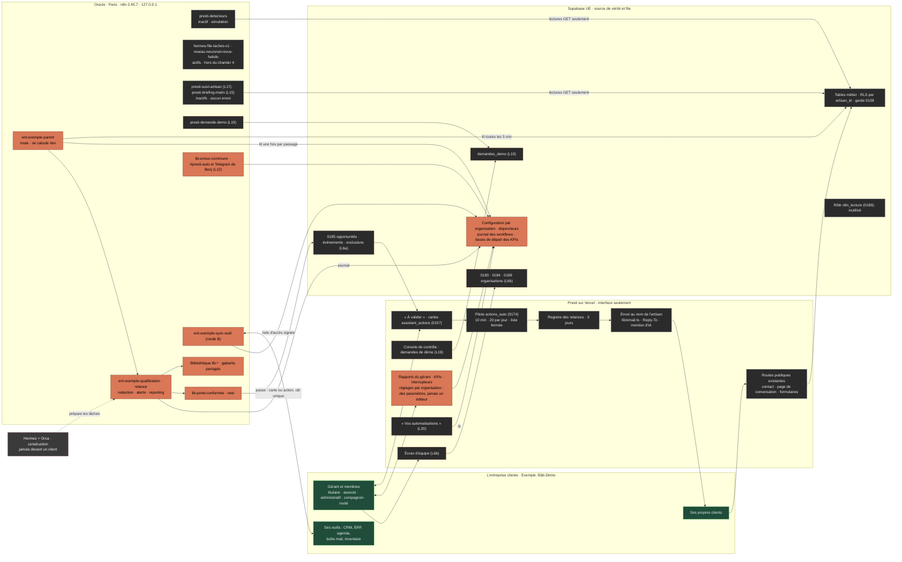
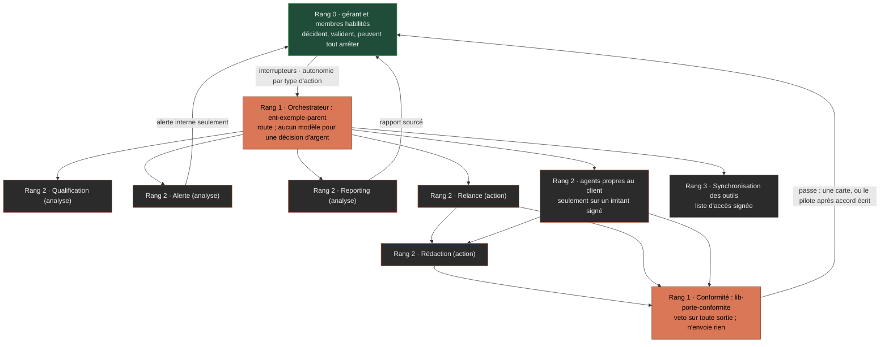
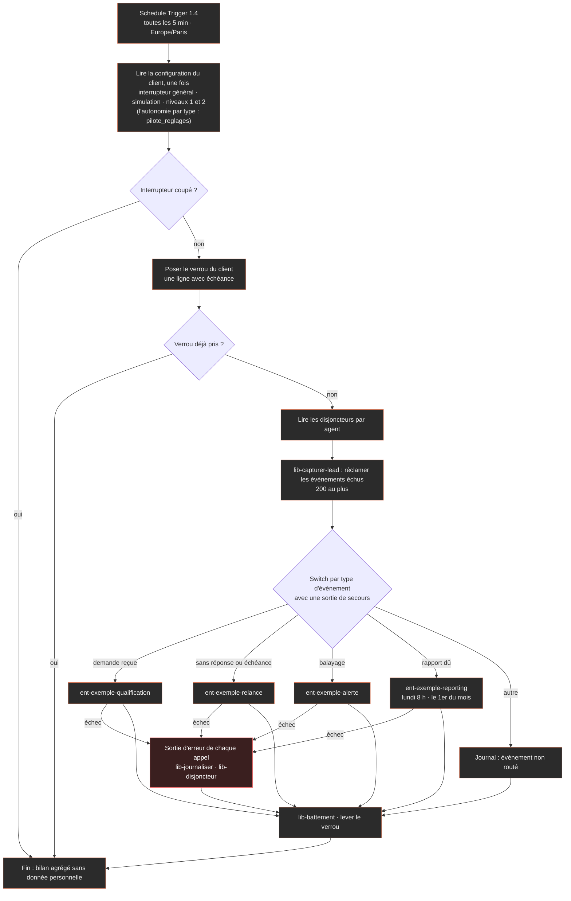
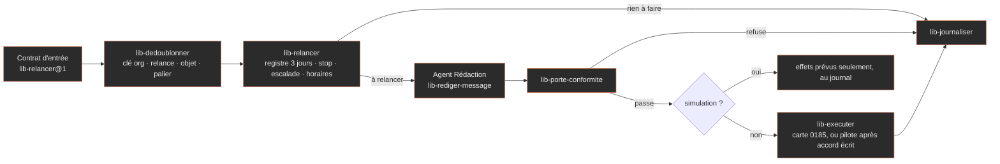

# Presti pour l'entreprise — première réponse au prompt 5, pour validation de Benj

> **Mode A — préparer l'offre.** Aucun client n'est signé (`prompts-benj/p5-entreprise-sur-mesure.md:4`, `:8`, `:22`) : aucune donnée
> réelle nulle part, et toute donnée d'exemple porte « Exemple. ». Rien n'est construit : « Ne construis rien avant la validation de
> Benj » (p5:335). Ce fichier est le seul que ce passage écrit : ni n8n, ni code, ni migration, ni commit, ni build, ni vault.
>
> Écrit le 02/11/2026 vers 17 h 45 (heure de Paris) par Claude Code, sous-agent du workflow du prompt 5. Il part des quatre fiches du
> dossier (`fiches-depots.md`, `fiche-methode-n8n.md`, `fiches-videos.md`, `inventaire.md`) et du plan du chantier 4. Il ajoute des contrôles
> faits ici : le code relu, le MCP `n8n-oracle` en lecture, le réseau neuronal (MCP `cerveau`), et des tarifs et licences lus en ligne.
>
> **Corrigé le 02/11/2026 vers 19 h** (heure de Paris), d'après les treize écarts d'un contre-vérificateur. Le suivi des tâches de
> l'en-tête est relu à cette heure ; le reste garde l'état de 17 h 45.
>
> **Corrigé une seconde fois le 02/11/2026 vers 20 h 30** (heure de Paris), tâche 032-027, d'après les 16 écarts du contre-vérificateur
> n° 2 (`ecarts-contre-verification-2.md`). La réponse est relue en entier : l'en-tête, le n8n d'Oracle (MCP, 19:20 UTC) et Oracle
> lui-même (mesuré à 19:20 UTC) sont remis à jour ; quatre contradictions avec le C4 deviennent les questions 25 à 28.
>
> **Conventions.**
> - « p5:NN » renvoie à la ligne NN du prompt 5.
> - « C4:NN » renvoie à `plans/011-cadrage-01-11/chantier-4-assistant-plan.md` dans son état de 17 h 32, celui du HEAD `49d22f09`. Le
>   fichier bouge encore : la section est nommée avec la ligne.
> - Le code est cité au commit `74db706a` ; « (arbre) » marque `lib/pilote/regles.ts` et `.claude/rules/architecture-outils.md`, alors
>   non commités et entrés tels quels, aux mêmes lignes, dans `49d22f09` (02/11, 19 h 06), le HEAD actuel.
> - Un fait externe porte sa source et sa date de lecture (2026-11-02).
> - Un chiffre d'auteur porte « annoncé par l'auteur, non vérifié ». Un tarif sans source datée porte « à vérifier ».
> - Aucun prix de l'offre n'est écrit ici : le prix, c'est Benj (p5:54).

---

## En tête : l'état vérifié au 02/11/2026, relu au HEAD `49d22f09` (vers 20 h 20, heure de Paris)

| Point | État | Source |
|---|---|---|
| **Oracle, mémoire** | 23 974 Mo, dont 17 542 Mo disponibles à 19:20 UTC, avec les agents Claude Code du soir en marche. C'était 22 135 Mo vers 15 h 55, avant eux | `free -m`, lancé sur le serveur par ce passage (02/11, 19:20 UTC) ; mesure de 15 h 55 : `inventaire.md:133` |
| **Oracle, disque `/`** | 96 Go, dont 38 Go utilisés (39 %) à 19:20 UTC, contre 29 Go (31 %) vers 15 h 55 : 9 Go de plus en trois heures et demie, avec les agents. Encore sous le seuil de ménage de 85 % (p5:359). Il était à 99 % le 11/10 (p5:359), et à 90 % le 01/11 avant le ménage (ADR-003, « Points à signaler », point 2) | `df -h /`, sur le serveur (02/11, 19:20 UTC) ; `inventaire.md:134` |
| **Oracle, machine** | aarch64, 4 cœurs ; charge de 0,41 sur 1 min et 0,99 sur 15 min à 19:20 UTC (0,17 vers 15 h 55). Docker n'est pas lisible par l'utilisateur `usine` : la charge de chaque conteneur est inconnue | `nproc` et `uptime`, sur le serveur (19:20 UTC) ; `inventaire.md:132`, `:135-136` |
| **Oracle, nouvel usage** | Depuis le 02/11, le serveur héberge aussi des agents Claude Code, lancés par la session principale. **La mémoire libre est donc à remesurer avant d'ajouter tout client** (p5:166) | `.claude/rules/architecture-outils.md:72-77` (arbre) |
| **Oracle, coût** | **À vérifier.** L'offre toujours gratuite d'Oracle couvre 2 OCPU et 12 Go de mémoire en Ampere A1, plus 200 Go de volumes. L'instance a 4 cœurs et 23 Gio. Seule la console Oracle dit si elle est facturée | docs.oracle.com/en-us/iaas/Content/FreeTier/freetier_topic-Always_Free_Resources.htm, lu le 2026-11-02 ; ADR-003, point 1 |
| **n8n d'Oracle** | **Version 2.45.7 depuis le 02/11**, avec l'accord de Benj ; la sauvegarde d'avant la montée est dans `/root/sauvegardes/`. Les fiches ont lu 2.45.6 : leurs relevés de code restent à recouper sur 2.45.7. L'instance répond. Le MCP `search_workflows` y voyait 3 workflows à 16:28 UTC, 5 vers 18:40 UTC (contre-vérificateur n° 2), et 5 encore à 19:20 UTC (relu ici) : `presti-detecteurs`, `presti-suivi-artisan` (L17, 032-014, créé à 18:03 UTC) et `presti-briefing-matin` (L15, 032-013, créé à 18:24 UTC), **tous trois inactifs** ; `reseau-neuronal-revue-hebdo` et `hermes-file-taches-v1`, **actifs**, qui ne relèvent pas du chantier 4. En cours, pas encore dans n8n à 19:20 UTC : `presti-sauvegarde` et `presti-garde-sauvegarde` (L8, 032-023), à livrer inactifs. Toujours 4 identifiants (`list_credentials`, 19:20 UTC). Les nœuds Code tournent dans le conteneur `runners`, qui a le réseau sortant ; aucun module n'y est autorisé | `.claude/rules/architecture-outils.md:69-71` (arbre) ; MCP `n8n-oracle` (`search_workflows`, `list_credentials`, 19:20 UTC) ; `briefs/c4-n8n-detecteurs.md:147-158` ; `.orchestre/digest.md` (032-013, 032-014, 032-023) |
| **Workflow `presti-detecteurs`** | Identifiant `J8pduyxn9seR8Z9t`, **inactif** : `active: false`, `activeVersionId: null`, `triggerCount: 0`, aucune étiquette, fuseau Europe/Paris (relu par le MCP `get_workflow_details` à 19:20 UTC). Modifié en dernier le 02/11 à 18:46:59 UTC, par le lot L12 (032-019, PASS à 19:06 UTC) : **41 nœuds** (34 à 16:28 UTC), **douze détecteurs** en simulation, lectures GET seulement, bilan agrégé, « branche d'erreur sans envoi » (description du workflow). À 16:28 UTC, aucun workflow d'erreur n'était désigné (`inventaire.md:158`) ; ce point n'est pas relu ici. L'identifiant « Supabase account » vise la vraie API du projet depuis le 02/11, selon `.claude/rules/architecture-outils.md:70-71` (arbre) ; aucune nouvelle exécution réelle n'est lue ici. Tâche 032-003 : PASS. L'audit 032-010 est rendu (la tâche est au digest), mais son rapport conclut **« NE TIENT PAS »**, parce que le juge avait trois défauts élevés ; le workflow, lui, n'en avait aucun (`.orchestre/preuves/032-010/rapport.md:12-18`). Le juge a été réécrit par 032-012 (PASS à 16:39 UTC, 49 mutants rouges, `briefs/c4-n8n-detecteurs.md:103-107`). Le nouvel audit, 032-016, est rendu : PASS à 17:07:02 UTC, « VERDICT : TIENT », aucun défaut élevé ; les points moyens et faibles vont au lot L12 (`.orchestre/preuves/032-016/rapport.md:25-30`). Le juge est inscrit au lanceur depuis le commit `49d22f09` (02/11, 19 h 06) : `scripts/tout-verifier.mjs:196` (« Détecteurs n8n (L3, 032-003, juge réécrit par 032-012, audité par 032-016) »), relu au HEAD par le contre-vérificateur n° 2 ; la copie de travail d'Oracle, antérieure à ce commit, ne le porte pas encore | `.orchestre/digest.md`, lignes des tâches 032-003, 032-010, 032-012, 032-016 et 032-019 (le fichier se régénère : ses numéros de ligne bougent) ; `ecarts-contre-verification-2.md:7`, `:33` |
| **Migrations des organisations (0183 à 0188)** | **Nulle part.** Aucun fichier, aucun commit (`git log --all` est vide), aucun objet en base (SQL en lecture seule, 15:46:52 UTC). Sur `main`, la liste passe de 0181 à 0189, et ces numéros sont libres. Le plan qui les dit « préparées » se trompe (p5:386, C4:472 et C4:659) ; C4:822-823 disait vrai à 17 h 32. **Relu à 19:20 UTC** : toujours aucun fichier 0183 à 0188 dans `supabase/migrations/`. Deux tâches en écrivent en ce moment, sans rien appliquer : 0185, 0186 et 0187 (L6a et L7, 032-025), et 0190 `demandes_demo` (L19, 032-026). 0183, 0184 et 0188 (L6b) ne sont pas commencées | `inventaire.md:87-124` ; `ls supabase/migrations` (19:20 UTC) ; `.orchestre/digest.md` (032-025, 032-026) |

**Changé dans la journée, et absent des fiches :**
- n8n est passé en 2.45.7.
- L'identifiant « Supabase account » a été corrigé.
- Oracle sert aussi d'hôte aux agents Claude Code.
- Le juge des détecteurs a été réécrit (032-012), puis audité : TIENT (032-016).
- Le texte de la landing v2 est fait (033-001, PASS à 16:27 UTC au digest). Il prévoit `/contact?motif=entreprise`, avec prénom, e-mail, taille de
  l'équipe, activité et message facultatif (`plans/011-cadrage-01-11/c2-lot4/texte.md:263-295`). La route ne lit encore ni le motif, ni la
  taille, ni l'activité (`inventaire.md:76`) ; la tâche 032-026 (L19, en cours) doit les lui faire lire, derrière un drapeau baissé.

**Changé le soir du 02/11, après 17 h 45** (`.orchestre/digest.md`, relu à 19:20 UTC) :
- `presti-suivi-artisan` (L17, 032-014, PASS à 18:20 UTC) et `presti-briefing-matin` (L15, 032-013, PASS à 18:37 UTC) sont dans le n8n
  d'Oracle, inactifs, sans aucun envoi.
- `presti-detecteurs` porte les détecteurs 11 et 12 et les défauts moyens de l'audit 032-010 (L12, 032-019, PASS à 19:06 UTC).
- La sauvegarde couvre toutes les tables (L9, 032-020, PASS à 18:38 UTC) ; son lancement par n8n (L8, 032-023) est en cours.
- Les relances groupées de l'assistant sont faites (L16, 032-021) ; le correctif R1 des impayés (032-017) est audité (032-018).
- Les 11 vidéos de @restructureai sont lues, son compris (032-022, `fiches-videos-restructureai.md`). Une seule nomme n8n à l'oral
  (`fiches-videos-restructureai.md:271`).
- En cours, rien d'appliqué ni de publié : `lib/sms` à blanc (L7, 032-024), les migrations 0185 à 0187 (032-025), les demandes de démo
  (L19, 032-026).
- Le juge des détecteurs est au lanceur (`49d22f09`, 19 h 06).

---

## 1. Le mode du jour et ce que j'ai compris

**Mode A : préparer l'offre.** Le kit se fait sur une entreprise fictive marquée « Exemple. ». Aucune donnée réelle n'entre nulle part
(p5:22).

1. L'Entreprise n'est pas un autre niveau d'autonomie. C'est Signature à l'identique, plus `organisation.membres` (`lib/plans.ts:101-103`),
   sur devis et hors du tunnel en libre-service (`:17-20`, `:114`). Le sur-mesure se règle par contrat (`:101-102`, p5:27).
2. Ce qu'elle ajoute naît d'irritants réels, signés, chiffrés quand c'est possible. En mode A, on construit le kit : la fiche de découverte,
   la bibliothèque `lib-*`, le catalogue d'agents et une démo « Exemple. » (p5:22, p5:339).
3. n8n-first : toute logique récurrente vit dans le n8n d'Oracle, et l'app ne sert qu'à l'interface. Supabase est la source de vérité et la
   file. n8n va chercher les données lui-même : rien ne l'appelle (p5:111-117).
4. Un workflow parent par client, qui ne fait que router. En dessous, des enfants à responsabilité unique, rangés en couches, et une
   bibliothèque de gabarits partagée entre clients ; les données, elles, ne se partagent jamais (p5:156-158).
5. Chaque enfant a un contrat d'entrée et de sortie, une clé d'idempotence vérifiée en base, et une porte de simulation. S'y ajoutent le
   workflow d'erreur commun, un disjoncteur par agent et un interrupteur par client et par agent (p5:159-162, p5:263).
6. Six agents au minimum, hiérarchisés. La porte de conformité a le veto, l'orchestrateur ne prend aucune décision d'argent, et les agents
   d'action préparent (p5:174-194). Le code calcule tout montant ; on n'utilise aucun modèle quand une règle suffit (p5:216-218).
7. L'autonomie est celle de Signature, réglée type d'action par type et accordée par écrit après le mode ombre. Un geste de la liste
   « jamais en automatique » reste une carte, même au contrat (p5:224-226).
8. Gratuit d'abord. Tout outil payant est justifié, accepté par Benj et payé par le client sur son propre compte (p5:233-238).
9. Rien ne bouge pour Studio ni pour Signature (p5:275). L'offre se pose sur l'existant et sur les lots du chantier 4 (L19, L20,
   organisations, 0185). Là où elle s'en écarte, c'est posé en question à Benj (questions 25 à 28 ; p5:415).
10. Cette réponse propose seulement. Les tâches se déposent après le « approuvé » de Benj (p5:335).

---

## 2. Ce qui existe déjà pour l'offre (résumé ; le détail est dans `inventaire.md`)

| Brique | Où (fichier:ligne) | Ce qui sert à l'offre | Ce qui manque, et ce que ça bloque |
|---|---|---|---|
| Offre `entreprise` | `lib/plans.ts:19-20`, `:101-103`, `:113-114` ; verrou `:160-164` ; offre de référence `:168-172` | Signature plus `organisation.membres`, sur devis, avec 600 crédits ; le verrou dit « Disponible avec Presti pour l'entreprise, sur démonstration. » | Aucun `peut()` ne lit `organisation.membres`, et le drapeau `organisations` cité en `lib/plans.ts:43-44` est absent de `lib/flags.ts` (0 occurrence). **Aujourd'hui, l'offre vaut exactement Signature** |
| Stripe | `lib/abonnementSync.ts:61-75` ; `app/api/stripe/portail/route.ts:53-65` ; `scripts/stripe-entreprise.mjs` | Un prix par contrat, et un portail sans changement d'offre ni résiliation | Le webhook n'écoute pas `customer.subscription.created` (`inventaire.md:26`). `/controle` ne sait pas poser l'Entreprise (`app/api/controle/clients/[id]/action/route.ts:114`) |
| Tests de l'offre | `scripts/offres-affichage-qa.mjs:64-71`, `scripts/essais-gratuits-qa.mjs`, au lanceur `scripts/tout-verifier.mjs:52`, `:57` | Couvrent déjà le dernier test obligatoire : l'Entreprise vaut Signature plus les membres, et Studio et Signature n'ont pas bougé (p5:320) | Aucun test d'isolation ni de rôles : `organisations-qa` n'existe pas |
| Pilote automatique | `lib/pilote/regles.ts:27` (10 min), `:30` (20 par jour), `:32` (24 h au plus en file), `:36` (6 types), `:70` (liste fermée), `:79-82` (jamais automatique) ; `0174_pilote_automatique.sql:21-44`, unicité `(artisan_id, cle)` à `:42` ; test `tout-verifier.mjs:162` | « 10 minutes pour annuler, plafond par jour, liste fermée » (p5:225) existe déjà, et l'Entreprise l'a (`lib/plans.ts:99`) | La file n'accepte que les sources `carte` et `proposition` (`0174:32`, clé `lib/pilote/regles.ts:278`, arbre) : rien n'est prévu pour une action préparée par n8n |
| Escalade | `lib/pilote/regles.ts:137` et `:174` (listes de mots), `:205` (`sujetEscalade`) (arbre) | La base de la porte sur les sujets d'escalade (p5:194, p5:226) | Aucun équivalent côté n8n ; une copie figée devra être comparée au code |
| Registre des relances | `lib/relancesRegistre.ts:18` (3 jours), `:38-47`, `:63` ; test `tout-verifier.mjs:195` | La règle de l'agent Relance (p5:190) existe, et une lecture en erreur vaut refus | C'est du code de l'app : un `lib-relancer` relira les mêmes tables. Un envoi parti de n8n n'est pas l'un des quatre chemins lus, et `relances_exclusions` (0185) n'existe pas |
| Cartes « À valider » | `0157_assistant_actions.sql:31-40` ; statuts et validité de 24 h dans `lib/assistant/cartes.ts:15`, `:18` | La boîte où doivent arriver les sorties des agents d'action | La table exige `conversation_id` et `tour` (`0157:34-35`) : aucune carte ne peut naître de n8n avant 0185 |
| E-mail au nom de l'artisan | `lib/email.ts:1-12`, `:18-20` ; mention d'IA dans `lib/mentionAssistant.ts:13-17` | La marque blanche est tenue : le nom et le Reply-To sont ceux de l'artisan, jamais « Presti » | n8n ne peut pas appeler ce code : chaque workflow qui écrit au nom d'un client doit la reproduire (C4:128-141) |
| Telegram, push | `lib/agents/telegram.ts:12` (commandes fermées), `:32` (`messageAlerte`) ; `lib/push.ts:28` (30 par heure) | Le canal d'alerte de Benj et les notifications internes | n8n n'a aucun identifiant Telegram (`inventaire.md:139`) ; le push ne vit que dans l'app |
| CRM « atelier vivant » | `lib/plans.ts:94-96` ; `lib/crm/pipeline.ts:30` (6 étapes en dur) ; `0141_crm_atelier.sql:30-39` | Le CRM standard dont l'Entreprise hérite | Aucun point d'extension : pas de champs, d'étapes ni de rôles propres à un client |
| Compta, inventaire | `lib/comptaAssistant.ts:1-11` (le code calcule), `lib/inventaire/CONTEXT.md` | « Le code calcule tous les montants » (p5:217) | Aucune synchronisation avec l'outil d'un client |
| Accès de n8n à la base | `0189_role_lecture_n8n.sql` (rôle `n8n_lecture`, inutilisé) ; identifiant « Supabase account », avec tous les droits (C4:28-32) | De quoi lire, puis écrire à blanc | La clé contourne la RLS : l'isolation repose sur le filtre de chaque requête (`fiche-methode-n8n.md:40-43`) |
| n8n d'Oracle | 5 workflows (MCP, 02/11 vers 18:40 UTC, et relu à 19:20 UTC : les 3 de 16:28 UTC, plus `presti-suivi-artisan` et `presti-briefing-matin`, inactifs) ; 4 identifiants (Supabase, deux Slack, OpenAI) ; un seul projet (`inventaire.md:138-140`) | L'instance tourne | Il manque un identifiant Telegram, un identifiant d'envoi, un identifiant Anthropic (pour `lib-rediger-message`), un workflow d'erreur, et toute la série `ent-*` et `lib-*` |
| Étape 0 : la demande de démo | `app/api/contact/route.ts:56-60` envoie un e-mail à Benj par `notifierEntreprise` ; le formulaire du chantier 2 est dans `c2-lot4/texte.md:263-295` | Une demande arrive aujourd'hui, mais par e-mail seulement | Rien en base. `demandes_demo` et `presti-demande-demo` sont dessinés (C4:176-211, L19 à C4:847), mais pas construits |
| Sous-traitants et registre | `lib/legalArtisan.ts:308-316` | La base de la liste « article 28 » d'un client | Ni Oracle ni n8n n'y figurent, et le registre ne cite pas n8n (`inventaire.md:83`) |
| SMS | C4 §11 (C4:661-685) ; ADR-007 | Conçu : le lien `sms:` d'abord, puis des portes, des plafonds et le STOP | Rien n'est en service. `lib/sms/` s'écrit à blanc depuis 19:15 UTC (L7, 032-024, en cours, non commité) ; 0186 se prépare sans être appliquée (032-025) |
| Organisations | C4 §10 (C4:625-660) | Conçues : cinq rôles, un interrupteur faux par défaut | Rien n'est écrit (voir l'en-tête) |

---

## 3. Les fiches de lecture : résumé, renvoi et sources manquantes

### 3.1 Ce qui a été lu

| Corpus | Fiche | Lu en entier ? | Ce qu'on en retient |
|---|---|---|---|
| `enescingoz/awesome-n8n-templates` | `fiches-depots.md`, fiche 1 | Non : README, licence et 8 JSON sur « 280+ » (annoncé par l'auteur, non vérifié) | Des patterns : normaliser, rejeter tôt, journaliser avant de router, battement à 26 h, diagnostic d'erreur, HMAC. Les JSON ne se copient pas : le README laisse les droits à leurs créateurs. Des pièges : webhooks ouverts, score décidé par le modèle, créneau réservé seul, SMS sans STOP |
| `Zie619/n8n-workflows` | fiche 2 | Non : 7 JSON sur « 4 343 » (annoncé par l'auteur, non vérifié) | Inutilisable tel quel : le commit `74bdcdc` du 29/09/2025 a vidé ou cassé les connexions. La licence MIT ne couvre que le code. Des patterns : alerte minimale, normaliseur avec cas épinglés, pagination par l'en-tête `Link` |
| Organisation `n8n-io` (11 dépôts sur 53) | fiches 3 à 11 | Non (lecture ciblée) | `n8n-io/skills` (Apache-2.0) donne la méthode officielle. La FAQ de la licence permet de construire et de faire tourner des workflows pour des clients, à condition de ne jamais leur ouvrir l'instance ni un éditeur. Le `.env.example` du starter kit porte des secrets fixes, identiques pour tous |
| Méthode n8n : docs.n8n.io, le code de `n8n@2.45.6`, le MCP | `fiche-methode-n8n.md`, 13 fiches | Oui pour l'essentiel ; en partie seulement pour les notes de version, la référence MCP et un fichier de code | Le contrat d'entrée natif est mince. En production, un parent appelle la version publiée de l'enfant. Les reprises ont un délai fixe, de 5 s au plus. Le workflow d'erreur ne part jamais sur une exécution manuelle. L'idempotence, c'est la clé unique en base. L'édition Community n'a ni projets, ni `$vars`, ni Git. Les exécutions sont gardées 14 jours par défaut. « send and wait » est impossible sur 127.0.0.1 |
| Vidéos du 01/11 : 3 cours YouTube, 7 TikToks utiles, 3 écartés | `fiches-videos.md` §2 | Parole : oui. Image des cours : non. Dates des cours : inconnues | Une trame de découverte : l'appel avec une chaîne de salles de sport (O3A2xnBadFo [02:02]-[02:44]). Un centre de commande où l'équipe approuve les actions des agents (RWKyUJLi-kI [01:42]-[01:43]). Un chiffre lu dans l'outil du client sert de base de départ. Une règle avant tout modèle. Les mêmes interdits partout. Aucun montant ne sert |
| `docs/connaissance-videos/` et @restructureai | `fiches-videos.md` §3-4 ; depuis 18:49 UTC, `fiches-videos-restructureai.md` (032-022) | Reel du 25/09 : oui. Les 11 vidéos TikTok du 29/09 au 02/11 : parole oui (transcription Whisper complète), images en partie (six par vidéo) ; la liste complète du compte : non | Un cerveau qui trie et route, une file d'approbation, une liste fermée d'interruptions, un résumé d'une page le matin. Aucune légende ne nomme n8n ; une seule vidéo le nomme à l'oral (`fiches-videos-restructureai.md:271`). Ce sont des maquettes, pas des preuves |
| Presti et le réseau neuronal | `inventaire.md` ; ADR-001 à ADR-008, Journal-Decisions, « Offres et grille tarifaire » | Non : ADR-008 en entier ; ADR-001 ; ADR-002, ADR-003 et ADR-004 en partie ; ADR-005 et ADR-006 non lus ; Journal-Decisions du 02/11 seulement ; C4 en partie (§ 0, 0 bis, 6, 8 à 12.1, 14) | Voir le § 2 et l'en-tête |

### 3.2 Ce que les fiches changent à la proposition

1. **Rien ne se copie** des deux collections communautaires. On s'inspire, on réécrit (p5:87), et la source fiable reste l'officielle :
   `n8n-io/skills` et la documentation.
2. **Le CRM sur mesure reste fait de paramètres.** La licence de n8n interdit d'offrir au client un éditeur de logique, même derrière une
   interface maison (`fiches-depots.md:367-372`). La limite est à faire confirmer par license@n8n.io (question 3).
3. **Le mode à blanc doit être une porte, pas un simple drapeau.** Pendant un test, les sous-workflows, les Data Tables et les nœuds Code à
   effet externe s'exécutent pour de vrai (`fiches-depots.md:493-494`). D'où un « If simulation ? » juste avant chaque effet, et un mutant
   qui le retire pour faire rougir le juge.
4. **La validation humaine reste dans « À valider ».** « send and wait », les formulaires et Wait sur webhook supposent un n8n joignable,
   alors que celui d'Oracle écoute sur 127.0.0.1 (`fiche-methode-n8n.md:47-49`).
5. **Un identifiant se fixe dans le nœud.** Tout ce qui touche un outil du client vit donc dans `ent-<client>-sync-*`, jamais dans un
   `lib-*` partagé (`fiche-methode-n8n.md:418-420`).
6. **n8n garde les exécutions** 14 jours, ou au-delà de 10 000, par défaut. Sur les `ent-*`, il faut couper la sauvegarde des succès et
   masquer les données de production ; sans cela, on contredit p5:95 (`fiche-methode-n8n.md:44-46`).
7. **Retry On Fail ne fait que 2 à 5 essais, à délai fixe de 5 s au plus.** L'attente croissante, le disjoncteur et l'interrupteur se
   construisent dans Supabase, sur le modèle du pilote (`pilote_reglages`, `actions_auto` : `0174_pilote_automatique.sql:8-13`).
8. **Deux points écartés par la synthèse du chantier 4 sont bien dans la source.** L'un est écarté en disant « la source ne le dit pas »
   (C4:120). L'autre est rangé parmi les « détails des seules transcriptions », dont le plan ne garde que :218, :271 et :375 (C4:122) :
   - le croisement de plusieurs sources, avec relance de la personne qui doit une pièce manquante (RWKyUJLi-kI [01:40]-[01:41]) ;
   - deux options et une fourchette (k1adsrTHwPg [00:13]-[00:14], RWKyUJLi-kI [04:00]).

   C'est à réexaminer par la session principale (question 19). Le prix reste à Benj.
9. **Une donnée lue dans l'outil du client pendant le rendez-vous vaut « mesuré : lu dans tel outil, à telle date ».** Dite de mémoire, elle
   vaut « déclaré » (RWKyUJLi-kI [03:24]-[03:26] ; p5:94).
10. **La porte de conformité se construit sans grand modèle** : des règles d'abord, puis un classifieur local si besoin
    (O3A2xnBadFo [03:31]-[03:32] ; p5:218).
11. **Le gardien ne se garde pas lui-même.** Un battement surveillé par n8n ne voit pas la panne de n8n (`fiches-depots.md:72`) :
    question 9.

### 3.3 Sources manquantes ou partielles

| Source | Ce qui manque | Ce que ça empêche | Défaut |
|---|---|---|---|
| Collection Zie619 (4 343 JSON annoncés) | 7 JSON lus, plus une version ancienne ; l'index lu en partie | Compter les fichiers cassés | Toute la collection est tenue pour non fiable |
| awesome-n8n-templates | Les deux modèles de rapport repérés, non lus | Tirer `lib-rapport-hebdo` d'un exemple réel | Gabarit écrit d'après la consigne ; tâche 035-010 |
| `n8n-io/skills` | 11 SKILL.md non lus, dont `REVIEW_CHECKLIST.md` (39 Ko), `n8n-agents-official` et `n8n-ai-nodes-official` | La liste officielle de revue avant publication | La lire avant le premier `lib-*` (035-010) |
| docs.n8n.io | Mode file d'attente, authentification des webhooks, retour OAuth, « rejouer une exécution » | Écrire le geste « rejouer » du runbook ; prouver la contrainte OAuth | 035-010 ; essai à blanc |
| Code de n8n | L'appelant de `executeErrorWorkflow`, la fin de `workflow-execute.ts` ; et rien n'est relu sur 2.45.7 | Savoir si l'échec d'un enfant déclenche son propre workflow d'erreur | Le prouver par un essai à blanc (035-003) |
| Instance d'Oracle | L'édition (Community ou enregistrée), la base de n8n (SQLite ou Postgres), la concurrence, la purge, la mémoire par conteneur | Trancher dossiers et projets, le mode file et la purge ; dire si un client de plus tient | Mode normal ; questions 7, 10 et 17 |
| `n8n-dynamic-credentials-example` | Le code, la version, la licence | Savoir si ces identifiants relèvent de l'édition Enterprise | Ne pas en dépendre : un identifiant nommé par client |
| Doc PostgREST (`on_conflict`) | Non lue | Fixer le chemin d'écriture idempotente | Essai à blanc (question 11) |
| Page des tarifs de n8n | Non lue | Confirmer la liste des fonctions de Community à la date du jour | Fiche 6 de la méthode, à revérifier |
| Les trois cours YouTube | Les images (texte d'écran illisible), les dates de publication ; des sous-titres automatiques non corrigés | Lire les documents montrés à l'écran ; dater les méthodes | Méthode connue par la parole seulement |
| ip4IHi1ZfhA | Deux passages lus sur 46 minutes | La méthode de vente complète | 035-010 |
| milesreevesai, ray_fu (×2), tonytuyisenge | L'audio | Citer leur méthode avec certitude | Leurs fiches restent « à recouper ». L'audio du TikTok de restructureai du 29/09 est désormais transcrit (`fiches-videos-restructureai.md:21`, 032-022) |
| Profil @restructureai | La liste complète du compte et les vidéos d'avant le 29/09. Les 11 vidéos du 29/09 au 02/11 sont lues (032-022), mais six images seulement par vidéo | Dire ce que montrent les vidéos plus anciennes | Tâche 035-009 réduite à la liste du compte et aux anciennes, après l'accord de Benj |
| Prompts maîtres 1 à 4 (`prompts-benj/p1-prospection.md`, `p2-contenu.md`, `p3-assistant.md`, `p4-landing.md`), `.orchestre/contexte.md`, état des lieux de l'assistant du 29/10 (`presti-ops/assistant-gestion/ETAT-DES-LIEUX-2026-10-29.md`, annexe 1 § A) ; ADR-005 et ADR-006 | Non lus pour cette réponse (p5:69 les exige) | Vérifier qu'ils ne contredisent pas l'offre : le prompt 4 porte le bloc entreprise de la landing, le prompt 3 l'assistant | Les lire avant le « approuvé » (035-010) |
| « Supabase account » | Le type de clé (secret, illisible pour un agent) | Savoir si le retrait des anciennes clés, annoncé pour la fin 2026 (non vérifié), le concerne | Question 12 |
| Stripe en LIVE, et `STRIPE_PORTAIL_ENTREPRISE` sur Vercel | Non relus | Confirmer que le portail des contrats est fermé en production | Question 16 |
| Tarifs du jour | La page de Brevo, illisible le 02/11 (rendue en JavaScript, et l'aide renvoie 403) ; l'offre de Presti chez Supabase, chez Resend et chez Vercel | Un coût réel daté pour ces lignes | Marqué « à vérifier » au § 6 |

---

## 4. L'architecture, posée sur l'existant

Légende de toutes les figures (même code que C4:445) :
- **gris** : ce qui existe ;
- **corail plein** : ce que le prompt 5 ajoute ;
- **contour corail pointillé** : ce qui est prévu au chantier 4 et pas encore construit ;
- **vert** : les humains ;
- **rouge pointillé** : ce qui reste derrière, jamais devant un client.

### 4.1 Le système



### 4.2 La hiérarchie des agents (p5:174-181)



**L'orchestrateur n'est pas un agent.** C'est le workflow parent. Il lit l'interrupteur, la configuration et les disjoncteurs, réclame les
événements échus et appelle la bonne chaîne. Il n'appelle aucun modèle et ne calcule rien (p5:156, p5:176).

### 4.3 Le workflow parent `ent-exemple-parent`



Chaque appel d'enfant est en « Continue (using error output) » : un enfant en panne ne fait pas échouer le parent. L'enfant fautif alerte
une fois, par son propre workflow d'erreur, ce qui reste à prouver par un essai (`fiche-methode-n8n.md:922-924`). Un agent dont le
disjoncteur est ouvert est sauté, et le saut est journalisé.

**L'arrêt a un effet immédiat (p5:263).** Chaque `lib-executer` relit l'interrupteur général et celui de l'agent juste avant l'effet ;
une lecture en erreur ne fait rien. Dans la console, couper l'interrupteur général coupe aussi `pilote_reglages.actif` du compte
(`0174_pilote_automatique.sql:8-9`) : le pilote de l'app relit ce réglage juste avant chaque envoi (`lib/pilote/executeur.ts:6`), et le
couper annule sa file (`lib/pilote/serveur.ts:197`).

L'autonomie par type n'est écrite qu'une fois : ce qui part par le pilote suit `pilote_reglages.types` du compte (`0174:24`) ; la
configuration par organisation ne porte que ce que le pilote n'a pas (simulation, disjoncteurs, interrupteur par agent, niveaux 1 et 2).
C'est l'erreur que `fiche-methode-n8n.md:744` demande d'éviter : « une table de configuration Entreprise qui doublerait `pilote_reglages` ».

### 4.4 La chaîne d'un agent d'action (exemple : Relance)



### 4.5 Exceptions à n8n-first, écrites comme l'exige l'ADR-008

- **Le prompt 5 n'ajoute aucune logique codée dans l'app.** Ce qui reste du code de l'app, et pourquoi :
  - l'interface : console, « À valider », rapports, réglages, écran d'équipe (p5:112) ;
  - le schéma, c'est-à-dire les migrations (p5:114) ;
  - les routes publiques existantes, qui écrivent une demande dans Supabase (p5:117).
- **Deux exceptions héritées du chantier 4, pas encore tranchées :**
  - **A** : le pilote de l'app envoie au niveau 3 ce qu'un workflow a préparé (C4:249-253). Le prompt 5 va dans ce sens (p5:225 : « par le
    pilote automatique existant … ou son équivalent n8n une fois migré »).
  - **B** : « Ne plus relancer ce client » (C4:254-258).

  Elles n'entrent au Journal-Decisions qu'avec l'accord de Benj (C4:244, C4:247-248) ; l'ADR-008 (« Garde-fous ») veut ensuite
  l'exception écrite dans la réponse et dans Journal-Decisions.
- **Une exception possible** : un guetteur hors de n8n, pour voir la panne de n8n lui-même (question 9).
- **Deux duplications assumées, qui ne sont pas des exceptions.** Le registre des relances (3 jours) et la liste « jamais en automatique »
  sont du code de l'app. Les `lib-*` en gardent une copie figée, qu'une suite compare au code. C'est le modèle des capacités de
  `presti-detecteurs`, comparées à `lib/plans.ts` (`briefs/c4-n8n-detecteurs.md`).

### 4.6 Les règles de construction (tirées de `fiche-methode-n8n.md` §3)

**La structure**
- Trois étages au plus : le parent, la chaîne d'un agent, les `lib-*`. La profondeur d'imbrication n'est pas documentée.
- Chaque enfant commence par un nœud Code « Contrat d'entrée » et finit par un seul nœud « Contrat de sortie ». Par défaut, les passes du
  nœud final se concatènent (`:837-849`).
- Compatible 3.0 dès le départ : Execute Sub-workflow en source `database`, AI Agent 3.x, aucun nœud retiré, nœuds Code de moins de 60 s.

**La mise en production**
- Publier, c'est déployer : les enfants sont publiés d'abord, le parent ensuite. L'export versionné est celui de la version publiée.

**Les réglages, posés sur chaque workflow**
- Workflow d'erreur `lib-erreur-commune` et fuseau Europe/Paris.
- Politique d'appel en liste. Sa disponibilité en Community est à vérifier : la doc la lie au partage de workflows.
- Délai maximal d'exécution.
- Sur les `ent-*` : succès non sauvés et données de production masquées.

**Les erreurs**
- Sur chaque nœud faillible : la sortie d'erreur, et son câblage. Retry On Fail : 3 essais.

**Les modèles**
- AI Agent : `passthroughBinaryImages` à faux et `maxIterations` borné.
- Parseur en JSON Schema, avec `autoFix` à faux, puis revalidation en Code.

**Les nœuds Code**
- Aucun module, comme le défaut relevé sur Oracle (`briefs/c4-n8n-detecteurs.md:151-152`).
- L'empreinte SHA-256 de chaque nœud Code est tenue par le juge : c'est la parade à É3, puisque `runners` a le réseau sortant.
- Execute Command reste exclu.

**Les lectures**
- En GET, avec `select=` limité et le filtre organisation sur chaque requête.
- Jamais un nom, un e-mail ni un texte de client, sauf au moment d'envoyer, et seulement ce que le message exige (C4:142-153).

---

## 5. Les agents et la bibliothèque

### 5.1 L'entreprise fictive de la démo, et sa matrice

**Exemple. Bâti-Démo** : une entreprise fictive du bâtiment, à plusieurs membres, comme le veut le défaut de p5:429. Elle a quatre membres
(titulaire, associé, administratif, compagnon) et un invité (Exemple. son cabinet comptable). Les rôles sont ceux de C4 §10. Chaque nom,
chiffre et texte est fabriqué et marqué « Exemple. ».

| N° | Irritant | Type de valeur (`fiches-videos.md:779-781`) | Workflow | Agents | KPI | Base de départ |
|---|---|---|---|---|---|---|
| Exemple. I1 | Exemple. Les demandes du site arrivées après 18 h attendent le lendemain midi | revenu (clients amenés) | `ent-exemple-qualification`, puis la rédaction et la porte, qui donnent une carte | Qualification, Rédaction, Conformité, Alerte | K1 | Inconnue, à mesurer (§ 7.3). En mode B : mesurée pendant le mode ombre, ou lue dans l'outil du client |
| Exemple. I2 | Exemple. Un devis sur deux n'est jamais relancé | revenu | `ent-exemple-relance` (devis) | Relance, Rédaction, Conformité | K2, K3 | Inconnue : une mesure de départ est à prévoir |
| Exemple. I3 | Exemple. Les factures échues sont relancées à la main, en retard | argent récupéré | `ent-exemple-relance` (factures) | Relance, Rédaction, Conformité, Alerte | K4 | Inconnue, à mesurer |
| Exemple. I4 | Exemple. Le lundi, le gérant ne sait pas ce qui attend ni ce qui a été fait | temps | `ent-exemple-reporting` | Reporting | K5 (déclaré) | Inconnue ; en mode B, déclarée seulement. **Signalé : aucun ROI mesurable** (p5:53) |
| Exemple. I5 | Exemple. Des consommables manquent au démarrage d'un chantier | coût | agent propre « stock », hors de la démo | — | Ruptures par mois | Inconnue |

### 5.2 La fiche de découverte : plan du modèle (à écrire en tâche 035-002)

Les huit parties de p5:100-107, dans l'ordre. Chaque champ porte sa **valeur, sa source, sa date et son niveau de confiance** (mesuré,
déclaré ou estimé par le client, p5:94). Un champ vide devient une question précise, jamais une valeur supposée (C4:729-732). La fiche se
remplit en deux temps : d'abord les outils, puis chaque processus, avec dictée possible (RWKyUJLi-kI [01:41]-[01:42]). Ce que les vidéos
ajoutent :
- **Partie 2, le parcours client** : « Avez-vous des procédures écrites ? » (k1adsrTHwPg [00:13]). Chaque procédure devient une compétence
  écrite, stockée dans le compte du client, sous RLS (C4 rang 12 ; C4:733-735).
- **Partie 3, les irritants** : la question « si vous pouviez claquer des doigts » (O3A2xnBadFo [02:11]) et le type de valeur de chaque
  irritant. Un irritant sans KPI mesurable est signalé.
- **Partie 4, les outils** : le rôle et le coût de chaque outil (RWKyUJLi-kI [03:35]), et « l'éditeur laisse-t-il sortir vos données ? »
  (O3A2xnBadFo [02:35]). Une synchronisation ne se promet qu'après un essai de lecture.
- **Partie 5, les volumes** : un chiffre lu dans l'outil pendant le rendez-vous est mesuré et daté ; un chiffre dit de mémoire est déclaré.

### 5.3 Les six fiches d'agents

Dans chaque fiche, ce qui ne porte pas « Exemple. » est fixé par le kit et vaut pour tout client. Ce qui porte « Exemple. » se remplace par
la fiche de découverte signée (p5:185).

```text
Agent : Qualification            Rang : 2 (analyse)          Irritant(s) d'origine : Exemple. I1
Rôle : noter et catégoriser chaque demande entrante selon la grille écrite avec le client, et repérer les doublons sur une empreinte
       du contact calculée en base, jamais sur le contact lui-même (question 27).
Déclencheurs : une demande reçue, lue par le parent (toutes les 5 min, Europe/Paris) ; une réponse d'un lead
Entrées (schéma) : lib-qualifier-lead@1.donnees et .config (§ 5.5)     Sorties (schéma) : lib-qualifier-lead@1.resultat
Outils n8n : Execute Workflow Trigger 1.3, Code 2 (contrat, grille), Switch avec sortie de secours, appels de lib-dedoublonner
             et lib-journaliser ; aucun nœud d'envoi
Modèle : aucun, la grille se calcule en code. Un modèle seulement si un irritant signé exige de classer un texte libre, avec l'accord
         de Benj (question 15) · plafond de coût par jour : 0 € (Exemple. aucun modèle)
Mémoire (Supabase) : lit les demandes (identifiants, dates, statut, champs structurés donnés par le prospect) et la grille ; écrit la
         note au journal ; retient les corrections de note du gérant (Exemple. 90 jours)
Permissions : lire les demandes et la grille · écrire le journal et la note · envoyer : jamais
Garde-fous : contrat d'entrée ; une sortie hors schéma est rejetée ; un critère discriminant est refusé dès l'écriture de la grille ;
         disjoncteur après 3 échecs de suite
Ce qu'il ne fait jamais : inventer une information sur le lead ; chercher sa vie privée ; noter sur un critère discriminant ; lire un
         texte libre sans accord ; contacter qui que ce soit
KPI : part des demandes qualifiées en moins de 5 min ; part des notes corrigées par le gérant
Propriétaire côté client : Exemple. l'associé
```

```text
Agent : Relance                  Rang : 2 (action)           Irritant(s) d'origine : Exemple. I2, Exemple. I3
Rôle : décider qui relancer, quand et par quel canal, selon le calendrier fixé par le client, et préparer la relance.
Déclencheurs : passage du parent sur les objets sans réponse (devis envoyé, conversation, facture échue) ; paliers lus dans la
         configuration (J+1, J+3, J+7 par défaut, p5:190)
Entrées (schéma) : lib-relancer@1.donnees et .config     Sorties (schéma) : lib-relancer@1.resultat, puis une demande à Rédaction
Outils n8n : appels de lib-dedoublonner, lib-relancer, lib-rediger-message, lib-porte-conformite, lib-executer et lib-journaliser ;
         Code 2 ; If « simulation ? »
Modèle : aucun pour décider (des règles) · plafond de coût par jour : 0 € ; la rédaction passe par l'agent Rédaction, sous son
         plafond
Mémoire (Supabase) : lit les statuts et les dates des devis, factures et conversations ; lit le registre commun des relances, soit les
         mêmes tables que lib/relancesRegistre.ts:63 ; lit les exclusions (0185, quand elles existeront) ; écrit le journal et la carte ;
         retient les relances faites (Exemple. la durée du contrat)
Permissions : lire ce qui précède · écrire une carte « À valider » (après 0185) · envoyer : une carte à valider ; automatique seulement
         après accord écrit, type d'action par type, par le pilote (question 1)
Garde-fous : aucune relance si un autre chemin a relancé il y a moins de 3 jours (lib/relancesRegistre.ts:18) ; arrêt sur « stop »,
         litige ou escalade (mots de lib/pilote/regles.ts:137, :174, arbre) ; horaires et jours permis ; une lecture en erreur vaut
         refus ; « palier atteint et non envoyé » plutôt qu'une égalité stricte ; disjoncteur après 3 échecs
Ce qu'il ne fait jamais : relancer après un stop, un litige ou une escalade ; présumer l'accord, culpabiliser ou inventer une urgence
         (C4:74-76) ; envoyer lui-même
KPI : chiffre d'affaires des devis relancés puis signés (relance antérieure à la signature) ; délai moyen de paiement
Propriétaire côté client : Exemple. l'administratif
```

```text
Agent : Rédaction                Rang : 2 (action)           Irritant(s) d'origine : Exemple. I1, I2, I3
Rôle : rédiger un e-mail ou un SMS au nom et dans le ton de l'entreprise, à partir des seuls faits en base, et le rendre en brouillon.
Déclencheurs : la demande d'un autre agent (Relance, agents propres) ; jamais de lui-même
Entrées (schéma) : lib-rediger-message@1.donnees et .config     Sorties (schéma) : lib-rediger-message@1.resultat
Outils n8n : Guardrails 2 « sanitize » avant l'appel ; AI Agent 3.1 sans aucun outil ; Anthropic Chat Model 1.6, dont l'identifiant
         reste à poser par Benj (aucun dans n8n, inventaire.md:139) ; Structured Output Parser 1.3 (JSON Schema, autoFix coupé) ;
         Code 2 (revalidation, remplissage des champs du destinataire)
Modèle : le palier le moins cher du produit, Standard, soit Claude Haiku 5.5 (lib/models.ts:7), chez Anthropic sous contrat
         (lib/legalArtisan.ts:312), mesuré sur des cas fictifs ; jamais un modèle gratuit en ligne · plafond de coût par jour fixé au contrat ; au-delà, arrêt, alerte et file du
         lendemain (p5:264)
Mémoire (Supabase) : lit les faits permis de l'objet (montants calculés par le code, dates, statuts) et le ton appris des messages
         validés par le client ; écrit le brouillon et son coût (jetons, tarif daté) au journal ; retient les corrections du client
         (Exemple. 12 mois)
Permissions : lire les faits · écrire le brouillon · envoyer : jamais
Garde-fous : une sortie hors schéma est rejetée. Le nom et l'adresse du destinataire ne vont jamais au modèle : un champ {{prenom}} est
         rempli par le code au moment d'envoyer (C4:142-153). Un prix, un délai, un créneau ou un fournisseur absent des faits arrête le
         brouillon à la porte. Mention d'IA quand rien n'est relu (lib/mentionAssistant.ts:13-17). Disjoncteur après 3 échecs
Ce qu'il ne fait jamais : envoyer ; écrire un prix, un délai, un créneau ou un fournisseur absent de la base ; écrire « Presti » ;
         promettre un résultat
KPI : part des brouillons validés sans modification, et part refusée ; la modification n'est pas tracée aujourd'hui (§ 7.3)
Propriétaire côté client : Exemple. le titulaire
```

```text
Agent : Alerte                   Rang : 2 (analyse)          Irritant(s) d'origine : Exemple. I1 (demande qui stagne), Exemple. I3
                                                             (échéance) ; transverse (workflow en panne, coût qui dérive,
                                                             client qui décroche, p5:192)
Rôle : repérer les anomalies d'une liste fermée et prévenir la bonne personne, sans jamais contacter le client final.
Déclencheurs : l'événement « balayage », routé par ent-exemple-parent après sa lecture de l'interrupteur, du verrou et des
         disjoncteurs (Exemple. toutes les heures de 8 h à 19 h, Europe/Paris) ; les erreurs remontées par lib-erreur-commune
Entrées (schéma) : la liste fermée des interruptions (type, seuil, destinataire) et des agrégats     Sorties (schéma) : lib-alerter@1.resultat
Outils n8n : Execute Workflow Trigger 1.3 (appelé par ent-exemple-parent, qui porte l'horaire et lit l'interrupteur), Code 2,
         lib-alerter (#presti-auto et Telegram 1.2 pour Benj ; pour le gérant, une notification de l'app quand n8n saura l'écrire :
         question 2 du C4, C4:236), lib-journaliser
Modèle : aucun · plafond de coût par jour : 0 €
Mémoire (Supabase) : lit des statuts, des dates, des compteurs, les coûts journalisés et les battements ; écrit l'alerte au journal ;
         retient la dernière alerte par catégorie et par objet, pour ne pas répéter (Exemple. 30 jours)
Permissions : lire des agrégats · écrire le journal · envoyer : des alertes internes seulement (#presti-auto et Telegram de Benj,
         notification au gérant), jamais au client final
Garde-fous : une alerte au plus par catégorie et par fenêtre ; aucune donnée sensible en clair (p5:247) ; jamais de notification
         vide ; disjoncteur après 3 échecs
Ce qu'il ne fait jamais : contacter le client final ; dire « tout est à jour » quand une source est en panne (C4:99-100)
KPI : délai entre l'anomalie et l'alerte ; part des alertes restées sans suite (le bruit)
Propriétaire côté client : Exemple. le titulaire
```

```text
Agent : Reporting                Rang : 2 (analyse)          Irritant(s) d'origine : Exemple. I4
Rôle : produire le rapport hebdomadaire et mensuel du gérant : les KPIs contre la base de départ, ce qui est parti seul, ce qui
       attend, ce qui a échoué ; chaque chiffre avec sa source et sa date.
Déclencheurs : l'événement « rapport dû », routé par ent-exemple-parent le lundi à 8 h et le 1er du mois à 8 h, Europe/Paris
         (p5:427, à régler)
Entrées (schéma) : lib-rapport-hebdo@1.config     Sorties (schéma) : lib-rapport-hebdo@1.resultat
Outils n8n : Execute Workflow Trigger 1.3 (appelé par ent-exemple-parent le lundi à 8 h et le 1er du mois), Code 2, Summarize,
         HTTP Request en lecture ; l'envoi au gérant (un PDF par défaut, p5:427 ; un lien en option, question 28) par l'identifiant
         d'envoi que posera Benj
Modèle : aucun · plafond de coût par jour : 0 €. Un commentaire, marqué « rédigé par l'assistant », n'existe qu'après l'accord de
         Benj (question 5) : il passe par lib-rediger-message, sous son plafond, et ne porte jamais un chiffre
Mémoire (Supabase) : lit le journal, les actions, les cartes, les devis et les factures (statuts, dates, montants) ; écrit le rapport
         (une table à créer, au « go ») ; Exemple. le garde pour la durée du contrat
Permissions : lire ce qui précède · écrire le rapport · envoyer : le rapport au gérant seulement (PDF par défaut, ou lien : question
         28) ; c'est un message de Presti à son client, texte validé par Benj avant l'activation
Garde-fous : un chiffre sans source ni date fait refuser le rapport ; un chiffre déclaré n'est jamais présenté comme mesuré ; un KPI
         sans base de départ ne prouve aucun ROI (p5:93) ; disjoncteur après 3 échecs
Ce qu'il ne fait jamais : présenter un chiffre déclaré comme mesuré ; laisser un modèle calculer ; promettre un gain
KPI : rapport sorti à l'heure ; 100 % des chiffres sourcés
Propriétaire côté client : Exemple. le titulaire
```

```text
Agent : Conformité (la porte)    Rang : 1 (veto)             Irritant(s) d'origine : transverse (toute sortie)
Rôle : vérifier chaque sortie avant son exécution et la refuser au moindre doute ; la porte ne peut rien envoyer elle-même.
Déclencheurs : toute sortie d'un agent d'action, avant lib-executer
Entrées (schéma) : lib-porte-conformite@1.donnees et .config     Sorties (schéma) : lib-porte-conformite@1.resultat (passe ou
         refuse, avec ses motifs)
Outils n8n : Code 2 (les règles) ; Guardrails 2 « sanitize » (données personnelles, clés, URL, motifs maison, sans modèle) ; toute
         erreur part sur la sortie d'erreur et vaut refus
Modèle : aucun · plafond de coût par jour : 0 € ; un classifieur local seulement si une règle ne suffit plus et qu'un corpus relu
         existe (fiches-videos.md, § 2.1 et § 3.6)
Mémoire (Supabase) : lit la liste « jamais en automatique » (copie figée de lib/pilote/regles.ts:79-82, comparée au code par le
         juge), les mots d'escalade, les règles du métier et les consentements de la configuration, et les plafonds ; écrit chaque
         verdict au journal ; ne retient aucun fait : ses verdicts restent au journal (Exemple. la durée du contrat)
Permissions : lire ce qui précède · écrire le verdict · envoyer : jamais
Contrôles : gestes jamais automatiques (p5:226) ; prix sans source ; mentions légales ; TVA ou franchise ; opt-out et STOP ;
         consentement SMS ; plafonds par jour ; horaires et jours permis ; sujets d'escalade ; mention d'IA ; jamais « Presti », ni nom
         de marque ou de modèle
Garde-fous : une lecture en erreur vaut refus ; une sortie illisible vaut refus. La porte n'a pas de disjoncteur qui l'ouvre : en
         panne, elle bloque tout
Ce qu'il ne fait jamais : laisser passer une sortie qu'il n'a pas pu lire ; envoyer ; modifier le message
KPI : zéro geste interdit parti ; zéro sortie sans verdict ; part des refus justifiés
Propriétaire côté client : Exemple. le titulaire
```

### 5.4 Les agents propres au client possibles

Chacun ne s'ouvre que s'il découle d'un irritant signé (p5:196, p5:271). Chacun s'ajoute plus tard sans toucher aux autres.

| Agent | Source ou existant | Ce qu'il ne fait jamais |
|---|---|---|
| Facturation et impayés | O3A2xnBadFo [02:11]-[02:12] (un prorata calculé à la main) ; l'impayé suivi jusqu'au paiement ou jusqu'au motif (C4 rang 1) | Calculer un montant par le modèle ; encaisser ; émettre seul une facture (`lib/pilote/regles.ts:79-82`) |
| Après-chantier (entretien, avis) | `lib/apresChantier.ts:47-50` ; C4 rang 6 | Parler de « contrat d'entretien » ; envoyer sans carte |
| Pièce manquante | RWKyUJLi-kI [01:40]-[01:41], écarté à tort par C4:120 | Relancer sans passer par la porte et par le registre de 3 jours |
| Stock et commandes | `lib/inventaire/CONTEXT.md` ; détecteur n° 9 (C4 § 9) | Commander seul ; citer un prix de plus de 30 jours comme actuel |
| Planning et rendez-vous | p5:253 | Réserver seul ; inventer un créneau |
| Synchronisation CRM ou ERP (rang 3) | `gabarit-synchroniser-outil` (§ 5.5) | Écrire hors de la liste signée |

### 5.5 La bibliothèque `lib-*`

Elle réunit les gabarits partagés d'un client à l'autre, jamais les données (p5:158). Les noms suivent `fiches-depots.md` (verbe et objet),
complétés par `fiche-methode-n8n.md` (`lib-decider`, `lib-executer`, `lib-disjoncteur`). Les étiquettes sont `lib` et `couche-<nom>`, plus
`tool` quand un agent appelle le gabarit.

| Gabarit | Couche (p5:157) | Rôle | Idempotence | En simulation | Test hors ligne qui doit pouvoir rougir |
|---|---|---|---|---|---|
| « Contrat d'entrée » et « Contrat de sortie » | entrée et sortie de tous | Un gabarit de **nœud Code**, et non un sous-workflow : il valide les champs, le contrat, les énumérations, les formats et les tailles. La même empreinte est contrôlée dans chaque enfant | sans effet | identique | Une entrée hors schéma ne produit ni écriture ni envoi (p5:314) |
| `lib-capturer-lead` | capture | Lit les nouvelles demandes écrites par les routes publiques (GET, colonnes permises) ; les réclame par mise à jour conditionnelle ; rejette ce qui n'a aucun moyen de contact, par un filtre `not.is.null`, sans lire le contact (C4:142-145) | réclamation `a_traiter` → `en_cours` et verrou par organisation | lit, ne réclame pas | Sans contact : rejet ; un doublon est ignoré ; aucune URL fournie par un prospect n'est appelée |
| `lib-normaliser-telephone` | exécution, au moment d'envoyer seulement (C4:144) | Met un numéro au format E.164 français, ou le vide s'il est invalide. Hors de l'envoi, n8n ne lit aucun téléphone (`0189_role_lecture_n8n.sql:8`) | pur | identique | « A string », vide ou trop court donnent vide, jamais une exception |
| `lib-dedoublonner` | décision | Calcule la clé (organisation, type, objet, étape) et la vérifie en base. L'étape est le palier d'une relance ou la période d'un rapport ; le jour seulement pour un geste quotidien (question 24). Au-delà de 80 caractères, la clé se condense (question 1) | La vraie garde est la contrainte unique à l'écriture | lit seulement | Le rejeu du même lot donne zéro doublon (p5:316) |
| `lib-qualifier-lead` | qualification | Note selon la grille du client, puis calcule la priorité et le délai cible | clé `org:qualification:lead:<événement>` (la demande, ou la réponse qui fait revoir la note) | rend la note, n'écrit rien | Une sortie de modèle hors schéma ne change aucune note |
| `lib-decider` | décision | Choisit l'action (carte, pilote ou rien), le niveau, le motif et la clé ; le montant est calculé par le code | crée la clé | rend la décision | Un geste jamais automatique n'est jamais en « pilote » ; Studio n'atteint jamais le niveau 3 |
| `lib-relancer` | décision | Applique la règle « palier atteint et non envoyé », le registre de 3 jours, le stop, l'escalade et les horaires | clé `org:relance:objet:palier` | rend la décision | Un passage manqué fait partir le palier une seule fois ; une relance à moins de 3 jours est bloquée |
| `lib-rediger-message` | rédaction | Rédige un brouillon à partir des faits, avec des champs du destinataire remplis par le code | clé `org:redaction:<clé de l'action>` | modèle épinglé en mode A, sauf la mesure accordée (question 5) | Un brouillon qui cite un prix absent de la base est arrêté par la porte |
| `lib-porte-conformite` | conformité | Veto (§ 5.3) | pur | identique | Un geste interdit reste une carte même réglé en automatique (p5:315) ; une lecture en erreur vaut refus |
| `lib-executer` | exécution | Relit l'interrupteur général et celui de l'agent juste avant l'effet (une lecture en erreur ne fait rien), puis écrit la carte, ou la ligne du pilote | POST sur clé unique ; un doublon est lu comme « déjà fait » | aucun nœud d'écriture n'est atteignable | Un mutant qui retire le « If simulation » fait rougir le juge (p5:318) ; un interrupteur coupé pendant un passage ne laisse partir aucun effet |
| `lib-journaliser` | journal | Une ligne par décision, appel de modèle (jetons, coût, source du tarif), envoi ou refus | clé par entrée | écrit le journal seulement (en mode A : la sortie de l'exécution et l'export) | Chaque chemin écrit sa ligne ; en simulation, la ligne dit ce qui aurait été fait |
| `lib-alerter` | alerte | Un texte minimal : workflow, catégorie, lien de l'exécution | une alerte par workflow, catégorie et fenêtre de 5 min | n'envoie rien | 10 erreurs en une minute donnent une seule alerte ; aucun secret ni donnée personnelle dans le texte |
| `lib-erreur-commune` (et son diagnostic) | erreurs | Error Trigger, diagnostic en 7 catégories et masquage, puis journal, alerte sur #presti-auto et sur le Telegram de Benj (C4:107-108 ; p5:162), sans donnée de client (p5:247), et compteur du disjoncteur | sans objet | N'écrit rien en base et n'envoie rien. L'état prévu (journal, alerte, compteur) part dans `effets_prevus` et se rejoue hors ligne sur des données épinglées. La table naît avec la configuration par organisation (p5:424, annexe 2 § 3), au « go » de Benj | Rejeu d'un objet d'erreur fictif (le déclencheur ne part pas en manuel) ; une exécution de production d'un workflow fictif, au « go » |
| `lib-disjoncteur` | erreurs | Coupé seul après N échecs de suite (3 par défaut), ou à la main par le gérant ou par Benj (l'interrupteur de l'agent) ; réarmé à la main | une ligne par organisation et par agent | N'écrit rien en base. L'état prévu (compteur, état) part dans `effets_prevus` et se rejoue hors ligne sur des données épinglées. La table naît avec la configuration par organisation (p5:424, annexe 2 § 3), au « go » de Benj | N+1 échecs coupent l'agent ; un succès remet le compteur à zéro |
| `lib-battement` | supervision | Chaque parent écrit son battement ; un contrôle alerte sans signe depuis 26 h (p5:255) | une ligne par passage | N'écrit rien en base. Le battement prévu part dans `effets_prevus` et se rejoue hors ligne sur des données épinglées. La table naît avec la configuration par organisation (p5:424, annexe 2 § 3), au « go » de Benj | Un parent muet depuis 26 h donne une seule alerte |
| `lib-rapport-hebdo` | reporting | Indicateurs calculés en SQL et en Code, chacun avec sa source, sa date et sa confiance | clé `org:rapport:période` | rend le rapport | Un chiffre sans source fait refuser le rapport |
| `gabarit-synchroniser-outil` | synchronisation (rang 3) | **Copié** dans `ent-<client>-sync-<outil>`, parce que l'identifiant est fixé dans le nœud. Pagination bornée, lots, écriture par clé, quota de l'API | écriture par clé (upsert) | lit seulement | Une page vide arrête la boucle ; un rejeu ne duplique rien |

**Les contrats.** Chaque gabarit reçoit l'enveloppe commune et rend la sortie commune (d'après `fiche-methode-n8n.md:837-880`). Seuls
`donnees`, `config` et `resultat` changent d'un gabarit à l'autre. Ce sont des schémas JSON courts, à figer dans les exports.

```json
{
  "enveloppe@1": {
    "entree": {
      "type": "object", "additionalProperties": false,
      "required": ["contrat", "organisation_id", "simulation", "cle_idempotence", "trace", "config", "donnees"],
      "properties": {
        "contrat": {"type": "string", "pattern": "^(lib|gabarit|ent)-[a-z0-9-]+@[0-9]+$"},
        "organisation_id": {"type": "string", "format": "uuid"},
        "simulation": {"type": "boolean"},
        "cle_idempotence": {"type": "string", "maxLength": 80},
        "trace": {"type": "object", "required": ["execution_parent", "declencheur", "tentative"]},
        "config": {"type": "object"},
        "donnees": {"type": "object"}
      }
    },
    "sortie": {
      "type": "object", "additionalProperties": false,
      "required": ["contrat", "statut", "cle_idempotence", "simulation", "resultat", "effets_prevus", "effets_faits", "journal", "erreurs"],
      "properties": {
        "contrat": {"type": "string", "pattern": "^(lib|gabarit|ent)-[a-z0-9-]+@[0-9]+$"},
        "cle_idempotence": {"type": "string", "maxLength": 80},
        "simulation": {"type": "boolean"},
        "statut": {"enum": ["ok", "rien_a_faire", "rejete", "refuse", "erreur"]},
        "resultat": {"type": ["object", "null"]},
        "effets_prevus": {"type": "array"},
        "effets_faits": {"type": "array", "description": "toujours vide quand simulation vaut vrai"},
        "journal": {"type": "array"},
        "erreurs": {"type": "array"}
      }
    }
  },
  "lib-capturer-lead@1": {
    "config": {"type": "object", "required": ["source", "lot_max"], "properties": {"source": {"enum": ["demandes", "leads"]}, "lot_max": {"type": "integer", "minimum": 1, "maximum": 200}}},
    "donnees": {"type": "object", "properties": {"depuis": {"type": "string", "format": "date-time"}}},
    "resultat": {"type": "object", "required": ["evenements", "reclames"], "properties": {"evenements": {"type": "array", "items": {"type": "object", "required": ["id", "type", "recu_le"], "properties": {"id": {"type": "string", "format": "uuid"}, "type": {"type": "string"}, "recu_le": {"type": "string", "format": "date-time"}, "champs": {"type": "object"}}}}, "reclames": {"type": "integer"}}}
  },
  "lib-normaliser-telephone@1": {
    "donnees": {"type": "object", "required": ["telephone"], "properties": {"telephone": {"type": ["string", "null"], "maxLength": 40}}},
    "resultat": {"type": "object", "required": ["e164", "valide"], "properties": {"e164": {"type": ["string", "null"], "pattern": "^\\+33[1-9][0-9]{8}$"}, "valide": {"type": "boolean"}}}
  },
  "lib-dedoublonner@1": {
    "donnees": {"type": "object", "required": ["type", "objet_id", "etape"], "properties": {"type": {"type": "string", "maxLength": 40}, "objet_id": {"type": "string", "format": "uuid"}, "etape": {"type": "string", "maxLength": 40}}},
    "resultat": {"type": "object", "required": ["cle", "deja_fait"], "properties": {"cle": {"type": "string", "maxLength": 80}, "deja_fait": {"type": "boolean"}}}
  },
  "lib-qualifier-lead@1": {
    "config": {"type": "object", "required": ["grille", "seuils"], "properties": {"grille": {"type": "array", "items": {"type": "object", "required": ["critere", "poids"], "properties": {"critere": {"type": "string"}, "poids": {"type": "integer", "minimum": 0, "maximum": 100}}}}, "seuils": {"type": "object", "required": ["haute", "normale"]}}},
    "donnees": {"type": "object", "required": ["lead_id", "champs"], "properties": {"lead_id": {"type": "string", "format": "uuid"}, "champs": {"type": "object", "description": "champs structurés donnés par le prospect ; jamais son texte libre, jamais une valeur devinée"}}},
    "resultat": {"type": "object", "required": ["note", "categorie", "priorite", "delai_cible_min", "raison", "doublon"], "properties": {"note": {"type": "integer", "minimum": 0, "maximum": 100}, "categorie": {"type": "string", "maxLength": 60}, "priorite": {"enum": ["haute", "normale", "a_revoir"]}, "delai_cible_min": {"type": "integer", "minimum": 0}, "raison": {"type": "string", "maxLength": 200}, "doublon": {"type": "boolean", "description": "lu sur une empreinte du contact calculée en base, jamais sur le contact (question 27)"}}}
  },
  "lib-decider@1": {
    "config": {"type": "object", "required": ["autonomie"], "properties": {"autonomie": {"type": "object", "description": "niveaux 1 et 2 de la configuration par organisation ; le niveau 3 par type suit pilote_reglages.types (0174:24), jamais une seconde copie ; 2 au plus en mode A"}}},
    "donnees": {"type": "object", "required": ["objet_type", "objet_id", "constat"], "properties": {"objet_type": {"enum": ["demande", "devis", "facture", "conversation", "chantier"]}, "objet_id": {"type": "string", "format": "uuid"}, "constat": {"type": "object"}}},
    "resultat": {"type": "object", "required": ["action", "type_action", "niveau", "motif", "cle_idempotence", "montant_centimes"], "properties": {"action": {"enum": ["carte", "pilote", "rien"]}, "type_action": {"type": "string"}, "niveau": {"type": "integer", "minimum": 1, "maximum": 3}, "motif": {"type": "string", "maxLength": 200}, "cle_idempotence": {"type": "string", "maxLength": 80}, "montant_centimes": {"type": ["integer", "null"], "description": "calculé par le code depuis la base, jamais par un modèle"}}}
  },
  "lib-relancer@1": {
    "config": {"type": "object", "required": ["paliers_jours", "jours_permis", "heures_permises"], "properties": {"paliers_jours": {"type": "array", "items": {"type": "integer", "minimum": 1}, "default": [1, 3, 7]}, "jours_permis": {"type": "array", "items": {"type": "integer", "minimum": 1, "maximum": 7}}, "heures_permises": {"type": "object", "required": ["debut", "fin"]}}},
    "donnees": {"type": "object", "required": ["objet_type", "objet_id", "depuis_le", "derniere_relance_le", "stop", "escalade"], "properties": {"objet_type": {"enum": ["devis", "facture", "conversation"]}, "objet_id": {"type": "string", "format": "uuid"}, "depuis_le": {"type": "string", "format": "date-time"}, "derniere_relance_le": {"type": ["string", "null"], "format": "date-time", "description": "lue sur les quatre chemins du registre commun"}, "stop": {"type": "boolean"}, "escalade": {"type": "boolean"}}},
    "resultat": {"type": "object", "required": ["a_relancer", "palier", "motif"], "properties": {"a_relancer": {"type": "boolean"}, "palier": {"type": ["integer", "null"]}, "motif": {"enum": ["palier_atteint", "relance_recente_moins_3_jours", "stop", "litige_ou_escalade", "hors_horaires", "palier_deja_envoye", "lecture_en_erreur"]}}}
  },
  "lib-rediger-message@1": {
    "config": {"type": "object", "required": ["canal", "ton", "signature", "mention_ia"], "properties": {"canal": {"enum": ["email", "sms"]}, "ton": {"type": "string", "maxLength": 300}, "signature": {"type": "string", "maxLength": 120}, "mention_ia": {"type": "boolean"}}},
    "donnees": {"type": "object", "required": ["action_cle", "faits"], "properties": {"action_cle": {"type": "string", "maxLength": 80}, "faits": {"type": "object", "description": "montants calculés par le code, dates, statuts ; aucun nom ni aucune adresse du destinataire"}}},
    "resultat": {"type": "object", "required": ["objet", "texte", "faits_cites", "champs_inconnus", "modele", "jetons_entree", "jetons_sortie"], "properties": {"objet": {"type": ["string", "null"], "maxLength": 120}, "texte": {"type": "string", "maxLength": 1500}, "faits_cites": {"type": "array", "items": {"type": "string"}}, "champs_inconnus": {"type": "array", "items": {"type": "string"}}, "modele": {"type": "string"}, "jetons_entree": {"type": "integer"}, "jetons_sortie": {"type": "integer"}}}
  },
  "lib-porte-conformite@1": {
    "config": {"type": "object", "required": ["jamais_auto", "regles_metier", "plafond_jour"], "properties": {"jamais_auto": {"type": "array", "items": {"type": "string"}, "description": "copie figée de lib/pilote/regles.ts:79-82, comparée au code par le juge"}, "regles_metier": {"type": "object"}, "plafond_jour": {"type": "integer", "minimum": 0}}},
    "donnees": {"type": "object", "required": ["action", "message", "destinataire"], "properties": {"action": {"type": "object", "required": ["type_action", "outil", "prix_sources"]}, "message": {"type": ["object", "null"]}, "destinataire": {"type": "object", "required": ["opposition", "consentement_sms"]}}},
    "resultat": {"type": "object", "required": ["verdict", "motifs"], "properties": {"verdict": {"enum": ["passe", "refuse"]}, "motifs": {"type": "array", "items": {"enum": ["geste_jamais_auto", "prix_sans_source", "mention_manquante", "tva_ou_franchise", "opposition_ou_stop", "consentement_sms_absent", "plafond_atteint", "hors_horaires", "sujet_escalade", "marque_interdite", "lecture_en_erreur"]}}}}
  },
  "lib-executer@1": {
    "donnees": {"type": "object", "required": ["verdict", "cible", "cle_idempotence"], "properties": {"verdict": {"const": "passe"}, "cible": {"enum": ["carte", "pilote"]}, "cle_idempotence": {"type": "string", "maxLength": 80}, "charge": {"type": "object"}}},
    "resultat": {"type": "object", "required": ["ecrit", "deja_fait", "ref_id"], "properties": {"ecrit": {"type": "boolean"}, "deja_fait": {"type": "boolean"}, "ref_id": {"type": ["string", "null"], "format": "uuid"}}}
  },
  "lib-journaliser@1": {
    "donnees": {"type": "object", "required": ["entrees"], "properties": {"entrees": {"type": "array", "maxItems": 200, "items": {"type": "object", "required": ["evenement", "agent", "objet_ref", "decision", "simulation"], "properties": {"evenement": {"type": "string"}, "agent": {"type": "string"}, "objet_ref": {"type": ["string", "null"]}, "decision": {"type": "string", "maxLength": 200}, "modele": {"type": ["string", "null"]}, "jetons_entree": {"type": ["integer", "null"]}, "jetons_sortie": {"type": ["integer", "null"]}, "cout_eur": {"type": ["number", "null"], "description": "null tant que non mesuré, jamais une estimation déguisée"}, "source_tarif": {"type": ["string", "null"]}, "simulation": {"type": "boolean"}}}}}},
    "resultat": {"type": "object", "required": ["ecrites"], "properties": {"ecrites": {"type": "integer"}}}
  },
  "lib-alerter@1": {
    "donnees": {"type": "object", "required": ["categorie", "workflow", "destinataire_role"], "properties": {"categorie": {"enum": ["workflow_en_panne", "disjoncteur_ouvert", "cout_qui_derive", "demande_qui_stagne", "client_qui_decroche", "echeance_proche", "stock_bas", "battement_absent"]}, "workflow": {"type": "string"}, "lien_execution": {"type": ["string", "null"]}, "destinataire_role": {"enum": ["benj", "titulaire", "associe", "administratif"]}}},
    "resultat": {"type": "object", "required": ["envoyee", "regroupees"], "properties": {"envoyee": {"type": "boolean"}, "regroupees": {"type": "integer"}}}
  },
  "lib-erreur-commune@1": {
    "donnees": {"type": "object", "description": "objet de l'Error Trigger : execution (id, url, error.message, lastNodeExecuted, mode) et workflow (id, name) ; trigger à la place si le déclencheur a échoué"},
    "resultat": {"type": "object", "required": ["categorie", "message_masque", "etape_suivante"], "properties": {"categorie": {"enum": ["authentification", "quota", "delai", "reseau", "entree_invalide", "expression", "execution"]}, "message_masque": {"type": "string", "maxLength": 300}, "etape_suivante": {"type": "string", "maxLength": 200}}}
  },
  "lib-disjoncteur@1": {
    "config": {"type": "object", "required": ["seuil"], "properties": {"seuil": {"type": "integer", "minimum": 1, "default": 3}}},
    "donnees": {"type": "object", "required": ["agent", "issue"], "properties": {"agent": {"type": "string"}, "issue": {"enum": ["succes", "echec"]}}},
    "resultat": {"type": "object", "required": ["etat", "echecs_consecutifs"], "properties": {"etat": {"enum": ["ferme", "ouvert"]}, "echecs_consecutifs": {"type": "integer"}}}
  },
  "lib-battement@1": {
    "donnees": {"type": "object", "required": ["workflow", "passe_le"], "properties": {"workflow": {"type": "string"}, "passe_le": {"type": "string", "format": "date-time"}}},
    "resultat": {"type": "object", "required": ["ecrit"], "properties": {"ecrit": {"type": "boolean"}}}
  },
  "lib-rapport-hebdo@1": {
    "config": {"type": "object", "required": ["periode", "kpis", "bases_de_depart"], "properties": {"periode": {"enum": ["semaine", "mois"]}, "kpis": {"type": "array", "items": {"type": "string"}}, "bases_de_depart": {"type": "object", "additionalProperties": {"type": "object", "required": ["valeur", "source", "date", "confiance"], "properties": {"confiance": {"enum": ["mesure", "declare", "estime_par_le_client"]}}}}}},
    "donnees": {"type": "object"},
    "resultat": {"type": "object", "required": ["indicateurs", "fait_seul", "en_attente", "echecs"], "properties": {"indicateurs": {"type": "array", "items": {"type": "object", "required": ["id", "valeur", "base", "source", "date", "confiance"]}}, "fait_seul": {"type": "integer"}, "en_attente": {"type": "integer"}, "echecs": {"type": "integer"}}}
  },
  "gabarit-synchroniser-outil@1": {
    "config": {"type": "object", "required": ["outil", "sens", "champs_signes", "page_max"], "properties": {"outil": {"type": "string"}, "sens": {"enum": ["lecture", "ecriture"]}, "champs_signes": {"type": "array", "items": {"type": "string"}}, "page_max": {"type": "integer", "maximum": 200}}},
    "donnees": {"type": "object", "properties": {"depuis": {"type": ["string", "null"], "format": "date-time"}}},
    "resultat": {"type": "object", "required": ["lus", "ecrits", "derniere_synchro_le"], "properties": {"lus": {"type": "integer"}, "ecrits": {"type": "integer"}, "derniere_synchro_le": {"type": "string", "format": "date-time"}}}
  }
}
```

Un changement incompatible crée un nouveau gabarit (`lib-qualifier-lead@2`), et les parents y passent un par un, de façon réversible
(`.claude/rules/migration-production.md`).

---

## 6. Les outils

Règle : gratuit d'abord ; un outil payant n'est retenu que s'il est justifié et accepté par Benj, et il est payé par le client sur son
compte (p5:238). Un tarif sans source datée porte « à vérifier ».

| Besoin | Outil retenu | Gratuit ou payant | Coût mensuel réel (source, date) | Alternative gratuite étudiée | Pourquoi | Où vivent les données | Licence |
|---|---|---|---|---|---|---|---|
| Orchestration | n8n auto-hébergé sur Oracle, 2.45.7 | gratuit | 0 € de licence : seule l'édition auto-hébergée est gratuite (docs.n8n.io/choose-how-to-use-n8n, lu le 01/11 par l'ADR-001) | n8n cloud : 14 jours d'essai, puis payant (ADR-001) ; et il ne reçoit aucune donnée personnelle (`.claude/rules/architecture-outils.md:78-79`, arbre) | Déjà en place ; le seul permis pour les données d'un client (p5:116) | Oracle, région Paris (`memoire/usine-oracle.md`, 24/09) | Sustainable Use License 1.0, et licence Enterprise pour les fichiers `.ee` (`fiches-depots.md` fiche 3). Usage à confirmer (question 3) |
| Hébergement de n8n et des services | VM Oracle `presti-usine` (aarch64, 4 cœurs, 23 Gio) | gratuite si Always Free, sinon payante | **À vérifier** : l'offre gratuite couvre 2 OCPU, 12 Go de mémoire et 200 Go de volumes (docs.oracle.com, lu le 02/11) ; l'instance dépasse ce gabarit (ADR-003, point 1) | Revenir à 2 OCPU et 12 Go | Toute la pile tient sur une machine, désormais partagée avec les agents Claude Code | Oracle Cloud, Paris | service |
| Base, file, journal | Supabase, projet `gorcdvmueakcncsmrouo`, eu-central-1 | selon l'offre | **À vérifier** : l'offre n'a pas été lue. L'audit du 05/09 suggérait l'offre gratuite, sans sauvegarde (`plans/audit-final/fiabilite.md` § 6) | — (c'est déjà la source de vérité) | RLS, données dans l'UE, déjà en place (p5:249) | Francfort, UE (`lib/legalArtisan.ts:310`) | service |
| Modèle d'IA | D'abord aucun (une règle SQL ou un nœud Code) ; sinon Claude Haiku 5.5, le palier Standard du produit (`lib/models.ts:7`) | payant à l'usage | 0,10 $ par million de jetons en entrée et 0,50 $ en sortie, pour les requêtes de moins de 100 000 jetons ; les lots coûtent moitié moins (platform.claude.com/docs/en/about-claude/pricing, lu le 02/11). Mesuré chez Presti le 04/09, aux tarifs d'alors : environ 0,005 € par réponse et 0,01 € par devis (`docs/couts-et-solde.md:19-24`). **Le coût par client se mesure en mode à blanc** | Un modèle local par Ollama sur Oracle. freellmapi est interdit avec une donnée de client (`.claude/rules/securite.md:12`) | Sous contrat et inscrit au registre (`lib/legalArtisan.ts:312`). Le modèle local reste à mesurer : ARM sans GPU, mémoire partagée | États-Unis, clauses contractuelles types (`lib/legalArtisan.ts:312`) ; le modèle local reste sur Oracle | service ; Ollama sous MIT (api.github.com, lu le 02/11) |
| E-mail transactionnel au nom de l'entreprise | La boîte du client par les nœuds SMTP et IMAP, Gmail ou Outlook de n8n, si elle le permet ; sinon Resend, comme le produit (C4 question 4, C4:238) | gratuit, ou payant au volume | Resend : gratuit jusqu'à 3 000 e-mails par mois et 100 par jour, sur 3 domaines ; l'offre Pro coûte 20 $ par mois pour 50 000 e-mails (resend.com/pricing, lu le 02/11). L'offre de Presti chez Resend : **à vérifier** | La boîte du client | Marque blanche : le nom et le Reply-To du client, et la mention d'IA, à reproduire dans n8n (C4:128-141). Il n'existe pas encore de domaine neutre (`lib/email.ts:18-20`) | Resend : États-Unis, clauses types (`lib/legalArtisan.ts:313`) ; la boîte : chez son fournisseur | service |
| E-mail en masse du client | Brevo gratuit, sur le compte du client | gratuit | 0 € : 300 e-mails par jour, 100 000 contacts, et la marque Brevo sur les e-mails (`.claude/rules/email-brevo.md:9-13`, décision du 01/11). La page de Brevo était illisible le 02/11 : **à revérifier** | Listmonk auto-hébergé, plus SES au-delà du seuil (`email-brevo.md:33-35`) | Le compte Brevo de Presti est réservé à sa propre prospection (p5:244) | Brevo : **à vérifier** | Listmonk : AGPL-3.0 (api.github.com, lu le 02/11) |
| SMS aux clients du client | Étape 0 : un lien `sms:` que le membre envoie lui-même (C4:670) ; une API ensuite | gratuit, puis payant | Sweego : 0,040 par SMS en France ; la devise et la taxe ne sont pas précisées sur la ligne ; packs prépayés à partir de 20 € (sweego.io/pricing, lu le 02/11). Twilio : 0,0798 $ par segment, et un numéro à partir de 1,15 $ par mois (twilio.com/en-us/sms/pricing/fr, lu le 02/11). Orange : **à vérifier** | Le lien `sms:` | Consentement pour tout SMS commercial, STOP dans chaque SMS, coût montré à Benj avant le premier envoi, payé par le client (p5:238, p5:246) | Chez le fournisseur : **à vérifier** | service |
| Notifications internes | Le Telegram de Benj et #presti-auto pour le technique (C4:107-108) ; les notifications de l'app pour le gérant | gratuit annoncé | Telegram, et l'offre Slack de Presti : **à vérifier** (l'API des bots n'a pas été relue). Le push de l'app ne coûte rien et vit dans l'app (`lib/push.ts:28`) | Le Slack du client, s'il en a un | Telegram est déjà branché côté app (`lib/agents/telegram.ts:12`), mais n8n n'en a pas l'identifiant ; Slack y a déjà deux identifiants (`inventaire.md:139`) | Telegram : hors UE (`lib/legalArtisan.ts:315`) ; Slack : **à vérifier**. Aucune donnée de client n'y passe (p5:247) | service |
| Formulaires | Ceux de Presti : `/contact?motif=entreprise` (`c2-lot4/texte.md:263-295`) | gratuit | 0 € | n8n Form demande un n8n joignable : écarté. Tally : seulement si le client l'utilise déjà | n8n va chercher les données lui-même, rien ne l'appelle (p5:117) | Supabase | — |
| Rapports | La console de Presti, plus un PDF par e-mail le lundi à 8 h, au choix du client (p5:427, défaut de Benj) ; proposé à la place : un lien vers la console, sans pièce jointe (question 28) | gratuit | 0 € | Gotenberg auto-hébergé, ou le moteur PDF de Presti (`lib/envoisPdfServeur.ts:1`) | Gotenberg serait un service de plus à mesurer sur Oracle | Supabase | Gotenberg : MIT (api.github.com, lu le 02/11) |
| Veille publique (étape 1) | SearXNG, Firecrawl auto-hébergé, Crawlee et ScrapeGraphAI, sur Oracle | gratuit | 0 € de licence | — | Firecrawl en ligne, Apify et LinkedIn sont interdits (`.claude/rules/architecture-outils.md:62-65`). ScrapeGraphAI tourne aujourd'hui sur Claude Haiku, avec le crédit payant (ADR-003, point 8) | Oracle | SearXNG et Firecrawl : AGPL-3.0 ; Crawlee : Apache-2.0 ; ScrapeGraphAI : MIT (api.github.com, lus le 02/11) |
| Agenda | Google Agenda ou Outlook du client, par les nœuds n8n | celui du client | Celui du client | — | Lecture des créneaux libres seulement ; aucune réservation seule (p5:253) | Chez son fournisseur | — |
| CRM, ERP, compta, signature du client | Un nœud natif, sinon HTTP Request | celui du client | **À demander** au rendez-vous (fiche, partie 4) | — | Lecture d'abord ; écriture seulement sur la liste signée (p5:254) | Chez son fournisseur | — |
| Mémoire des agents | Tables Supabase et recherche plein texte Postgres | gratuit | 0 € de plus | `pgvector`, seulement sur un besoin mesuré (p5:219) | — | Supabase | — |
| Supervision | Workflow d'erreur commun, journal Supabase, #presti-auto et Telegram ; battement à 26 h | gratuit | 0 € de plus (les canaux : ligne « Notifications internes ») | `n8n-observability` (Prometheus et Grafana, MIT), plus tard | Ce sont deux services de plus sur Oracle (`fiches-depots.md` fiche 10) | Supabase, Oracle | — |
| Construction | Claude Code (jugement, workflows) ; Hermes par Orca (volume) | payant (crédit de l'API) | Hermes tourne sur Haiku 5.5 avec la clé « presti », dont le crédit est partagé avec le produit (`.claude/rules/architecture-outils.md:82`, arbre). Tarif : voir la ligne « Modèle d'IA ». Une clé à plafond mensuel est à créer par Benj (`:100-102`, arbre) | freellmapi, pour une petite tâche sans donnée personnelle | — | PC et Oracle | Hermes : MIT (ADR-002) |
| Interface | Presti sur Vercel | selon l'offre | **À vérifier** : le dépôt dit « Hobby » (`docs/agents/horloge.md:3`), et le vault note que Hobby interdit l'usage commercial (`vault/Legal/DPA-prestataires-2026-10-21.md` ; l'offre n'est pas vérifiée) | — | — | États-Unis, clauses types (`lib/legalArtisan.ts:311`) | service |

---

## 7. Le plan par phases et les KPIs

### 7.1 Ce que le prompt 5 ajoute au chantier 4, et où il s'en écarte

| Sujet | Le chantier 4 (où) | Le prompt 5 ajoute | Écart à trancher |
|---|---|---|---|
| L'offre | § 12, lot L2 fait | Rien au code des offres | — |
| Les « moteurs » | § 12.1, point 6 (C4:736-741) : des modèles copiés et adaptés par client | Une bibliothèque `lib-*` partagée et rangée en couches, plus des chaînes `ent-<client>-<agent>`. Seul ce qui touche un outil du client est copié par client | « Un projet et une étiquette n8n par client » (C4:738) : les projets manquent peut-être en Community. Défaut : étiquettes seulement (question 7) |
| La mise en place | § 12.1, point 4 (C4:729-732) : une fiche de cadrage en deux temps | Une fiche de découverte en 8 parties, où chaque donnée a sa source, sa date et sa confiance ; une matrice avec le type de valeur ; un registre des données | Le moment de la fiche (C4:729, :181-182, contre p5:52-54) et la brique d'entrée unique (C4:727-728, :737-738) : question 26 |
| Les agents | § 6 : l'artisan ne voit qu'un assistant | Six agents hiérarchisés, avec leurs fiches, et une porte de conformité à veto | Aucun : le client ne parle toujours qu'à l'assistant (p5:170) |
| Les erreurs | Rang 26 (C4:107-108), lot L12 (C4:837) | Workflow d'erreur commun avec diagnostic, qui alerte sur #presti-auto et sur le Telegram de Benj comme le rang 26 ; disjoncteur, interrupteurs par client et par agent, battement | Même lot, L12 |
| Le juge des exports | `n8n-specs-qa`, écrit par L12 le 02/11 (032-019, pas encore commité) | Les règles propres aux `ent-*` et aux `lib-*` (§ 4.6) | Une seule suite, étendue (tâche 035-001) ; sa règle « lectures GET seulement » est à régler pour les `lib-*` qui écrivent |
| Le niveau 3 | Question 9 (C4:243), défaut : niveau 2 | p5:225 passe par le pilote existant, ce qui mène à l'exception A (C4:249-253) | Benj (question 1) |
| Hermes | Aucune tâche de ce chantier pour lui, crédit partagé (C4:802, :831) | p5:410 donne le volume à Hermes | Benj (question 6) |
| La démo | § 12.1, point 1 : la démo ne montre que le vrai produit (C4:723-725) | Une démo n8n à blanc, plus un rapport « Exemple. » | Compatible si aucun écran du produit n'est imité (question 4) ; mais le C4 range les moteurs dans L20, « rien avant un contrat signé » (C4:721) : question 25 |
| Le rapport du gérant | Rang 24, « Vos automatisations » (L20) ; L15, le briefing (`presti-briefing-matin`, fait le 02/11 et inactif) | L'agent Reporting, hebdomadaire et mensuel, avec des KPIs contre une base de départ | La forme : PDF (p5:427) ou lien (question 28) |
| Les vidéos | L'un écarté par « la source ne le dit pas » (C4:120) ; l'autre parmi les « détails des seules transcriptions », dont seules :218, :271 et :375 tiennent (C4:122) | La source les dit (`fiches-videos.md:16-22`) | La session principale (question 19) |
| Le préalable | § 12.1, point 1 : deux semaines de `presti-detecteurs` en simulation (P2) | Inchangé : c'est le préalable de toute mise en service chez un client | — |

**Proposé : le prompt 5 devient un lot du chantier 4, « L20-A : le kit du mode A ».** Il passerait avant L20, qui reste « sur contrat »
(C4:849). Le C4 ne le prévoit pas : il range les moteurs, « copiés et adaptés par client », dans L20, « rien avant un contrat signé »
(C4:721, :736-737). C'est la question 25. Le kit ne suppose aucune migration, aucune publication réelle ni aucune donnée réelle.

### 7.2 Les phases, chacune réversible

| Phase | Contenu | Réversible par | Critère de sortie | Lot du C4 | Attend Benj |
|---|---|---|---|---|---|
| **A0** Validation | Cette réponse | — | Le « approuvé » de Benj, avec les défauts confirmés ou changés | — | La lecture, les questions |
| **A1** Les juges d'abord | `n8n-specs-qa` étendu (il existe : 032-019), `kit-entreprise-qa`, `fiches-videos-qa` ; inscrits dans `SUITES` par la session principale | Retirer la suite de `SUITES` | Chaque suite tourne hors ligne et rougit sur ses mutants | L12, L11 | — |
| **A2** Le socle `lib-*` | Contrats, dédoublonnage, journal, erreur commune, alerte, disjoncteur, battement ; dans n8n, inactifs, en simulation | Archiver les `lib-*` : rien d'autre ne les appelle encore. Les exports restent | Exports sans secret ; juges verts et mutants rouges ; `test_workflow` vert sur des cas fictifs ; chaîne d'erreur prouvée par une exécution de production d'un workflow fictif | L12 | L'identifiant Telegram dans n8n (deux identifiants Slack y sont déjà, `inventaire.md:139`) ; le « go » pour publier ce workflow fictif |
| **A3** La chaîne métier | Capture, normalisation, qualification, décision, relance, rédaction, porte, exécution (en simulation), rapport | Comme A2 | Comme A2. En plus : un geste interdit reste une carte ; une relance à moins de 3 jours est bloquée ; un prix absent arrête le brouillon ; un chiffre sans source fait refuser le rapport ; le coût de l'IA est mesuré (question 5) ; un interrupteur coupé pendant un passage ne laisse partir aucun effet | L13 (ton, relances), L15 (proposer sans agir) | Le crédit de la mesure ; l'identifiant Anthropic posé par Benj dans n8n, de préférence une clé à plafond mensuel, comme celle prévue pour Hermes (`.claude/rules/architecture-outils.md:100-102`, arbre) |
| **A4** La démo « Exemple. Bâti-Démo » | `ent-exemple-parent` et cinq chaînes ; configuration et données fictives ; rapport d'exemple et runbook | Supprimer les `ent-exemple-*` | La définition du « fini » du mode A (p5:339) : tout tourne à blanc, exporté, testé, capable de rougir ; aucune donnée réelle | L20-A, proposé (§ 7.1) ; le C4 range ces moteurs dans L20, « rien avant un contrat signé » (C4:721, :849) : question 25 | Le « go » pour toute publication, même fictive ; la réponse à la question 25 |
| **A5** Le kit commercial et juridique | Fiche de découverte, matrice, registre des données, annexe d'autonomie, sous-traitants, question à n8n ; notes du vault | Ce sont des documents | Benj valide les textes et envoie la question | L19 (trame de démo, rang 17) | L'envoi ; la relecture juridique |
| **B0** Les préalables du mode B (hors du prompt 5, bloquants) | Sauvegarde prouvée (L9, M0 ; le script couvre toutes les tables depuis 032-020, son lancement par n8n est L8, 032-023 en cours) ; 0183, 0184, 0188 (L6b) ; 0185 (L6a) ; `demandes_demo` (L19) ; section n8n du registre ; P2 vert ; webhook Stripe éprouvé ; coût d'Oracle lu ; identifiant d'envoi ; réseau sortant de `runners` coupé | Chaque migration a sa réversion ; `organisations_ouvertes` reste faux | `organisations-qa` et `automatisation-schema-qa` verts | L9, L6a, L6b, L19, L12 | Un « go » écrit par migration ; ses gestes sur les comptes |
| **B1** Étapes 0 à 2 | Demande de démo, qualification, rendez-vous de découverte (la fiche de découverte en 8 parties, p5:52 ; son moment est la question 26) | — | Une fiche signée des deux côtés | L19 | Le créneau (p5:50) ; les textes de confirmation (C4:204) |
| **B2** Étapes 3 à 5 | Matrice ; proposition (coûts mesurés à blanc, temps de construction) ; contrat, art. 28, annexe d'autonomie | — | Le contrat signé | L20 | Le prix ; l'accord |
| **B3** Étape 6 | Après la signature, la fiche par processus de la brique retenue (C4:729-732). Puis construction à blanc sur une copie fictive de même forme, la brique d'entrée d'abord, un workflow à la fois, les autres chaînes par avenant (C4:727-728, :737-738 ; défaut de la question 26) ; configuration du client en base | Supprimer les `ent-<client>-*` | Tests verts, capables de rougir | L20 | — |
| **B4** Étape 7a, le mode ombre | Les vraies données ; rien ne sort ; comparaison avec l'équipe ; exécutions masquées | L'interrupteur général | Le journal comparé ; l'accord du client | L20 | Le « go » de publication |
| **B5** Étape 7b, la validation | Une carte d'un clic par action | — | Le taux de validation, mesuré | L20, L5 | — |
| **B6** Étape 7c, l'automatique type par type | Par le pilote (exception A) ou par n8n une fois migré | Décocher le type, ou couper l'interrupteur | Un accord écrit par type ; 10 minutes d'annulation ; tout au journal | P6, L18 | L'exception A, ou la migration du pilote |
| **B7** Étape 8, l'exploitation | Rapports, alertes, KPIs contre la base ; avenants | — | Le premier rapport sourcé | L20, P8 | — |

**Les tests obligatoires (p5:312-320), et où ils se prouvent :**
- **Le rejeu de chaque sous-workflow** : juges de 035-003, 035-004, 035-005 et 035-007.
- **Une sortie de modèle hors schéma** : 035-005, pour `lib-rediger-message`.
- **Un geste « jamais en automatique »** : la porte (035-005), plus `securite-assistant-0211-qa`, déjà en place (`tout-verifier.mjs:194`).
- **L'idempotence** : 035-003, puis le rejeu de la démo (035-007).
- **L'isolation et les rôles** : `organisations-qa` (L6b), plus le filtre organisation contrôlé par `n8n-specs-qa` (035-001).
- **Le mode à blanc** : 035-001 et 035-007.
- **Les plafonds, les disjoncteurs et les interrupteurs** : 035-003 et 035-005 ; un interrupteur coupé pendant un passage ne laisse
  partir aucun effet (`lib-executer`, 035-005).
- **« L'Entreprise vaut Signature plus les membres »** : déjà couvert (`tout-verifier.mjs:52`, `:57`).

### 7.3 Les KPIs de ROI

En mode A, toute base de départ est « inconnue ». La démo n'affiche aucun chiffre de gain, même marqué « Exemple. » (p5:42 ;
C4:156-158). Chaque KPI y porte sa base « inconnue, à mesurer », et seuls y figurent les comptes des passages à blanc : actions
préparées, refusées par la porte, bloquées. En mode B, la base se mesure en base sur quatre semaines avant le mode ombre, ou se lit
dans l'outil du client pendant le rendez-vous : elle vaut alors « mesuré », avec sa date. À défaut, elle vaut « déclaré » (p5:94).

| KPI | Définition | Formule | Source (colonnes sans texte de client) | Base de départ | Fréquence | Cible proposée au client |
|---|---|---|---|---|---|---|
| K1 Délai de première réponse | Le temps entre la demande et le premier message sortant | Médiane de (premier `sent_at` sortant − `created_at`) ; part de ce délai sous 60 min | `leads.created_at` (`0010_hardening.sql:11`) ; `messages.sens` et `sent_at` (`:22`), ou la table synchronisée de l'outil du client | Mesurée en mode B | hebdomadaire | À proposer en mode B, une fois la base de départ mesurée (p5:288) ; aucune en mode A |
| K2 Qualification et transformation | La part des demandes qualifiées ; les passages demande → devis → signé | Qualifiées ÷ reçues ; devis liés ÷ demandes ; acceptés ÷ envoyés | `devis.lead_id` (`0033_devis_conversation.sql:3`), `statut` (`0002_devis.sql:42`), `accepte_le` (`0033:4`), `envoye_le` (`0055_verrou_credits_stripe.sql:35`) | Idem | hebdomadaire, mensuelle | À proposer en mode B, une fois la base de départ mesurée (p5:288) ; aucune en mode A |
| K3 Chiffre d'affaires relancé puis signé | La somme des devis signés après au moins une relance **antérieure** à la signature | Σ montant en base, pour chaque devis où une relance précède `accepte_le` | Le registre commun (`lib/relancesRegistre.ts:63`) et les devis | Idem | mensuelle | À proposer en mode B, une fois la base de départ mesurée (p5:288) ; aucune en mode A |
| K4 Paiement | Le délai moyen de paiement ; les impayés récupérés | Moyenne de (`payee_le` − `date_echeance`) ; Σ des factures échues payées après une relance | `factures.date_echeance` (`0006_factures.sql:19`), `payee_le` (`0140_compta_automatisations.sql:18`), relances d'impayés | Idem | mensuelle | À proposer en mode B, une fois la base de départ mesurée (p5:288) ; aucune en mode A |
| K5 Temps administratif | Les heures par semaine, déclarées par l'équipe, avant et après | Toujours « déclaré », jamais « mesuré » (p5:298) | Partie 3 de la fiche, puis un questionnaire mensuel | Déclarée au rendez-vous | mensuelle | À proposer en mode B, une fois la base de départ mesurée (p5:288) ; aucune en mode A |
| K6 Qualité des agents | La part des cartes validées sans modification ; la part refusée | Exécutées sans changement ÷ proposées ; refusées ÷ proposées | `assistant_actions.statut` (`0157:38`) ; pour les cartes nées de n8n, 0185 (absente). **« Sans modification » n'est pas mesurable aujourd'hui** : aucune modification n'est tracée | — | hebdomadaire | À proposer en mode B, une fois la base de départ mesurée (p5:288) ; aucune en mode A |
| K7 Incidents | Les envois échoués, les doublons (cible : zéro), les disjoncteurs déclenchés | Des comptes | `actions_auto.statut = 'echec'` (`0174:38`) ; le journal des workflows (à créer) ; les violations de clé unique | — | hebdomadaire | Zéro doublon, zéro geste interdit parti (p5:300) |
| K8 Coût mensuel réel par client | L'IA, les SMS et l'hébergement | Σ jetons × tarif daté ; Σ SMS × tarif ; part de l'hébergement | Le journal (jetons rendus par le nœud du modèle) ; `sms_envois` (0186, absente) ; la console d'Oracle | Mesurée en mode à blanc | mensuelle | À proposer en mode B, une fois la base de départ mesurée (p5:288) ; aucune en mode A |

Le « temps estimé économisé » des réglages de n8n est une valeur saisie à la main. Ce n'est jamais un KPI (`fiche-methode-n8n.md:192`).

### 7.4 Qui fait quoi

| Travail | Qui | Agent, skill ou connecteur |
|---|---|---|
| Workflows `ent-*` et `lib-*` | Claude Code, par le MCP `n8n-oracle` (p5:113) | `n8n-io/skills`, lu à la main (subworkflows, error-handling, credentials) ; skill `presti-verify` avant tout « c'est bon » |
| Prompt de l'agent Rédaction (un cerveau) | Claude Code, jamais Hermes | Agent `presti-ai-engineer` ; skill `presti-ai-lab` (harnais `ai-eval`) |
| Règles de la porte, modèles juridiques | Claude Code | Audit par `presti-audit-conformite` |
| Audits avant toute publication | Des agents distincts de l'auteur | `presti-audit-attaque` (isolation, injection) ; `presti-gestion-fiabilite` (coûts, quotas, idempotence) |
| KPIs, mesures de départ (mode B) | Claude Code | `presti-gestion-donnees` (requêtes agrégées, jamais de donnée personnelle exposée) |
| Envoi au nom du client (mode B) | Claude Code | `presti-mails-delivrabilite` (SPF, DKIM, DMARC du domaine du client) ; `presti-mails-cycle` (ton des relances) |
| Volume : données fictives, fiches, transcriptions, notes du vault | Hermes, par Orca (`node scripts/hermes-tache-n8n.mjs --prendre --passage=…`) | Tâches de `.orchestre/file/`, vérifiées par `node scripts/orchestre.mjs verifier <id>` |
| Migrations, commit, push, build, publication | La session principale, après le « go » de Benj | — |
| Mémoire | Toutes les tâches commencent par `regles_pour` | MCP `cerveau` (l'écriture passe par une tâche `SaaS/…`) ; Supabase en lecture SQL seulement, pour mesurer |

---

## 8. Les questions ouvertes, chacune avec son défaut

Chaque défaut s'applique d'ici la réponse de Benj, pour tout ce qui se défait (p5:412).

| # | Question | Défaut | Qui tranche |
|---|---|---|---|
| 1 | Au niveau 3, le pilote de l'app envoie-t-il ce qu'un workflow a préparé (exception A, C4:249-253), comme le suggère p5:225 ? Ou faut-il attendre le pilote migré dans n8n ? | Mode A : niveau 2 au plus, rien d'automatique. Mode B : l'exception A est proposée, et n'entre au Journal-Decisions qu'avec l'accord écrit de Benj. Elle exige une migration : la file n'accepte que `carte` et `proposition` (`0174_pilote_automatique.sql:32`). La même migration doit accepter une clé venue de n8n : `cle` est bornée à 80 caractères (`0174_pilote_automatique.sql:41`) ; au-delà, la clé se condense (`<type>:<empreinte SHA-256 tronquée>`) | Benj |
| 2 | Où naît une carte préparée par n8n ? | Dans `opportunites` (0185, lot L6a, C4:839), au « go » écrit. En mode A, aucune carte n'est écrite : les cartes prévues sortent dans le bilan | Benj |
| 3 | La licence de n8n couvre-t-elle l'offre ? | Claude Code rédige la question (035-011) ; Benj l'envoie à license@n8n.io avant le premier contrat. D'ici là, le client ne règle que des paramètres bornés | Benj |
| 4 | Comment Benj montre-t-il la démo du mode A ? | Un rapport d'exemple et les cartes prévues, en HTML statique, tirés des passages à blanc et marqués « Exemple. » partout, sans aucun chiffre de gain (p5:42 ; § 7.3). Jamais l'éditeur de n8n. Aucun écran du produit imité (C4:723-725) | Benj |
| 5 | Faut-il mesurer le coût de l'IA en mode à blanc (p5:54) ? | Au plus 50 appels de Haiku 5.5 sur des cas fictifs, après accord, et une fois l'identifiant Anthropic posé par Benj dans n8n, qui n'en a aucun (`inventaire.md:139`). Estimation : 50 × (2 000 jetons en entrée et 500 en sortie) ≈ 0,02 $ au tarif lu le 02/11 ; l'hypothèse de taille n'est pas mesurée. D'ici là, le nœud du modèle reste épinglé | Benj |
| 6 | Hermes peut-il prendre le volume (p5:410), alors que le C4 ne lui confie rien à cause du crédit partagé (C4:831) ? | Les tâches 035-006, 035-009, 035-010 et 035-012 vont à Hermes, avec un budget borné. La clé à plafond mensuel (`.claude/rules/architecture-outils.md:100-102`, arbre) est recommandée avant | Benj |
| 7 | Comment ranger les clients dans n8n sans projets en édition Community (C4:738) ? | Les étiquettes `ent`, `lib`, `client-<id>`, et le nommage. Enregistrer l'instance (clé gratuite, qui donne les dossiers) est un geste de Benj, après avoir lu l'édition (Settings > Usage and plan) | Benj |
| 8 | Faut-il couper le réseau sortant du conteneur `runners` (`briefs/c4-n8n-detecteurs.md:154-160`) ? | Oui, avant la première donnée réelle d'un client ; c'est la proposition de la session principale, pas encore faite. D'ici là, l'empreinte de chaque nœud Code est tenue par le juge | Benj (geste sur le serveur) |
| 9 | Qui surveille n8n et Oracle eux-mêmes, au-delà du battement de 26 h ? | La console affiche la date de la dernière synchronisation (p5:95). Un guetteur hors de n8n serait une exception à n8n-first, à justifier par écrit. GitHub Actions n'a plus de quota, et les crons Vercel sont pris (p5:364-365) | Benj |
| 10 | Que gardent les exécutions de n8n ? | Sur les `ent-*` : succès non sauvés, données de production masquées, échecs gardés 7 jours, purge à 168 h. Le registre nomme Oracle comme lieu de passage des données | Benj |
| 11 | Comment écrire de façon idempotente ? | PostgREST avec « Supabase account » sur une clé unique, prouvé par un essai à blanc. Un identifiant Postgres seulement si l'essai échoue | Claude Code |
| 12 | Comment isoler les clients dans n8n, alors que la clé contourne la RLS ? | Le filtre organisation est obligatoire et prouvé par le juge. Benj vérifie le type de clé (retrait des anciennes clés annoncé pour la fin 2026, non vérifié). Un rôle Postgres par client seulement si un contrat l'exige | Benj |
| 13 | Comment brancher les comptes OAuth des outils du client ? | Une séance menée par Benj, où le client saisit lui-même son mot de passe chez son fournisseur. n8n n'est jamais exposé, et aucun agent ne saisit rien | Benj |
| 14 | La VM d'Oracle est-elle facturée ? Elle dépasse l'offre gratuite | Benj lit la console avant le premier client. Si elle est facturée, c'est une décision d'argent : la garder, ou revenir à 2 OCPU et 12 Go | Benj |
| 15 | n8n peut-il lire un texte libre pour qualifier une demande, dont les « outils cités » de l'étape 0 (p5:50) ? | Non. n8n ne lit aucun texte de client (C4:142-153), et `presti-demande-demo` jamais le message (C4:199-200). La demande de démo se qualifie donc sur la taille et l'activité seulement, champs du formulaire (`c2-lot4/texte.md:284-285`) ; les outils se notent au premier échange (C4:181-182). Une exception par irritant signé, vers le modèle du produit seulement | Benj |
| 16 | Le webhook Stripe n'écoute pas `customer.subscription.created`. Que faire avant le premier contrat ? | Un essai en mode test Stripe avant le premier contrat, par la session principale (c'est de l'argent) | Session principale |
| 17 | Quelle base porte n8n sur Oracle (SQLite ou Postgres), et faut-il le mode file ? | Mode normal, avec une limite de concurrence, tant que ce n'est pas lu | Benj ou la session principale |
| 18 | Faut-il monter n8n en 3.0 ? | Non, pas avant le rapport de migration, une sauvegarde et un client signé. On construit compatible 3.0 | Benj |
| 19 | Que faire des deux points écartés par la synthèse du C4, l'un comme « la source ne le dit pas » (C4:120), l'autre comme « détail des seules transcriptions » (C4:122) ? | La session principale les réexamine. Dans ce kit, « pièce manquante » est un agent propre possible, et « deux options réelles en étapes » une forme de proposition, chacune chiffrée par Benj | Session principale, Benj |
| 20 | Faut-il installer le plugin officiel `n8n-io/skills` ? | Non : c'est un réglage. On le lit à la main avant chaque `lib-*` | Benj |
| 21 | Quelle forme de prix, et quels crédits pour l'Entreprise (C4 question 6, c et d) ? | Sur devis, structure fixée par Benj ; 600 crédits inchangés (`lib/plans.ts:114`). Le prompt 5 ne fournit que des coûts mesurés et un temps de construction | Benj |
| 22 | Les SMS (C4 question 3) ? | Changé pour l'Entreprise sur un point : le SMS par API est payé par le client, sur son compte (p5:238), alors que le C4 fait payer Presti en v1 (C4:683). Inchangé : le lien `sms:` d'abord ; une API seulement après approbation du coût | Benj |
| 23 | Faut-il lire le reste des vidéos de @restructureai ? Les 11 du 29/09 au 02/11 sont lues, son compris (032-022) | Oui : la tâche 035-009, réduite à la liste du compte et aux vidéos plus anciennes, après l'accord de Benj, avec le vérificateur 035-008 d'abord. Contenu public seulement, aucun compte | Benj |
| 24 | Quelle clé d'idempotence ? p5:160 dit (organisation, type, objet, jour), et `fiche-methode-n8n.md:884` le reprend ; le C4 a retenu (artisan, type, objet, étape) et écarte le jour (C4:440) | L'étape (C4:440) : le palier d'une relance, la période d'un rapport, l'événement d'une qualification ; le jour seulement pour un geste quotidien. Au-delà de 80 caractères, la clé se condense (question 1) | Benj |
| 25 | Le kit du mode A (A2 à A4 : les `lib-*` et la démo `ent-exemple-*` dans le n8n d'Oracle) se construit-il avant tout contrat, et en bibliothèque partagée, alors que le C4 range les moteurs « copiés et adaptés par client » dans L20, « rien avant un contrat signé » (C4:721, :736-737, :849) ? | Oui : la consigne le demande (p5:22, p5:158, p5:339) et prime en cas de doute (p5:406) ; rien de sur mesure, rien de publié, aucune donnée réelle avant un contrat (C4:726) | Benj |
| 26 | Quand se remplit la fiche, et que construit-on d'abord ? Le C4 met la fiche de cadrage après la signature et une seule brique d'entrée (C4:727-732, :737-738) ; le prompt 5 met la fiche de découverte au rendez-vous, avant la proposition (p5:52-54) | La fiche de découverte en 8 parties au rendez-vous (p5:52) ; la fiche par processus de la brique retenue après la signature (C4:729-732) ; en B3, la brique d'entrée d'abord, les autres chaînes par avenant (C4:727-728) | Benj |
| 27 | Le repérage des doublons (p5:189) peut-il lire un contact dans n8n, alors que n8n n'en lit aucun hors de l'envoi (C4:142-145 ; `0189_role_lecture_n8n.sql:8`) ? | Non : le doublon se lit sur une empreinte du contact calculée en base (colonne générée, migration au « go ») | Benj |
| 28 | Le rapport du gérant part-il en PDF (p5:427) ou en lien vers la console ? | Le PDF de p5:427, au choix du client | Benj |

---

## Tâches à déposer après validation

Ces tâches ne se déposent dans `.orchestre/file/` qu'après le « approuvé » de Benj. Chacune porte l'en-tête YAML complet : `id`, `type`,
`objectif`, `perimetre`, `interdit`, `verifier`, `budget`, `preuve`, `executant`.

**Comment les lancer.**
- Une à la fois, avec deux agents au plus en même temps sur le PC (`memoire-presti/pc-plante-surcharge-agents-0211.md`), ou sur l'hôte
  d'agents d'Oracle, par la session principale (`.claude/rules/architecture-outils.md:72-77`, arbre).
- Après les tâches du chantier 4 en cours au digest.

**Ce que dit chaque prompt de tâche.**
- Commencer par `regles_pour` sur son objet.
- Lire l'ADR-001 et l'ADR-008 ; selon la tâche, l'ADR-004 et l'ADR-005 (e-mail) ou l'ADR-007 (SMS) ; et
  `memoire-presti/source-restructureai-depots-n8n-0211.md` pour toute source externe.

**Ce qui ne se redépose pas ici**, parce que le C4 l'a déjà prévu : L19 (`demandes_demo`, `presti-demande-demo`), L6a (0185), L6b
(organisations), L9 (sauvegarde), et la branche d'erreur de L12.

| Id proposé | Objectif | Exécutant | Périmètre | Vérifier | Dépend de |
|---|---|---|---|---|---|
| 035-001 | Étendre le juge commun des exports n8n, `scripts/n8n-specs-qa.mjs`. Il existe depuis le 02/11 (L12, 032-019, fichier de 18:55 UTC, pas encore commité) et tient déjà sept règles : inactif, aucun secret, branche d'erreur, pied de chaque envoi, lectures GET seulement, identifiants nommés, colonnes permises (`scripts/n8n-specs-qa.mjs:5-14`). Sa règle « lectures GET seulement » refuserait un `lib-*` qui écrit, même derrière la porte « simulation » : l'extension doit la régler par famille de workflows, sans l'affaiblir pour les détecteurs. Il doit en plus contrôler, sur les `ent-*` et `lib-*` : workflow inactif ; aucun secret, `chat_id` ni e-mail ; workflow d'erreur désigné ; fuseau Europe/Paris ; politique d'appel ; succès non sauvés et données masquées sur les `ent-*` ; filtre organisation et colonnes permises ; porte « simulation » avant tout effet ; contrats d'entrée et de sortie ; nœuds compatibles 3.0 ; empreinte des nœuds Code ; mention d'IA sur les workflows visés. Avec ses mutants | Claude Code | `scripts/n8n-specs-qa.mjs`, `.orchestre/preuves/035-001/**` | `node scripts/n8n-specs-qa.mjs --mutants` | La validation ; le juge de L12, déjà écrit |
| 035-002 | Le kit commercial du mode A : modèle de fiche de découverte (§ 5.2), matrice avec le type de valeur, registre des données collectées, annexe d'autonomie. Et leur juge, `scripts/kit-entreprise-qa.mjs` : les 8 parties sont là, chaque valeur d'exemple porte « Exemple. », il n'y a aucun montant de l'offre ni aucune phrase interdite de p5:42 | Claude Code | `plans/011-cadrage-01-11/p5-entreprise/kit/**`, `scripts/kit-entreprise-qa.mjs`, preuves | `node scripts/kit-entreprise-qa.mjs` | La validation |
| 035-003 | Le socle `lib-*` dans le n8n d'Oracle, inactif et en simulation : le gabarit de nœud « Contrat », `lib-dedoublonner`, `lib-journaliser`, `lib-erreur-commune` (avec son diagnostic), `lib-alerter`, `lib-disjoncteur`, `lib-battement`. Avec les exports et un juge hors ligne | Claude Code, par le MCP `n8n-oracle` | Les workflows `lib-*` neufs seulement ; `scripts/lib-socle-n8n-qa.mjs` ; preuves. Interdits : publier, toucher un workflow existant (cinq au 02/11 vers 18:40 UTC, et ceux qui naîtront avant la tâche, dont `presti-sauvegarde` et `presti-garde-sauvegarde`), écrire dans Supabase, tout identifiant | `node scripts/lib-socle-n8n-qa.mjs && node scripts/n8n-specs-qa.mjs .orchestre/preuves/035-003` | 035-001 ; l'identifiant Telegram dans n8n (Benj), pour l'essai réel de l'alerte |
| 035-004 | La chaîne de la capture à la décision : `lib-capturer-lead` (sans lire le contact), `lib-qualifier-lead` (doublon sur empreinte, question 27), `lib-decider` (avec une copie figée des listes du pilote, comparée au code) | Claude Code | Comme 035-003, plus `scripts/lib-metier-n8n-qa.mjs` | Idem | 035-003 |
| 035-005 | La chaîne de la relance au rapport : `lib-relancer` (registre de 3 jours copié et comparé), `lib-normaliser-telephone` (au moment d'envoyer seulement, C4:144), `lib-rediger-message` (prompt écrit par Claude Code, harnais de `presti-ai-lab`), `lib-porte-conformite`, `lib-executer` (en simulation seulement), `lib-rapport-hebdo`. Le nœud du modèle reste épinglé jusqu'à l'accord de mesure (question 5) | Claude Code | Idem | Idem | 035-004 |
| 035-006 | Le jeu de données fictif « Exemple. Bâti-Démo », de même forme que les tables : membres, demandes, devis, factures, relances. Avec des cas limites : sans contact, doublon, stop, litige, palier manqué, prix absent, sujet d'escalade. Identifiants `00000000-0000-4000-8000-…`, adresses en `@exemple.invalid` | Hermes | `.orchestre/preuves/035-006/exemple/**` | `node scripts/kit-entreprise-qa.mjs --donnees .orchestre/preuves/035-006/exemple` | 035-002, qui fournit le juge |
| 035-007 | La démo du mode A : `ent-exemple-parent` et les cinq chaînes, une configuration fictive, des passages par `test_workflow` sur données épinglées. Plus le rapport d'exemple du gérant (HTML statique, « Exemple. » partout, aucun chiffre de gain) et le runbook : que faire quand un agent s'arrête, comment rejouer, comment couper | Claude Code | Les workflows `ent-exemple-*` ; preuves | `node scripts/n8n-specs-qa.mjs .orchestre/preuves/035-007 && node scripts/demo-entreprise-qa.mjs`, qui rougit sur toute paire base / résultat chiffrée | 035-005, 035-006 |
| 035-008 | Le vérificateur des fiches de lecture, `scripts/fiches-videos-qa.mjs`. Il contrôle : le format du prompt 5 ; les horodatages dans la durée ; la présence de la transcription ; les chiffres marqués ; aucune phrase de plus de 15 mots recopiée. Mutation prouvée | Claude Code | `scripts/fiches-videos-qa.mjs`, preuves | `node scripts/fiches-videos-qa.mjs --mutants` | La validation |
| 035-009 | Finir la lecture de @restructureai : la liste du compte, puis au plus 20 vidéos d'avant le 29/09, choisies sur leur légende (les 11 du 29/09 au 02/11 sont lues : 032-022). Une image par seconde, une transcription locale par faster-whisper. Une fiche par vidéo (en-tête proposé : `fiches-videos.md:1006-1018`) | Hermes | `videos/references-2026-11-02/restructureai/**`, preuves | `node scripts/fiches-videos-qa.mjs videos/references-2026-11-02/restructureai` | 035-008 ; l'accord de Benj |
| 035-010 | Fiches complémentaires, en lecture seule : les deux modèles de rapport d'awesome (sans import) ; `REVIEW_CHECKLIST.md` et trois SKILL.md de `n8n-io/skills` ; les pages manquantes de docs.n8n.io (mode file, authentification des webhooks, retour OAuth, rejouer une exécution) ; la doc de PostgREST (`on_conflict`) ; ip4IHi1ZfhA en entier | Hermes | `plans/011-cadrage-01-11/p5-entreprise/complements/**` | `node scripts/fiches-videos-qa.mjs plans/011-cadrage-01-11/p5-entreprise/complements` | 035-008 |
| 035-011 | La conformité du kit : la liste des sous-traitants ultérieurs d'un client Entreprise (Supabase, Vercel, Oracle et n8n, Anthropic, Resend, le fournisseur SMS ; Slack et Telegram seulement s'ils portent une donnée du client) ; un modèle de contrat de sous-traitance (art. 28) à faire relire ; le brouillon de la question à license@n8n.io, que Benj enverra. La section n8n du registre reste au lot L12 | Claude Code, audit par `presti-audit-conformite` | `plans/011-cadrage-01-11/p5-entreprise/kit/conformite/**` | Contrôle `node -e` sur le rapport (« VERDICT : ») | 035-002 |
| 035-012 | Le vault : une note par source utile (p5:88), tirée des quatre fiches ; puis la note de session de `Produit/`, l'entrée de `Journal-Decisions` (après les réponses de Benj) et une ligne de `wiki/hot.md` | Hermes pour les notes de source, Claude Code pour les décisions | `SaaS/…`, par le MCP `cerveau` (écriture gardée) | `cd /d C:\Users\benja\Documents\cerveau && node scripts\test-ecriture.mjs`, plus un contrôle du rapport | Les réponses de Benj |
| 035-013 | Un audit offensif, distinct de l'auteur, des tâches 035-003 à 035-007, avant toute publication : isolation entre organisations, porte, simulation, idempotence au rejeu, coûts bornés | Claude Code, agents `presti-audit-attaque` et `presti-gestion-fiabilite` | `.orchestre/preuves/035-013/**` | Contrôle `node -e` sur `rapport.md` (`^VERDICT : (TIENT\|NE TIENT PAS)`) | 035-007 |

---

## Sources lues pour cette réponse (le 2026-11-02)

**Les fiches du dossier**
- `fiches-depots.md`, `fiche-methode-n8n.md`, `fiches-videos.md` et `inventaire.md`, lus en entier.

**Le prompt et les plans**
- Le prompt 5, lu en entier.
- Le plan du chantier 4 : § 0 et 0 bis, § 6, § 8 à 12.1, § 14, dans son état de 17 h 32.
- `c2-lot4/texte.md:263-295`.

**Le réseau neuronal (MCP `cerveau`)**
- `regles_pour` (« offre entreprise, n8n, agents, données, outils payants »).
- ADR-003 (« Points à signaler »), ADR-008 en entier, `Journal-Decisions` (02/11), « Offres et grille tarifaire ».
- Des recherches sur l'ADR-007, sur Supabase et Vercel, et sur la région d'Oracle, qui ont rendu `memoire/usine-oracle.md` et
  `vault/wiki/entities/Usine.md`.

**Le code, relu au fichier:ligne**
- `lib/plans.ts:1-175`, `lib/models.ts:7-9`, `lib/pilote/regles.ts` (constantes et listes), `lib/relancesRegistre.ts`, `lib/email.ts:1-22`,
  `lib/mentionAssistant.ts`, `lib/agents/telegram.ts`, `lib/push.ts`, `lib/legalArtisan.ts:305-318`, `lib/assistant/cartes.ts:10-22`,
  `lib/crm/pipeline.ts:28-32`, `lib/flags.ts` (drapeaux cités).
- `app/api/contact/route.ts:50-62`.
- `supabase/migrations/0174`, `0157`, `0150`, `0010` (colonnes citées).
- `scripts/tout-verifier.mjs` (lignes citées), `docs/couts-et-solde.md`, `docs/agents/horloge.md:3`.
- `.claude/rules/*.md` (arbre de 17 h 30).

**Les preuves et le suivi**
- `.orchestre/digest.md`, `.orchestre/preuves/032-010/rapport.md:1-34` et `:117-120`, `.orchestre/en-cours/032-012.md`,
  `briefs/c4-n8n-detecteurs.md:100-158`.

**Les mesures**
- MCP `n8n-oracle` : `search_workflows` (16:28 UTC).

**En ligne**
- Les licences de Gotenberg, Listmonk, SearXNG, Ollama, Crawlee, ScrapeGraphAI et Firecrawl (api.github.com).
- Les tarifs de Claude (platform.claude.com), de Resend, de Sweego et de Twilio, et la page Always Free d'Oracle.
- La page de Brevo, illisible : marquée « à vérifier ».

**Relus pour la correction (vers 18 h 50)**
- `supabase/migrations/0174_pilote_automatique.sql:1-60`, `lib/pilote/executeur.ts:1-14`, `lib/pilote/serveur.ts:190-199`,
  `lib/legalArtisan.ts:300-316`, `docs/registre-traitements.md` (§ 11, § 12 et § 24), `.claude/rules/architecture-outils.md:55-108`
  (arbre), `scripts/tout-verifier.mjs` (sans `detecteurs-n8n` à 18 h 50 ; il y est à la l.196 depuis `49d22f09`, 19 h 06).
- Le plan du chantier 4 (état de 17 h 32) : C4:95-160, :172-215, :425-445, :834-850 ; `c2-lot4/texte.md:258-300` ;
  `inventaire.md:70-162`.
- `.orchestre/digest.md` (régénéré à 18 h 38) et `.orchestre/preuves/032-016/rapport.md:1-60`.
- Le bloc JSON des contrats, analysé par `node` : il se lit, et chaque champ requis d'un objet fermé est déclaré.

**Relus pour la seconde correction (tâche 032-027, 02/11 vers 20 h 20)**
- `ecarts-contre-verification-2.md` en entier ; le prompt 5 aux lignes citées ; le C4 (état de 17 h 32, celui du HEAD `49d22f09`) :
  C4:118-124, :140-146, :176-184, :199-200, :234-258, :440, :680-686, :716-752, :822-823, :831, :834-852.
- `supabase/migrations/0174_pilote_automatique.sql:20-26`, `0189_role_lecture_n8n.sql:6-9`, la liste `supabase/migrations/`.
- `lib/pilote/regles.ts` (lignes citées) et `.claude/rules/architecture-outils.md:62-102` : mêmes lignes qu'à 17 h 45.
- `fiche-methode-n8n.md:37-41`, `:742-746` ; `fiches-depots.md:686-690` ; `fiches-videos-restructureai.md` (en-tête, titres, `:271`,
  `:364-368`) ; `.orchestre/digest.md` (relu à 19:20 UTC) ; l'objectif des tâches 032-017 à 032-026.
- MCP `n8n-oracle`, en lecture : `search_workflows`, `list_credentials`, `get_workflow_details` de `presti-detecteurs` (19:20 UTC).
- Oracle : `free -m`, `df -h /`, `nproc`, `uptime` (19:20 UTC).
- `scripts/n8n-specs-qa.mjs:1-14` (écrit par 032-019, non commité) ; `ls scripts/*n8n*`.
- Les trois fiches, après leur remise au format de p5:75 (écart 12) : chaque renvoi de cette réponse vers une fiche est recalé sur sa
  nouvelle numérotation, en retrouvant la ligne citée mot pour mot.
- `scripts/tout-verifier.mjs:196` n'est pas relu ici : la copie d'Oracle est antérieure à `49d22f09`. Le fait vient du contre-vérificateur
  n° 2 (`ecarts-contre-verification-2.md:7`, `:33`) et de la tâche 032-027.
