# Prompt 6, prompt 2 (Presti pour l'entreprise) : la première réponse (§ 2.13)

> Tâche 037-000, écrite le 03/11/2026 sur l'hôte d'agents d'Oracle par Claude Code, architecte du produit Entreprise (p6 § 0.1).
> Source : `plans/011-cadrage-01-11/prompts-benj/p6-signature-et-sur-mesure-0311.md`, lu en entier (696 lignes ; « p6:NNN » renvoie à ses
> lignes). Le prompt 2 va de p6:426 à p6:655, le § 2.13 de p6:636 à p6:646. Modèle de forme : `plans/011-cadrage-01-11/p6-signature/premiere-reponse.md`.
>
> **C'est un plan. Rien n'est construit, rien n'est appliqué.** Aucun fichier de construction, aucun workflow n8n, aucune migration, aucun
> envoi. p6:646 le dit : « Ne construis rien avant le « approuvé » de Benj ». Les cinq décisions du § 5 portent chacune une réponse par défaut.
> Elles ne s'appliquent qu'avec ce « approuvé ».
>
> **État relu ce jour, en lecture seule.** Supabase, par le MCP (`list_migrations` et `to_regclass`, le 03/11) : la dernière migration
> enregistrée est `0189_role_lecture_n8n`. Les tables `organisations`, `membres`, `invitations`, `droits_roles`, `utilisateurs`,
> `evenements_metier`, `connexions`, `competences`, `couts_ia_jour` et `demandes_demo` **n'existent pas en base**. `equipe_membres` (0141) et
> `actions_auto` (0174) existent. Le code est cité au fichier:ligne, et chaque ligne citée a été relue. n8n n'a pas été relu : il n'y a pas de MCP
> n8n sur cet hôte. L'état n8n vient donc des preuves écrites, et chaque lot le relit avant d'agir.

---

## 1. Le résumé en dix lignes, puis l'inventaire de ce qui existe déjà

### 1.1 En dix lignes

1. **Presti pour l'entreprise est un vrai produit, vendu sur devis et livré en production.** Il n'y a plus de démonstration, plus d'entreprise fictive, plus de « Bâti-Démo » (p6:430-438).
2. Le produit est le moteur du prompt 1, auquel s'ajoutent **une organisation multi-membres**, **des départements et des agents écrits pour le client**, **ses outils branchés**, **son CRM sur mesure** et **ses applications sur mesure** (p6:430-433, 443-456).
3. **L'autonomie est la même que Signature**, réglée type d'action par type d'action par une annexe au contrat. Prix sur devis, aucun prix public. **Le prix, c'est Benj** (p6:440-441). Dans le code, l'offre vaut exactement Signature plus `organisation.membres` (`lib/plans.ts:103`).
4. **Le client zéro est l'organisation de Benj** (compte fondateur, plan `business`, `lib/plans.ts:116`). Il travaille sur ses vrais outils, avec son accord écrit, selon la même méthode qu'un client. C'est la preuve qu'on montre (p6:458-468).
5. L'architecture compte un **parent `ent-<client>-cerveau`** qui route, des **chefs `ent-<client>-dep-*`** et des spécialistes. Ceux-ci appellent les `lib-*` du prompt 1. Tout ce qui touche un outil du client vit dans `ent-<client>-*` (p6:570-574).
6. **On ne refait pas le catalogue.** Les **9 gabarits outillés `gabarit-ent-*`** existent déjà, avec 671 nœuds (§ 1.2). Le **déployeur à blanc** fabrique la copie d'un client (`scripts/deployer-client-n8n.mjs:1-17`). La spécification OUTILLAGE fixe la copie par client et les identifiants (O1 à O6).
7. Chaque application du § 2.5 (p6:486-503) est **un écran par rôle**, sous un drapeau par organisation. Son interface est en Next.js, sa logique entière est dans n8n, et jamais un éditeur de workflows n'est exposé au client.
8. La sécurité impose une **isolation RLS entre organisations, prouvée jusque dans n8n**. Chaque requête filtre l'organisation, parce que l'identifiant « Supabase account » passe outre la RLS (p6:158, 596-606). Le RGPD fait de Presti un **sous-traitant** pour un client, et un **responsable de traitement** pour le client zéro (§ 3.8).
9. Le parcours compte **onze étapes**, du bouton « Parler à l'équipe » à l'exploitation mensuelle (p6:470-484). Le système passe en **mode ombre**, puis en **validation**, puis en **automatique**, type par type, avec un accord écrit à chaque passage.
10. Ma mission : écrire ce plan au fichier:ligne, puis le découper en **lots 037-001 à 037-016**. Chaque lot a son juge hors ligne et ses mutants. Rien ne se lance avant l'« approuvé ».

### 1.2 L'inventaire de ce qui existe, au fichier:ligne

**L'offre dans le code.**

| Élément | Où | Ce qui est vrai au 03/11 |
|---|---|---|
| L'offre Entreprise | `lib/plans.ts:15-18` | sur mesure, même autonomie que Signature, hors du tunnel en libre-service, abonnement créé à la main chez Stripe (`metadata.plan = 'entreprise'`) |
| La capacité des membres | `lib/plans.ts:43-45` | `organisation.membres` ; le commentaire renvoie à un drapeau `organisations` **qui n'existe pas** dans `lib/flags.ts` |
| Le contenu de l'offre | `lib/plans.ts:103` | `ENTREPRISE = [...SIGNATURE, 'organisation.membres']` |
| La fiche de l'offre | `lib/plans.ts:114` | `entreprise` : « Presti pour l'entreprise », `prixMois: 0`, `surDevis` ; l'accroche dit encore « **Sur démonstration** et sur devis » (texte à corriger au lot 037-014) |
| Le plan du client zéro | `lib/plans.ts:116` | `business` : plan interne des fondateurs, avec les capacités `ENTREPRISE` |
| Le verrou | `lib/plans.ts:149-151` | `peut(plan, capacite)` ; `messageVerrou` dit « sur démonstration » (`lib/plans.ts:163`) |
| La grille publique | `lib/plans.ts:175-176` | `OFFRES` ne contient que Studio et Signature. La landing en production n'a **aucune carte Entreprise** : sa section `#tarifs` (`app/page.tsx:314`) lit `OFFRES` (`app/page.tsx:23`) |
| L'empreinte des offres | `scripts/offres-affichage-qa.mjs:64-71` | elle contrôle déjà que l'Entreprise vaut Signature plus les membres |

**Les organisations : préparées, non appliquées.**

| Élément | Où | État |
|---|---|---|
| Les tables | `supabase/migrations/0183_organisations.sql:68` (`utilisateurs`), `:84` (`organisations`, id = `artisans.id`), `:98` (`membres`), `:155` (`invitations`), `:231` (`droits_roles`) | **absentes en base** (relu le 03/11) ; l'en-tête dit « NON APPLIQUÉE » (`0183_organisations.sql:4`) |
| Les rôles | `0183_organisations.sql:102` | `titulaire`, `associe`, `administratif`, `compagnon`, `invite` ; un seul titulaire par organisation (`:118`) ; un compagnon peut être relié à sa fiche d'équipe (`:114`) |
| L'invitation | `0183_organisations.sql:155-175` | usage unique, empreinte du jeton, pas de titulaire invité (`:158`) |
| La matrice des droits | `0183_organisations.sql:231-307` | 12 domaines, dont `a_valider` et `autonomie` ; niveaux `aucun`, `lecture`, `ecriture`, `siens`, `restreint` |
| Les fonctions | `0183_organisations.sql:340-376` | `comptes_accessibles`, `peut_acceder`, `role_de` |
| L'interrupteur | `0183_organisations.sql:5-7` | `organisations_ouvertes` naît FAUX. Aucune politique `org_*` n'est posée : elles viennent « en M3, lot par lot » (`:6-7`) |
| La garde de session | `supabase/migrations/0184_garde_session_membres.sql:102-150` | un membre non titulaire sans ligne de sécurité est refusé (`:124-128`) ; non appliquée (`:4`) |
| Le miroir TypeScript | `lib/organisations/droits.ts:11` (`ROLES`), `:42-107` (`MATRICE`) | « Rien ne lit encore ce fichier » (`lib/organisations/droits.ts:7`) ; seul `scripts/organisations-qa.mjs` l'importe |
| Un piège d'ordre | `0183_organisations.sql:21-24` | 0186 réécrit la contrainte d'`ops.interrupteurs` sans `organisations_ouvertes` : à corriger avant de poser 0186 après 0183 |

**Le socle du prompt 1, préparé, non appliqué.** La migration `supabase/migrations/0193_systeme_agents.sql` crée `connexions` (`:99`),
`departements_reglages` (`:184`), `competences` (`:241`), `couts_ia_appels` (`:294`) et `couts_ia_jour` (`:315`). Trois limites concernent
l'Entreprise. Elles sont relevées pour le lot 037-002 :

- le compteur de ce qui sort vers un modèle externe a déjà sa colonne, `couts_ia_appels.externe` (`0193_systeme_agents.sql:300`) ;
- la liste des départements est **fermée sur les sept départements artisans** (`0193_systeme_agents.sql:298`). Un département `administratif`, `finance`, `ventes` ou `marketing` y serait refusé ;
- la lecture est `auth.uid() = artisan_id` (`0193_systeme_agents.sql:310-311`), si bien qu'un membre de l'organisation ne la voit pas. Il faut les politiques `org_*`.

`0185_automatisation.sql:125` (`evenements_metier`) et `:186` (`autonomie_reglages`) sont la file et l'annexe d'autonomie de base.

**Le catalogue Entreprise outillé.** Lots 036-016 et 036-018 ; fiches dans `plans/011-cadrage-01-11/p6-signature/outillage/gabarits/ent-*.md` ;
exports dans `.orchestre/preuves/036-016/` et `036-018/`.

| Gabarit | Nœuds | Spécialistes IA | Outils principaux |
|---|---|---|---|
| `gabarit-ent-accueil` | 81 (`ent-accueil.md:20`) | Trieur, Qualificateur (`:55-56`) | Gmail, Outlook, IMAP, WhatsApp, Slack/Teams, Typeform/Jotform/Tally, Calendly/Cal.com, 8 CRM |
| `gabarit-ent-leads` | 85 (`ent-leads.md:18`) | Rédacteur de séquence (`:56`) | Lead Ads, Graph, Google Ads, Brevo du client, Mailchimp, ActiveCampaign, Lemlist, LinkedIn (publication), 8 CRM |
| `gabarit-ent-ventes` | 93 (`ent-ventes.md:18`) | Rédacteur de propositions, Relanceur (`:60-61`) | 8 CRM, Yousign, DocuSign, Gmail, Outlook |
| `gabarit-ent-marketing` | 69 (`ent-marketing.md:19`) | Rédacteur de contenu (`:48`) | Graph, LinkedIn, YouTube, X, TikTok, Google Ads, Notion, Airtable |
| `gabarit-ent-administratif` | 79 (`ent-administratif.md:19`) | Rédacteur de relances, Rédacteur d'attestations (`:49-50`) | Drive, OneDrive, Gmail, Outlook, agendas, Docs, Sheets |
| `gabarit-ent-operations` | 73 (`ent-operations.md:19`) | Répartiteur (`:51`) | agendas, ClickUp, monday, Notion, Drive, OneDrive, Sheets, Excel |
| `gabarit-ent-finance` | 74 (`ent-finance.md:19`) | Rédacteur d'impayés (`:48`) | Stripe, QuickBooks, Xero, Qonto et Pennylane par API ; Tiime et Sage par fichier |
| `gabarit-ent-apres-vente` | 62 (`ent-apres-vente.md:19`) | Rédacteur de réponses (`:42`) | fiche Google, Zendesk, Trustpilot, Gmail, Outlook, Slack/Teams |
| `gabarit-ent-direction` | 55 (`ent-direction.md:19`) | Rédacteur de la direction (`:43`) | Slack, Teams, Google Chat, Gmail, Docs, Sheets |

Le total est de 328 nœuds (`.orchestre/preuves/036-016/resume.md:25-28`) plus 343 (`.orchestre/preuves/036-018/resume.md:18-22`), soit 671.
Juges : `gabarits-entreprise-qa.mjs` (16 essais, 64 mutants), `gabarits-entreprise-2-qa.mjs` (18 essais, 51 mutants) et
`n8n-specs-qa.mjs` (110 mutants), tous verts selon leurs sorties. **Ces gabarits sont en fichiers, pas dans n8n**
(`.orchestre/preuves/036-016/resume.md:21`, `:85` ; `.orchestre/preuves/036-018/resume.md:51`). Ils sont inactifs, sans identifiant, sans webhook,
et n'ont été joués que par un rejeu hors ligne de leurs nœuds Code (`036-016/resume.md:41`).

Leur section C6 est déjà écrite (par exemple `ent-apres-vente.md:74-76`). Chaque carte porte son `perimetre` et ses `approbateurs_roles`, et la
relève n'exécute une carte approuvée que si le rôle de l'approbateur est dans la liste.

Ce qui manque au catalogue :
- **le Cerveau de l'organisation**. Son modèle est `ent-exemple-parent` (29 nœuds, `.orchestre/preuves/035-007/resume.md:68`), qui a été construit sur « Bâti-Démo » et redevient un gabarit ;
- **l'accueil téléphonique**, désactivé par défaut (§ 5, décision 2).

**La spécification OUTILLAGE** (`plans/011-cadrage-01-11/p6-signature/outillage/OUTILLAGE.md`) pose six décisions :
- **O1** : un gabarit par département et une copie `client-<slug>-<département>` liée aux seuls identifiants du client (`:97`, `:102-105`). Son déploiement attend l'accord écrit du client, le « go » de Benj et O3 (`:107`) ;
- **O2** : les entrées sont lues à intervalle, et chaque message va d'abord dans la plateforme (`:109-115`) ;
- **O3** : aucun identifiant dans un gabarit. Deux voies sont à trancher : (a) un identifiant créé par l'API de n8n, (b) un jeton déchiffré et un appel HTTP (`:117-123`) ;
- **O4** : une porte « simulation » se tient devant chaque effet (`:125`) ;
- **O5** : l'agent IA a un parseur strict et des outils en lecture seule (`:132`) ;
- **O6** : la marque blanche, Brevo séparé, LinkedIn en publication seulement (`:140-146`).

Deux faits bornent le reste :
- **les identifiants dynamiques de n8n exigent une licence Enterprise, alors que l'instance est la Community 2.45.7** (`OUTILLAGE.md:88-91`). Un nœud natif ne sert donc qu'un seul compte ;
- **n8n d'Oracle n'est pas exposé**, donc un déclencheur à webhook ne reçoit rien (`OUTILLAGE.md:92-93`).

**Le déployeur et la mise en service.**
- `scripts/deployer-client-n8n.mjs:1-17` fabrique sur disque les exports `client-<slug>-*` à partir des gabarits. Il met des emplacements à la place des identifiants, désactive les envois en Studio et n'ouvre aucune connexion. Il accepte `--offre=entreprise` et `--organisation=<uuid>` (`:15-16`). Son juge est `scripts/deployer-client-n8n-qa.mjs`.
- `plans/011-cadrage-01-11/p6-signature/mise-en-service.md:3` dit « Rien de ce document n'est fait ». Ses douze gestes, dans l'ordre, sont aux lignes `:23-35` : O3, webhook, essai à sec, coller 0185 puis 0192 puis 0193, lever les drapeaux, clé n8n, comptes volontaires, copie réelle, ombre, Studio, Signature, premier envoi.

**Les connecteurs.**
- 20 fiches outils sur 40 visées (`plans/011-cadrage-01-11/p6-signature/outillage/connecteurs/INDEX.md:7-27`).
- 9 fiches du prompt 1 (`plans/011-cadrage-01-11/p6-signature/connecteurs/` : agenda, drive-sheets, fiche-google, gmail, imap, messageries, outlook, stripe-artisan, verification-google).
- Il manque les fiches de l'Entreprise : CRM (HubSpot, Pipedrive, Salesforce, Zoho, Odoo, Airtable, Notion, monday, ClickUp), compta (Pennylane, Tiime, Sage, QuickBooks, Xero), banque (Qonto, ou un agrégateur « à étudier », `OUTILLAGE.md:183`), signature (Yousign, DocuSign, prévus par `OUTILLAGE.md:80`), Google Docs et Google Chat. Le lot 037-005 les écrit.

**Le kit du prompt 5, à corriger** (`plans/011-cadrage-01-11/p5-entreprise/kit/`, 9 fichiers). Il comprend :
- `fiche-decouverte.md`, en huit parties (`:24`, `:39`, `:52`, `:66`, `:80`, `:93`, `:105`, `:116`) ; son titre dit « rempli sur l'entreprise fictive « Exemple. Bâti-Démo » » (`:1`) ;
- `matrice.md`, `annexe-autonomie.md`, `registre-donnees.md` ;
- `conformite/contrat-sous-traitance.md` (article 28), `conformite/sous-traitants.md`, `conformite/rapport.md` ;
- `conformite/question-licence-n8n.md`, un brouillon pour license@n8n.io, **non envoyé**.

Cinq fichiers citent « Bâti-Démo ». **Il manque un formulaire d'accueil en deux temps et un gabarit de compétence séparés** : la fiche de
découverte en tient lieu.

**Le socle `lib-*` du prompt 1.** Il compte 17 workflows, inactifs, en mode A et jamais publiés (`.orchestre/preuves/035-003/resume.md:16-24`,
`035-004/resume.md:63-66`, `035-005/resume.md:74-80`), et 14 gabarits retenus (`plans/011-cadrage-01-11/p5-entreprise/fiches-depots.md:668-681`).
Les `callerIds` des `lib-*` ne contiennent que les bancs (`.orchestre/preuves/035-007/resume.md:173-186`). Un parent Entreprise devra y être
ajouté au moment de la publication.

**`presti-demande-demo` et le contact.**
- Le workflow n8n `4R2wS9374GUxb63F` est **inactif, jamais publié** (`plans/011-cadrage-01-11/briefs/c4-n8n-demande-demo.md:1-8`).
- La route `app/api/contact/route.ts:22-30` range une demande dans `demandes_demo` seulement si le drapeau `demandesDemo` est levé ; il est baissé (`lib/flags.ts:323`). La table vient de `0190_demandes_demo.sql:26-42` et n'est pas en base.
- La logique est `lib/demandesDemo.ts:92` (`traiterContact`).
- Le poste de contrôle a un onglet « Démos » (`app/controle/page.tsx:48-49`).
- **Aucun bouton « Parler à l'équipe » n'existe** dans `app/` ni dans `lib/`.

**Le CRM « atelier » et l'interface du prompt 1.**
- `/crm` tient derrière le drapeau `crm` levé (`lib/flags.ts:172`, `app/crm/layout.tsx:12`). Ses onglets sont l'Atelier, le Tableau de bord, le Pipeline, les Chantiers, les Clients, le Planning, l'Équipe et les véhicules (`app/crm/page.tsx:34-43`). L'atelier 3D est dans `app/crm/atelier/Scene3D.tsx:623`.
- **Les étapes sont fixes** : `ETAPES = ['demande','devis_envoye','signe','chantier','a_facturer','paye']` (`lib/crm/pipeline.ts:30`). Aucun champ ni aucune étape n'est personnalisable aujourd'hui.
- L'interface du prompt 1 vit sous `/systeme` (`app/systeme/layout.tsx:8`), derrière `systemeAgents` baissé (`lib/flags.ts:340`) : `clients`, `connexions`, `departements` et `fait`. `app/systeme/clients/page.tsx:9-10` rend `ClientsAtelier`, qui lit sans écrire (`app/systeme/ClientsAtelier.tsx:17-21`). Le drapeau `connexions` est baissé (`lib/flags.ts:344`).
- La maquette du CRM est dans `plans/011-cadrage-01-11/p6-signature/maquettes/crm-atelier.html:6`, `:143-253`.

**Ce que le prompt 1 a livré** (`plans/011-cadrage-01-11/p6-signature/RAPPORT-0311.md:21-41`) : les tâches 036-000 à 036-016 et 036-018, soit 18
entrées dans `.orchestre/fait/`. Elles couvrent le Cerveau et l'accueil, le schéma 0193 (écrit, non posé), la boîte mail, le suivi, devis et
facturation, l'après-chantier, la direction, les opérations, les connexions OAuth (drapeau baissé), les maquettes, l'interface, l'intégration et
les gabarits. **Rien n'est en production** : `RAPPORT-0311.md:9-11` dit la production inchangée depuis `5640cc75`, et le travail reste sur une
branche non poussée.

Ce qui reste au prompt 1 : la validation des écrans par Benj, le mode ombre, les migrations et Google (`RAPPORT-0311.md:58-67`). Deux écarts
sont à noter dans ce rapport :
- il annonce 20 gabarits, alors qu'on en compte 19, soit 10 artisans et 9 Entreprise (`mise-en-service.md:13`) ;
- il dit que les gabarits sont « dans n8n », alors qu'ils sont en fichiers.

**Ce que la copie d'Oracle n'a pas.**
- Le dossier `mobile/`, coque Capacitor citée par `CLAUDE.md`, est **absent de cette copie** (`git ls-files mobile` est vide ; seul `plans/008-application-pwa-capacitor.md` en parle). L'app de terrain le relit sur le PC avant de s'en servir (lot 037-011).
- La capacité `plateforme.comptes_clients` existe (`lib/plans.ts:24`, `:242`), mais aucune table de ce nom n'existe dans `supabase/migrations`. Le portail client le relit avant de s'en servir (lot 037-012).

---

## 2. Les patterns de la partie 0 : ceux retenus pour le prompt 2, et ceux écartés

Fiches lues :
- `plans/011-cadrage-01-11/p5-entreprise/fiches-videos-restructureai.md` ;
- `plans/011-cadrage-01-11/p5-entreprise/fiches-videos.md` § 5 (lignes `:934-951`) ;
- `plans/analyse-videos.md` : Tim Chao `O3A2xnBadFo` (`:20`), `RWKyUJLi-kI` (`:189`), `k1adsrTHwPg` (`:339`) ; volkis `7684021380060302625` (`:575`), **`7685717353828519170`, « arrêtez de construire des CRM » (`:680`)** ; angelotturri (`:470`) ; **mikalianov, l'entreprise montrée à partir d'un export (`:941`)** ; sambutlerai (`:1271`) ; metakaihos (`:1376`) ;
- `docs/connaissance-videos/milesreevesai-7691818218767322400.analyse.md` et `ray_fu-7692946113241959711.analyse.md`.

Les chiffres des vidéos n'entrent nulle part (p6:54). Une pièce est rangée sous « Où » quand il existe, sous « Lot » quand elle est à construire.

### 2.1 A : l'architecture d'un système agentique

| # | Retenu ? | Où il se branche dans le prompt 2 | Lot |
|---|---|---|---|
| A1 | oui | `ent-<client>-cerveau` (gabarit `gabarit-ent-cerveau`, tiré d'`ent-exemple-parent`) : Trier · Lire et écrire · Parler · Vérifier. Il route par organisation et ne calcule aucun montant | 037-004 |
| A2 | oui | l'organigramme propre au client (§ 3.2). Le gérant interroge chaque niveau par l'assistant, qui lit l'état par département en base | 037-004, 037-010 |
| A3 | oui | la note structurée entre départements = une ligne `evenements_metier` (`0185_automatisation.sql:125`) et un contrat validé à l'entrée de chaque `ent-*` | 037-004 |
| A4 | oui | les compétences par organisation : table `competences` (`0193_systeme_agents.sql:241`), étendue aux départements Entreprise | 037-002, 037-013 |
| A5 | oui | « À valider » par rôle : chaque carte porte `perimetre` et `approbateurs_roles` (sections C6 des fiches `ent-*`) | 037-003, 037-010 |
| A6 | oui | une exception arrive préparée (brouillon, montant du code, pièce jointe), jamais en simple alerte | tous |
| A7 | oui | la page du matin de direction et le rapport du lundi (`gabarit-ent-direction`) ; s'y ajoutent le **bilan à un mois** et le point mensuel (C13) | 037-010, 037-013 |
| A8 | oui | une liste fermée d'interruptions **propre au client**, écrite avec lui (fiche de découverte, partie 6) | 037-001, 037-013 |
| A9 | oui | chaque KPI en euros ou en clients, avec sa base de départ (§ 3.10) | 037-015 |
| A10 | oui | l'entonnoir contact → rendez-vous → proposition → signé → payé, lu dans ses outils | 037-006, 037-010 |
| A11 | oui | réponse en moins d'une minute aux demandes de l'entreprise (`gabarit-ent-accueil`). Pour le client zéro : les demandes « Parler à l'équipe » | 037-013 |
| A12 | oui | relances datées par le registre commun ; `gabarit-ent-ventes` (Relanceur) | 037-004 |
| A13 | oui | le dossier qui avance d'étape en étape dans n8n ; l'app de terrain le suit au chantier | 037-011 |
| A14 | **oui, central** | le **mode privé** (§ 3.7) : modèles locaux pour le sensible, compteur visible de ce qui sort (`couts_ia_appels.externe`, `0193_systeme_agents.sql:300`), journal des agents lisible ; l'étape « Ask you » avant l'envoi d'une facture | 037-007 |
| A15 | **oui** (réservé au prompt 2 par p6:82) | compte rendu de rendez-vous transcrit en local (Whisper sur Oracle) avec l'accord des participants ; proposition préparée depuis les prix et les propositions gagnées | 037-007 |
| A16 | oui | première page de la découverte : « où perd-on de l'argent ? », demande ou vente | 037-001, 037-013 |
| A17 | oui | rapport du lundi comparatif ; les gabarits gagnants servent dans la même niche (p6:573-574) | 037-013 |
| A18 | oui | `gabarit-ent-apres-vente` : avis difficiles d'abord au patron, aucun avis négatif sans humain | 037-004 |
| A19 | oui | le lot hebdomadaire : dix minutes le lundi, cible d'ergonomie du centre de commande | 037-008, 037-010 |
| A20 | oui | contrôleur de conflit, et grille de qualification écrite avec le client (fiche de découverte, partie 6) | 037-001, 037-004 |

### 2.2 B : les agents, la mémoire et le CRM

| # | Retenu ? | Où il se branche | Lot |
|---|---|---|---|
| B1 | oui | infrastructure commune ; la part du client, ce sont **ses compétences** | 037-002 |
| B2 | oui | chaque procédure recueillie devient une compétence écrite, qui est à la fois la consigne de l'agent et la spécification du workflow. Il faut un gabarit de compétence (absent du kit) | 037-001 |
| B3 | oui | double chemin dans chaque app : tout ce que fait un agent, un bouton le fait aussi | 037-009 à 037-012 |
| B4 | **oui, cœur du CRM** | panneau « une question à la fois », avec une ligne « fait : … » sous chaque action (volkis 7685, `plans/analyse-videos.md:680`) | 037-009 |
| B5 | oui | « Ce que vos assistants ont fait » par département et par membre | 037-010 |
| B6 | oui | les départements sont des assemblages de `gabarit-ent-*` et de `lib-*` ; un avenant ajoute un département sans toucher le reste | 037-004 |
| B7 | oui | `gabarit-ent-finance` : un impayé se relance jusqu'au paiement ou jusqu'au motif | 037-004 |
| B8 | oui | après-vente : entretien et contrats | 037-004 |
| B9 | oui | un prix pratiqué est un **repère cité**, jamais un prix sourcé seul | 037-004 |
| B10 | **oui** | l'import de son export par le circuit contrôlé (lecture → aperçu validé → écriture), puis la **vue « monde »** sur ses vraies données (mikalianov, `plans/analyse-videos.md:941` ; `app/crm/atelier/Scene3D.tsx`) | 037-006, 037-012 |
| B11 | oui | mémoire des refus et des choix par organisation ; KPI « validé sans retouche » | 037-002, 037-015 |
| B12 | oui | la barre du jour du centre de commande de direction | 037-010 |

### 2.3 C : vendre et mettre en place le sur-mesure (le cœur du prompt 2)

| # | Retenu ? | Où il se branche | Lot |
|---|---|---|---|
| C1 | oui | la trame du rendez-vous dans la fiche de découverte, dans cet ordre : activité, outils, goulots, ce qui a été essayé, objectif, puis seulement la proposition | 037-001 |
| C2 | oui | la question du claquement de doigts : elle choisit le premier chantier | 037-001 |
| C3 | oui | chaque donnée porte « lu dans <outil> le <date> » ou « déclaré » ; colonne obligatoire des imports et des KPIs | 037-006, 037-015 |
| C4 | oui | **essai de lecture** de chaque outil avant toute promesse (étape 7) | 037-005, 037-006 |
| C5 | oui | le formulaire d'accueil **en deux temps, avec dictée** (d'abord les outils, puis chaque tâche) ; une info manquante appelle un second formulaire | 037-001, 037-011 |
| C6 | **oui, central** | le centre de commande où chacun approuve ce qui le concerne (matrice de `0183_organisations.sql:231-307`) | 037-003, 037-010 |
| C7 | oui | l'agent « pièce manquante » de `gabarit-ent-administratif` | 037-004 |
| C8 | oui | intégrer plutôt que remplacer : le CRM sur mesure se branche sur le CRM qu'il paie (§ 3.4) ; un problème à la fois, d'abord celui qui rapporte | 037-009, 037-013 |
| C9 | oui | la carte de lot montre qui reçoit et qui est exclu, avec la raison | 037-010 |
| C10 | oui | la porte : des règles d'abord, un classifieur local ensuite, un grand modèle en dernier | 037-004, 037-007 |
| C11 | oui | `presti-erreurs` et l'alerte Telegram de Benj (`lib/agents/telegram.ts:32`), plus le canal d'équipe du client | 037-004 |
| C12 | oui | le dossier de proposition : ce qui sera construit, le calendrier, **deux options réelles**, le coût récurrent mesuré. **Le prix est laissé vide pour Benj** | 037-001, 037-015 |
| C13 | oui | les 48 premières heures soignées, le bilan à un mois, le point mensuel | 037-013, 037-016 |
| C14 | oui | chaque irritant est rangé par sa porte de valeur dans la matrice ; un gain de temps reste marqué « déclaré » | 037-001, 037-015 |
| C15 | oui | les comptes rendus de rendez-vous vont dans la mémoire du client (Supabase, RLS), **jamais dans le vault** | 037-002, 037-007 |

### 2.4 D : données, IA locale, agents visibles

| # | Retenu ? | Où il se branche | Lot |
|---|---|---|---|
| D1 | oui | `lib-synchroniser-outil` par organisation, avec la date de dernière synchronisation visible dans chaque app | 037-006 |
| D2 | oui, réduit | des règles d'abord, puis un modèle local sur Oracle pour classer ou résumer une donnée sensible, **après mesure de la charge** ; aucun modèle affiné sans corpus réel relu et accord du client | 037-007 |
| D3 | oui | le coût IA et le compteur « vers un modèle externe » visibles par le gérant (`couts_ia_jour`, `0193_systeme_agents.sql:315`) | 037-007, 037-010 |

### 2.5 E et F

- **E, la méthode n8n.** Elle est appliquée telle que le prompt 1 l'a fixée. Voir la première réponse du prompt 1, § 2.5, et `plans/011-cadrage-01-11/p5-entreprise/fiche-methode-n8n.md:17-49`. Le prompt 2 y ajoute une règle : **le filtre d'organisation sur chaque requête**, prouvé par un test à deux organisations (§ 3.11).
- **F, ce qu'on écarte.** On écarte une fois pour toutes les chiffres et promesses des vidéos, l'argent sans l'humain, la collecte de personnes et les outils payants par réflexe (p6:163-171).

Deux exceptions sont tranchées à part :
- **l'agent vocal** reste le module optionnel « accueil téléphonique », **désactivé par défaut** (décision 2) ;
- **le portail client des cours** est vendu à part, et la fiche dit que la console de Presti en tient lieu (`fiches-videos.md:217`, `:286`). Il n'est donc pas un modèle de forme : le portail suit `/p/[slug]` et A13.

---

## 3. L'organisation type

### 3.1 Le schéma

Gris : existe et tourne en production. Bleu : construit par le prompt 1, en fichiers ou en simulation, non appliqué. **Corail : ce que le prompt 2 ajoute.**

```mermaid
flowchart TB
  classDef existe fill:#2b2a28,stroke:#87867f,color:#faf9f5
  classDef p1 fill:#1d2b3a,stroke:#5b8bd9,color:#faf9f5
  classDef ajout fill:#d97757,stroke:#faf9f5,color:#141413,font-weight:bold

  subgraph R0["Rang 0 · l'organisation du client"]
    TIT[Titulaire · gérant]:::ajout
    ASO[Associé]:::ajout
    ADM[Administratif]:::ajout
    CMP[Compagnon · technicien]:::ajout
    INV[Invité · comptable]:::ajout
  end
  subgraph APPS["Ses applications · Next.js, interface seulement · drapeau par organisation"]
    CCD[Centre de commande de direction<br/>page du matin · À valider par rôle · organigramme · coût IA · sorties externes]:::ajout
    CRM[CRM sur mesure<br/>ses étapes · ses champs · ses vues par rôle · une question à la fois]:::ajout
    MON[Vue « monde »<br/>sites · équipes · chantiers · stock]:::ajout
    TER[App de terrain<br/>chantiers du jour · photos · PV · signature · temps]:::ajout
    POR[Portail de ses clients<br/>dossier · documents · devis · factures]:::ajout
    FOR[Formulaires métier · dictée]:::ajout
    TDB[Tableaux de bord · PDF du lundi]:::ajout
    SYS[/systeme · fait · connexions · départements/]:::p1
    CRMA[CRM atelier /crm]:::existe
    PUB[Page /p · comptes clients]:::existe
  end
  subgraph OUT["Ses outils · branchés par lui · lecture d'abord"]
    WS[Google Workspace / Microsoft 365]:::ajout
    EQ[Slack / Teams / Google Chat]:::ajout
    SON[Son CRM : HubSpot, Pipedrive…]:::ajout
    CPT[Compta : Pennylane, Sage, Tiime…]:::ajout
    BQ[Banque en lecture : Qonto…]:::ajout
    SIG[Signature : Yousign, DocuSign]:::ajout
    MET[Logiciel métier · tableurs]:::ajout
    IMAP[IMAP/SMTP · Telegram · Stripe]:::existe
  end
  subgraph SB["Supabase UE · RLS par organisation"]
    ORG[(organisations · membres · invitations<br/>droits_roles · 0183/0184)]:::p1
    S193[(connexions · competences · couts_ia_*<br/>departements_reglages · 0193)]:::p1
    S185[(evenements_metier · autonomie_reglages · 0185)]:::p1
    S194[(crm_config · apps_organisation · synchronisations<br/>memoire_client · politiques org_* · 0194)]:::ajout
  end
  subgraph N8N["Oracle · n8n Community · copie par client (O1)"]
    CER{{ent-client-cerveau<br/>Trier · Lire et écrire · Parler · Vérifier}}:::ajout
    DEP[ent-client-dep-* · chefs<br/>accueil · leads · ventes · marketing · opérations<br/>administratif · finance · après-vente · direction]:::ajout
    GAB[gabarit-ent-* · 9 gabarits · 671 nœuds<br/>déployés par deployer-client-n8n.mjs]:::p1
    LIB[socle lib-* · décider · relancer · rédiger · journaliser · disjoncteur]:::p1
    SYNC[lib-synchroniser-outil · paginé · par clé]:::ajout
    PRIV[Mode privé · modèles locaux · Whisper]:::ajout
    PORTE[[lib-porte-conformite · veto · annexe d'autonomie]]:::p1
    TEL[Accueil téléphonique · désactivé]:::ajout
  end
  R0 <--> CCD & CRM & TER & FOR & TDB & MON
  POR --> S185
  OUT <--> SYNC
  IMAP <--> SYNC
  SYNC -->|lu dans outil, date| S194
  CER -->|lit, filtre organisation| S185 & S193 & S194
  CER --> DEP
  GAB -.->|copie client-slug-*| DEP
  DEP --> LIB --> PORTE
  DEP -.-> PRIV
  PORTE -->|carte au bon rôle| CCD
  PORTE -->|type accepté au contrat| SYNC
  ORG --> CCD
  CRM <--> S194
  CRMA -.->|même socle, champs du client| CRM
  SYS -.->|mêmes écrans, par organisation| CCD
```

Les règles du schéma sont celles de p6:224-233. Le prompt 2 en ajoute quatre :
- **le filtre d'organisation sur chaque requête** ;
- **une porte qui lit l'annexe d'autonomie du client**, type par type ;
- **les écritures vers un outil seulement sur la liste d'accès signée** ;
- **jamais un éditeur n8n devant le client**.

### 3.2 L'organigramme et les départements types (§ 2.6)

Il suit l'organigramme de p6:509-516 :
- **Rang 0** : les membres de `0183_organisations.sql:102` ;
- **Rang 1** : `ent-<client>-cerveau` et `lib-porte-conformite` ;
- **Rang 2** : les chefs `ent-<client>-dep-*` ;
- **Rang 3** : les spécialistes des gabarits et les connecteurs.

**On ne garde que les départements qu'exige un irritant signé** (p6:521).

| Département (p6:523-533) | Gabarit de départ | Spécialistes repris | Approbateurs par défaut (matrice 0183) | Vidéos |
|---|---|---|---|---|
| Accueil et qualification | `gabarit-ent-accueil` | Trieur, Qualificateur, lecteur multi-boîtes, lecteur de photo, répondeur | titulaire, associé, administratif | A11, A13, A20 |
| Ventes (avec Leads) | `gabarit-ent-ventes` + `gabarit-ent-leads` | rédacteur de propositions, relanceur, rédacteur de séquence, contrôleur de conflit, chiffreur sur ses prix (code) | titulaire, associé | A12, A15, A20, B9 |
| Opérations | `gabarit-ent-operations` | répartiteur, planificateur sur l'agenda réel, gardien du stock, sous-traitants | titulaire, associé ; un compagnon ne voit que **les siens** | A13, B10 |
| Administratif | `gabarit-ent-administratif` | **pièce manquante**, échéances, attestations, archiviste | administratif, titulaire | C7 |
| Finance | `gabarit-ent-finance` | facturier « quand c'est fini », relanceur d'impayés jusqu'au motif, lecteur des encaissements, export au comptable | titulaire ; l'invité comptable est en lecture | A14, B7 |
| Après-vente et réputation | `gabarit-ent-apres-vente` | demandeur d'avis consenti, rédacteur de réponses, alerte mécontent, entretien | titulaire, associé | A18, B8 |
| Marketing (seulement si l'irritant est « pas assez de demandes ») | `gabarit-ent-marketing` | écoute, production, mesure à 48 h, attribution ; publication après les 2-3 premiers validés | titulaire | A9, A10, A17 |
| Direction | `gabarit-ent-direction` | page du matin, rapport du lundi, alerte (liste fermée du client), compteur de coût, bilan mensuel | titulaire | A7, A8, D3 |
| Accueil téléphonique (module) | aucun | agent vocal | — | **désactivé (décision 2)** |

Chaque département et chaque agent du client reçoit **sa fiche au format de p6:537-552**. Ces fiches sont écrites pour le client zéro au lot
037-013 et forment le catalogue au lot 037-004. Les règles communes de p6:554-566 s'appliquent sans exception, notamment la liste de ce qui
n'est **jamais en automatique, même au contrat** : encaisser, rembourser, payer, émettre une facture scellée, supprimer, changer des prix en lot,
répondre seul sur un sujet d'escalade ou à un avis négatif, inventer.

### 3.3 Les connecteurs d'entreprise et leurs fiches (§ 2.10, point 4)

On reprend les fiches de Hermes (`outillage/connecteurs/`, 20 fiches) et celles du prompt 1 (`p6-signature/connecteurs/`, 9 fiches), sans
les réécrire. Chaque nouvelle fiche suit le format de p6:258-262 : portées minimales, ce qu'on lit, ce qu'on écrit, où vit l'autorisation, le
retrait, l'expiration, les quotas, le coût et le test.

| Famille | Existe | À écrire (lot 037-005) | Sens par défaut |
|---|---|---|---|
| Google Workspace | Gmail, Agenda, Drive/Sheets (prompt 1), Google Agenda (Hermes) | Google Docs, Google Chat (utilisé par `gabarit-ent-direction`) | lecture ; brouillon ; écriture sur la liste signée |
| Microsoft 365 | Outlook, Outlook Agenda, OneDrive, Excel, Teams | — | idem |
| Messagerie d'équipe | Slack, Microsoft Teams | Google Chat | notifications et validations d'équipe |
| CRM du client | aucune | HubSpot, Pipedrive, Salesforce, Zoho, Odoo, Airtable, Notion, monday, ClickUp | **lecture d'abord** ; écriture par clé, sur la liste signée (C8) |
| Compta | Stripe (artisan) | Pennylane, QuickBooks, Xero (API) ; Tiime, Sage (par fichier, `ent-finance.md`) | lecture ; export au comptable ; **jamais d'écriture comptable seule** |
| Banque | aucune | Qonto (API) ; un agrégateur bancaire « à étudier » (`OUTILLAGE.md:183`), gratuit d'abord | **lecture seule, toujours** |
| Signature | aucune | Yousign, DocuSign (`OUTILLAGE.md:80`) | envoi d'un devis à signer = carte, jamais seul |
| Formulaires et rendez-vous | Typeform, Calendly (« webhook à écarter », `INDEX.md:22`, `:24`) | Tally, Jotform, Cal.com | lus à intervalle (O2) |

Le stockage des autorisations est la décision 3. **L'essai de lecture précède toute promesse** (C4) : une fiche n'est « prête » qu'après un
essai sur le compte réel, le premier étant celui du client zéro.

### 3.4 Le CRM sur mesure, écran par écran

**Le principe** (volkis 7685, `plans/analyse-videos.md:680`). On ne construit pas « un CRM de plus ». Le CRM sur mesure est **le même socle
que le CRM « atelier »** (`lib/crm/`, `app/crm/`), auquel s'ajoute **la configuration de l'organisation** : ses étapes, ses champs, ses vues par
rôle et son vocabulaire. L'assistant le connaît et pose une question à la fois. **Si le client paie déjà un CRM (C8)**, le CRM de Presti en
devient la vue de travail synchronisée : lecture d'abord, puis écriture par clé sur la liste signée. Le client ne change pas d'outil.

Ce qui manque dans le code :
- les étapes sont figées (`lib/crm/pipeline.ts:30`) ;
- aucun champ n'est personnalisable.

Le lot 037-002 écrit, **sans l'appliquer**, une table `crm_config` dans `0194_entreprise`. Elle porte, par organisation, les étapes ordonnées
(chacune reliée à un statut réel de Presti, pour que l'entonnoir A10 reste calculable), les champs (type, liste de valeurs, rôles qui les voient),
les vues par rôle et le vocabulaire. Ces données sont validées par un schéma strict à l'écriture. Une valeur de champ propre au client vit dans
une colonne `jsonb` validée contre ce schéma : on n'ajoute aucune colonne libre.

| # | Écran | Pour qui | Ce qu'il fait | Vidéo-modèle | Existant repris |
|---|---|---|---|---|---|
| CRM-1 | **Le pipeline à ses étapes** | administratif, commerciaux | ses colonnes, dans son vocabulaire ; chaque carte montre l'étape réelle déduite des statuts ; un déplacement à la main est journalisé | B4, B5 | `lib/crm/pipeline.ts:17`, `:30` ; onglet Pipeline `app/crm/page.tsx:34-43` |
| CRM-2 | **La fiche client ou dossier** | selon le rôle | ses champs ; devis, factures, documents, historique ; chaque donnée porte « lu dans <outil> le <date> » ou « déclaré » (C3) | B4, C3 | maquette `crm-atelier.html:188-201` |
| CRM-3 | **Le panneau « une question à la fois »** | tous | quand un agent a besoin d'une info pour finir un travail, il pose une seule question, puis écrit « fait : … » sous la réponse | **B4** (volkis 7685) | journal `crm_journal` (en base) ; `lib/assistant/cartes.ts:15` |
| CRM-4 | **La vue par rôle** | compagnon, invité | un compagnon voit ses chantiers, pas la compta ; un invité voit seulement ce que la matrice ouvre | C6 | matrice `0183_organisations.sql:241-307` |
| CRM-5 | **Démarrer sur ses vrais chiffres** | titulaire, administratif | import de son export (CRM ou Excel) : lecture, aperçu validé, puis écriture ; rien n'est écrit sans l'aperçu validé | **B10** (mikalianov, `plans/analyse-videos.md:941`) | circuit de « Mes chiffres » ; aperçu sans écriture `app/systeme/ClientsAtelier.tsx:21` ; maquette `crm-atelier.html:210` |
| CRM-6 | **Les réglages du CRM** | titulaire seulement | étapes, champs, vues, vocabulaire, **par l'interface** ; un changement est journalisé et réversible | C8 | nouveau |
| CRM-7 | **La synchronisation avec son CRM actuel** | titulaire | état, dernière synchronisation, conflits à trancher (jamais tranchés seuls) | D1, C4 | `gabarit-ent-ventes` (8 CRM) |

### 3.5 Les applications sur mesure du § 2.5, écran par écran

Ces règles valent pour toutes les apps (p6:502-503) :
- un écran par rôle ;
- un **drapeau par organisation** (table `apps_organisation`, 0194), en plus d'un drapeau global baissé dans `lib/flags.ts` ;
- aucune donnée d'une autre organisation ;
- jamais d'éditeur n8n ;
- un bouton pour chaque geste d'agent (B3) ;
- la marque blanche : son nom et ses couleurs, jamais « Presti » chez ses clients ;
- le design system (`.claude/skills/presti-design`) : sombre et corail pour les écrans internes, clair et thémable (`--pc`) pour le portail de ses clients.

Les écrans internes vivent sous `/systeme`, qui existe (`app/systeme/layout.tsx:8`), lu par organisation. Le portail de ses clients vit sous
`/p/[slug]`.

| Application | Écrans | Rôles | Vidéo-modèle | Existant repris | Lot |
|---|---|---|---|---|---|
| **Centre de commande de direction** | (1) barre du jour : à valider et trois priorités ; (2) page du matin, l'argent d'abord, terminée par des cartes ; (3) « À valider » **par rôle**, ligne par ligne et en lot ; (4) organigramme des agents et leur état (dernier passage, disjoncteur, interrupteur) ; (5) coût IA du jour et **compteur des sorties vers un modèle externe** ; (6) interrupteur général et par département | titulaire, associé ; l'administratif voit ses cartes | C6 (RWKyUJLi-kI [01:42], `plans/analyse-videos.md:189`), A1, A2, A14, D3, B12 | `lib/assistant/cartes.ts:15`, `:44` (lot) ; `lib/assistant/briefing.ts:44`, `:134` ; `/systeme/fait`, `/systeme/departements` | 037-010 |
| **CRM sur mesure** | CRM-1 à CRM-7 (§ 3.4) | administratif, commerciaux | B4, B10 | `lib/crm/`, `app/crm/` | 037-009 |
| **Vue « monde »** | (1) ses sites, équipes, chantiers et stock dessinés comme un monde cliquable ; (2) clic → la fiche du CRM ; (3) repli en liste accessible (mouvement réduit, mobile) | direction | B10 (mikalianov) | `app/crm/atelier/Scene3D.tsx:623` | 037-012 |
| **App de terrain** | (1) mes chantiers du jour ; (2) photos et PV ; (3) signature du client ; (4) temps passé et matériel ; (5) check-list de fin ; **hors ligne** : saisies gardées sur l'appareil, rejouées avec une clé d'idempotence | compagnon (les siens), conducteur de travaux | A13, C7 | `app/crm/PointageCompagnon`, drapeau `crmPointage` ; coque Capacitor **à relire au PC** (absente d'Oracle) | 037-011 |
| **Portail de ses clients** | (1) suivi du dossier ; (2) documents ; (3) devis à signer ; (4) factures ; (5) demande d'intervention avec photo | les clients de l'entreprise (lien magique) | A13 | `/p/[slug]` ; capacité `plateforme.comptes_clients` (`lib/plans.ts:24`), dont la table est **à relire** | 037-012 |
| **Formulaires métier** | demande d'intervention, état des lieux, check-list de fin de chantier, **accueil en deux temps** ; dictée vocale (transcription locale, A15) | équipe, clients | C5 (RWKyUJLi-kI [01:41]) | formulaires Presti ; n8n Form exclu tant que n8n n'est pas exposé (`OUTILLAGE.md:92`) | 037-011 |
| **Tableaux de bord et rapports** | KPIs en euros contre la base de départ, chaque chiffre avec sa source et sa date ; PDF du lundi ; bilan à un mois | direction, comptable (invité, lecture) | A7, A9, D1 (milesreevesai, `docs/connaissance-videos/milesreevesai-7691818218767322400.analyse.md:14`) | `presti-briefing-matin`, `lib-rapport-hebdo`, moteur PDF (`lib/DevisPDF.tsx`) | 037-010 |

Benj a demandé d'être rassuré : **le CRM et les applications sur mesure font partie des tâches.** Ce sont les lots 037-008 (maquettes) puis
037-009 à 037-012 (code). Chacun est construit d'après ses vidéos-modèles et derrière son drapeau.

### 3.6 L'organisation multi-membres et les droits (C6)

- **Le schéma est écrit** (0183, 0184), mais n'est pas en base. Le lot 037-002 ajoute, dans `0194_entreprise`, **les politiques `org_*`**, que 0183 renvoie à « M3, lot par lot » (`0183_organisations.sql:6`). Elles sont écrites `to authenticated`, parce que `comptes_accessibles` est retirée à anon (`0183_organisations.sql:26-27`). Elles couvrent les tables lues par les apps : leads, devis, factures, CRM, 0185, 0193 et 0194.
- **Les droits dans l'app** : le lot 037-003 branche `lib/organisations/droits.ts` (aujourd'hui lu par personne, `:7`). Il écrit `resoudreCompte`, la route d'invitation (P4b, `0183_organisations.sql:17-19`) et l'écran « Équipe » (inviter, changer un rôle, retirer), derrière le drapeau `organisations`, qui est **à créer baissé** dans `lib/flags.ts` (p6:599-600).
- **L'approbation par rôle** : une carte n'est exécutable que si le rôle de celui qui valide figure dans `approbateurs_roles`, comme le prévoient déjà les sections C6 des neuf fiches `ent-*`. Le même contrôle est fait **dans l'app** (route de confirmation) **et dans n8n** (relève des cartes).
- **L'ordre en production**, qui ne change pas : sauvegarde, essai à sec, « go » écrit de Benj, puis 0183, 0184, 0194 posées, puis interrupteur `organisations_ouvertes` levé, **puis** drapeau `organisations` (`.claude/rules/migration-production.md`).

### 3.7 Le mode privé (A14)

- **Ce qui sort se compte.** Chaque appel de modèle s'écrit dans `couts_ia_appels`, avec `externe` (`0193_systeme_agents.sql:300`), le département et le coût. Le centre de commande montre, par jour, le nombre d'appels **vers un modèle externe** et ce qu'ils ont coûté. Le test vérifie qu'un appel externe non journalisé fait rougir le juge.
- **L'ordre des modèles** (p6:557-559) : d'abord aucun, une règle ; puis un modèle local sur Oracle pour classer ou résumer une donnée sensible ; puis le modèle du produit, au palier le moins cher mesuré. **Jamais un modèle gratuit en ligne** avec une donnée du client (`.claude/rules/securite.md`).
- **La charge d'Oracle, mesurée le 03/11** : disque `/` à 53 Go sur 96 (55 %), mémoire de 23 Go dont 17 disponibles (`df -h`, `free -g`). Un modèle local n'est installé qu'après une mesure le jour même, sous 85 % de disque (p6:580). Le lot 037-007 prépare la fiche d'installation (Ollama et un petit modèle, Whisper), **sans rien installer** : l'installation passe par `docker` sur Oracle, un geste réservé.
- **Le journal des agents** : `assistant_journal`, `actions_auto`, `passages_detecteurs` et `evenements_metier`, lisibles par le gérant. On n'ajoute pas Langfuse ni Qdrant sans besoin mesuré (p6:561-563).
- **La promesse affichée** : « vos données sont hébergées dans l'Union européenne » (Supabase eu-central-1, `.claude/rules/architecture-outils.md`). Le texte « 0 octet vers le nuage » de la vidéo **n'est pas repris**, parce que le modèle du produit est externe : le compteur dit la vérité à la place.

### 3.8 La sécurité, le RGPD et l'isolation (§ 2.9)

- **L'isolation.** Chaque entreprise est une organisation, isolée par RLS. L'identifiant « Supabase account » de n8n passe outre la RLS (`fiche-methode-n8n.md:40-43`). Chaque requête n8n filtre donc explicitement `organisation_id`, et chaque copie `client-<slug>-*` n'est liée qu'aux identifiants de son client (`OUTILLAGE.md:102-105`). Un spécialiste propre à un client ne peut pas appeler l'outil d'un autre client (test du § 3.11).
- **Le RGPD, pour un client.** Presti est **sous-traitant** (article 28). On reprend `kit/conformite/contrat-sous-traitance.md`, qui a été écrit sans relire le texte en ligne et doit être relu, et `kit/conformite/sous-traitants.md`. La liste des sous-traitants ultérieurs est à **compléter** :
  - `SOUS_TRAITANTS` (`lib/legalArtisan.ts:308-316`) cite Supabase, Vercel, Anthropic, Resend et Telegram, mais **ni Stripe ni Oracle** ;
  - le registre les cite tous deux (`docs/registre-traitements.md:38`, `:355`). L'accord de traitement d'Oracle est « à archiver » (`:355`).

  Il faut aussi des durées de conservation, l'export et la suppression sur demande. Une suppression n'est jamais automatique (p6:564).
- **Le RGPD, pour le client zéro.** Les données traitées sont les artisans abonnés et les demandes de contact. **Presti en est responsable de traitement**, non sous-traitant : c'est le registre de l'entreprise Presti (`docs/registre-traitements.md`) qui s'applique, pas le contrat article 28. Le lot 037-013 ajoute la ligne de traitement « système agentique interne » à ce registre, **par une tâche dont le périmètre l'autorise**.
- **Les autorisations.** Elles sont chiffrées, aux portées minimales, retirables par le client et jamais dans un fichier versionné (décision 3). L'**interrupteur général et par département** a un effet immédiat. Les plafonds de coût IA et SMS sont fixés par jour : un dépassement arrête le travail, envoie une alerte et met le reste en file pour le lendemain (p6:605-606).
- **La licence n8n.** Aucun client n'accède à l'instance (`fiche-methode-n8n.md:47-49`). Le courrier `kit/conformite/question-licence-n8n.md` reste **à envoyer par Benj** : c'est un geste sortant, avant le premier client signé (pas avant le client zéro, qui est Presti lui-même).
- **La revue de sécurité.** Avant tout drapeau levé, une passe `presti-audit-attaque` cherche l'IDOR entre deux organisations, l'élévation de rôle, une invitation rejouée et une carte validée par un rôle non habilité. Elle est faite par un sous-agent distinct de celui qui a corrigé.

### 3.9 Les exigences de méthode

On applique le § E (p6:143-161) sans exception :
- contrats validés et un seul « Return » ;
- enfants publiés avant le parent ;
- workflow d'erreur commun ;
- idempotence en base ;
- disjoncteurs et interrupteurs dans Supabase ;
- exécutions réussies non gardées ;
- « compatible n8n 3.0 ».

La **synchronisation** (D1) se fait en lecture d'abord, par lots paginés, dans les quotas. L'écriture se fait par clé, sur la liste signée.
Rejouée, elle ne duplique rien et s'arrête sur une page vide.

### 3.10 Les KPIs et leur base de départ (§ 2.11)

**Aucune base n'est inventée.** Chaque base se **lit dans ses outils** au branchement (C3), ou pendant les deux premières semaines de mode
ombre. Elle s'écrit avec sa source et sa date, et le mot « déclaré » marque ce que le client dit sans preuve.

| Porte | KPI | Base de départ, pour le client zéro (où la lire) |
|---|---|---|
| Revenu | délai de première réponse aux demandes de contact ; part répondue hors horaires | horodatage des demandes reçues sur `contact@prestiapp.fr` et des réponses (Gmail ou boîte relue), puis `demandes_demo` une fois 0190 posée |
| Revenu | demande → rendez-vous → signé ; euros signés après relance (relance antérieure à la signature) | Stripe (abonnements créés), agenda de Benj |
| Coût | euros d'impayés récupérés ; délai de paiement | Stripe des abonnements de Presti, en lecture |
| Conformité | documents manquants rattrapés ; échéances tenues | à définir à la découverte, s'il y a un irritant |
| Temps | heures d'administratif par semaine, **marquées « déclaré »** | déclaré par Benj |
| Qualité des agents | part validée sans retouche ; part refusée | `assistant_actions` (statuts `lib/assistant/cartes.ts:15`) |
| Coût du système | IA, SMS, hébergement par mois | `couts_ia_jour` ; factures des fournisseurs ; **mesuré pendant l'ombre pour que Benj fixe son prix** (p6:618-619) |

### 3.11 Les tests obligatoires (§ 2.12)

Ils tournent hors ligne, sur des données de test seulement. Chacun prouve qu'il peut rougir (mutants), puis entre dans `SUITES`
(`scripts/tout-verifier.mjs`). Les cas limites de l'ancien jeu « Bâti-Démo » servent **seulement** de données de test (p6:436-437).

| Test (p6:630-634) | Juge | Mutant qui doit rougir |
|---|---|---|
| tous ceux du prompt 1 | juges des lots 036 | — |
| deux organisations étanches, **y compris dans n8n** | `organisations-etanches-qa.mjs` (PGlite + rejeu des nœuds Code des copies) | une requête n8n sans filtre `organisation_id` ; une politique `org_*` sans `to authenticated` |
| droits par rôle dans chaque app | `apps-entreprise-droits-qa.mjs` | un compagnon qui lit une facture ; un invité qui valide une carte |
| un spécialiste ne peut pas appeler l'outil d'un autre client | `deployer-client-n8n-qa.mjs`, étendu | une copie `client-a-*` qui porte un emplacement `CLIENT_B` |
| l'annexe d'autonomie respectée type par type | `annexe-autonomie-qa.mjs` | un type non signé qui part seul ; un geste « jamais en automatique » activé |
| synchronisation rejouée sans doublon, arrêt sur une page vide | `synchronisation-qa.mjs` | une clé d'idempotence retirée ; une boucle sans condition d'arrêt |
| le compteur « vers un modèle externe » compte vraiment | `mode-prive-qa.mjs` | un appel externe non journalisé |
| l'Entreprise vaut exactement Signature plus `organisation.membres` ; Studio et Signature n'ont pas bougé | `scripts/offres-affichage-qa.mjs:64-71`, déjà là | une capacité ajoutée à l'Entreprise |
| aucun texte visible de la page Entreprise ne contient « démo » | `page-entreprise-qa.mjs` | « Demander une démo » réintroduit ; « Sur démonstration » laissé dans `lib/plans.ts:114` |

---

## 4. Le plan du client zéro, étape par étape, puis la page Entreprise et les lots

### 4.1 Le client zéro (§ 2.3), sur le parcours du § 2.4

Par défaut, le client zéro est **l'organisation de Benj** : compte fondateur, plan `business` (`lib/plans.ts:116`). Il travaille sur ses outils :
- sa boîte Gmail et son agenda ;
- la boîte `contact@prestiapp.fr` (son hébergeur est à relire à l'étape 7) ;
- son Telegram (`lib/agents/telegram.ts:32`) ;
- son Stripe (`lib/abonnementSync.ts`).

**Garde** : la prospection automatique (ADR-005, Brevo, `.claude/rules/email-brevo.md`) reste un système séparé. Le client zéro ne la lit ni ne
la touche, et ne consomme pas son quota.

| # | Étape | Pour le client zéro | Sortie vérifiable | Qui décide | Lot |
|---|---|---|---|---|---|
| 0 | Prise de contact | sans objet : c'est Benj. Le bouton « Parler à l'équipe » est lui-même un **irritant** du client zéro : les demandes arrivent et doivent être rangées et répondues | — | Benj | 037-014 |
| 1 | Préparation | informations publiques de Presti seulement, sourcées et datées ; trois irritants probables : les demandes « Parler à l'équipe », le suivi des artisans abonnés, la facturation et les relances (p6:463) | dossier de préparation | — | 037-013 |
| 2 | Découverte | la fiche de découverte corrigée (037-001), **remplie avec Benj** : ordre C1, question C2, entonnoir A16, chiffres **lus** dans Stripe et Gmail (C3), ce que ses outils laissent sortir (C4), quatre portes (C14). Comme personne ne répond en direct sur Oracle, les questions partent en **une question à options**, et rien n'est supposé | fiche remplie | Benj | 037-013 |
| 3 | Accueil en deux temps | (a) ses outils et ses accès ; (b) chaque tâche, pas à pas → compétences écrites, relues par lui | inventaire, compétences | Benj | 037-001, 037-013 |
| 4 | Cartographie | matrice irritant → porte → département → agents → workflows → connecteurs → KPI. Ordre proposé : (1) demandes de contact (revenu), (2) suivi des abonnés (revenu, `presti-suivi-artisan`, 0191), (3) facturation et relances (coût) | matrice signée par Benj | Benj | 037-013 |
| 5 | Proposition | deux options réelles, calendrier, **coût récurrent mesuré** ; le prix est sans objet pour le client zéro, et vide pour un client | dossier | Benj | 037-013 |
| 6 | Accord écrit | une ligne écrite de Benj : accord client zéro, **annexe d'autonomie** (types automatiques) et liste des accès en écriture. Pas de contrat article 28, puisque Presti est responsable (§ 3.8) | accord daté dans `.orchestre/en-cours/<id>.reponse.md` | Benj | 037-013 |
| 7 | Branchement | **Benj connecte lui-même** ses comptes (geste réservé : aucun agent ne saisit un secret) ; essai de lecture de chaque outil ; rapport de lecture | fiches et rapport de lecture | Benj | 037-005, 037-006 |
| 8 | Construction | copies `client-presti-*` fabriquées par `scripts/deployer-client-n8n.mjs --client=presti --offre=entreprise --organisation=<id>` (`:15-16`), testées **sur des données de test** de même forme ; rien ne touche ses outils | exports versionnés, juges verts | — | 037-013 |
| 9 | Mise en service | 48 premières heures soignées : **mode ombre** sur ses vraies données (tout se prépare, rien ne sort, comparé à ce qu'il a fait), puis validation d'un clic, puis automatique type par type, chaque passage accepté par écrit | journal comparé, accords | Benj | 037-016 |
| 10 | Exploitation | page du matin de direction, rapport du lundi, alertes, **bilan à un mois**, point mensuel ; chaque refus ajuste une compétence (B11) | rapports, journal des changements | Benj | 037-016 |

Le client zéro dépend de gestes qui reviennent à Benj seul :
- poser 0183, 0184, 0185, 0193 et 0194 ;
- publier les enfants, puis les parents ;
- brancher ses comptes ;
- poser la clé de déchiffrement dans le conteneur n8n ;
- décider le premier envoi réel.

Tout le reste est prêt avant.

### 4.2 La page « Presti pour l'entreprise » (§ 2.8)

- **Contenu** (p6:584-592) :
  - ce que le client obtient : son organigramme d'assistants, ses outils branchés sous leurs vrais noms, son CRM et ses applications sur mesure, ses données en Europe ;
  - le parcours en cinq temps : rendez-vous, accueil, proposition, mise en service, suivi mensuel ;
  - le bouton **« Parler à l'équipe »**, branché sur `app/api/contact/route.ts` (motif « entreprise »), donc sur `demandes_demo` et `presti-demande-demo` une fois 0190 posée et le drapeau levé.
- **Ce qu'elle ne contient pas** : aucun « démo » visible ; aucun chiffre de gain, logo, témoignage ni capture d'un faux client ; aucun prix ; aucune ligne pour une fonction derrière un drapeau baissé. Une capture ne montre que le client zéro, avec son accord.
- **Où** : un bloc de la landing, c'est-à-dire **une carte « Sur mesure » à côté de Studio et Signature** dans `#tarifs` (`app/page.tsx:314`), au format « carte claude.com + Nous contacter » voulu la nuit du 02/11 (mémoire `nuit-0311-consignes-benj`). Plus une page dédiée `/entreprise`, qui n'existe pas aujourd'hui.
- **Les textes du code à corriger** : `lib/plans.ts:114` (« Sur démonstration ») et `lib/plans.ts:163` (`messageVerrou`). Les noms techniques `demandesDemo`, `0190_demandes_demo` et `presti-demande-demo` restent tels quels (décision 5).
- **Réserve** : vers 11 h 45 le 03/11, Benj a dit « arrête avec cette landing page […], notre site est très bien » (mémoire `nuit-0311-consignes-benj`). Le lot 037-014 se limite donc à **ajouter** la carte et la page, sans retoucher le reste de la landing. Il commence par une maquette, et n'est poussé qu'après le « oui » de Benj sur cette maquette.
- **Le cycle** : design system `presti-design` et landing en production ; build, typecheck, déploiement, puis vérification en direct (routes 200, DOM sans « démo ») par la session principale.

### 4.3 Les lots, numérotés, chacun avec son juge et ses mutants

Règles communes à tous les lots :
- n8n-first ;
- tout workflow est construit en fichiers ou créé **inactif**, sans identifiant ;
- toute migration est **écrite et non appliquée** ;
- tout drapeau reste **baissé** ;
- tout envoi est à blanc ou en mode ombre ;
- chaque juge est hors ligne et prouve qu'il rougit ;
- les juges existants restent verts (`gabarits-entreprise-qa`, `gabarits-entreprise-2-qa`, `n8n-specs-qa`, `deployer-client-n8n-qa`, `organisations-qa`, `offres-affichage-qa`, `pilote-qa`) ;
- `npx tsc --noEmit` pour tout lot qui touche le code ;
- ni commit, ni push, ni build sur Oracle.

Qui écrit :
- **Claude Code** : le schéma, les droits, l'argent, les cerveaux, les verdicts ;
- **Hermes** : le volume (fiches connecteurs, données de test, captures), par sa file n8n.

| Lot | Contenu | Juge | Mutants (au moins) | Qui | Dépend de |
|---|---|---|---|---|---|
| **037-001** | **Le kit réel** : retirer « Bâti-Démo » des cinq fichiers ; ajouter le **formulaire d'accueil en deux temps** et le **gabarit de compétence** ; fiche de découverte dans l'ordre C1 avec C2, A16, C14 ; annexe d'autonomie type par type, avec la liste « jamais en automatique » ; dossier de proposition à deux options, prix vide | `kit-entreprise-qa.mjs` | « Bâti-Démo » réintroduit ; un prix écrit ; un geste « jamais » rendu activable ; une section obligatoire ôtée | Claude Code (annexe, contrat) ; Hermes (nettoyage) | — |
| **037-002** | **Le schéma** : `0194_entreprise` et son jumeau. Il crée les politiques `org_*` (M3), `crm_config`, `apps_organisation`, `synchronisations`, `memoire_client` (comptes rendus, C15), l'annexe d'autonomie par organisation, la liste des départements élargie (`0193_systeme_agents.sql:298`) ; drapeaux `organisations` et `entreprise` baissés dans `lib/flags.ts` | `entreprise-schema-qa.mjs` (statique + PGlite) ; `migrations-jumelles-e2e` | politique sans `to authenticated` ; table sans RLS ; fonction `security definer` sans `search_path` ; drapeau levé | Claude Code | — |
| **037-003** | **Les droits dans l'app** : `resoudreCompte`, invitation (P4b), écran « Équipe », confirmation de carte contrôlée par `approbateurs_roles` | `organisations-qa.mjs`, étendu ; `apps-entreprise-droits-qa.mjs` | compagnon lit la compta ; invitation rejouée ; rôle non habilité valide une carte ; titulaire retiré | Claude Code (sécurité) | 037-002 |
| **037-004** | **Le Cerveau et le catalogue** : `gabarit-ent-cerveau` (tiré d'`ent-exemple-parent`), porte qui lit l'annexe du client, contrat d'enveloppe par organisation ; fiche de chaque département et de chaque agent au format p6:537-552 ; `deployer-client-n8n.mjs` étendu au parent | `gabarits-entreprise-cerveau-qa.mjs` ; `deployer-client-n8n-qa.mjs` | parent qui calcule un montant ; requête sans filtre d'organisation ; copie qui appelle l'outil d'un autre client ; type non signé qui part | Claude Code (cerveau) | 037-002 |
| **037-005** | **Les fiches connecteurs d'entreprise** (§ 3.3) : CRM, compta, banque, signature, Docs, Chat, formulaires | `connecteurs-entreprise-qa.mjs` (format p6:258-262) | fiche sans portées minimales ; banque en écriture ; fiche sans retrait ni expiration ; secret dans la fiche | Hermes (volume) ; Claude Code (verdict) | — |
| **037-006** | **La synchronisation** (D1, C3, C4) : `lib-synchroniser-outil` par organisation, paginé, par clé ; import d'un export par le circuit contrôlé | `synchronisation-qa.mjs` | clé ôtée → doublon ; pas d'arrêt sur page vide ; écriture hors liste signée ; donnée sans « lu dans / déclaré » | Claude Code | 037-002 |
| **037-007** | **Le mode privé** (A14, A15, D2, D3) : compteur des sorties externes, ordre des modèles, fiche d'installation Ollama et Whisper (**rien installé**), compte rendu de rendez-vous en local avec consentement | `mode-prive-qa.mjs` | appel externe non journalisé ; donnée du client vers un modèle gratuit ; transcription sans consentement | Claude Code | 037-002 |
| **037-008** | **Les maquettes** : centre de commande de direction, CRM-1 à CRM-7, vue « monde », app de terrain, portail client, formulaires, tableaux de bord ; HTML statique, 390 et 1440 px, critique de design avant rendu | `maquettes-entreprise-qa.mjs` | « Presti » sur le portail client ; donnée sans source ; un écran sans rôle ; mot « démo » | Claude Code (design) ; Hermes (captures) | — |
| **037-009** | **Le CRM sur mesure en code** (drapeau baissé) | `crm-sur-mesure-qa.mjs` | étape non reliée à un statut réel ; champ hors schéma accepté ; compagnon voit un champ réservé ; écriture d'import sans aperçu validé | Claude Code | 037-002, 037-003, 037-008 |
| **037-010** | **Le centre de commande de direction et les tableaux de bord** en code | `centre-commande-entreprise-qa.mjs` | carte d'un autre rôle affichée ; chiffre sans source ; page qui finit sur une action et non sur une carte ; compteur externe absent | Claude Code | 037-003, 037-007, 037-008 |
| **037-011** | **L'app de terrain et les formulaires métier** (dont l'accueil en deux temps, avec dictée) ; relecture de la coque `mobile/` au PC | `terrain-formulaires-qa.mjs` | saisie hors ligne rejouée en double ; compagnon voit un chantier qui n'est pas le sien ; information manquante supposée au lieu d'un second formulaire | Claude Code ; Hermes (captures) | 037-003, 037-008 |
| **037-012** | **Le portail des clients et la vue « monde »** : relecture de `plateforme.comptes_clients` d'abord ; marque blanche | `portail-monde-qa.mjs` | « Presti » visible ; dossier d'un autre client lu ; vue 3D sans repli en liste | Claude Code | 037-003, 037-008 |
| **037-013** | **Le client zéro, jusqu'à la construction** : préparation, découverte (questions à options), compétences, matrice, organigramme, fiches de ses départements, copies `client-presti-*` à blanc, ligne au registre des traitements, dossier du mode ombre | `client-zero-qa.mjs` | donnée de prospect Brevo lue ; irritant sans porte ni KPI ; copie active ; accord absent mais type automatique | Claude Code | 037-001 à 037-007 |
| **037-014** | **La page « Presti pour l'entreprise »** : maquette d'abord, puis carte et page `/entreprise`, « Parler à l'équipe », textes de `lib/plans.ts:114`, `:163` | `page-entreprise-qa.mjs` | « démo » visible ; prix public ; ligne pour un drapeau baissé ; témoignage | Claude Code (design) | 037-001 |
| **037-015** | **Les KPIs et le coût** : base de départ par porte, rapport des coûts récurrents pour le prix de Benj (sans prix écrit) | `kpis-entreprise-qa.mjs` | KPI sans source ni date ; gain de temps sans « déclaré » ; prix écrit | Claude Code | 037-013 |
| **037-016** | **L'intégration** : tous les juges 037 au lanceur, tests transverses du § 3.11, runbook Entreprise (couper, rejouer, reprendre, retirer un accès, exporter, supprimer sur demande), revue `presti-audit-attaque`, dossier de mise en service du client zéro | lanceur à jour ; `p6-entreprise-transverse-qa.mjs` | juge hors `SUITES` et hors `HORS_LANCEUR` ; test transverse qui ne rougit pas | Claude Code ; auditeur distinct | 037-001 à 037-015 |

**Ce qui se lance ensemble** (périmètres disjoints) : 037-001, 037-002, 037-005 et 037-008 ; puis 037-003, 037-004, 037-006 et 037-007 ; puis
037-009 à 037-012 ; puis 037-013 et 037-014 ; puis 037-015 et 037-016. On ne lance jamais deux juges lourds en même temps : une suite à la fois
sur Oracle.

**Ce que ces lots préparent pour Benj, sans le faire** :
- poser 0183, 0184, 0185, 0193 et 0194, en corrigeant d'abord l'ordre de 0186 (`0183_organisations.sql:21-24`) ;
- lever ensuite `organisations_ouvertes`, puis les drapeaux ;
- brancher ses comptes ;
- publier les copies ;
- envoyer le courrier de licence n8n avant le premier client signé ;
- valider la maquette de la page ;
- accepter chaque passage en automatique.

---

## 5. Les décisions pour Benj (au plus cinq), chacune avec sa réponse par défaut

### Décision 1 : qui est le client zéro

- **Défaut : l'organisation de Benj** (compte fondateur, plan `business`, `lib/plans.ts:116`), sur ses outils, avec ses trois irritants de p6:463 dans cet ordre : demandes « Parler à l'équipe », suivi des abonnés, facturation et relances.
- **Autre choix** : Physic Gym, cité dans son prompt d'origine. On n'en sait rien (p6:467-468), et il faudrait leur accord écrit, un contrat article 28 et leurs accès. Le choisir repousse la preuve au rythme d'un tiers.

### Décision 2 : l'accueil téléphonique

- **Défaut : non.** Le module reste désactivé (p6:533, p6:169-170).
- Pour l'ouvrir plus tard, il faudrait un fournisseur vocal **payant**, une règle de consentement à l'enregistrement et à la transcription, et une limite claire : l'agent ne prend aucun engagement de prix ni de date. Le coût serait relevé à la date du jour et présenté avant toute dépense.

### Décision 3 : où ranger les autorisations des outils d'une entreprise

- **Défaut : les mêmes que le prompt 1** (`p6-signature/premiere-reponse.md`, décision 1). L'autorisation est chiffrée dans Supabase (table `connexions`, `0193_systeme_agents.sql:99`), et n8n la déchiffre à l'exécution par un nœud HTTP : c'est la voie (b) d'O3 (`OUTILLAGE.md:117-123`).
- **Une seule exception, pour le client zéro** : ses outils peuvent passer par les **nœuds natifs** de n8n, avec un identifiant créé **par Benj lui-même** dans n8n (un agent n'en crée jamais). Un nœud natif ne sert qu'un compte (`OUTILLAGE.md:91`), et le client zéro en est un.
- **Pas de licence Enterprise de n8n** (identifiants dynamiques, `OUTILLAGE.md:88`) : c'est une dépense, à réétudier au troisième client signé.

### Décision 4 : les outils payants éventuels

- **Défaut : aucun.** On prend le gratuit d'abord : les API des outils que le client paie déjà, les exports, l'auto-hébergé sur Oracle.
- Les candidats sont relevés, **sans prix avancé** : signature électronique (Yousign, DocuSign), agrégateur bancaire, accès API de certains logiciels de compta, SMS, voix (décision 2), licence Enterprise de n8n (décision 3).
- Chacun ne s'ouvre que par un tableau daté (besoin, outil, coût réel du jour, alternative gratuite étudiée, lieu des données, licence) accepté par Benj (p6:264-265). Pour un client, l'outil est de préférence **le sien**, sur son compte.

### Décision 5 : renommer `demandesDemo` dans le code

- **Défaut : non.** `demandesDemo` (`lib/flags.ts:323`), `0190_demandes_demo` et `presti-demande-demo` (`4R2wS9374GUxb63F`) gardent leur nom, pour ne rien casser (p6:589-590).
- Seuls les **textes visibles** changent : le bouton « Parler à l'équipe », `lib/plans.ts:114` et `:163`, l'onglet « Démos » du poste de contrôle (`app/controle/page.tsx:48-49`, écran du fondateur, non public), qui devient « Demandes ».

---

**Ne rien construire avant le « approuvé » de Benj** (p6:646). Une fois ce plan approuvé, les lots 037-001 à 037-016 se déposent dans la file
dans l'ordre du § 4.3. Seuls les gestes que la sécurité lui réserve restent à faire, et ils sont préparés : migration en production, dépense,
compte, identifiant, premier envoi réel, page publiée.
