# Prompt 6, prompt 1 (Studio et Signature) : la première réponse (§ 1.8)

> Tâche 036-000, écrite le 03/11/2026 sur l'hôte d'agents d'Oracle par Claude Code (architecte en chef, p6 § 0.1). Source :
> `plans/011-cadrage-01-11/prompts-benj/p6-signature-et-sur-mesure-0311.md` (696 lignes, lu en entier ; « p6:NNN » renvoie à ses lignes).
> Benj a dit le 03/11 : « je n'ai pas besoin d'intervenir, tu as tout en main ; termine le travail entièrement ». Le « approuvé » de p6:415
> est donc remplacé par ses mots : **les cinq décisions prennent leur réponse par défaut (§ 5), et les lots du § 4 se lancent après ce plan**.
> Seuls les gestes que la sécurité lui réserve l'attendent, **préparés** (`.claude/rules/securite.md`) : migration en production, dépense,
> création de compte, application OAuth, premier envoi réel à un client, saisie d'un secret.
>
> État relevé ce jour, en lecture seule : n8n d'Oracle par le MCP `n8n-oracle` (37 workflows, 4 identifiants), Supabase par
> `list_migrations` (dernière migration enregistrée : `0189_role_lecture_n8n`, le 02/11), le code au fichier:ligne.

---

## 1. Résumé de compréhension, puis ce qui tourne, ce qui est en simulation, ce qui manque

### 1.1 En dix lignes

1. Derrière l'interface de Presti, une **équipe d'agents** fait l'administratif et le commercial de chaque artisan, du message reçu à l'avis laissé (p6:27-30).
2. Elle est faite d'un **Cerveau** (workflow parent n8n `presti-cerveau`) et de **sept départements** (chefs `presti-dep-*`, spécialistes `lib-*`), p6:325-341, 357-364.
3. **Le même système pour Studio et Signature** ; seule change **ce qui part sans l'artisan** (p6:309-318) : Studio prépare tout et s'arrête à « À valider » ; Signature envoie seul les types activés, par le pilote (10 min, 20 par jour).
4. **Toute sortie passe la porte de conformité** (`lib-porte-conformite`, existant), une lecture en erreur vaut refus (p6:231-232) ; le Cerveau route et **ne décide jamais d'un montant** (p6:226).
5. Les agents travaillent **dans les vrais outils** (boîte mail, agenda, Drive, WhatsApp, Telegram, fiche Google), **sous** les fonctionnalités existantes, sans en réécrire aucune (p6:269-286).
6. **Tout message arrive d'abord dans la plateforme**, rangé dans la conversation du client, et la réponse repart par son canal (p6:279-285).
7. **n8n fait toute l'automatisation** ; le code de Presti ne fait que l'interface (centre de commande, « Ce que vos assistants ont fait », « Connexions », « Mes départements »), p6:343-353.
8. La mise en production va **par paliers, compte par compte** : simulation → mode ombre sur un compte volontaire → Studio réel → Signature réel, type par type (p6:369-372).
9. Rien ne se rase : les automatisations déjà codées (relève, relances, pilote) migrent **une par une** en cinq pas (`.claude/rules/migration-production.md`).
10. Ma mission ici : écrire ce plan au fichier:ligne et le découper en tâches `036-001` à `036-012`, **classées par valeur** (l'usage hebdomadaire des agents est à 83 % et s'arrête à 95 %).

### 1.2 Ce qui tourne déjà en production (dans le code, pas encore dans n8n)

| Brique | Où | Ce qu'elle fait |
|---|---|---|
| Réponse IA aux demandes de `/p` | `lib/plateformeConfig.ts:46` (défaut « assistée »), `lib/plateformeConfig.ts:168-186` (blocages : manuelle, escalade, assistée, limite, horaire), `lib/plateformeConfig.ts:202-203` (`modeEffectif`, motif `verrou_offre`) | prépare (Studio) ou envoie (Signature, mode « auto ») la réponse ; c'est le cœur de A11 |
| Pilote automatique (Signature) | `lib/pilote/regles.ts:27` (10 min), `lib/pilote/regles.ts:30` (20 par jour), `lib/pilote/regles.ts:36` (6 types), `lib/pilote/regles.ts:257-276` (`decisionPilote`) ; file `actions_auto` (`supabase/migrations/0174_pilote_automatique.sql:28`, clé unique `0174_pilote_automatique.sql:42`) ; vidée chaque minute par le tic (`app/api/agents/tic/route.ts:87-99`, `lib/pilote/file.ts:62`) | l'exécuteur de tout envoi de Signature tant qu'il n'a pas migré (p6:366-367) |
| Cartes « À valider » | statuts `lib/assistant/cartes.ts:15`, validité 24 h `lib/assistant/cartes.ts:18`, carte de lot `lib/assistant/cartes.ts:163-171` et `lib/assistant/cartes.ts:366` ; confirmer / écarter / annuler `lib/assistant/confirmation.ts:95`, `lib/assistant/confirmation.ts:126`, `lib/assistant/confirmation.ts:131` ; quatre sources sur l'accueil `app/api/aujourdhui/route.ts:25` | la file à feu vert de A5, déjà là ; le mode « fait tout seul » met en carte (`lib/assistant/actions-serveur.ts:1844`) |
| Relances de conversation J+2, J+5, J+10 | `lib/relances.ts:38` ; cron Vercel `app/api/cron/relances/route.ts:39`, registre commun `app/api/cron/relances/route.ts:131`, envoi seul réservé à `relances.auto` `app/api/cron/relances/route.ts:186` | préparées en Studio, parties seules en Signature |
| Registre commun des relances | `lib/relancesRegistre.ts:18` (3 jours), `lib/relancesRegistre.ts:38` | jamais deux relances en 3 jours, tous chemins |
| Relances d'impayés J+3, J+10, J+21 (opt-in) | `lib/relancesImpayes.ts:38` ; statut `a_valider` `supabase/migrations/0181_relances_impayes_a_valider.sql:22` ; drapeau `lib/flags.ts:179` | B7, avant le motif |
| Relève des boîtes mail (IMAP) | `app/api/canaux/relever/route.ts:9-25` (cron Vercel **une fois par jour**, 7 h) ; `lib/releveCanal.ts:21` (Message-ID gardé, jamais deux fois) ; hôtes Gmail, Outlook… `lib/canaux.ts:5-12` ; secret chiffré AES-256-GCM `lib/secretBox.ts:3-30` | **un e-mail reçu à 7 h 05 attend le lendemain** : c'est le premier trou d'argent (§ 4, lot 3) |
| Briefing du matin (calcul pur) | `lib/assistant/briefing.ts:44`, trois priorités `lib/assistant/briefing.ts:134` | le code compte, le modèle ne compte rien (A7) |
| Après-chantier (avis, entretien) | `lib/apresChantier.ts:23` (avis à J+2), `lib/apresChantier.ts:36`, désactivé par défaut `lib/apresChantier.ts:38` ; outils `lib/assistant/outils-actions.ts:447` et `lib/assistant/outils-actions.ts:452` | B8, A18 (demande d'avis) |
| Telegram de l'artisan et alertes de Benj | drapeau `lib/flags.ts:281`, seul canal pilotable `lib/canaux/regles.ts:42`, alerte `lib/agents/telegram.ts:32` | C11 |
| SMS, étape gratuite | `lib/sms/lien.ts:1-16` (lien `sms:` ouvert d'un geste) ; envoi réel fermé : `lib/sms/tarifs.ts:23` (`SMS_COUT_APPROUVE = null`), `lib/sms/envoyer.ts:13` (à blanc par défaut) ; drapeau baissé `lib/flags.ts:319` | décision 4 |
| White-label des e-mails | `lib/email.ts:6-11` (au nom de l'artisan, son adresse en Reply-To) | règle § 0.6 |

### 1.3 Ce qui est en simulation ou préparé (n8n d'Oracle, relevé MCP du 03/11)

- **Actifs** (5) : `presti-detecteurs` (douze détecteurs, lectures GET, simulation), `presti-briefing-matin` (simulation, n'écrit rien), `presti-erreurs`
  (workflow d'erreur commun, alerte Slack), `hermes-file-taches-v1`, `reseau-neuronal-revue-hebdo`. Les deux premiers ont été passés actifs par un
  autre acteur (`.orchestre/preuves/035-003/resume.md:131`).
- **Inactifs, envois désactivés, refaits depuis le code et comparés à lui** : `presti-accuse-reception` (VnU1onu9T4Z2asTu,
  `.orchestre/preuves/032-040/resume.md:33`), `presti-reponse-seule` (5g63ItVJ41l3yP9V, `.orchestre/preuves/032-042/resume.md:31`, écarts E1-E4
  `.orchestre/preuves/032-042/resume.md:74-77`), `presti-relances` (2VwYlKx60iX8z4pg, `.orchestre/preuves/032-044/resume.md:29`, pause générale
  illisible par n8n `.orchestre/preuves/032-044/resume.md:64`), `presti-apres-chantier`, `presti-suivi-artisan`, `presti-demande-demo`,
  `presti-sauvegarde`, `presti-garde-sauvegarde`.
- **Le socle `lib-*`, inactif, mode A, jamais publié** (17 workflows) : socle `.orchestre/preuves/035-003/resume.md:16-24`, métier
  `.orchestre/preuves/035-004/resume.md:63-66` (copie figée des listes du pilote comparée au code : `.orchestre/preuves/035-004/resume.md:200-219`),
  sortie `.orchestre/preuves/035-005/resume.md:74-80` (modèle `claude-haiku-5-5` épinglé, jamais appelé : `.orchestre/preuves/035-005/resume.md:155-161`).
- **La chaîne parent `ent-exemple-*`** (6 workflows, `.orchestre/preuves/035-007/resume.md:68-73`) : bon gabarit (parent qui route, porte
  simulation avant tout appel), mais sur « Exemple. Bâti-Démo ». p6:186-190 abandonne la démonstration : **ces six workflows deviennent des gabarits**,
  pas des produits. Limite à lever : les `callerIds` des `lib-*` ne contiennent que les bancs (`.orchestre/preuves/035-007/resume.md:173-186`).
- **Migrations préparées, non appliquées** (relevé `list_migrations` : seule `0189_role_lecture_n8n` l'est, rôle `supabase/migrations/0189_role_lecture_n8n.sql:27`) :
  `0183` (organisations, `supabase/migrations/0183_organisations.sql:84`), `0185` (`evenements_metier` `supabase/migrations/0185_automatisation.sql:125`,
  clé unique `0185_automatisation.sql:135`, `autonomie_reglages` `0185_automatisation.sql:186`, `passages_detecteurs` `0185_automatisation.sql:207`,
  `opportunites` `0185_automatisation.sql:227`), `0186` (SMS, oppositions `supabase/migrations/0186_sms_clients.sql:101`), `0187`, `0188`, `0190`,
  `0191`, `0192` (accusé, `supabase/migrations/0192_accuse_reception_n8n.sql:4`, vue étroite `0192_accuse_reception_n8n.sql:99`). Réserve : une
  migration collée à la main dans le SQL Editor n'apparaît pas dans `list_migrations` ; chaque lot relit l'objet en base avant de s'en servir.
- **Drapeaux** : `assistant` `lib/flags.ts:161`, `crm` `lib/flags.ts:172`, `piloteAutomatique` `lib/flags.ts:243`, `canauxNotifications`
  `lib/flags.ts:295` levés ; `canauxWhatsapp` `lib/flags.ts:70`, `consoleV2` `lib/flags.ts:315`, `smsClients` `lib/flags.ts:319`, `demandesDemo`
  `lib/flags.ts:323`, `accuseParN8n` `lib/flags.ts:334` baissés.

### 1.4 Ce qui manque (le travail de ce plan)

1. **Aucun Cerveau multi-comptes** ni chef de département : les workflows `presti-*` sont des tâches planifiées isolées ; le seul parent est une démonstration.
2. **Aucun juge n8n n'est au lanceur** : ni `lib-socle-n8n-qa`, ni `lib-relance-n8n-qa`, ni `relances-n8n-qa`… n'apparaissent dans `SUITES`
   (`scripts/tout-verifier.mjs:25`) ni dans `HORS_LANCEUR` (`scripts/tout-verifier.mjs:208`) ; déclaré par chaque preuve
   (`.orchestre/preuves/035-005/resume.md:370`). Personne ne les rejoue la nuit.
3. **Un envoi de relance par n8n n'est pas lu par le registre commun** (`.orchestre/preuves/035-005/resume.md:369`) : risque de double relance.
4. **La boîte mail n'est relevée qu'une fois par jour** ; aucun brouillon n'est écrit dans la boîte de l'artisan ; aucune connexion OAuth
   (Google ou Microsoft) n'existe ; l'écran des canaux est `app/messages/canaux/page.tsx:101`, il n'y a pas d'écran « Connexions » (le seul
   « Connexions » du dépôt est un onglet du poste de contrôle).
5. **Ni agenda, ni Drive, ni fiche Google** : rien ne lit un créneau, rien ne range un document, rien ne lit un avis.
6. **Ni table des connexions, ni interrupteur par département, ni compteur de coût IA par compte** dans le schéma.
7. **L'interface du § 1.3** : la première tentative (032-041, coque derrière `consoleV2`) a été refusée par Benj (« immonde et médiocre »,
   `.orchestre/refuse/032-046.md:22-23`) ; 032-046 et 032-047 sont arrêtés, leur état disque n'est pas validé (fichiers non suivis
   `app/console/**`, `scripts/ombre-accuse-reception.mjs`) : **aucun lot ne s'en sert sans le relire**.
8. Le document `assistant-gestion/ETAT-DES-LIEUX-2026-10-29.md` cité par p6:319 n'est pas dans le dépôt ; son contenu vit dans
   `plans/011-cadrage-01-11/chantier-4-assistant-plan.md:280-311`.

---

## 2. Les patterns de la partie 0 : où chacun se branche, ou pourquoi il est écarté

Fiches lues : `plans/011-cadrage-01-11/p5-entreprise/fiches-videos-restructureai.md` (onze fiches), `fiches-videos.md` § 5
(`plans/011-cadrage-01-11/p5-entreprise/fiches-videos.md:930-951`), `fiches-depots.md` (gabarits, `plans/011-cadrage-01-11/p5-entreprise/fiches-depots.md:666-681`),
`fiche-methode-n8n.md` (« Ce qu'il faut retenir », `plans/011-cadrage-01-11/p5-entreprise/fiche-methode-n8n.md:17-49`). Colonne « Lot » : la tâche du § 4.

### 2.1 A — l'architecture d'un système agentique (@restructureai)

| # | Retenu ? | Où il se branche | Lot |
|---|---|---|---|
| A1 | oui | `presti-cerveau` (n8n, parent multi-comptes : Trier · Lire et écrire · Parler · Vérifier) ; « Vérifier » = `lib-porte-conformite` avant toute sortie ; fiche `fiches-videos-restructureai.md:368` (« Guards the Gate ») | 036-001 |
| A2 | oui | un chef `presti-dep-<nom>` par département ; l'assistant de Presti lit l'état par département en base (`passages_detecteurs`, journal) | 036-001, 036-011 |
| A3 | oui | contrat JSON `enveloppe@1` à l'entrée de chaque sous-workflow (gabarit `.orchestre/preuves/035-003/construire.mjs`) ; une note passée = une ligne `evenements_metier` (`0185_automatisation.sql:125`) | 036-001, 036-002 |
| A4 | oui | les « compétences » de chaque département : table `competences` (par compte, RLS), lue par l'agent ; gabarit de ton et procédures | 036-002 (schéma), 036-007 (contenu) |
| A5 | oui | « À valider » existant (`lib/assistant/cartes.ts:15`, carte de lot `lib/assistant/cartes.ts:366`) ; ligne par ligne et « tout valider » | 036-010, 036-011 |
| A6 | oui | une exception arrive **préparée** (brouillon, montant calculé par le code, pièce) : sortie `carte` de `lib-decider` avec son aperçu ; jamais une alerte nue | 036-001 et tous les départements |
| A7 | oui | `presti-briefing-matin` devient le spécialiste « page du matin » de `presti-dep-direction` ; se termine par des cartes (`lib/assistant/briefing.ts:134`) | 036-007 |
| A8 | oui | agent Alerte, liste fermée (prix ferme demandé, client mécontent, litige, urgence le soir, panne, coût qui dérive, impayé au-dessus du seuil) ; `lib-alerter` ; reel du 25/09 (`fiches-videos.md:618`) | 036-007 |
| A9 | oui | chaque KPI en euros ou en clients ; le juge de `lib-rapport-hebdo` refuse un chiffre sans source ou un « gain » (`.orchestre/preuves/035-005/resume.md:74-80`) | 036-007, 036-012 |
| A10 | oui | entonnoir lien → demande → conversation → devis → signé → facture → payé, déjà en base (`leads.origine`, `supabase/migrations/0177_canaux_reseaux.sql:33`) ; une relance n'est créditée que si elle précède la signature | 036-007 |
| A11 | oui | **le lot de plus grande valeur** : réponse préparée ou partie en moins d'une minute, à toute heure (`presti-dep-accueil`) ; e-mail relevé toutes les 5 minutes au lieu d'une fois par jour | 036-001, 036-003 |
| A12 | oui | `lib-relancer` (copie figée du registre de 3 jours, `lib/relancesRegistre.ts:18`) ; note d'intérêt calculée par le code | 036-004 |
| A13 | oui | la demande devient un **dossier** qui avance dans n8n (étape en `evenements_metier`) ; tri en trois classes par règles (copie figée de `MOTS_ESCALADE_TOUJOURS`, `lib/pilote/regles.ts:137`) ; photo jointe lue (modèle épinglé jusqu'à mesure) ; devis sur les tarifs, sinon « estimé » ; fiche `fiches-videos-restructureai.md:292`, chaîne `fiches-videos-restructureai.md:300` | 036-001, 036-005 |
| A14 | oui | « facture quand le chantier est fini » + « Ask you » (`fiches-videos-restructureai.md:265`) = carte (Studio) ou délai de 10 minutes (Signature) ; journal = `assistant_journal`, `actions_auto`, `passages_detecteurs` ; **compteur visible de ce qui part vers un modèle externe** | 036-005, 036-007 |
| A15 | écarté (prompt 2) | réunions transcrites par Whisper : sert l'offre Entreprise (p6:83) | — |
| A16 | oui | premier écran d'un nouveau compte : « où perdez-vous de l'argent ? » (demandes sans réponse ou devis non signés), calculé par `presti-dep-direction` sur ses données, sinon « pas encore de données » ; fiche `fiches-videos-restructureai.md:196` | 036-007, 036-011 |
| A17 | oui, réduit | la boucle se limite au rapport du lundi qui compare ce qui a rapporté ; les gabarits gagnants deviennent des exemples (B11) ; la production de contenu est le chantier 5 | 036-007 |
| A18 | oui | département « Après-chantier et réputation » : demande d'avis par canal consenti, réponses aux avis préparées, **avis négatif toujours à l'artisan** ; fiche `fiches-videos-restructureai.md:363` (« Approval Desk » avant « Reply Poster ») ; décision 3 | 036-006 |
| A19 | oui | le lot hebdomadaire de Studio : une carte de lot (`lib/assistant/cartes.ts:163-171`) validée en dix minutes ; cible d'ergonomie de « À valider » ; fiche `fiches-videos-restructureai.md:329` | 036-004, 036-010 |
| A20 | oui | `lib-controler-conflit` avant tout geste : déjà en cours ? déjà relancé ? client sensible (escalade, `lib/pilote/regles.ts:205`) ? La grille de qualification est écrite avec l'artisan | 036-004 |

### 2.2 B — les agents, la mémoire et le CRM

| # | Retenu ? | Où il se branche | Lot |
|---|---|---|---|
| B1 | oui | infrastructure commune (n8n, Supabase, assistant, connecteurs) ; la part propre à l'artisan = ses compétences et ses réglages | 036-002 |
| B2 | oui | chaque compétence est un document pas à pas, consigne de l'agent **et** spécification du workflow (`fiches-videos.md:940`) | 036-007 |
| B3 | oui | double chemin : chaque action d'agent a son bouton manuel au même endroit ; le juge `double-chemin` du chantier 4 (`plans/011-cadrage-01-11/chantier-4-assistant-plan.md:816`) est repris | 036-011, 036-012 |
| B4 | oui | une question à la fois quand il manque une info ; une ligne « fait : … » sous chaque action, reprise du journal | 036-010, 036-011 |
| B5 | oui | vue « Ce que vos assistants ont fait » en colonnes repéré, préparé, à valider, parti ; aucune garantie de résultat | 036-010, 036-011 |
| B6 | oui | départements = assemblages de `lib-*` réutilisables (aucun département ne réécrit une brique) | tous |
| B7 | oui | relance d'impayé jusqu'au paiement **ou au motif** rangé d'un geste (contestation, échéancier, litige → escalade) | 036-005 |
| B8 | oui | `presti-apres-chantier` devient le spécialiste « rappel d'entretien » ; la date est proposée dans « À valider » | 036-006 |
| B9 | oui | prix pratiqué sur un ancien chantier = **repère cité** ; il ne part jamais seul (`prixSources`, `lib/pilote/regles.ts:116-124`) | 036-005 |
| B10 | oui, réduit | l'import d'un export passe par le circuit contrôlé de « Mes chiffres » (lecture, aperçu, validation) ; l'atelier 3D existant montre les vrais chantiers ; aucune nouvelle vue 3D | 036-008 |
| B11 | oui | mémoire des refus par compte (statut `refusee`, `lib/assistant/confirmation.ts:131`) : une proposition écartée ne revient pas ; KPI « validé sans retouche » | 036-001, 036-007 |
| B12 | oui | en-tête du centre de commande : « à valider » + trois priorités (`lib/assistant/briefing.ts:134`) | 036-010, 036-011 |

### 2.3 C — vendre et mettre en place un système sur mesure (sert surtout le prompt 2)

| # | Retenu pour le prompt 1 ? | Où, ou pourquoi écarté |
|---|---|---|
| C1 | écarté | trame du rendez-vous Entreprise (prompt 2) |
| C2 | écarté | question du premier chantier d'un client Entreprise (prompt 2) |
| C3 | oui, réduit | chaque donnée importée porte « lu dans <outil> le <date> » ou « déclaré » ; colonne `source` des imports (036-008) |
| C4 | oui | une synchronisation ne se promet qu'après un essai de lecture réussi : état « vérifié le » dans « Connexions » (036-009) |
| C5 | écarté | formulaire d'accueil d'une entreprise (prompt 2) |
| C6 | écarté | centre de commande multi-rôles (prompt 2) ; le prompt 1 n'a qu'un compte |
| C7 | écarté | agent « pièce manquante » du département Administratif (prompt 2) |
| C8 | oui | on se branche sur la boîte, l'agenda, le Drive que l'artisan a déjà (§ 0.4) ; un problème à la fois, d'abord celui qui rapporte (ordre du § 4) |
| C9 | oui | carte de lot : qui reçoit, qui est exclu et pourquoi (`lib/assistant/cartes.ts:366`) ; étendue aux demandes d'avis (036-006) |
| C10 | oui | la porte de conformité : règles d'abord (`lib-porte-conformite`), un classifieur local ensuite, un grand modèle seulement si rien d'autre ne suffit (036-001) |
| C11 | oui | panne signalée tout de suite : `presti-erreurs` + `lib-erreur-commune` désignés dans chaque workflow ; alerte Telegram de Benj (`lib/agents/telegram.ts:32`) (036-001, 036-012) |
| C12 | écarté | proposition et devis d'un client Entreprise (prompt 2 ; le prix reste à Benj) |
| C13 | écarté | mise en service d'un client Entreprise ; pour le prompt 1, le palier « mode ombre » en tient lieu (036-012) |
| C14 | oui, réduit | chaque département est rangé par sa porte de valeur ; l'ordre du § 4 commence par « amener des clients » |
| C15 | écarté | base de connaissance des comptes rendus (prompt 2) |

### 2.4 D — données, IA locale, agents visibles

| # | Retenu ? | Où il se branche |
|---|---|---|
| D1 | oui | `lib-synchroniser-outil` (gabarit `fiches-depots.md:680`) : outil → Supabase, date de dernière synchronisation visible dans « Connexions » (036-009) |
| D2 | oui, réduit | tri par règles d'abord (036-001) ; un modèle local sur Oracle seulement après mesure ; aucun modèle affiné sans corpus réel relu et accord (`docs/connaissance-videos/ray_fu-7692946113241959711.analyse.md`) |
| D3 | oui | coût IA par compte et par jour, visible et plafonné : table `couts_ia_jour` (036-002), compteur sur « Ce que vos assistants ont fait » (036-011), alerte de dérive (A8, 036-007) ; fiche `fiches-videos.md:721` |

### 2.5 E — la méthode n8n, appliquée partout (`fiche-methode-n8n.md:17-49`)

| Règle | Comment chaque lot l'applique |
|---|---|
| parent qui route, enfants à responsabilité unique, un seul « Return » | `presti-cerveau` → `presti-dep-*` → `lib-*` ; gabarit `ent-exemple-parent` (`.orchestre/preuves/035-007/resume.md:68-73`) |
| contrat validé par un nœud Code | nœud « Contrat » aux empreintes communes (035-003) ; hors contrat = rejet, journal, rien ne part |
| publier les enfants avant le parent (`fiche-methode-n8n.md:22-24`) | ordre écrit dans le runbook (036-012) ; aucune publication sans Benj |
| workflow d'erreur commun | `lib-erreur-commune` désigné partout ; `presti-erreurs` reste l'alerte |
| reprises croissantes, disjoncteur, interrupteur dans Supabase | `lib-disjoncteur` ; interrupteur général et par département dans `departements_reglages` (036-002) |
| idempotence par clé unique | `evenements_metier (artisan_id, cle)` (`0185_automatisation.sql:135`), `actions_auto` (`0174_pilote_automatique.sql:42`) |
| n8n ne garde pas les données | sauvegarde des exécutions réussies coupée, données masquées (réglage de chaque workflow, vérifié par `n8n-specs-qa`) |
| édition Community | configuration dans Supabase ; versionnage = export JSON + juge hors ligne |
| « Supabase account » passe outre la RLS (`fiche-methode-n8n.md:40-43`) | chaque requête filtre sur `artisan_id` ; test « deux comptes » de chaque juge (036-012) |
| compatible n8n 3.0 | aucun nœud ni expression annoncés cassés ; `n8n-specs-qa` les refuse |
| licence | aucun artisan n'accède à l'instance ni à un éditeur ; l'OAuth se fait sur Presti, pas sur n8n (décision 1) |

---

## 3. Le système d'un artisan

### 3.1 Le schéma, posé sur l'existant

Gris : existe et tourne en production (code). Bleu : existe dans n8n, inactif ou en simulation. **Corail : ce que ce plan ajoute.**

```mermaid
flowchart TB
  classDef existe fill:#2b2a28,stroke:#87867f,color:#faf9f5
  classDef simulation fill:#1d2b3a,stroke:#5b8bd9,color:#faf9f5
  classDef ajout fill:#d97757,stroke:#faf9f5,color:#141413,font-weight:bold

  subgraph HUM["Rang 0 · l'artisan"]
    H[Artisan<br/>valide · coupe · reprend la main]
  end
  subgraph UI["Presti · interface seulement (Next.js)"]
    AV[À valider · cartes et carte de lot<br/>lib/assistant/cartes.ts]:::existe
    ASS[Assistant de gestion]:::existe
    PUB[Page /p · conversation · comptes clients]:::existe
    CC[Centre de commande · barre du jour · page du matin]:::ajout
    FAIT[Ce que vos assistants ont fait · fait : … · coût IA]:::ajout
    CNX[Connexions · état · dernière synchro · retirer]:::ajout
    DEP[Mes départements · à valider / part seul · plafond · interrupteur]:::ajout
  end
  subgraph OUT["Les vrais outils de l'artisan"]
    IMAP[Boîte mail IMAP/SMTP<br/>Gmail, Outlook, Orange…]:::existe
    TG[Telegram]:::existe
    GAPI[Gmail API · Google Agenda · Drive<br/>après vérification Google]:::ajout
    GBP[Fiche Google · avis]:::ajout
    SMS[SMS préparé · lien sms:]:::existe
    WA[WhatsApp · drapeau baissé]:::simulation
  end
  subgraph SB["Supabase UE · source de vérité · RLS"]
    LEADS[(leads · messages · devis · factures<br/>relances · actions_auto · assistant_actions)]:::existe
    EVT[(evenements_metier · autonomie_reglages<br/>opportunites · passages_detecteurs · 0185)]:::simulation
    NEW[(connexions chiffrées · departements_reglages<br/>competences · couts_ia_jour · 0193)]:::ajout
  end
  subgraph CODE["Automatisations déjà codées · migrent une par une"]
    PIL[Pilote automatique · 10 min · 20/jour<br/>tic de la minute]:::existe
    CRON[Crons Vercel · relances 8 h · relève 7 h]:::existe
  end
  subgraph N8N["Oracle · n8n · Docker"]
    CER{{presti-cerveau · Trier · Lire et écrire · Parler · Vérifier}}:::ajout
    D1[presti-dep-accueil<br/>lecteur de boîte · trieur · photo · qualificateur · rédacteur]:::ajout
    D2[presti-dep-devis<br/>chiffreur sur tarifs · vérificateur]:::ajout
    D3[presti-dep-suivi<br/>relanceur · contrôleur de conflit · note d'intérêt]:::ajout
    D4[presti-dep-facturation<br/>facturier · relance impayé jusqu'au motif]:::ajout
    D5[presti-dep-apres<br/>demande d'avis · réponses aux avis · entretien]:::ajout
    D6[presti-dep-operations<br/>créneaux lus · rappel veille · stock]:::ajout
    D7[presti-dep-direction<br/>page du matin · lundi · alerte · coût IA]:::ajout
    LIB[socle lib-* · capturer · qualifier · décider · relancer<br/>rédiger · exécuter · journaliser · alerter · disjoncteur]:::simulation
    EXI[presti-reponse-seule · presti-relances · presti-accuse-reception<br/>presti-apres-chantier · presti-briefing-matin · presti-detecteurs]:::simulation
    PORTE[[lib-porte-conformite · veto]]:::simulation
    SYNC[lib-boite-* · lib-agenda-* · lib-avis-* · lib-synchroniser-outil]:::ajout
    ERR[presti-erreurs · lib-erreur-commune]:::existe
  end
  H <--> AV & ASS & CC & FAIT & CNX & DEP
  PUB --> LEADS
  IMAP & TG & GAPI & GBP <--> SYNC
  SYNC -->|chaque message déposé dans la conversation| LEADS
  CER -->|lit les événements non traités, page par page| EVT
  CER -->|lit offre, types activés, interrupteurs| NEW
  CER --> D1 & D2 & D3 & D4 & D5 & D6 & D7
  D1 & D2 & D3 & D4 & D5 & D6 --> LIB
  EXI -.->|deviennent spécialistes| LIB
  LIB --> PORTE
  PORTE -->|Studio : carte, brouillon| AV
  PORTE -->|Signature, type activé : file actions_auto| PIL
  PIL -->|après 10 min| SYNC
  D7 --> CC
  CRON -.->|migre en 5 pas| D1 & D3
  N8N -.-> ERR
```

### 3.2 Départements, agents et connecteurs

| Département (chef n8n) | Agents spécialistes | Déclencheurs | Connecteurs | KPI (euros ou clients) | Existant branché |
|---|---|---|---|---|---|
| 1. Accueil et réponse (`presti-dep-accueil`) | Lecteur de boîte (`lib-boite-lire`), Trieur (`lib-trier-demande` : urgence, peut attendre, curieux, spam, client existant), Lecteur de photo (`lib-lire-photo`, modèle épinglé), Qualificateur (`lib-qualifier-lead`), Rédacteur (`lib-rediger-message`), Écrivain de brouillon (`lib-boite-brouillon`) | demande `/p`, e-mail, Telegram (WhatsApp quand levé) | IMAP/SMTP (`lib/canaux.ts:86`), Telegram, Gmail API plus tard | délai médian de première réponse ; part du soir et du week-end répondue en moins de 5 min | `presti-reponse-seule`, `presti-accuse-reception`, `lib/releveCanal.ts:68` |
| 2. Devis (`presti-dep-devis`) | Chiffreur (le code de l'app : `lib/devisAuto.ts:25`), Vérificateur de lignes (TVA, mentions, `prixSources`), Metteur en page (PDF existant) | demande qualifiée ; demande à l'assistant | — | taux demande → devis → signé | `lib/devisAuto.ts:25`, `lib/pilote/regles.ts:116-124` |
| 3. Suivi et relances (`presti-dep-suivi`) | Relanceur de conversation, Relanceur de devis (`lib-relancer`), Noteur d'intérêt (code), Contrôleur de conflit (`lib-controler-conflit`) | palier J+2, J+5, J+10 atteint ; devis sans réponse | e-mail, Telegram | euros de devis relancés puis signés (relance antérieure à la signature) | `presti-relances`, `lib/relances.ts:38`, `lib/relancesRegistre.ts:18` |
| 4. Facturation et encaissement (`presti-dep-facturation`) | Facturier (« facture quand le chantier est fini »), Relanceur d'impayés jusqu'au paiement ou au motif, Lecteur de paiements (Stripe de l'artisan, lecture) | chantier terminé ; échéance dépassée ; paiement reçu | e-mail ; Stripe de l'artisan (fiche seulement) | délai moyen de paiement ; euros d'impayés récupérés | `lib/factureDepuisDevis.ts:64` (simuler), `lib/relancesImpayes.ts:38`, 0181 |
| 5. Après-chantier et réputation (`presti-dep-apres`) | Demandeur d'avis (canal consenti), Préparateur de réponses aux avis (`lib-avis-*`), Rappel d'entretien | chantier terminé + 2 jours (`lib/apresChantier.ts:23`) ; nouvel avis | e-mail, lien SMS, fiche Google (décision 3) | avis obtenus après chantier | `presti-apres-chantier`, `lib/apresChantier.ts:36` |
| 6. Opérations (`presti-dep-operations`) | Planificateur (créneaux lus dans l'agenda), Rappel de rendez-vous, Gardien du stock (seuil bas → commande préparée), Archiviste (fiche Drive) | rendez-vous à poser ; veille ; stock sous le seuil | Google Agenda / Outlook (après OAuth) ; Drive (fiche) | rendez-vous honorés ; ruptures évitées | `lib/inventaire/`, CRM « atelier » (`app/crm/atelier/`) |
| 7. Direction (`presti-dep-direction`) | Page du matin, Rapport du lundi (`lib-rapport-hebdo`), Alerte (liste fermée A8, `lib-alerter`), Compteur de coût IA | 7 h 30 chaque jour ; lundi 8 h ; événement d'interruption | push (`lib/push.ts:105`), e-mail à l'artisan | part des cartes validées sans retouche ; coût IA par compte et par mois | `presti-briefing-matin`, `lib/assistant/briefing.ts:44` |

**Transverses** : `presti-cerveau` (parent), `lib-porte-conformite` (veto), `lib-decider` (carte, pilote ou rien, montant calculé par le code),
`lib-executer` (relit les interrupteurs juste avant l'effet), `lib-journaliser`, `lib-dedoublonner`, `lib-disjoncteur`, `lib-battement`,
`lib-erreur-commune`, `presti-erreurs`.

**Connecteurs, et dans quel ordre** : (1) IMAP/SMTP existant, gratuit, lecture puis brouillon par `APPEND` dans le dossier Brouillons de
l'artisan, puis envoi SMTP sur la liste autorisée ; (2) Telegram existant ; (3) lien SMS existant ; (4) Google Agenda et Drive (portées
« sensibles », vérification Google sans évaluation de sécurité, à confirmer sur la console) ; (5) Gmail API et Outlook Graph (portées
« restreintes » pour Gmail, décision 2) ; (6) fiche Google (décision 3) ; (7) WhatsApp (drapeau baissé, Meta) ; (8) Stripe de l'artisan en
lecture (fiche). Le nœud Google Business Profile de n8n sait lire et répondre aux avis (`review` : `getAll`, `reply`), le nœud Gmail sait
écrire un brouillon (`draft.create`), le nœud Google Calendar lit les disponibilités (`calendar.availability`) : relevé `search_nodes` du 03/11.
Ces nœuds exigent un identifiant n8n par compte : ils ne servent qu'au client zéro ; pour les artisans, la même opération passe par un nœud
HTTP Request avec le jeton déchiffré à l'exécution (décision 1).

### 3.3 Studio et Signature, par type d'action (vérifié au fichier:ligne)

Rappels du code : Studio a `canaux.email`, `relances`, `factures.relances`, `assistant` (`lib/plans.ts:72`, `lib/plans.ts:80`, `lib/plans.ts:85`) ;
Signature ajoute `plateforme.ia.auto`, `relances.auto`, `factures.relances.auto` (`lib/plans.ts:90`), `crm` (`lib/plans.ts:96`) et
`assistant.pilote` (`lib/plans.ts:99`). Le verrou passe toujours par `peut()` (`lib/plans.ts:149`). Le pilote ne fait partir que la liste fermée
`OUTIL_TYPE` (`lib/pilote/regles.ts:53-63`) restreinte aux outils exécutables sans session (`lib/pilote/regles.ts:70`) ; `OUTILS_JAMAIS_AUTO`
reste une carte quel que soit le réglage (`lib/pilote/regles.ts:79-82`, contrôlé en tête de `decisionPilote`, `lib/pilote/regles.ts:267`).

| Type d'action | Studio (prépare) | Signature (part seul si activé) | Garde du code |
|---|---|---|---|
| Réponse à une demande | carte + brouillon dans la boîte (nouveau, 036-003) | `reponse_prospect` (`lib/pilote/regles.ts:54`), mode « auto » seulement (`lib/plateformeConfig.ts:202-203`) | escalade d'abord (`lib/plateformeConfig.ts:168-186`), horaires, limite de messages |
| Relance de conversation J+2/5/10 | préparée (`relances`, `lib/plans.ts:72`) | partie seule (`relances.auto`, `lib/plans.ts:90` ; `app/api/cron/relances/route.ts:186`) | registre 3 jours (`lib/relancesRegistre.ts:18`) |
| Relance de devis | carte (de lot le lundi) | `relance_devis` (`lib/pilote/regles.ts:55`) | registre ; contrôleur de conflit (nouveau) |
| Envoi d'un devis | carte | `envoi_devis` (`lib/pilote/regles.ts:57`), **seulement si toutes les lignes sont sourcées** (`lib/pilote/regles.ts:272`) | `prixSources` (`lib/pilote/regles.ts:124`) |
| Envoi d'une facture **déjà émise** | carte | `envoi_facture` (`lib/pilote/regles.ts:58`) | jamais émise ni encaissée par le pilote (`lib/pilote/regles.ts:45`) |
| Émettre une facture, marquer payée, avoir, rembourser | carte | **carte, toujours** | `OUTILS_JAMAIS_AUTO` (`lib/pilote/regles.ts:79-82`) |
| Relance d'impayé | préparée (`factures.relances`, `lib/plans.ts:80`, statut `a_valider`) | `relance_impaye` (`lib/pilote/regles.ts:56`), opt-in (`lib/plans.ts:262-265`) | J+3/10/21 (`lib/relancesImpayes.ts:38`) |
| Message de l'assistant à un client | carte | `assistant_client` via `repondre_client` (`lib/pilote/regles.ts:59`) | escalade lue dans les messages du client (`lib/pilote/regles.ts:205`) |
| Demande d'avis, rappel d'entretien, relance de commande | carte | **carte** : typés `assistant_client` (`lib/pilote/regles.ts:60-62`) mais hors des outils exécutables (`lib/pilote/regles.ts:70`) | à ouvrir au pilote seulement par un lot testé (036-006) |
| Réponse à un avis Google | carte | carte pour un avis négatif, **toujours** ; avis positif : type nouveau, hors liste fermée tant que Benj ne l'a pas accepté | décision 3 |
| Rendez-vous posé sur un créneau libre | carte (créneau lu dans l'agenda) | **carte** (décision 5) | aucun créneau inventé : le juge refuse un créneau absent de l'agenda |
| Rappel de rendez-vous la veille | carte | type nouveau, hors liste fermée jusqu'à l'accord de Benj | horaires d'envoi (`lib/sms/plage.ts:7-8`) |
| SMS à un client | lien `sms:` préparé, ouvert d'un geste (`lib/sms/lien.ts:10`) | identique (décision 4) | STOP, opposition (`supabase/migrations/0186_sms_clients.sql:101`) |
| Commande fournisseur | carte | carte | argent |
| Page du matin, rapport, alerte | interne, rien ne part chez un client | idem | — |
| Délai et plafond | — | 10 min pour annuler (`lib/pilote/regles.ts:27`), 20 par jour (`lib/pilote/regles.ts:30`), 15 par passage (`lib/pilote/regles.ts:34`) | `decisionPilote` (`lib/pilote/regles.ts:257-276`) |

Les empreintes des offres se contrôlent par `scripts/offres-affichage-qa.mjs` (vert le 03/11, joué avec `--experimental-strip-types --import
./scripts/ts-loader.mjs`) ; `scripts/pilote-qa.mjs` : 95 verts le 03/11.

---

## 4. Le plan par lots, classés par valeur

Règles communes à tous les lots : n8n-first ; tout workflow créé **inactif**, en simulation (données épinglées), sans identifiant créé ni
modifié ; migration **écrite et non appliquée** ; drapeau **baissé** ; envoi à blanc ou en mode ombre ; un juge hors ligne qui prouve qu'il
rougit (mutants) ; les juges existants restent verts (`lib-socle-n8n-qa`, `lib-metier-n8n-qa`, `lib-relance-n8n-qa`, `n8n-specs-qa`,
`offres-affichage-qa`, `pilote-qa`) ; `npx tsc --noEmit` pour tout lot qui touche le code ; ni commit, ni push, ni build. Chaque lot est
réversible (supprimer ses workflows inactifs, retirer ses fichiers, garder le drapeau baissé) et déployable (rien ne change en production
tant que Benj n'a ni collé ni levé). Qui écrit : **Claude Code** pour le schéma, la sécurité, l'argent, les cerveaux et les verdicts ;
**Hermes** pour le volume, par une tâche déposée dans sa file n8n quand le lot le dit (cas d'essai, variantes de textes, captures).

**Classement par valeur.** Le budget hebdomadaire des agents s'arrête à 95 % (83 % le 03/11) : les lots 036-001 à 036-004 tiennent dans ce qui
reste et portent l'argent qui se perd aujourd'hui (demandes répondues tard, e-mails lus le lendemain, relances en double) ; les lots suivants
partent au renouvellement du budget, dans l'ordre.

| Ordre | Tâche | Lot | Valeur (porte C14) | Critère de sortie | Qui écrit | Dépend de |
|---|---|---|---|---|---|---|
| 1 | 036-001 | **Le Cerveau et l'Accueil** : `presti-cerveau`, `presti-dep-accueil`, `lib-trier-demande`, `lib-lire-photo` (épinglé) ; gabarits `ent-exemple-*` ; contrats JSON | amener des clients : réponse en moins d'une minute (A11, A13) | juge `scripts/cerveau-accueil-n8n-qa.mjs` vert avec mutants (Studio sans envoi, Signature type non activé = carte, rejoué deux fois = une carte, deux comptes isolés, escalade = carte) | Claude Code (cerveau, porte) ; Hermes : 40 demandes d'essai fictives | — |
| 2 | 036-002 | **Le schéma** : migration `0193_systeme_agents` (connexions chiffrées, interrupteurs par département, compétences, coût IA par jour, vue étroite des événements à traiter) et son jumeau ; drapeaux `systemeAgents` et `connexions` baissés | sans lui, rien ne passe en ombre | `scripts/systeme-agents-schema-qa.mjs` (statique + PGlite si présent) et `migrations-jumelles-e2e` verts ; `npx tsc --noEmit` ; drapeaux baissés | Claude Code (schéma, sécurité) | — (parallèle de 1) |
| 3 | 036-003 | **La boîte mail dans la plateforme** : `presti-boite` toutes les 5 min, `lib-boite-lire` (IMAP), `lib-boite-brouillon` (APPEND au dossier Brouillons, Studio), dépôt dans la même conversation, Message-ID ; pas 1 à 3 de la migration de la relève (`app/api/canaux/relever/route.ts`) | amener des clients : un e-mail n'attend plus le lendemain | juge `scripts/boite-n8n-qa.mjs` : même message par deux canaux = une conversation ; brouillon créé et jamais envoyé en Studio ; jeton expiré = le département se tait, l'alerte part ; décisions identiques à `releverCanal` sur les cas d'essai | Claude Code | 1 (contrat), 2 (table) |
| 4 | 036-004 | **Suivi et relances** : `presti-dep-suivi`, `lib-controler-conflit`, relance de devis, carte de lot du lundi ; le registre lit les envois de n8n ; pas 1 à 3 de la migration du cron (`app/api/cron/relances/route.ts`) | récupérer des devis : relances datées sans doublon (A12, A20) | juge `scripts/suivi-n8n-qa.mjs` : jamais deux relances en 3 jours, tous chemins confondus ; conflit = rien ; décisions identiques au cron ; `relances-n8n-qa` reste vert | Claude Code | 1 |
| 5 | 036-005 | **Devis et facturation** : `presti-dep-devis` (carte « devis prêt », sources par ligne), `presti-dep-facturation` (« facture quand le chantier est fini » + « Ask you »), impayé jusqu'au motif (B7) | encaisser plus vite (A14, B7, B9) | juge `scripts/devis-facture-n8n-qa.mjs` : un prix sans source bloque `envoi_devis` ; aucune facture émise par n8n ; aucun montant hors du code ; motif rangé = relances arrêtées | Claude Code (argent) | 1, 2 |
| 6 | 036-006 | **Après-chantier et réputation** : `presti-dep-apres`, `lib-avis-lire`, `lib-avis-repondre` (épinglés), demande d'avis par canal consenti ; fiche de demande d'accès à l'API des avis | amener des clients : avis obtenus (A18, B8) | juge `scripts/apres-reputation-n8n-qa.mjs` : avis négatif jamais publié ; demande d'avis sans consentement refusée ; STOP coupe tout | Claude Code ; Hermes : 30 avis d'essai | 1 |
| 7 | 036-007 | **Direction** : `presti-dep-direction` (page du matin réelle, rapport du lundi, Alerte liste fermée, compteur de coût IA, diagnostic A16) ; compétences par département (textes) | piloter par l'argent (A7, A8, A9, A16, D3) | juge `scripts/direction-n8n-qa.mjs` : chaque chiffre sourcé ; aucune alerte hors de la liste fermée ; la page se termine par des cartes | Claude Code ; Hermes : les compétences en brouillon | 1, 2 |
| 8 | 036-008 | **Opérations** : `presti-dep-operations`, `lib-agenda-creneaux` (créneaux lus, épinglé), rappel de la veille, gardien du stock (commande préparée), import contrôlé (B10, C3) | tenir les rendez-vous, éviter les ruptures | juge `scripts/operations-n8n-qa.mjs` : un créneau absent de l'agenda ne peut pas être proposé ; aucun rendez-vous posé seul ; commande = carte | Claude Code | 1, 2 |
| 9 | 036-009 | **Connecteurs** : fiches connecteurs (§ 0.4 : portées, lecture, écriture, autorisation, retrait, expiration, quotas, coût, test) ; routes OAuth « Connecter » derrière le drapeau `connexions` baissé ; demande de vérification Google **rédigée, pas envoyée** | ouvrir Gmail API, Agenda, Drive, avis | `scripts/connexions-qa.mjs` : drapeau baissé = 404 ; aucun secret en clair ; jeton chiffré au format `secretBox` ; retrait = jeton effacé ; `npx tsc --noEmit` | Claude Code (sécurité) | 2 |
| 10 | 036-010 | **Les maquettes de l'interface** (§ 1.3) : centre de commande, « Ce que vos assistants ont fait », « Connexions », « Mes départements », en HTML statique, captures 390 et 1440 px, critique de design | rendre le travail visible (B4, B5, B12, A5, A19) | `scripts/maquettes-p6-qa.mjs` : les quatre écrans, aucun « Presti » sur une surface artisan, aucun mot interdit, Studio sans « part seul » actif | Claude Code (design) | — |
| 11 | 036-011 | **L'interface en code**, drapeau `systemeAgents` baissé ; double chemin (B3) ; une question à la fois (B4) | idem, en vrai | `scripts/interface-p6-qa.mjs` + `scripts/accueil-qa.mjs` ; drapeau baissé = rien dans le DOM ; `peut()` seulement ; `npx tsc --noEmit` | Claude Code ; Hermes : captures | 2, 10 |
| 12 | 036-012 | **Intégration et mise en service** : tous les juges n8n au lanceur (`SUITES`), tests transverses du § 1.7, runbook (couper, rejouer, reprendre), plan de migration des automatisations codées, base de départ des KPIs, dossier du mode ombre prêt pour un compte volontaire | rien ne se perd la nuit ; Benj peut lancer l'ombre | lanceur à jour (aucun juge n8n hors `SUITES` ni `HORS_LANCEUR`) ; `scripts/p6-transverse-qa.mjs` vert ; runbook relu par le juge | Claude Code | 1 à 9 |

**Lancés ensemble** (périmètres disjoints) : 036-001 et 036-002 ; puis 036-003 et 036-004 ; puis 036-005, 036-006, 036-007 ; jamais deux juges
lourds en même temps (une suite à la fois sur Oracle). 036-010 peut tourner à tout moment ; 036-011 attend 036-010 et 036-002.

**Ce que ces lots préparent pour Benj, sans le faire** : coller `0185`, `0192` et `0193` (dans cet ordre, puis lever les drapeaux) ; publier les
enfants puis les parents ; poser la clé de déchiffrement dans le conteneur n8n (décision 1) ; créer l'application OAuth Google et, s'il le veut,
payer l'évaluation de sécurité (décision 2) ; envoyer la demande d'accès à l'API des avis (décision 3) ; choisir le compte volontaire du mode
ombre et le premier envoi réel.

---

## 5. Les décisions pour Benj, chacune avec sa réponse par défaut APPLIQUÉE

### Décision 1 — Où ranger les autorisations des connecteurs

- **Défaut appliqué** : dans **Supabase, chiffrées**, au format existant `v1.<iv>.<tag>.<données>` (AES-256-GCM, `lib/secretBox.ts:21-30`), dans
  une table `connexions` (036-002) à côté de `canaux` ; **n8n les déchiffre à l'exécution**, en mémoire, avec une clé qui lui est propre
  (posée par Benj dans l'environnement du conteneur n8n d'Oracle : saisie d'un secret, geste réservé) ; l'application chiffre pour n8n au moment
  de la connexion. La sauvegarde des exécutions réussies est coupée et les données masquées, donc le jeton ne reste pas dans n8n. Le bouton
  « Connecter » et l'échange OAuth vivent dans Presti (036-009), jamais sur n8n, qui n'est pas exposé (p6:226-228).
- **Pourquoi pas les identifiants de n8n** : un identifiant par artisan dans n8n ne passe pas à l'échelle, exige que l'OAuth se fasse sur
  l'instance (interdit par la licence : aucun client n'accède à l'instance, `fiche-methode-n8n.md:47-49`) et donne à un agent la création
  d'identifiants (interdit, `.claude/rules/securite.md`). Les identifiants dynamiques (`n8n-io/n8n-dynamic-credentials-example`) ne sont lus que
  par leur README (`fiches-depots.md:571-596`) : à réétudier après le prompt 1.
- **Conséquence pratique** : la lecture IMAP se fait dans un nœud Code, qui a besoin des modules `imapflow` et `nodemailer` autorisés dans le
  conteneur (réglage `NODE_FUNCTION_ALLOW_EXTERNAL`) : geste d'exploitation sur Oracle, préparé par 036-003, fait par Benj.

### Décision 2 — La vérification Google pour Gmail

- **Défaut appliqué** : **l'IMAP/SMTP existant d'abord** (`lib/canaux.ts:5-12`, mot de passe d'application saisi par l'artisan lui-même) : il
  lit la boîte, écrit le brouillon de Studio dans le dossier Brouillons par `APPEND` et envoie en Signature, sans application OAuth ni
  vérification. Gmail en OAuth ne se promet à personne avant la vérification.
- **Coût chiffré pour Benj** (relevé du 03/11/2026, à confirmer par un devis) : les portées Gmail de lecture et d'envoi sont « restreintes » ;
  Google exige une vérification de l'application **et une évaluation de sécurité annuelle** (CASA Tier 2) par un évaluateur agréé
  ([aide Google](https://support.google.com/cloud/answer/13465431?hl=fr)). Ordre de grandeur relevé dans des sources non officielles :
  **500 à 6 000 dollars par an** à l'évaluateur ([deepstrike.io](https://deepstrike.io/blog/google-casa-security-assessment-2025),
  [unipile.com](https://www.unipile.com/integrating-google-oauth-2-0-user-authentication-into-your-app/)) ; un chiffre de 15 000 à 75 000 dollars
  vient d'un vendeur d'application déjà vérifiée et n'est pas retenu. Délai : quelques jours pour la revue de Google, plus long pour l'évaluation.
  Google Agenda et Drive (portées « sensibles ») demandent la vérification sans l'évaluation : à confirmer sur la console.
- 036-009 rédige la demande de vérification (fiche, portées minimales, vidéo de démonstration à tourner) **sans l'envoyer** ; la dépense reste à Benj.

### Décision 3 — L'API des avis Google

- **Défaut appliqué** : **la demande d'accès à l'API Business Profile est rédigée** (formulaire « Application for Basic API Access », projet
  Google Cloud de Presti) et laissée à Benj, qui l'envoie (compte, geste réservé). En attendant : le département réputation **demande les avis**
  par un canal consenti et **prépare la réponse** à un avis que l'artisan colle ou transfère ; rien n'est lu ni publié sur la fiche. Une fois
  l'accès accordé, le nœud Google Business Profile de n8n (`review` : `getAll`, `reply`) ou son équivalent HTTP lit et répond. **Un avis négatif
  ne part jamais sans l'artisan**, en Signature compris ; la réponse seule à un avis positif reste une carte tant que Benj n'a pas ajouté ce type
  à la liste fermée, après tests.

### Décision 4 — Le SMS payant

- **Défaut appliqué** : **le SMS préparé, ouvert d'un geste** sur le téléphone de l'artisan (`lib/sms/lien.ts:10`), gratuit, avec les mêmes règles
  de texte (STOP, pas de lien, pas de montant). L'envoi par un fournisseur reste fermé (`lib/sms/tarifs.ts:23`, `SMS_COUT_APPROUVE = null` ;
  drapeau `smsClients` baissé `lib/flags.ts:319`) jusqu'à ce que Benj choisisse un fournisseur sur un tarif relevé à la date du jour et approuve le
  coût par écrit. Aucun SMS ne part sans consentement du client ; le STOP coupe tout envoi suivant (table d'oppositions de 0186).

### Décision 5 — Le rendez-vous posé seul en Signature

- **Défaut appliqué** : **non**. Le planificateur lit les créneaux libres dans l'agenda réel et les **propose** ; le rendez-vous se pose après un
  clic de l'artisan, en Studio comme en Signature. Le type « rendez-vous posé » n'entre pas dans la liste fermée `OUTIL_TYPE`
  (`lib/pilote/regles.ts:53-63`) ; il pourra y entrer après les tests de 036-008 et l'accord écrit de Benj. Le rappel de la veille reste une carte
  pour la même raison.

---

**Sources externes consultées le 03/11/2026** (recherche web du modèle, aucune donnée de Presti envoyée) :
[support.google.com/cloud/answer/13465431](https://support.google.com/cloud/answer/13465431?hl=fr) ·
[deepstrike.io, CASA 2025](https://deepstrike.io/blog/google-casa-security-assessment-2025) ·
[unipile.com, vérification OAuth 2026](https://www.unipile.com/integrating-google-oauth-2-0-user-authentication-into-your-app/) ·
[référence Google `reviews.updateReply`](https://developers.google.com/my-business/reference/rest/v4/accounts.locations.reviews/updateReply).
