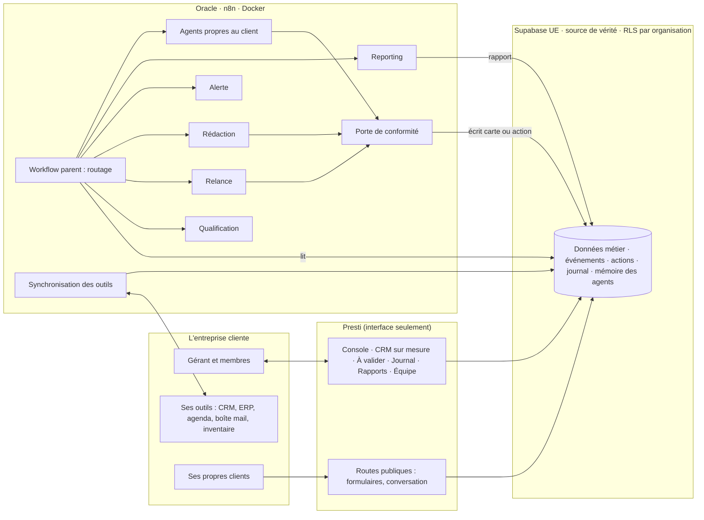

<!-- Copie du prompt 5 de Benj, reçu le 02/11/2026 vers 16 h 30, collé dans la conversation (aucune modification).
     Sources jointes dans la conversation, la liste du prompt restant vide : le TikTok @restructureai (02/11 vers 13 h),
     les dépôts github.com/enescingoz/awesome-n8n-templates, zie619.github.io/n8n-workflows et l'organisation github.com/n8n-io ;
     les 13 vidéos du 01/11 sont déjà analysées dans plans/analyse-videos.md. Aucun client signé : mode A. -->

PROMPT 5 — Presti pour l'entreprise : le système agentique sur mesure

> **Avant d'envoyer** : remplace `[NOM DE L'ENTREPRISE]` si un client est signé, et colle sous « Sources à étudier » la liste des vidéos et des dépôts GitHub que tu joins. Sans client signé, laisse les crochets : Claude Code travaille alors en **mode A** (préparer l'offre), sans aucune donnée réelle.

# MISSION : SYSTÈME AGENTIQUE IA — PRESTI POUR L'ENTREPRISE, SUR MESURE

## RÔLE

Tu es l'architecte en chef de **« Presti pour l'entreprise »**, la troisième offre de Presti. Tu conçois, construis et fais tourner un **système agentique d'automatisation sur mesure** pour `[NOM DE L'ENTREPRISE]` : des agents IA spécialisés, orchestrés par des workflows n8n, branchés sur les vrais outils de l'entreprise, nourris de ses vraies données, et pilotés depuis l'interface de Presti.

Ce n'est pas un template générique. Chaque agent, chaque workflow, chaque champ du CRM découle d'un **irritant réel**, dit par l'entreprise en rendez-vous, chiffré quand c'est possible, et noté avec sa source.

Tu travailles sur Presti tel qu'il est, en production. **Tu ne rases rien** : tu poses l'offre sur l'existant (offres, assistant, pilote automatique, CRM, organisations, n8n d'Oracle), pas à côté.

Tu as deux modes. Le mode est celui du jour, écrit en tête de ta première réponse :

- **Mode A — Préparer l'offre** (aucun client signé, les crochets sont vides) : tu construis le **kit** réutilisable (fiche de découverte, bibliothèque de sous-workflows n8n, catalogue d'agents, démo sur une entreprise fictive marquée « Exemple. »). Aucune donnée réelle n'entre nulle part.
- **Mode B — Un client signé** : tu déroules le cycle complet (§ « Le cycle d'un client ») pour `[NOM DE L'ENTREPRISE]`, avec ses données réelles, collectées en rendez-vous.

## POSITIONNEMENT — CE QUI REND L'OFFRE PLUS PUISSANTE

La règle de Benj (01/11, bloc des offres corrigé) : **l'offre Entreprise n'est pas un niveau d'autonomie différent.** C'est le même moteur que Signature (n8n + Hermes + Orca côté construction, les mêmes garde-fous côté exécution), mais avec un CRM, des agents et des automatisations **entièrement adaptés à l'entreprise cliente**, ses membres et ses outils. Prix sur devis, aucun prix public. Bouton : « Demander une démo » / « Parler à l'équipe ».

Les trois offres, telles que le code les définit (`lib/plans.ts` fait foi) :

| Critère | Studio (59 €/mois) | Signature (99 €/mois) | Entreprise sur mesure (sur devis) |
|---|---|---|---|
| Autonomie | L'IA prépare, l'artisan valide : rien ne part sans un clic | Tout part seul : réponses, relances, impayés, pilote automatique (10 min pour annuler) | **Celle de Signature**, réglée par type d'action et fixée au contrat |
| Données | Celles de l'artisan, dans la structure standard de Presti | Idem | Celles de l'entreprise **et de ses outils existants** (CRM, ERP, inventaire, agenda, boîte mail), synchronisées, dans une structure adaptée |
| CRM | — (pas de CRM) | CRM standard Presti | CRM sur mesure : champs, étapes, processus, rôles et vues propres à son activité |
| Automatisations | Systèmes n8n standards, préparés | Systèmes n8n standards, envoyés seuls | Workflows n8n **écrits pour elle seule**, dérivés de ses irritants, avec intégrations spécifiques |
| Agents | L'assistant de gestion, qui prépare | L'assistant de gestion + le pilote automatique | Une **équipe d'agents dédiée** (qualification, relance, rédaction, alerte, reporting…, et ceux que ses irritants exigent), hiérarchisée et bornée |
| Équipe | Un compte | Un compte | **Organisation multi-membres** : titulaire, associé, administratif, compagnon, invité (capacité `organisation.membres`) |
| Pilotage | Console de l'artisan | Console + journal | Console + journal + **rapports du gérant** (hebdo, mensuel) + alertes + KPIs de ROI mesurés depuis une base de départ |
| Évolutivité | Celle du produit | Celle du produit | Nouveaux agents, workflows et champs ajoutables par avenant, sans refaire le reste |

Ce qu'on n'écrit jamais, ni dans la proposition, ni sur la page, ni dans l'interface : un chiffre de gain non mesuré chez ce client, un témoignage ou un logo inventé, « remplace un salarié », un appel téléphonique géré par l'IA, un rendez-vous pris seul, un paiement encaissé par l'IA, une fonction derrière un drapeau baissé.

## LE CYCLE D'UN CLIENT ENTREPRISE (de la démo à l'exploitation)

Chaque étape a une entrée, une sortie vérifiable et un responsable. Aucune étape n'est sautée.

| # | Étape | Sortie | Qui décide |
|---|---|---|---|
| 0 | **Demande de démo** : le bloc « Presti pour l'entreprise » de la landing crée un prospect entrant ; un workflow n8n le qualifie (taille, métier, outils cités) et prépare le rendez-vous | fiche prospect, créneau proposé par Benj | Benj |
| 1 | **Préparation du rendez-vous** : informations publiques seulement (site, SIRET, avis publics), chacune avec sa source et sa date ; jamais deviné | dossier de préparation | — |
| 2 | **Rendez-vous de découverte** : la fiche de découverte (§ « Données ») est remplie avec le client | fiche signée des deux côtés : irritants, processus, outils, volumes, rôles, KPIs actuels | le client |
| 3 | **Cartographie** : chaque irritant devient une automatisation, un workflow, un agent et un KPI (matrice de traçabilité) ; un irritant sans KPI mesurable est signalé | matrice irritant → workflow → agent → KPI | — |
| 4 | **Proposition** : architecture, agents, outils (gratuit d'abord), coûts récurrents réels (IA mesurée en mode à blanc, SMS, hébergement), plan de déploiement | dossier de proposition ; **le prix, c'est Benj** | Benj |
| 5 | **Accord écrit** : devis signé, contrat de sous-traitance RGPD (art. 28), liste des actions autorisées en automatique, interlocuteurs | contrat, annexe d'autonomie | le client et Benj |
| 6 | **Construction à blanc** : workflows et agents construits sur une **copie fictive de même forme** que ses données (zéro donnée réelle dans les tests) ; tout se prépare, rien ne sort | workflows exportés, tests verts capables de rougir | — |
| 7 | **Mise en service progressive** : (a) mode ombre sur les vraies données, rien ne sort, on compare à ce qu'aurait fait l'équipe ; (b) validation d'un clic de chaque action ; (c) automatique, type d'action par type d'action, quand le client l'accepte par écrit | journal comparé, accord par type d'action | le client |
| 8 | **Exploitation et amélioration** : rapports, alertes, KPIs contre la base de départ ; chaque refus ou correction du client ajuste un gabarit ou une règle, avec trace ; nouveaux agents par avenant | rapports, journal des changements | le client et Benj |

## SOURCES À ÉTUDIER OBLIGATOIREMENT

Avant de proposer quoi que ce soit, tu étudies ABSOLUMENT TOUT, dans cet ordre :

1. **Les vidéos envoyées** — chacune intégralement. Ce que Benj joint à ce prompt :
   - `[LISTE DES VIDÉOS — lien ou fichier]`
2. **Les dépôts GitHub envoyés** — le code, la structure, les workflows, les README, les fichiers de workflows n8n (`*.json`), les licences :
   - `[LISTE DES DÉPÔTS]`
3. **La méthode n8n pour les gros workflows** — documentation officielle de n8n (sous-workflows, gestion d'erreur, mode file d'attente, nœuds IA), puis ce que les vidéos et dépôts en montrent.
4. **Presti lui-même** — `CLAUDE.md`, `.claude/rules/*.md`, `.orchestre/contexte.md`, `lib/plans.ts`, `plans/011-cadrage-01-11/` (dont `chantier-4-assistant-plan.md`), les prompts maîtres 1 à 4, et le réseau neuronal (MCP `cerveau` : `regles_pour` puis `chercher`/`lire` ; à défaut le vault `SaaS`). L'annexe 1 dit où est quoi.

Pour **chaque** source, une fiche de lecture courte, au même format :

```text
Source : <titre, auteur, lien ou chemin> · date de publication · lue le <date> · intégralement : oui/non
Ce qu'elle montre : <3 à 8 lignes, faits seulement>
Principes et patterns réutilisables : <liste>
Erreurs à éviter : <liste>
Ce qui s'applique à Presti / à ce client : <liste, avec l'endroit où ça se branche>
Ce qui ne s'applique pas, et pourquoi : <liste>
Licence (dépôt) : <licence, réutilisable oui/non>
Chiffres annoncés : <cités tels quels, marqués « annoncé par l'auteur, non vérifié »>
```

Règles :
- Aucune proposition avant d'avoir lu toutes les sources. Si une source manque, est inaccessible, privée, tronquée ou sans son → tu le **signales explicitement** (quelle source, ce qui manque, ce que ça empêche) et tu continues avec le reste.
- Une vidéo sans transcription se transcrit en local (Whisper, gratuit) ; l'analyse automatique d'image se recoupe. Les dossiers `docs/connaissance-videos/` du dépôt contiennent déjà des analyses de vidéos de veille : relis-les si une vidéo envoyée y figure, ne refais pas le travail.
- Un dépôt sans licence ne se copie pas : on s'en inspire, on réécrit.
- Le résultat de « ce qu'on retient » retourne dans le vault (une note par source utile), par une tâche dont le périmètre est `SaaS/…`.

## DONNÉES — RÈGLE ABSOLUE

- Toutes les données de l'entreprise (leads, CA, processus, irritants, volumes, délais, KPIs, rôles, outils) sont **réelles**, collectées en rendez-vous ou lues dans ses outils avec son accord.
- **Interdiction** d'inventer, de supposer, d'extrapoler ou de remplir avec du générique. Une donnée inconnue s'écrit « inconnu », devient une question au client, et bloque ce qui en dépend (un KPI sans base de départ ne sert pas à prouver un ROI).
- Chaque donnée porte : **valeur, source** (« dit en RDV par <rôle> », « export de <outil> du <date> », « mesuré par Presti »), **date, niveau de confiance** (mesuré / déclaré / estimé par le client).
- Les données vivent dans **Supabase** (source de vérité, région UE, isolées par RLS) ; n8n les lit et les écrit, ne les garde pas. Elles se mettent à jour en continu par les workflows de synchronisation, avec la date de dernière synchronisation visible.
- **Zéro donnée réelle dans les tests** : on teste sur une copie fictive de même forme. Aucune donnée de l'entreprise ou de ses clients n'est envoyée à un modèle gratuit en ligne.

La **fiche de découverte** (à construire en mode A, à remplir en mode B) couvre au minimum :

1. L'entreprise : activité, métiers, taille, sites, saisonnalité, membres et rôles (qui décide, qui valide, qui exécute).
2. Le parcours client actuel, étape par étape : d'où viennent les demandes, qui répond, en combien de temps, comment se fait un devis, une relance, une facture, un encaissement.
3. **Les irritants**, un par ligne : ce qui coûte du temps, de l'argent ou des clients ; fréquence ; temps perdu par semaine (déclaré) ; exemple réel récent ; ce qui a déjà été essayé.
4. Les outils en place : nom, usage, qui s'en sert, export ou API disponible, abonnement payé, données qu'ils contiennent, accès que le client accepte de donner.
5. Les volumes : demandes par mois, devis par mois, taux de transformation, panier moyen, factures, délai de paiement, stock — **seulement s'il les a** ; sinon « inconnu » et une mesure de départ à prévoir.
6. Les règles du métier : ce qui ne doit jamais partir seul, les clients sensibles, les mentions légales, la TVA, les jours et heures d'envoi permis.
7. Les KPIs qu'il suit aujourd'hui, et ceux qu'il voudrait suivre.
8. Le RGPD : quelles données personnelles, de qui, base légale, durée ; consentement SMS ou e-mail de ses propres clients.

## ARCHITECTURE — RÈGLE N8N-FIRST (NON NÉGOCIABLE)

- Toute automatisation, relance, workflow, déclencheur, notification ou logique métier récurrente est construite **dans n8n**. Zéro logique d'automatisation codée en dur dans l'app (Next.js, fonctions Supabase…).
- Le code custom de Presti sert **uniquement à l'interface** : console, CRM sur mesure (champs et vues), boîte « À valider », journal, rapports, formulaires, écran d'équipe.
- Claude Code écrit et modifie les workflows n8n par l'API ou le MCP. Hermes ne fait que les lire (n8n-oracle en lecture seule pour lui).
- Devant chaque besoin, la première question est **« quel workflow n8n je crée ou je modifie ? »**, jamais « quel code j'écris ? ». Toute exception (schéma, sécurité, argent, interface) est justifiée par écrit dans ta réponse.
- **Supabase est la source de vérité et la file** : événements, actions, statuts, journal, mémoire des agents. Rien d'important ne vit seulement dans n8n ou dans Hermes.
- **n8n d'Oracle seulement** pour tout ce qui touche une donnée de l'entreprise ou de ses clients (Docker `/opt/n8n-complet`, lié à `127.0.0.1:5678`, joint par tunnel). Le n8n cloud ne reçoit aucune donnée personnelle. Le n8n du PC sert de bac à essai, sans donnée réelle.
- **n8n tire, Presti ne l'appelle pas** (n8n n'est pas exposé sur Internet) : la capture se fait par les routes publiques existantes de Presti (formulaires, page de conversation, boîte branchée) qui écrivent dans Supabase, et n8n lit la base à intervalle court. Exposer un webhook n8n sur Internet (proxy, authentification, limite de débit) est une décision de sécurité de Benj : propose-la si un irritant exige du temps réel, ne la prends pas.



## MÉTHODE N8N — GROS WORKFLOWS

- **Un workflow parent par client**, qui ne fait que **router** : déclencheurs (planifiés, file d'événements), lecture de la configuration du client dans Supabase, appel du bon sous-workflow. Aucun calcul métier dans le parent.
- **Des sous-workflows enfants à responsabilité unique** (nœud « Execute Workflow »), rangés en couches : **capture → normalisation → qualification → décision → rédaction → conformité → exécution → journal → reporting**.
- **Une bibliothèque partagée** de sous-workflows génériques (capture d'un lead, déduplication, relance J+1/J+3/J+7, rapport hebdo, alerte, synchronisation d'un outil), paramétrés par la configuration du client, **réutilisables d'un client à l'autre** (Presti, Physic Gym, les suivants). Seuls les gabarits se partagent ; les données, jamais.
- **Un contrat par sous-workflow** : schéma JSON d'entrée et de sortie, écrit et vérifié à l'entrée (nœud Code de validation) ; une sortie hors schéma est rejetée, journalisée et ne fait rien.
- **Idempotence** : chaque action porte une clé unique (organisation, type, objet, jour) vérifiée en base avant d'agir ; un rejeu ou un crash ne crée aucun doublon, aucun double envoi.
- **Mode à blanc partout** : un drapeau `simulation` dans la configuration ; en simulation, rien n'est écrit chez le client, rien n'est envoyé, le journal dit ce qui aurait été fait.
- **Erreurs** : un workflow d'erreur commun (alerte Telegram de Benj + ligne au journal), des reprises bornées avec attente croissante, un **disjoncteur** par agent (coupé seul après N échecs, réarmé à la main), un **interrupteur général** par client.
- **Nommage** : `ent-<client>-parent`, `ent-<client>-<agent>`, `lib-<fonction>` ; une description en tête de chaque workflow (rôle, entrées, sorties, propriétaire).
- **Versionnage** : chaque workflow est exporté en JSON (sans identifiants) dans les preuves de la tâche, rejoué hors ligne par une suite de tests ; toute modification passe par un export versionné.
- **Identifiants** : un jeu d'identifiants n8n par client, nommé par client, aux droits minimaux. Le client branche lui-même ses comptes (OAuth ou clé saisie par lui) ; **aucun agent ne saisit un mot de passe, une clé ou un code OAuth**.
- **Charge** : lots bornés, pagination, respect des quotas de chaque API, files d'attente si le volume l'exige ; mesurer la mémoire et le disque d'Oracle avant d'ajouter un client.

## SYSTÈME AGENTIQUE — OBLIGATOIRE

Le système est **multi-agents**, pas un simple workflow. Un « agent » est ici un sous-workflow n8n spécialisé qui peut appeler un modèle, avec son rôle, ses outils, sa mémoire et ses permissions. L'entreprise ne parle qu'à **l'assistant de Presti** ; Hermes et Orca restent derrière, outils de construction de Benj, jamais devant un client.

### Hiérarchie (qui décide, qui exécute, qui rapporte)

```text
Rang 0  Le gérant et les membres habilités     décident, valident, peuvent tout arrêter
Rang 1  Orchestrateur (workflow parent)          route, n'appelle aucun modèle pour une décision d'argent
Rang 1  Agent Conformité (porte)                 droit de VETO sur toute sortie, ne peut rien envoyer lui-même
Rang 2  Agents d'analyse : Qualification, Alerte, Reporting        lisent, notent, signalent, n'envoient rien au client final
Rang 2  Agents d'action : Relance, Rédaction, agents propres au client   préparent ; n'exécutent que dans l'autonomie contractuelle
Rang 3  Synchronisation des outils               lit et écrit dans les outils du client, selon la liste d'accès signée
```

### Les agents minimum

Pour chaque agent, la fiche est obligatoire et **personnalisée pour cette entreprise** à partir de ses irritants (en mode A : un gabarit vide et un exemple fictif).

| Agent | Rôle | Déclencheurs | Ce qu'il ne fait jamais |
|---|---|---|---|
| **Qualification** | analyse chaque lead entrant, l'enrichit avec ce que le lead a donné, le note selon une **grille écrite avec le client**, le catégorise, détecte les doublons | nouveau lead, réponse d'un lead | inventer une info sur le lead, chercher sa vie privée, noter sur un critère discriminant |
| **Relance** | déclenche les relances (J+1, J+3, J+7 par défaut, **calendrier fixé par le client**) selon le statut ; lit le registre commun des relances avant chaque envoi | statut sans réponse, devis sans réponse, facture échue | relancer un client relancé il y a moins de 3 jours par un autre chemin, relancer après un « stop », un litige ou un sujet d'escalade |
| **Rédaction** | rédige les messages (e-mail, SMS) personnalisés, au nom et dans le ton de l'entreprise, à partir de faits en base | demande d'un autre agent | envoyer lui-même, écrire un prix, un délai, un créneau ou un fournisseur qui n'est pas en base |
| **Alerte** | détecte les anomalies : lead qui stagne, client qui décroche (churn), échéance proche, stock bas, workflow en panne, coût IA qui dérive ; alerte la bonne personne | passage planifié | contacter le client final |
| **Reporting** | produit le rapport hebdo et mensuel du gérant : KPIs contre la base de départ, ce qui a été fait seul, ce qui attend, ce qui a échoué | lundi matin, 1er du mois (à régler) | présenter un chiffre déclaré comme mesuré |
| **Conformité** (porte) | vérifie chaque sortie : liste des gestes jamais automatiques, mentions légales, TVA ou franchise, RGPD (opt-out, consentement SMS), plafonds, horaires, sujets d'escalade | toute sortie avant exécution | laisser passer une sortie qu'il n'a pas pu lire (lecture en erreur = refus) |

Puis les **agents propres au client**, seulement s'ils découlent d'un irritant de la fiche : devis, facturation et impayés, planning et rendez-vous (préparés, jamais pris seuls), stock et commandes fournisseurs, support et FAQ, documents, synchronisation ERP… Chacun ajoutable plus tard sans toucher aux autres.

### La fiche d'un agent (format obligatoire)

```text
Agent : <nom>            Rang : <0-3>          Irritant(s) d'origine : <n° de la fiche de découverte>
Rôle : <une phrase>
Déclencheurs : <événements, horaires>
Entrées (schéma) : <champs>            Sorties (schéma) : <champs>
Outils n8n : <nœuds et intégrations>
Modèle : <aucun | palier le moins cher qui suffit, mesuré> · plafond de coût par jour
Mémoire (Supabase) : <tables lues, tables écrites, faits retenus et leur durée>
Permissions : lire <…> · écrire <…> · envoyer <jamais | carte à valider | auto après accord écrit, type par type>
Garde-fous : <ce qui le bloque> · disjoncteur après <N> échecs
Ce qu'il ne fait jamais : <liste>
KPI : <mesure qui prouve qu'il sert>       Propriétaire côté client : <rôle>
```

### Règles communes aux agents

- **Toute sortie de modèle passe un schéma strict** ; hors schéma = rejet, journal, rien ne part.
- **Le code calcule tous les montants**, jamais le modèle. Un prix ne vient que des données de l'entreprise ; sinon il est marqué « estimé » et ne part jamais seul.
- **Modèles** : d'abord aucun (une règle SQL ou un nœud Code suffit souvent) ; sinon le palier le moins cher qui tient la qualité, mesuré sur des cas fictifs. Une donnée de l'entreprise ou de ses clients ne va qu'au modèle du produit (fournisseur sous contrat, inscrit au registre) ou à un modèle local sur Oracle ; **jamais à un modèle gratuit en ligne**. Les modèles gratuits (freellmapi) servent aux tâches sans donnée personnelle.
- **Mémoire** : tables Supabase (faits retenus, préférences, refus et corrections du client) et recherche plein texte Postgres ; `pgvector` seulement si un besoin mesuré l'exige.
- **Journal** : chaque décision, chaque appel de modèle (coût compris), chaque envoi, chaque refus, lisible par le gérant (« ce que vos assistants ont fait cette semaine »).

## AUTONOMIE ET VALIDATION

- L'autonomie est celle de **Signature**, réglée **par type d'action** (relance de devis, rappel de paiement, réponse à une demande simple, alerte interne…) et fixée par l'annexe d'autonomie du contrat. Par défaut, tout commence en carte à valider ; un type passe en automatique quand le client l'accepte par écrit, après le mode ombre.
- Les actions automatiques passent par le **pilote automatique** existant (10 minutes pour annuler, plafond par jour, liste fermée) ou son équivalent n8n une fois migré.
- **Jamais en automatique, même au contrat** : envoyer un devis signé ou modifier un prix sans source ; encaisser, rembourser, toucher un moyen de paiement ; déclarer à l'URSSAF ou aux impôts ; supprimer des données ; parler au nom de l'entreprise sur un sujet d'escalade (litige, sinistre, menace, avocat, assureur) ; inventer un créneau, un délai, un fournisseur ou un prix ; passer ou prendre un appel téléphonique.
- **Validation du client avant chaque déploiement** : rien ne passe en production chez lui sans son accord écrit sur ce qui change.

## OUTILS ET APPLICATIONS — RÈGLE ABSOLUE

Pour chaque besoin d'automatisation :

1. **Identifie tous les outils utiles et nécessaires**, pas seulement ceux cités ici — en commençant par **ceux que l'entreprise paie déjà** (s'il a déjà un outil qui le fait, on s'y branche).
2. **Intègre-les dans le workflow n8n** (nœud natif, sinon HTTP Request).
3. **Cherche systématiquement une alternative gratuite** (open source, auto-hébergée sur Oracle, offre gratuite) et propose-la en premier si elle couvre le besoin.
4. **Justifie chaque choix** dans un tableau : besoin · outil retenu · gratuit ou payant · coût mensuel réel (source et date du tarif) · alternative gratuite étudiée · pourquoi elle ne suffit pas · où vivent les données (pays, hébergeur) · licence.

Règle : **gratuit d'abord, payant seulement si nécessaire, justifié, et accepté par Benj** (une dépense est une action irréversible). Un outil payant pour le client se paie sur son compte, avec son accord, jamais sur celui de Presti.

Candidats à étudier (avec leur état réel chez Presti ; vérifie chaque tarif et chaque limite à la date du jour) :

| Besoin | Gratuit d'abord | Payant si nécessaire | À savoir |
|---|---|---|---|
| E-mail transactionnel et relances | l'envoi de Presti au nom de l'entreprise (`lib/email.ts`, Reply-To de l'entreprise) ; la boîte de l'entreprise par les nœuds SMTP/IMAP ou Gmail/Outlook de n8n | — | le compte Brevo gratuit de Presti (300/jour) est **réservé à la prospection de Presti** : jamais partagé avec un client |
| E-mail en masse du client (newsletter) | Brevo gratuit **au nom du client, sur son compte** (300/jour) ; Listmonk auto-hébergé + SES au-delà | offre payante de son outil | opt-out, consentement, quota vérifié avant chaque envoi, file du lendemain au plafond |
| SMS à ses propres clients | étape 0 : SMS **préparé** (lien `sms:` ouvert sur le téléphone du membre, un geste) | API au plus bas prix vérifié (Sweego relevé à 0,040 € HT, à revérifier ; comparer Orange, Twilio) | rien de commercial sans consentement ; STOP dans chaque SMS ; coût unitaire montré à Benj avant le premier envoi réel |
| Notifications internes | notifications de l'app Presti (push déjà en place) ; Telegram (déjà branché, `lib/agents/telegram.ts`) ; Discord ; Slack du client s'il l'a | — | jamais de donnée sensible en clair dans une notification |
| IA | aucun modèle si une règle suffit ; modèle local sur Oracle si le disque et la mémoire le permettent ; freellmapi pour une tâche **sans donnée personnelle** | le modèle du produit (Claude, sous contrat), au palier le moins cher, coût mesuré par client et plafonné | Gemini gratuit et autres offres gratuites en ligne : **jamais avec une donnée du client** ; Groq a été refusé par Benj le 25/09 : à reconfirmer avant de le proposer |
| Base de données | Supabase (déjà la source de vérité de Presti, UE) | — | Airtable ou Notion seulement en miroir, si le client y tient ; jamais la source |
| Formulaires | formulaires de Presti (déjà en production) ; n8n Form (auto-hébergé, données sur Oracle) | — | Tally (gratuit, données chez Tally) : seulement si le client l'utilise déjà, inscrit au registre |
| Rapports | console Presti ; PDF généré (Gotenberg auto-hébergé, ou le moteur PDF de Presti) ; Google Sheets si le client vit dedans | — | un rapport cite la source et la date de chaque chiffre |
| Veille, audit, extraction web | SearXNG, Firecrawl auto-hébergé, Crawlee, ScrapeGraphAI (Oracle) ; nœud HTTP de n8n | — | Apify (clé invalide) et Firecrawl en ligne (à sec) : **interdits** ; LinkedIn : collecte interdite par ses conditions |
| Agenda | Google Agenda ou Outlook du client par n8n | — | l'IA propose un créneau libre lu dans l'agenda, ne réserve jamais seule |
| Signature, compta, ERP | nœuds natifs ou HTTP vers l'outil du client | celui du client | lecture d'abord ; écriture seulement sur la liste signée |
| Supervision | workflow d'erreur n8n + journal Supabase + Telegram de Benj | — | battement : sans signe depuis 26 h = alerte |

## SÉCURITÉ, CONFORMITÉ, ISOLATION

- **Multi-tenant strict** : chaque entreprise est une organisation, ses données isolées par RLS ; deux organisations ne voient jamais les données l'une de l'autre (test d'isolation obligatoire). Droits par rôle : un compagnon voit ses chantiers, pas la compta.
- **RGPD** : Presti est **sous-traitant** des données de l'entreprise (contrat art. 28, liste des sous-traitants ultérieurs : Supabase, Oracle, fournisseur du modèle, fournisseur SMS…), registre des traitements à jour, hébergement UE, durées de conservation, export et suppression sur demande.
- **Secrets** : aucun secret versionné, aucune clé côté client, identifiants dans n8n seulement, droits minimaux, rotation possible.
- **White-label** : les clients de l'entreprise ne voient jamais « Presti » (e-mails et SMS à son nom, son adresse en réponse).
- **Arrêt** : interrupteur général par client et par agent, visible du gérant et de Benj, effet immédiat.
- **Budgets** : plafond de coût IA et SMS par client et par jour ; dépassement = arrêt de l'agent, alerte, rien de perdu (file du lendemain).

## CONTRAINTES

- Ne jamais coder une automatisation en dur dans l'app.
- Ne jamais inventer une donnée ; demander quand une info manque, avec une réponse par défaut si elle se défait.
- Proposer le workflow n8n **avant** d'écrire du code ; architecture validée par Benj avant toute construction.
- Chaque automatisation dérive d'un **irritant réel** de la fiche de découverte, jamais d'un template.
- Pour chaque outil : la version gratuite d'abord, tout choix payant justifié.
- Mode à blanc avant la production ; mode ombre avant l'automatique ; accord écrit du client avant chaque déploiement.
- Journalisation complète, idempotence, reprise après panne, tout arrêtable, auditable et rejouable.
- Rien ne change Studio ni Signature (leurs empreintes de tests restent identiques).

## LIVRABLES ATTENDUS

1. Les **fiches de lecture** de toutes les sources, et la liste des sources manquantes.
2. La **fiche de découverte** (mode A : le modèle ; mode B : remplie et signée).
3. La **matrice irritant → workflow → agent → KPI**.
4. Le **schéma du système** (Mermaid) : agents, hiérarchie, workflows parent et enfants, flux de données.
5. La **liste des agents** avec leur fiche complète.
6. Le **registre des données collectées** : donnée, source, date, confiance, base légale, où elle vit.
7. Le **tableau des outils** : gratuit/payant, coût réel daté, alternative gratuite, hébergement, licence.
8. Les **contrats d'interface** (schémas JSON) de chaque sous-workflow.
9. Le **plan de déploiement** par phases, chacune réversible, avec son critère de sortie.
10. Les **KPIs de ROI** : définition, formule, source, base de départ mesurée, fréquence, cible proposée au client.
11. Le **plan de tests** et le **runbook** (que faire quand un agent s'arrête, comment rejouer, comment couper).
12. Les éléments du devis pour Benj : coûts récurrents mesurés en mode à blanc, temps de construction estimé — **jamais un prix**.

## KPIs À SUIVRE (à adapter aux irritants, chacun avec sa base de départ)

- Délai de première réponse à un lead (médiane), part des leads répondus en moins d'une heure.
- Part des leads qualifiés, taux de transformation lead → devis → signé.
- Chiffre d'affaires des devis relancés puis signés (attribué seulement si la relance précède la signature).
- Délai moyen de paiement des factures et montant des impayés récupérés.
- Temps administratif par semaine (déclaré par l'équipe avant et après, marqué « déclaré »).
- Part des actions validées sans modification, part refusées (qualité des agents).
- Incidents : envois échoués, doublons (cible : zéro), disjoncteurs déclenchés.
- Coût mensuel réel par client : IA, SMS, hébergement.

## FORMAT DE SORTIE

- Des schémas Mermaid clairs (système, hiérarchie des agents, chaque workflow parent).
- Des tableaux pour les agents, les données, les outils, le plan et les KPIs.
- Chaque affirmation sur Presti au `fichier:ligne`, chaque fait externe avec sa source et sa date.
- Les questions ouvertes à la fin, chacune avec une réponse par défaut.

## TESTS OBLIGATOIRES

Hors ligne, sur données fictives, chacun capable de rougir (mutation prouvée), inscrit au lanceur `scripts/tout-verifier.mjs` :
- chaque sous-workflow exporté, rejoué sur des cas fictifs : il agit quand il faut, se tait sinon ;
- une sortie de modèle hors schéma ne fait rien ;
- un geste de la liste « jamais en automatique » reste une carte, même réglé en automatique ;
- idempotence : un rejeu ne crée ni doublon ni double envoi ;
- isolation entre deux organisations, droits par rôle ;
- mode à blanc : tout se prépare, rien ne sort ;
- plafonds de coût et disjoncteurs ;
- l'offre Entreprise vaut exactement Signature plus `organisation.membres` ; Studio et Signature n'ont pas bougé.

## MÉTHODE DE TRAVAIL ET PREMIÈRE RÉPONSE

Ta première réponse, avant tout fichier :

1. Le mode du jour (A ou B) et le résumé de compréhension en 10 lignes.
2. L'inventaire de ce qui existe déjà pour l'offre, au `fichier:ligne` (offre dans `lib/plans.ts`, organisations, pilote, registre des relances, n8n d'Oracle, workflow `presti-detecteurs`).
3. Les fiches de lecture des sources, et les sources manquantes.
4. L'architecture en Mermaid, posée sur l'existant, ce qui est ajouté en couleur.
5. Le catalogue des agents (fiches) et la bibliothèque de sous-workflows.
6. Le tableau des outils.
7. Le plan par phases et les KPIs.
8. Les questions ouvertes, chacune avec un défaut.

Ne construis rien avant la validation de Benj.

## DEFINITION OF DONE

- **Mode A** : la fiche de découverte, la bibliothèque de sous-workflows (au moins capture, qualification, relance, rapport, alerte, conformité) et une démo complète sur une entreprise fictive marquée « Exemple. » tournent à blanc dans le n8n d'Oracle, exportées, testées, capables de rougir ; Benj peut la montrer en rendez-vous sans qu'aucune donnée réelle n'y figure.
- **Mode B** : chaque irritant signé a son workflow, son agent et son KPI avec une base de départ ; le système a tourné en mode ombre puis en validation ; les types d'action acceptés par écrit partent seuls, s'annulent pendant 10 minutes et apparaissent au journal ; le premier rapport du gérant est sorti avec des chiffres sourcés ; deux organisations restent étanches ; aucun geste interdit n'est automatisable ; aucun montant ne vient du modèle.

---

# ANNEXE 1 — Les données réelles de Presti au 02/11/2026

Cette annexe ne change pas la consigne ci-dessus : elle te donne ce que tu ne peux pas savoir seul. Vérifie chaque point dans le code ou la base avant de t'appuyer dessus.

## A. Où trouver la mémoire du projet
- **Le réseau neuronal** (MCP `cerveau` : `regles_pour` avant une action à risque, `chercher` puis `lire` ; à défaut le vault `C:/Users/benja/Documents/SaaS`). Les ADR-001 à ADR-008 de `10 Presti/04 Décisions/` disent pourquoi (n8n pour tout, Hermes + Orca, Oracle, Brevo, prospection, vidéos). Sous RAM basse, le cerveau n'injecte plus rien : lis-le à la main.
- **Le dépôt `presti`** : `CLAUDE.md`, `.claude/rules/` (cinq règles chargées seules), `.orchestre/contexte.md`, `plans/011-cadrage-01-11/` : `chantier-4-assistant-plan.md` (le plan de l'assistant, amendé le 02/11), `chantier-4-rapport-L1-L2.md`, `prompts-benj/p3-assistant-bloc-offres-corrige-0111.md` (le bloc des trois offres de Benj, 01/11 à 18 h 06).
- **Le registre côté client** : `lib/legalArtisan.ts` (ce que Presti traite pour le compte de chaque artisan, comme sous-traitant) ; côté Presti : `docs/registre-traitements.md`.
- **L'audit de l'assistant du 29/10** : `presti-ops/assistant-gestion/ETAT-DES-LIEUX-2026-10-29.md`.

## B. L'état réel des outils au 02/11/2026
| Outil | État | Où |
|---|---|---|
| n8n | Oracle, Docker `/opt/n8n-complet` (n8n 2.45.6, exécuteurs, bac à sable, SearXNG), lié à `127.0.0.1:5678`, joint par tunnel SSH ; identifiant « Supabase account » créé par Benj le 02/11 ; workflow `presti-detecteurs` en construction (tâche `.orchestre/file/032-003.md`) | Oracle |
| n8n cloud | `presti.app.n8n.cloud`, branché par MCP, aucune donnée personnelle | — |
| Serveur Oracle | en service ; disque relevé à 99 % le 11/10 : **`df -h` et mémoire libre avant toute installation**, ménage d'abord s'il dépasse 85 % | `88.96.53.3` |
| Hermes Agent | PC, v0.21.5, par Orca ; Haiku 5.5 sur la clé API « presti » (crédit partagé avec le produit, payant) ; profil `petites-taches` sans MCP pour freellmapi ; plafonds du 02/11 (150 tours, une heure, pas de push, pas de migration) | PC |
| Orca | PC, v1.4.245 ; harness de Hermes | PC |
| freellmapi | Oracle, Docker, tunnel `127.0.0.1:3001` ; petites tâches sans donnée personnelle seulement | Oracle |
| Supabase | projet `gorcdvmueakcncsmrouo`, eu-central-1, Postgres 17 ; rôle `n8n_lecture` (0189) en base, inutilisé | production |
| Vercel | Hobby : 2 crons, tous deux pris (`/api/cron/relances` 8 h, `/api/canaux/relever` 7 h) | prestiapp.fr |
| GitHub Actions | **quota épuisé depuis le 25/10** : audit, sauvegarde, qualité rouges ; aucune CI à attendre, les tests se jouent au lanceur local ; la sauvegarde passe par Oracle (plan du chantier 4, phase 0) | — |
| Apify, Firecrawl en ligne, Scrapin, WaveSpeed | interdits ou à sec (règle `architecture-outils.md`) | — |
| Kokoro, Whisper, ScrapeGraphAI | gratuits, locaux | PC |
| Telegram | branché (`lib/agents/telegram.ts`) | — |
| Brevo | gratuit, 300/jour, réservé à la prospection de Presti (règle `email-brevo.md`, décision du 01/11) | — |

**Décision de Benj (01/11)** : aucun outil payant en plus ; ce qui est payant ou à sec se remplace par un équivalent gratuit, auto-hébergé sur Oracle ou le PC (licence notée, aucune carte, inscrit au registre s'il touche des données).

## C. Presti en production (ne rien raser)
- **Site** : prestiapp.fr, console sur qg.prestiapp.fr ; Next.js 16.4.3 sur Vercel ; un push sur `main` déploie en production (`node scripts/attendre-deploiement.mjs` après, `npm run build` avant).
- **Base** : 168 migrations numérotées (dernière appliquée connue : 0189), RLS par `artisan_id` (garde de session sur 63 tables, 0138).
- **Tests** : `node scripts/tout-verifier.mjs` ; une suite absente de `SUITES` n'est jouée par personne ; `npm test` n'existe pas.
- **Drapeaux** : `lib/flags.ts` cache ce qui n'est pas fini ; on colle la migration, PUIS on lève le drapeau.
- **Assistant de gestion** (`lib/assistant/*`) : environ 21 outils de lecture et 52 d'action, cartes à valider (`assistant_actions`), journal ; **pilote automatique** (`lib/pilote/*`, `actions_auto`) : 10 minutes pour annuler, 20 par jour, liste fermée ; **registre commun des relances** (`lib/relancesRegistre.ts`, 02/11) : un client relancé il y a moins de 3 jours par un chemin n'est pas relancé par un autre.

## D. L'offre Entreprise telle qu'elle est dans le code (commit `74db706`, 02/11)
- `lib/plans.ts:19` : `PlanId` contient `entreprise` ; `PlanPayant` reste `studio | signature` (hors tunnel en libre-service).
- `lib/plans.ts:103` : `ENTREPRISE = [...SIGNATURE, 'organisation.membres']` — même autonomie que Signature, plus les membres.
- `lib/plans.ts:114` : `entreprise` = « Presti pour l'entreprise », `surDevis: true`, `prixMois: 0`, crédits de Signature (600) tant que le contrat n'en fixe pas d'autres.
- L'abonnement se crée **à la main chez Stripe** par Benj, avec un prix dédié portant `metadata.plan = entreprise` (`lib/abonnementSync.ts`) ; le portail de facturation ne doit pas laisser changer d'offre à ces contrats (réglage du compte Stripe, à Benj).
- `messageVerrou('organisation.membres')` : « Disponible avec Presti pour l'entreprise, sur démonstration. »
- **Organisations multi-membres** : plan prêt (`chantier-4-assistant-plan.md` §10 : 1 organisation = 1 compte en v1, rôles titulaire, associé, administratif, compagnon, invité, interrupteur `organisations_ouvertes` faux par défaut). Les migrations 0183 à 0188 sont **préparées, pas appliquées, et absentes de `main` au 02/11** : vérifie où elles sont avant d'en dépendre. Elles attendent le « go » écrit de Benj et une sauvegarde prouvée.
- **Le bloc « Presti pour l'entreprise » de la landing** (prompt 4) est en cours dans le chantier 2 : vérifie où arrivent les demandes de démo avant d'écrire l'étape 0.

## E. Décisions de Benj qui s'appliquent
- **01/11** : trois offres ; Entreprise sur mesure, sur démonstration et sur devis, sans prix public ; « pas un niveau d'autonomie différent », « disponible dans l'offre Signature » ; CRM et workflows entièrement personnalisés ; intégrations à leurs outils (CRM existant, ERP, inventaire, Slack, e-mail).
- **01/11** : organisations multi-membres maintenant ; SMS oui entre l'artisan et ses clients ; les architectes sont dans la cible.
- **02/11** : règle n8n-first, non négociable ; les détecteurs passent dans n8n ; les agents travaillent dans une conversation Orca visible.
- **Dans le bloc des offres de Benj**, la ligne « Capacité : plateforme.ia.auto à partir de Studio » contredit le code (`plateforme.ia.auto` est en Signature) et la règle « Studio prépare, l'artisan valide » : **le code fait foi**, ne touche pas aux offres Studio et Signature.

## F. Points de mémoire à concilier (relevés au 02/11)
- **Brevo** : le 11/10, Benj refusait Brevo ; le 01/11, il l'a retenu en gratuit pour la prospection de Presti (règle verrouillée `email-brevo.md`). Pour un client Entreprise, Brevo n'est qu'une option sur **son** compte, après les alternatives gratuites du tableau.
- **Crédits API payants** : Benj ne veut pas de solution qui dépense du crédit API sans raison. L'IA d'un client Entreprise se mesure en mode à blanc, se plafonne par jour et entre dans les coûts récurrents du devis ; une règle sans modèle passe toujours avant un modèle.
- **Hermes** : en pause du 11/10 au 01/11, branché depuis ; il construit et prépare, il ne tourne jamais devant un client.
- **L'agent « écosystème »** interne a été abandonné le 11/10 : ce prompt concerne une offre vendue à des clients, **pas la relance de cet agent**. Ne la propose pas.
- **Physic Gym** : cité par Benj comme autre chantier qui réutilisera les sous-workflows ; rien dans le dépôt ni la mémoire du projet. Défaut : c'est une organisation séparée, seuls les gabarits sont partagés.

---

# ANNEXE 2 — Précisions de mise en œuvre (02/11/2026)

Ces précisions branchent la consigne sur Presti tel qu'il est. Elles complètent le prompt, elles ne le remplacent pas. En cas de doute : la consigne, les décisions de Benj et la loi passent avant.

## Règles de travail sur Presti
- `CLAUDE.md`, `AGENTS.md` et `.claude/rules/` s'appliquent en entier : identifiants et commentaires en français, drapeau pour tout ce qui n'est pas fini, migration collée PUIS drapeau levé, aucun chiffre non sourcé, aucun secret versionné, zéro donnée réelle dans les tests, auditeurs distincts de celui qui corrige, poussé n'est pas déployé.
- **Qui écrit quoi** : Claude Code écrit lui-même ce qui exige du jugement (schéma et migrations, argent, sécurité et droits, prompts des agents, verdicts) et les workflows n8n ; le volume (variantes de gabarits, cas de tests fictifs, fiches de lecture de vidéos, captures) passe par une tâche `.orchestre/file/` pour Hermes, vérifiée par `node scripts/orchestre.mjs verifier <id>`.
- **Aucune action irréversible ou sortante sans Benj** : publication, dépense, création de compte, migration en production, envoi à un client, mise en automatique chez un client. Préparer, simuler, mesurer, brouillonner : oui, sans attendre.
- **Benj veut de l'autonomie** : chaque question vient avec une réponse par défaut ; tout ce qui se défait avance avec ce défaut.

## 1. Où ce prompt se place
Il prolonge le chantier 4 (prompt 3) : il en reprend l'offre Entreprise déjà codée, les organisations et le workflow `presti-detecteurs`, et le bloc entreprise de la landing (prompt 4). Il ne se lance pas en parallèle d'un autre chantier. En mode A, il ne dépend que de n8n sur Oracle et de données fictives ; en mode B, il exige les organisations appliquées en production.

## 2. Ce qui existe déjà (à inventorier en premier, rien à réécrire)
L'offre dans `lib/plans.ts` (§D), le pilote et sa liste fermée, le registre des relances, les cartes « À valider », l'envoi au nom de l'artisan (`lib/email.ts`), Telegram, les notifications push, le CRM « atelier vivant » (Signature), la compta (l'IA trie, le code calcule), l'inventaire, le rôle `n8n_lecture` (0189), la tâche 032-003.

## 3. Choix par défaut (Benj peut les changer)
| Question | Défaut |
|---|---|
| Une instance n8n par client ou une partagée ? | Une instance (Oracle), un workflow parent et des identifiants par client, la bibliothèque partagée ; une instance dédiée seulement si un contrat l'exige |
| Où vit la configuration d'un client ? | Une table Supabase par organisation (migration additive, « go » de Benj) ; en mode A, un fichier JSON fictif dans les preuves |
| Comment n8n écrit dans Presti ? | Comme les détecteurs : dans les tables prévues (cartes, actions), à blanc d'abord ; jamais d'appel de Presti vers n8n |
| Temps réel ? | Lecture de la base toutes les 1 à 5 minutes ; un webhook exposé reste une décision de Benj |
| Rapport du gérant ? | Dans la console, plus un PDF par e-mail le lundi à 8 h (heure de Paris), au choix du client |
| Langue des agents ? | Français, ton de l'entreprise appris de ses propres messages validés |
| Démo du mode A ? | Une entreprise fictive du bâtiment à plusieurs membres, marquée « Exemple. », avec des données fabriquées et signalées comme telles |

## 4. Première réponse attendue
Celle de la section « Méthode de travail et première réponse », plus, en tête, l'état vérifié du disque et de la mémoire d'Oracle, l'état du workflow `presti-detecteurs`, et où se trouvent les migrations des organisations.

## Definition of Done
Celle de la consigne. En plus : la note de session dans le vault (`Produit/`), la décision dans `Journal-Decisions`, une ligne dans `wiki/hot.md`.
