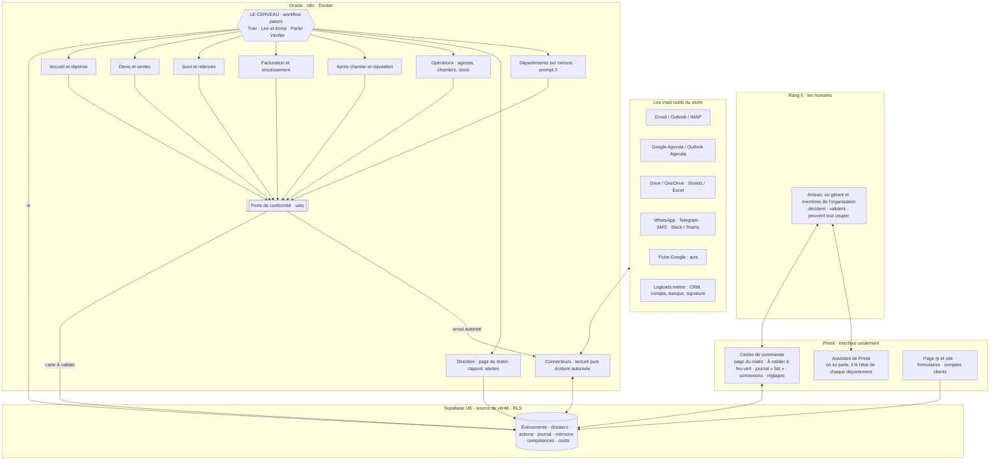

PROMPTS SIGNATURE ET SUR MESURE — les systèmes agentiques d'automatisation de Presti (version du 03/11/2026)

> Texte de Benj, collé dans la session le 03/11/2026 vers 11 h 30, recopié mot pour mot. Consigne qui l'accompagnait : « Donc tu suis ce prompt
> maintenant. Ok ? Ça reprend exactement tout ce que j'avais demandé et que tu n'as toujours pas fait. Donc tu me fais ça. Voilà. Au boulot. »

> **Un seul fichier, deux prompts, un socle commun.** La partie 0 est partagée : les vidéos de référence, l'architecture d'un système
> agentique, les vrais outils, les règles. Le **prompt 1** construit le système des offres **Studio et Signature**. Le **prompt 2** construit
> **Presti pour l'entreprise**, le sur-mesure, sur le même moteur, en plus puissant. Les deux sont dans le même fichier pour qu'ils ne
> divergent jamais : ce que le prompt 2 ajoute, il l'ajoute au-dessus du prompt 1, il ne le refait pas.
>
> **Ce fichier remplace `PROMPT-5-entreprise-sur-mesure.md`** (gardé pour l'historique). Différences voulues par Benj le 03/11 :
> 1. **les vidéos envoyées sont la référence de conception**, recopiées ici pattern par pattern, avec leur identifiant ;
> 2. **des vrais outils dans les systèmes** : Gmail, Google Agenda, Drive, Sheets, Outlook, WhatsApp, Telegram, Slack, les logiciels du client ;
> 3. **l'offre Entreprise est un vrai produit en production**, pas une démonstration : il n'y a plus de « mode démo », plus d'entreprise fictive,
>    plus de « Bâti-Démo ». On construit le vrai système, on le fait tourner pour de vrai.
>
> Ordre d'exécution : partie 0, puis prompt 1 jusqu'à sa Definition of Done, puis prompt 2. Jamais les deux en parallèle (règle du 01/11 :
> un chantier à la fois). Le prompt 2 commence par réutiliser tout ce que le prompt 1 a construit.

---

# PARTIE 0 — LE SOCLE COMMUN AUX DEUX PROMPTS

## 0.1 Ton rôle

Tu es **l'architecte en chef et le constructeur des systèmes agentiques de Presti**. Presti est un SaaS en production pour les artisans
français et, depuis le 01/11, pour les entreprises (`prestiapp.fr`, console `qg.prestiapp.fr`). Ton travail : faire en sorte que, derrière
l'interface de Presti, une **vraie équipe d'agents IA** fasse tourner l'administratif et le commercial du client, du premier message reçu
jusqu'à la facture payée et à l'avis laissé, **branchée sur ses vrais outils**, et pilotée par des workflows n8n.

Tu travailles sur Presti tel qu'il est. **Tu ne rases rien** : l'assistant de gestion, le pilote automatique, les relances, le CRM « atelier »,
les organisations, les workflows n8n déjà publiés sur Oracle et le socle `lib-*` existent ; tu les branches, tu les complètes, tu les fais
enfin tourner pour de vrai.

Qui fait quoi (`.claude/rules/architecture-outils.md`) :
- **Claude Code** (toi) : architecture, schéma et migrations, sécurité, argent, cerveaux (prompts des agents), workflows n8n (par l'API ou le
  MCP `n8n-oracle`), verdicts. Le volume (variantes, contenus, tests de masse, captures) va à Hermes par `.orchestre/file/`.
- **n8n** (Oracle, Docker `/opt/n8n-complet`) : **toute** l'automatisation. Aucune logique d'automatisation en dur dans Next.js ou Supabase.
- **Supabase** : la source de vérité, la file d'événements, le journal, la mémoire des agents, isolés par RLS.
- **Hermes et Orca** : outils de construction de Benj, **jamais montrés** à un artisan, à une entreprise ou à leurs clients, qui ne parlent
  qu'à l'assistant de Presti.
- **Le code de Presti** : l'interface seulement (centre de commande, CRM, « À valider », journal, connexions, réglages, apps sur mesure).

Avant tout : le réseau neuronal (MCP `cerveau` : `regles_pour` sur « agents, n8n, Gmail, données client, envoi automatique », puis `chercher`
et `lire` ; à défaut le vault `C:/Users/benja/Documents/SaaS`), `CLAUDE.md`, `.claude/rules/*.md`, `.orchestre/contexte.md`, `lib/plans.ts`,
`lib/flags.ts`, `plans/011-cadrage-01-11/chantier-4-assistant-plan.md`, puis les notes de vidéos de l'annexe A.

## 0.2 Les vidéos de référence : ce qu'on construit d'après elles

Benj a envoyé ces vidéos pour qu'elles servent de **modèle de conception**. Elles sont déjà toutes lues et transcrites dans le dépôt (annexe A :
chemins exacts). Tu relis les fiches avant de concevoir, tu reprends **chaque pattern ci-dessous** dans ton architecture, et tu dis pour
chacun où il se branche (fichier, workflow n8n, écran). Un pattern que tu écartes s'écarte par écrit, avec la raison.

Les chiffres des vidéos (revenus, « 41 agents », « 25 000 $ ») sont annoncés par leurs auteurs, jamais vérifiés : **ils n'entrent nulle part**.
Les écrans des vidéos sont des maquettes : on reprend leur **forme**, on prouve **notre** fonctionnement par des tests et un journal.

### A. L'architecture d'un système agentique — @restructureai (11 TikToks + 1 reel, tous transcrits)

Sources : `7690784360898874645` (système d'exploitation e-commerce, 29/09), `7698948033576275220` (32 bots qui font tout le service commercial,
21/10), `7699324388650323201` (équipe de contenu, 22/10), `7699692280952720692` (équipe immobilier, 23/10), `7700803999376755989` (système
marketing d'un concessionnaire, 26/10), `7701176337448357172` (marketing contre vente, 27/10), `7701546969398873352` (repérage pour fonds,
28/10), **`7701924045775801601` (système d'exploitation IA privé pour toute l'entreprise, 29/10)**, **`7702288090131418374` (système marketing
et vente des services de dépannage, 30/10, le seul qui nomme n8n)**, `7702667600089632007` (équipe réseaux sociaux, 31/10),
`7703401774446562581` (réputation des restaurants, 02/11) ; reel Instagram `DdscwJUROKo` (équipe marketing, 25/09).

| # | Pattern à reprendre | Vidéo, moment | Ce que ça devient chez Presti |
|---|---|---|---|
| A1 | **Le Cerveau** au sommet : un orchestrateur avec quatre fonctions nommées, **Trier · Lire et écrire · Parler · Vérifier le travail** (« garder la porte ») | 31/10 image 100 ; 02/11 image 095 ; 29/09 image 080 « Every task starts here » | le workflow parent n8n qui reçoit chaque événement, le trie, le route vers le bon département, et fait passer **chaque sortie** par la porte de conformité ; il ne décide jamais d'un montant |
| A2 | **Un organigramme explicite** : un chef, des chefs de département, des spécialistes ; on peut parler à chaque niveau (« Qui a répondu aujourd'hui ? ») | 21/10 images 066, 010 ; 23/10 [01:05] | chaque département est un sous-workflow chef qui distribue à ses spécialistes ; l'artisan interroge l'assistant de Presti, qui lit l'état de chaque département dans Supabase |
| A3 | **Des notes structurées entre départements** (le chercheur passe au rédacteur, l'appelant aux opérations) | 21/10 [01:07]-[01:13] | le contrat JSON d'entrée et de sortie de chaque sous-workflow, validé à l'entrée ; une note passée = une ligne d'événement en base |
| A4 | **Un dossier de consignes par domaine** à côté du schéma (`/messaging`, `/voice`, `/compliance`, `/reporting`) | 21/10 images 010, 018 | les « compétences » de chaque département : ton, règles, procédures, stockées par compte (et par organisation) sous RLS, lues par l'agent |
| A5 | **La file d'approbation à feu vert** : une ligne par sortie, un bouton par ligne et un bouton « tout valider » | 29/09 image 055 ; 23/10 image 080 « Waiting for you · Approve » | la boîte « À valider » de Presti (`lib/assistant/cartes.ts`), avec la carte de lot ; en Studio c'est le passage obligé, en Signature elle ne garde que les exceptions |
| A6 | **Deux issues seulement pour un cas hors norme** : « déjà traité » ou « sur ton bureau avec la solution prête » | 29/09 [01:05]-[01:10] | une exception n'arrive jamais comme une simple alerte : elle arrive **préparée** (brouillon écrit, montant calculé par le code, pièce jointe), il ne reste qu'à valider |
| A7 | **La page unique du matin** (ce qui est arrivé, ce qui attend, ce qui rapporte, quoi faire) et **le rapport du lundi** | 29/09 [01:18] ; 22/10 [01:11] ; 26/10 image 100 ; 29/10 [01:21] | `presti-briefing-matin` (n8n, publié en simulation) devient réel : une page, l'argent d'abord, qui se termine par des cartes à valider, jamais par une action |
| A8 | **Une liste fermée d'événements qui interrompent la boucle**, chacun avec son responsable (agent ou humain) | reel DdscwJUROKo (note du vault `Ecosysteme-Marketing-Reel-2026-09-25.md:144-152`) | l'agent Alerte : demande de prix ferme, client mécontent, litige, message urgent tard le soir, workflow en panne, coût qui dérive, impayé qui dépasse un seuil ; rien d'autre ne réveille l'humain |
| A9 | **Mesurer l'argent, pas l'activité** : visites, devis signés, euros encaissés, pas des vues ni des « tâches faites » | 22/10 [01:20] ; 23/10 [01:20] ; 31/10 [00:26] | chaque KPI est en euros ou en clients ; le compteur de tâches n'est jamais un indicateur de valeur |
| A10 | **Le suivi du premier contact à la vente payée** (attribution) | 26/10 [01:28] ; 23/10 [01:13] | l'entonnoir lien → demande → conversation → devis → signé → facture → payé, déjà dans la base (`leads.origine`, 0177) ; une relance n'est créditée que si elle précède la signature |
| A11 | **La vitesse de réponse** : répondre en moins d'une minute, y compris le soir, avec la bonne photo ou la bonne info | 26/10 [00:45]-[01:12] ; 27/10 [00:40] | le cœur de Presti : la réponse est préparée tout de suite (Studio) ou part seule (Signature), à toute heure ; un délai ne se publie qu'avec sa mesure réelle |
| A12 | **Relances datées et note d'intérêt** avant de déranger un humain | 26/10 [01:12]-[01:28] | J+2, J+5, J+10 (`lib/plans.ts`), registre commun des relances (`lib/relancesRegistre.ts:18`, jamais deux relances en 3 jours) ; la note d'intérêt est calculée par le code |
| A13 | **La chaîne du dépannage, avancée par n8n** : trouver → prendre la demande → conclure → relancer ; tri en trois classes (urgence, peut attendre, curieux) ; photo lue avant l'intervention ; devis sur **vos** prix ; facture puis demande d'avis | **30/10**, [00:49]-[01:48], image 092 « n8n · job · Claude running » | c'est le métier de nos artisans. Chaque demande devient un **dossier** qui avance d'étape en étape dans n8n ; l'urgence est classée (mots d'escalade et d'urgence, `MOTS_ESCALADE_TOUJOURS`, `lib/pilote/regles.ts:137`) ; la photo jointe sur `/p/[slug]` est lue ; le devis vient des tarifs de l'artisan, sinon il est marqué « estimé » |
| A14 | **Le système d'exploitation privé** : un agent central (Hermes) + n8n + modèles locaux (Ollama, Qwen, Llama) + journal des agents (Langfuse) + base (PostgreSQL, Qdrant) ; **accueil → devis → paiement** ; un workflow n8n « facture quand le travail est fini » avec une étape **« Ask you »** avant l'envoi ; contrôle quotidien des paiements reçus ; « 0 octet vers le nuage » | **29/10**, images 008, 028, 050, 068, 085, 095 | la vidéo la plus proche de Presti. Chantier terminé → facture préparée → l'étape « Ask you » = la carte (Studio) ou le délai d'annulation de 10 min (Signature) → envoi. Le journal des agents = `assistant_journal`, `actions_auto`, `passages_detecteurs`. La promesse « vos données restent chez vous » = hébergement UE (Supabase UE, Oracle Paris), modèles locaux pour les tâches sensibles, **un compteur visible de ce qui sort vers un modèle externe** |
| A15 | **Les réunions transformées en propositions** : visio, sous-titres en direct par Whisper sur le serveur, notes écrites, proposition rédigée à partir des prix et des propositions déjà gagnées | 29/10 [00:41]-[00:59], image 050 | prompt 2 : compte rendu de rendez-vous transcrit en local (Whisper sur Oracle), proposition préparée depuis les prix et les devis signés du client |
| A16 | **Diagnostiquer avant d'agir** : problème de demande (pas assez de clients) ou problème de vente (demandes perdues), entonnoir à deux étages | **27/10** [01:13]-[01:30], images 075, 088 | la première chose que l'assistant montre à un nouveau compte, et la première page de la découverte d'une entreprise : où perd-on de l'argent ? |
| A17 | **La boucle fermée** : écouter les clients → produire → mesurer à 48 h → n'amplifier que ce qui marche → revenir à l'écoute | 22/10 [01:11]-[01:20] | l'agent Reporting compare chaque semaine ce qui a rapporté ; les gabarits gagnants servent d'exemple, les écartés ne reviennent pas |
| A18 | **La réputation** : réponse à chaque avis dans la voix de l'entreprise, **les avis difficiles d'abord au patron**, signalement des faux avis, invitation à laisser un avis **par un canal consenti** (QR code, SMS avec accord), le mécontent attrapé avant qu'il publie | **02/11** [00:22]-[01:25], image 026 « Approval Desk » avant « Reply Poster » | un département « Après-chantier et réputation » : demande d'avis après chantier (`lib/apresChantier.ts`, `demander_avis`), réponses aux avis Google préparées ; un avis négatif ne part **jamais** sans l'humain |
| A19 | **Dix minutes le lundi** pour valider une semaine de travail préparé | 31/10 [00:50]-[00:55] | le lot hebdomadaire en Studio ; la cible d'ergonomie de « À valider » : tout se valide vite, avec le détail à un geste |
| A20 | **Le contrôleur de conflit** et le tri par critères écrits du client | 28/10 [00:37]-[01:03], image 042 | avant d'agir : déjà en cours ? déjà relancé ? client sensible ? Les critères (grille de qualification) sont écrits avec le client |

### B. Les agents, la mémoire et le CRM — TikToks du 01/11 (transcrits)

Sources : `@realbastianvolkis` `7684021380060302625` (agent, mémoire, connexions, compétences), **`7685717353828519170` (« arrêtez de construire
des CRM » : le logiciel agentique)**, `7678336589503827202` (licence plus mise en place), `7675806697113357590` (facturer le travail fait) ;
`@angelotturri` `7698795221999471902` (cinq agents à vendre aux entreprises) ; `@mikalianov` `7702516743494733089` (l'entreprise montrée telle
qu'elle est, à partir d'un export) ; `@sambutlerai` `7682094375119146272` (cocher, écarter, régénérer) ; `@metakaihos` `7701671513002429729`.

| # | Pattern à reprendre | Vidéo, moment | Ce que ça devient chez Presti |
|---|---|---|---|
| B1 | **Quatre briques : un agent, une mémoire, des connexions, des compétences.** Les trois premières sont l'infrastructure, commune ; **les compétences sont ce qui distingue une entreprise** | volkis 7684…, [68,2-116,9 s] | infrastructure commune (n8n, Supabase, l'assistant, les connecteurs) ; la part propre à chaque client = ses compétences |
| B2 | **Une compétence est un document d'instructions pas à pas** ; l'accueil d'un nouveau client est lui-même un workflow que l'IA doit connaître | volkis 7684…, [120,6-173,2 s] | chaque procédure recueillie (« comment on fait un devis de toiture chez nous ») devient une compétence écrite, qui sert **à la fois** de consigne à l'agent et de spécification au workflow n8n |
| B3 | **L'agent dans le logiciel, à côté des boutons manuels** (double chemin) | volkis 7684…, [197,5-221,4 s] | tout ce que fait un agent se fait aussi à la main, au même endroit ; aucune action n'existe seulement « dans l'IA » |
| B4 | **Le CRM qui ne perd personne : réduire la confusion** ; un panneau qui pose **une question à la fois** et écrit **sous chaque réponse ce qu'il vient de mettre à jour** | **volkis 7685…**, [50,9-60,9 s], image à 30,5 s | le CRM et l'assistant : un écran par rôle, une question à la fois, une ligne « fait : … » sous chaque action, reprise au journal |
| B5 | **Montrer le travail fait** : un tableau à colonnes (repéré, préparé, à valider, parti) | volkis 7675…, image à 19 s | la vue « Ce que vos assistants ont fait » ; on facture la valeur rendue visible, jamais une garantie de résultat |
| B6 | **Des moteurs, pas des briques** : relance, recouvrement, après-chantier, chiffrage, vendus et assemblés ensemble | angelotturri [117,3-130,4 s] | les départements sont des assemblages de sous-workflows `lib-*` réutilisables |
| B7 | **Relancer un impayé jusqu'au paiement, ou jusqu'à la raison du non-paiement** | angelotturri [38,0-51,8 s] | la relance d'impayé s'arrête sur un paiement, ou sur un motif rangé d'un geste (contestation, échéancier, litige → escalade), jamais sur le silence |
| B8 | **L'après-chantier** : à chaque chantier fini, proposer l'entretien ou l'abonnement, puis des rappels périodiques | angelotturri [58,1-82,7 s] | `presti-apres-chantier` (n8n, préparé) et `envoyer_rappel_entretien` : la date d'entretien est proposée dans « À valider » |
| B9 | **Le chiffrage à partir des prix déjà pratiqués** | angelotturri [85,3-112,7 s] | un prix pratiqué sur un ancien chantier est un **repère cité** dans le devis préparé ; il ne part jamais seul comme un prix sourcé |
| B10 | **L'entreprise montrée telle qu'elle est** : on donne un export du CRM ou d'Excel, le système reprend les vrais chiffres, puis les dessine comme un monde cliquable | **mikalianov** [15,2-31,7 s] | l'import d'un export (circuit contrôlé de « Mes chiffres » : lecture, aperçu validé, puis écriture) amorce les vraies données ; l'atelier 3D existant (`app/crm/atelier/`) montre les vrais chantiers, l'équipe, le stock |
| B11 | **Une proposition écartée ne revient pas ; une proposition gardée sert d'exemple** | sambutlerai [29,5-38,4 s] | mémoire des refus et des choix par compte (statut `refusee`, `lib/assistant/confirmation.ts:131`) ; KPI de qualité : part validée sans retouche |
| B12 | **La barre du jour** : « à valider » plus trois priorités | metakaihos | l'en-tête du centre de commande |

### C. Vendre et mettre en place un système sur mesure — 3 cours YouTube de Tim Chao, plus `ip4IHi1ZfhA`

Sources : `O3A2xnBadFo` (5 h, appel de découverte complet avec une chaîne de salles de sport), **`RWKyUJLi-kI` (4 h 05, agents de back-office
chez une entreprise de travaux)**, `k1adsrTHwPg` (1 h 27, audit puis cadrage en deux options), `ip4IHi1ZfhA` (les quatre « portes » de la valeur).
Ces sources servent surtout le prompt 2.

| # | Pattern à reprendre | Vidéo, moment | Ce que ça devient chez Presti |
|---|---|---|---|
| C1 | **L'ordre de la découverte** : activité et chiffres → outils → goulots → ce qui a été essayé → objectif → seulement ensuite la proposition | O3A2xnBadFo [01:29]-[01:36] | la trame du rendez-vous Entreprise |
| C2 | **La question du claquement de doigts** : « si vous pouviez claquer des doigts, qu'automatiseriez-vous ? » | O3A2xnBadFo [02:11] | la question qui choisit le premier chantier |
| C3 | **Les chiffres lus dans l'outil du client**, pas dits de mémoire : on lui fait ouvrir son CRM et confirmer | RWKyUJLi-kI [03:24]-[03:26] | chaque donnée porte son niveau de confiance : « lu dans <outil> le <date> » ou « déclaré » |
| C4 | **Ce que l'éditeur laisse sortir** : vérifier, outil par outil, si les données sortent par API ou par export | O3A2xnBadFo [02:35] | une synchronisation ne se promet qu'après un essai de lecture réussi |
| C5 | **Le formulaire d'accueil en deux temps, avec dictée vocale** : d'abord les outils (pour cartographier les connexions), puis chaque tâche en détail ; une info manquante appelle un second formulaire, jamais une supposition | RWKyUJLi-kI [01:41]-[01:42] | l'accueil d'une entreprise dans Presti (prompt 2) |
| C6 | **Le centre de commande** : les décideurs y voient leurs données, **l'équipe y approuve d'un clic les actions des agents** ; cinq agents, quatre à cinq workflows chacun | **RWKyUJLi-kI [01:42]-[01:43]** | l'écran central de l'offre Entreprise, avec des droits par rôle (chacun approuve ce qui le concerne) |
| C7 | **L'agent « pièce manquante »** : il croise une dizaine de sources et relance la personne qui doit le document | RWKyUJLi-kI [01:40]-[01:41] | un spécialiste type du département Administratif (attestations, assurances, PV de réception, photos de fin de chantier, bons de commande) |
| C8 | **Intégrer plutôt que remplacer** : combler les manques de l'existant, puis retirer ses fonctions une à une ; **un problème à la fois, d'abord celui qui rapporte** ; « les gens s'occupent des gens, les machines des machines » | O3A2xnBadFo [02:10], [02:23]-[02:27] | on se branche sur les outils que le client paie déjà ; on ne lui fait pas tout changer |
| C9 | **L'envoi segmenté** : une demande en langage naturel rend un brouillon **et un échantillon de destinataires avec les exclus** (résiliés, décédés, opposés, partis) | O3A2xnBadFo [02:39]-[02:40] | la carte de lot : on voit qui reçoit, qui est exclu et pourquoi, avant d'envoyer |
| C10 | **Chaque sortie contrôlée par une règle ou un petit classifieur, avant tout grand modèle** | O3A2xnBadFo [03:31]-[03:32] | la porte de conformité : des règles d'abord, un classifieur local ensuite, un grand modèle seulement si rien d'autre ne suffit |
| C11 | **La panne d'un outil signalée tout de suite** | O3A2xnBadFo [03:30] | `presti-erreurs` (publié) et le Telegram de Benj (`lib/agents/telegram.ts:32`) |
| C12 | **La proposition : ce qui sera construit, le calendrier, le coût** ; **deux options réelles** en étapes ; le devis envoyé avant le second rendez-vous et **parcouru ligne à ligne** | O3A2xnBadFo [02:09] ; k1adsrTHwPg [00:13]-[00:14] ; RWKyUJLi-kI [00:34] | le dossier de proposition du prompt 2 (le prix reste à Benj) |
| C13 | **Les 48 premières heures soignées**, avec de petites réussites visibles, puis **un bilan à un mois** et un point mensuel | RWKyUJLi-kI [01:48]-[01:49] ; O3A2xnBadFo [04:41]-[04:42] ; ip4IHi1ZfhA [00:40] | la mise en service et l'exploitation d'un client Entreprise |
| C14 | **Les quatre portes de la valeur** : faire gagner du temps (peu payé, vite résilié), baisser une dépense, régler un problème légal ou administratif, **amener des clients** | ip4IHi1ZfhA [00:09]-[00:12] | chaque irritant est classé par sa porte ; elle dit quel KPI on peut mesurer ; on commence par ce qui ramène de l'argent |
| C15 | **Les comptes rendus des rendez-vous nourrissent une base de connaissance** reliée à l'assistant | k1adsrTHwPg [00:36] | la mémoire du client, sous RLS, jamais dans le vault |

### D. Données, IA locale, agents visibles — `docs/connaissance-videos/`

| # | Pattern à reprendre | Source | Ce que ça devient chez Presti |
|---|---|---|---|
| D1 | **Des tableurs éparpillés synchronisés vers une source unique, puis un tableau de bord** | milesreevesai `7691818218767322400` | la synchronisation des outils du client vers Supabase, avec la date de dernière synchronisation visible |
| D2 | **Un petit modèle local pour une tâche étroite** (classer des demandes), les données chez soi, seulement avec des centaines d'exemples relus | ray_fu `7692946113241959711` | règles d'abord ; un modèle local sur Oracle ensuite ; un modèle affiné seulement avec un corpus réel relu et l'accord du client |
| D3 | **Voir les agents travailler** : qui fait quoi, et **ce que coûte l'IA, en clair** ; un agent qui rédige le compte rendu | trevsagents `7644344691688770846`, androoagi `7623856430621134110` | le coût IA par compte et par jour, visible et plafonné ; le journal lisible par l'humain |

### E. La méthode n8n — 11 dépôts et la documentation officielle (`fiches-depots.md`, `fiche-methode-n8n.md`)

Sources sûres : `n8n-io/skills` (Apache-2.0), `n8n-io/n8n`, `n8n-io/n8n-docs`, `n8n-io/self-hosted-ai-starter-kit`, `n8n-io/n8n-observability`,
`n8n-io/test-workflows`, `n8n-io/n8n-dynamic-credentials-example`. Les deux collections communautaires (`enescingoz/awesome-n8n-templates`,
`Zie619/n8n-workflows`) donnent des idées, **aucun JSON ne se copie** (provenance inconnue ; connexions cassées chez Zie619 depuis le 29/09/2025).

À appliquer partout (détail et preuves dans `fiche-methode-n8n.md`, « Ce qu'il faut retenir ») :
- **parent qui route, enfants à responsabilité unique** (Execute Workflow), un seul nœud final « Return » par enfant ;
- **contrat d'entrée validé par un nœud Code** (le contrat natif n'a ni champ obligatoire ni énumération) ; hors contrat = rejet, journal, rien ne part ;
- **publier les enfants avant le parent** : en production, un parent appelle la version publiée de l'enfant ;
- **workflow d'erreur commun** désigné dans les réglages de chaque workflow (`presti-erreurs` existe) ;
- **reprises croissantes, disjoncteur et interrupteur dans Supabase** (Retry On Fail est à délai fixe, 5 s au plus) ;
- **idempotence par une clé unique en base** (modèle : `actions_auto`, `unique (artisan_id, cle)`, migration 0174) ;
- **n8n ne garde pas les données** : sauvegarde des exécutions réussies coupée, données de production masquées ;
- **édition Community** : ni projets, ni variables, ni Git ; la configuration vit dans Supabase, le versionnage = export JSON + juge hors ligne ;
- **l'identifiant « Supabase account » passe outre la RLS** : chaque requête n8n filtre explicitement sur le compte ou l'organisation, prouvé hors ligne ;
- **construire « compatible n8n 3.0 »** (annoncée avec des changements cassants) ;
- **licence n8n** : Presti fait tourner des workflows pour ses clients sur sa propre instance et les clients y branchent leurs comptes, mais **aucun
  client n'accède à l'instance ni à un éditeur de workflows**, même derrière une interface maison.

### F. Ce qu'on ne reprend pas des vidéos (une fois pour toutes)

- **Les chiffres et les promesses** : revenus, « remplace votre agence », « zéro employé », garantie de résultat, précision « 99 % ».
- **L'argent sans l'humain** : acompte pris pendant l'appel, facture émise ou encaissée seule, prix deviné envoyé comme sûr (`lib/plans.ts`,
  `OUTILS_JAMAIS_AUTO` dans `lib/pilote/regles.ts:79`).
- **La collecte de personnes** sur X, Reddit, LinkedIn, et les messages privés automatiques de prospection.
- **L'agent vocal qui appelle ou décroche** (ElevenLabs) : payant, et sans règle de consentement dans les vidéos. Il n'est **pas interdit pour
  toujours** : c'est un module optionnel du prompt 2, proposé à Benj avec son coût, désactivé par défaut.
- **Les outils payants par réflexe** (Higgsfield, ElevenLabs, Metricool, ManyChat, Clay, Apollo, Triple Whale…) : gratuit d'abord (§ 0.4).

## 0.3 L'architecture commune : « le Cerveau et ses départements »

Le même schéma sert aux deux offres. Le prompt 1 le fait tourner pour chaque artisan avec des départements standards ; le prompt 2 le
fait tourner pour une organisation, avec des départements et des agents écrits pour elle.



Règles du schéma :
- **Le Cerveau route et ne décide jamais d'un montant.** Il lit les événements en base à intervalle court (n8n d'Oracle n'est pas exposé
  sur Internet : n8n tire, Presti ne l'appelle pas ; exposer un webhook est une décision de sécurité de Benj, à proposer si un besoin de temps
  réel l'exige).
- **Chaque département a un chef** (un sous-workflow qui distribue) **et des spécialistes** (des sous-workflows `lib-*` réutilisables, ou
  propres au client dans le prompt 2). Chaque département a son **dossier de compétences** (A4, B2).
- **Toute sortie passe la porte** (A1 « vérifier le travail », C10) : liste des gestes jamais automatiques, registre des relances, opposition
  et STOP, consentement, horaires d'envoi, plafonds, sujet d'escalade, mentions légales, white-label. Une lecture en erreur vaut un refus.
- **Deux issues pour une exception** (A6) : traitée, ou posée sur le bureau de l'humain avec la solution prête.
- **Tout ce que fait un agent se fait à la main au même endroit** (B3), et chaque action laisse une ligne « fait : … » (B4) au journal.

## 0.4 Les vrais outils : les connecteurs

Les systèmes travaillent **dans les outils du client**, pas à côté. C'est le changement principal demandé par Benj le 03/11. Pour chaque
connecteur : le client le branche **lui-même** (bouton « Connecter » dans Presti, autorisation OAuth faite par lui, ou identifiant saisi par
lui), Presti garde l'autorisation chiffrée, n8n s'en sert. **Aucun agent ne saisit un mot de passe, une clé ou un code OAuth**
(`.claude/rules/securite.md`). Chaque connecteur commence **en lecture**, puis passe en écriture sur la liste des gestes autorisés.

| Outil | Ce que le système en fait | Comment (à vérifier à la date du jour) | Ce qui existe déjà |
|---|---|---|---|
| **Gmail** | lire les demandes reçues, les rattacher au bon client et au bon dossier ; **en Studio, écrire la réponse préparée comme brouillon dans la vraie boîte Gmail de l'artisan** (il la relit et l'envoie de chez lui, ou valide la carte) ; en Signature, envoyer depuis sa boîte ; ranger par libellés (« Presti · à traiter », « devis », « factures ») ; extraire les pièces jointes vers Drive | nœuds Gmail et Gmail Trigger de n8n, OAuth Google. **Attention** : les portées Gmail de lecture et d'envoi sont « restreintes » chez Google ; en production, l'application OAuth doit être vérifiée, avec une évaluation de sécurité. Chiffre ce coût et ce délai pour Benj **avant** de promettre Gmail en OAuth à tous ; en attendant, l'IMAP/SMTP existant reste le chemin gratuit | `lib/canaux.ts` (IMAP/SMTP, Gmail compris), `canaux.email` dès Studio |
| **Outlook / Microsoft 365** | idem Gmail, plus l'agenda | nœuds Microsoft Outlook de n8n, Microsoft Graph | IMAP/SMTP Outlook dans `lib/canaux.ts` |
| **Google Agenda / Outlook Agenda** | lire les disponibilités réelles ; **proposer des créneaux libres lus dans l'agenda**, jamais inventés ; poser le rendez-vous de visite ou de chantier une fois choisi par le client (Studio : après clic de l'artisan ; Signature : seulement si l'artisan a activé ce type d'action) ; rappel la veille | nœud Google Calendar (disponibilités), Outlook Calendar | aucun : à construire |
| **Google Drive / OneDrive** | un dossier par client et par chantier : photos reçues, devis et factures en PDF, PV, attestations | nœuds Google Drive, OneDrive | PDF de devis et factures (`lib/DevisPDF.tsx`, `lib/envoisPdfServeur.ts`) |
| **Google Sheets / Excel** | importer l'existant de l'artisan (clients, tarifs, stock) par le circuit contrôlé lecture → aperçu → validation ; exporter des tableaux pour lui ou son comptable | nœuds Google Sheets, Microsoft Excel | import de classeurs dans « Mes chiffres » (`lib/comptaClasseur.ts`, `lib/comptaImport.ts`) |
| **Fiche Google de l'entreprise** | lire les avis, préparer les réponses, signaler un avis négatif à l'humain, suivre la note | API Google Business Profile (accès sur demande auprès de Google : à vérifier) | demande d'avis après chantier (`demander_avis`) |
| **WhatsApp** | recevoir et répondre dans la même conversation que la page de l'artisan | API WhatsApp Business Cloud (Meta), nœud WhatsApp de n8n ; modèles de messages validés par Meta pour écrire en premier | `lib/canaux/meta.ts`, drapeau `canauxWhatsapp` baissé (`lib/flags.ts:70`) |
| **Telegram** | le canal de l'artisan avec ses clients, et le canal d'alerte de Benj | nœud Telegram | `canauxTelegram` levé (`lib/flags.ts:281`), `lib/canaux/telegram.ts`, `lib/agents/telegram.ts` |
| **SMS** | rappels, confirmations, demande d'avis, uniquement aux clients de l'artisan qui l'ont accepté ; STOP dans chaque SMS | étape gratuite : SMS préparé, ouvert d'un geste sur le téléphone de l'artisan ; ensuite une API au plus bas prix vérifié (comparer à la date du jour), coût montré à Benj avant le premier envoi réel | SMS à blanc (chantier 4, L7) |
| **Slack / Microsoft Teams** | prompt 2 : notifications internes et validations d'équipe, si l'entreprise y vit | nœuds Slack, Microsoft Teams | — |
| **Stripe du client** | lire les paiements reçus pour arrêter les relances et marquer « payé » **avec validation** ; lien de paiement dans une facture si l'artisan a son compte Stripe | nœud Stripe, en lecture d'abord | Stripe sert aujourd'hui aux abonnements de Presti (`lib/abonnementSync.ts`) |
| **Banque, compta, signature** | prompt 2 surtout : lire les encaissements (contrôle quotidien des paiements, A14), exporter au comptable (Pennylane, Tiime, Sage…), faire signer un devis (Yousign, Docusign…) | API de chaque outil ou export ; agrégateur bancaire à étudier, gratuit d'abord ; écriture jamais sans la liste signée | export mensuel au comptable (`chiffres.auto`) |
| **Notifications Presti** | prévenir l'humain sur son téléphone (carte à valider, alerte) | push existant (`lib/push.ts`) et la coque mobile (`mobile/`) | oui |

Pour chaque connecteur retenu, tu livres une **fiche connecteur** : portées demandées (le minimum), ce qu'on lit, ce qu'on écrit, où vit
l'autorisation (chiffrée, jamais dans n8n en clair, jamais dans un fichier versionné), comment le client la retire, ce qui se passe quand elle
expire (le système se tait, l'écran « Connexions » le dit, une alerte part, rien ne plante), quotas de l'API, coût, et le test hors ligne qui
le prouve. Où ranger l'autorisation (Supabase chiffré et passée à n8n à l'exécution, ou identifiants dynamiques de n8n,
`n8n-io/n8n-dynamic-credentials-example`) est une décision de sécurité : tu la proposes avec tes raisons, Benj tranche.

**Règle des outils : gratuit d'abord**, auto-hébergé sur Oracle si possible ; payant seulement si nécessaire, justifié dans un tableau (besoin,
outil, coût réel daté, alternative gratuite étudiée, où vivent les données, licence) et **accepté par Benj** (une dépense est irréversible).
Interdits (`.claude/rules/architecture-outils.md`) : Firecrawl en ligne, Apify, Scrapin, collecte LinkedIn, WaveSpeed sans accord. Aucune donnée
d'un artisan, d'une entreprise ou de leurs clients n'est envoyée à un modèle gratuit en ligne.

## 0.5 Les fonctionnalités de Presti ne changent pas (règle de Benj, 03/11)

Les vrais outils des vidéos s'ajoutent **sous** les fonctionnalités existantes ; ils ne les remplacent pas et n'en retirent aucune.
Devis, inventaire, factures, compta (« Mes chiffres »), plateforme (page `/p`, conversation, comptes clients), réponse automatique, relances
et impayés restent **les mêmes fonctionnalités, avec les mêmes écrans et les mêmes règles d'offre** (`lib/plans.ts`). Les agents s'en servent :
ils les remplissent, les déclenchent et les font tourner seuls, à partir de ce qui arrive dans Gmail, l'agenda, WhatsApp ou Drive. Par exemple,
un e-mail reçu dans Gmail crée la même demande que la page `/p`, et le devis préparé est le même devis Presti. Un e-mail de facture fournisseur
alimente « Mes chiffres », et un bon de livraison met à jour l'inventaire, par le circuit d'import existant. Aucune fonctionnalité n'est
réécrite, déplacée ou renommée. Si un connecteur l'exige, on la complète, et ses tests existants restent verts.

**Tout message arrive dans la plateforme.** La plateforme regroupe déjà tous les messages de l'artisan, ceux de ses réseaux compris
(« Messages », `canauxNotifications`, `lib/canaux/`). Chaque connecteur doit donc **déposer chaque message reçu dans la plateforme, d'abord** :
e-mail Gmail, Outlook ou IMAP, WhatsApp, Telegram, SMS, Facebook, Instagram, LinkedIn, TikTok, plateformes de devis, avis Google. Le message
est rangé dans **la même conversation par client**, quel que soit le canal, et y reste visible avec son canal d'origine. Les agents lisent et
répondent **depuis la plateforme**, et la réponse repart par le canal d'où vient le message. Aucun agent ne traite un message qui n'est pas
dans la plateforme, et aucun message ne reste seulement dans Gmail ou dans n8n. Test obligatoire : un message de chaque canal branché apparaît
une seule fois dans la bonne conversation, et un doublon reçu par deux canaux ne crée pas deux conversations.

## 0.6 Les règles qui ne bougent pas (rappel court)

- **n8n-first** : devant un besoin, d'abord « quel workflow n8n je crée ou je modifie ? ». Toute exception est justifiée par écrit.
- **Les automatisations déjà codées** (pilote, relances, crons Vercel, pg_cron) migrent **une par une** dans n8n : workflow créé → testé à blanc
  → comparé à l'ancien → ancien coupé → drapeau vérifié (`.claude/rules/migration-production.md`). On ne rase rien en attendant.
- **Le code calcule tous les montants**, jamais le modèle. Un prix vient des tarifs du client ; sinon il est marqué « estimé » et ne part jamais seul.
- **Anti-fabrication** : ni prix sourcé deviné, ni fournisseur absent, ni délai intenable, ni créneau inventé (un créneau vient de l'agenda réel).
- **Chaque sortie de modèle passe un schéma strict** ; hors schéma = rejet, journal, rien ne part.
- **Idempotence, journal complet, mode à blanc avant la production, interrupteur général et par département, plafonds de coût par jour.**
- **White-label** : les clients de l'artisan ou de l'entreprise ne voient jamais « Presti » (e-mails à son nom, son adresse en réponse,
  `lib/email.ts:6-11`).
- **Multi-tenant strict par RLS** ; une migration attend le « go » écrit de Benj ; on colle la migration, **puis** on lève le drapeau.
- **Une fonctionnalité non finie n'apparaît pas** (drapeau `lib/flags.ts`) ; une ligne de la grille n'existe que si la fonction existe.
- **Tests** : hors ligne, données de test seulement, chaque suite prouve qu'elle peut rougir et entre dans `SUITES`
  (`scripts/tout-verifier.mjs`). Un test qui fabrique ce qu'il vérifie ne prouve rien.

---

# PROMPT 1 — STUDIO ET SIGNATURE : LE SYSTÈME AGENTIQUE DE CHAQUE ARTISAN

## 1.1 Mission

Faire tourner **pour de vrai**, pour chaque artisan abonné, l'équipe d'agents de la partie 0 : le Cerveau et ses sept départements standards,
branchés sur sa boîte mail, son agenda, ses messageries et ses documents. **Le même système pour les deux offres** ; la seule différence est
**ce qui part sans lui** :

- **Studio (59 €/mois, `lib/plans.ts`)** : « Tout est automatisé et préparé pour vous : vous validez d'un clic, rien ne part sans vous. »
  Les agents font **tout le travail** (lire, trier, rédiger, chiffrer sur ses prix, préparer les relances, préparer la facture, préparer la
  réponse à l'avis) et **tout s'arrête à la file « À valider » à feu vert** (A5), et dans sa boîte Gmail sous forme de brouillons.
- **Signature (99 €/mois)** : « Tout part automatiquement. » Les mêmes agents **envoient seuls** les types d'action que l'artisan a activés,
  par le pilote automatique (10 minutes pour annuler, 20 envois par jour au plus, `lib/pilote/regles.ts:27-30`, liste fermée `OUTIL_TYPE`),
  avec en plus les règles, le CRM « atelier » et les automatisations de « Mes chiffres ». Il ne voit que **les exceptions, préparées** (A6).

Le constat de départ (audit du 29/10, `assistant-gestion/ETAT-DES-LIEUX-2026-10-29.md`, puis chantier 4) : l'assistant n'automatisait rien
seul (il n'agissait que sur un mot d'action) ; depuis le 02/11, les détecteurs, le briefing du matin, l'après-chantier et le socle `lib-*`
existent dans n8n, **en simulation ou inactifs**. Ta mission est de passer de « préparé en simulation » à « tourne chez les artisans », sans
casser ce qui marche.

## 1.2 Les sept départements standards

Chaque département : un chef (sous-workflow `presti-dep-<nom>`), des spécialistes (`lib-*`), un dossier de compétences, ses déclencheurs, ses
connecteurs, son comportement Studio et Signature, son KPI en euros ou en clients. Tu pars de l'existant indiqué, tu ne le refais pas.

| Département | Spécialistes (agents) | Déclencheurs | Studio : prépare | Signature : part seul si activé | Vidéos | Existant à brancher |
|---|---|---|---|---|---|---|
| **1. Accueil et réponse** | Lecteur de boîte (Gmail, Outlook, IMAP), Trieur (urgence, peut attendre, curieux, spam, client existant), Lecteur de photo, Qualificateur (questions manquantes : dimensions, photo, adresse, délai voulu), Rédacteur | nouvelle demande sur `/p`, nouvel e-mail, message WhatsApp ou Telegram, notification d'une plateforme de devis | réponse prête **en moins d'une minute**, en brouillon Gmail et en carte | `reponse_prospect` | A11, A13, 21/10 image 044 (trieur de réponses) | réponse IA de la plateforme, `plateformeConfig.ts` (mode assistée par défaut), `canauxNotifications` |
| **2. Devis** | Chiffreur (tarifs de l'artisan, prix pratiqués cités comme repères, sinon « estimé »), Vérificateur de lignes (TVA, mentions), Metteur en page | demande qualifiée, demande de l'artisan à l'assistant | devis brouillon complet, chaque prix avec sa source | `envoi_devis`, **seulement si tous ses prix viennent des tarifs de l'artisan** | A13, B9 | `devisAuto.ts`, `devisEnvoi.ts`, `lib/prix/` |
| **3. Suivi et relances** | Relanceur de conversation (J+2, J+5, J+10), Relanceur de devis, Noteur d'intérêt (code), Contrôleur de conflit | conversation ou devis sans réponse, palier atteint | relances préparées, en lot à feu vert | `relance_devis`, réponses de suivi | A12, A20, B6 | `lib/relances.ts`, `lib/relancesRegistre.ts`, `presti-detecteurs` |
| **4. Facturation et encaissement** | Facturier (« facture quand le chantier est fini »), Relanceur d'impayés (jusqu'au paiement **ou au motif**), Lecteur de paiements (Stripe de l'artisan, s'il en a un) | chantier terminé, échéance dépassée, paiement reçu | facture préparée (l'émission reste un clic : comptabilité scellée), relances d'impayés préparées | `envoi_facture` (une facture **déjà émise**), `relance_impaye` (opt-in) | A14 « invoice-when-job-done » + « Ask you », B7 | `factureDepuisDevis.ts`, `relancesImpayes`, 0181 |
| **5. Après-chantier et réputation** | Demandeur d'avis (canal consenti), Préparateur de réponses aux avis Google, Rappel d'entretien | chantier terminé + N jours, nouvel avis | demande d'avis et réponses préparées ; **avis négatif toujours à l'artisan** | demande d'avis et réponse aux **avis positifs** seulement, si activées | A18, B8 | `lib/apresChantier.ts`, `presti-apres-chantier` (n8n) |
| **6. Opérations : agenda, chantiers, stock** | Planificateur (créneaux libres lus dans l'agenda), Rappel de rendez-vous, Gardien du stock (seuil bas → commande fournisseur préparée), Archiviste Drive | rendez-vous à poser, veille de rendez-vous, stock sous le seuil, document reçu | créneaux proposés, commande fournisseur préparée | rappel de rendez-vous, rendez-vous posé sur un créneau libre choisi par le client (type nouveau, à ajouter à la liste fermée seulement après tests et accord de Benj) | A13, B10 | `lib/inventaire/`, CRM « atelier » (`app/crm/atelier/`) |
| **7. Direction de l'artisan** | Briefing du matin (une page, l'argent d'abord, se termine par des cartes), Rapport du lundi, Alerte (liste fermée A8), Compteur de coût IA | 7 h chaque jour, lundi 8 h, événement d'interruption | page et rapport | idem (rien n'y « part » chez un client) | A7, A8, A9, A16, D3 | `presti-briefing-matin`, `lib/assistant/briefing.ts` (le code compte, le modèle ne compte rien) |

Le premier écran d'un nouveau compte applique **A16** : « où perdez-vous de l'argent ? » (demandes sans réponse, ou devis non signés), calculé
sur ses vraies données dès qu'il y en a, sinon dit « pas encore de données », jamais estimé.

## 1.3 L'interface (le seul code à écrire, tout le reste est dans n8n)

- **Le centre de commande** (l'accueil) : la barre du jour (« à valider » + trois priorités, B12), la page du matin (A7), la file **À valider
  à feu vert** par ligne et pour tout le lot (A5, A19), les exceptions préparées (A6).
- **« Ce que vos assistants ont fait »** : colonnes repéré, préparé, à valider, parti (B5) ; une ligne « fait : … » sous chaque action (B4) ;
  le coût IA du jour (D3) ; tout annulable pendant le délai.
- **« Connexions »** : Gmail, Outlook, agenda, Drive, WhatsApp, Telegram, fiche Google ; état, dernière synchronisation, bouton pour retirer.
- **« Mes départements »** (Signature) : pour chaque type d'action, « à valider » ou « part seul », le plafond du jour, l'interrupteur.
  En Studio, la même page montre tout en « à valider » avec le verrou d'offre (`peut(plan, capacite)`, jamais `plan === 'studio'` en dur).
- **Double chemin** (B3) : chaque action d'agent a son bouton manuel au même endroit.
- **Une question à la fois** (B4) quand l'assistant a besoin d'une info pour finir un travail.

## 1.4 L'architecture n8n du prompt 1

- **Un parent unique `presti-cerveau`**, multi-comptes : à chaque passage, il lit en base les événements non traités et la configuration de
  chaque compte (offre, types activés, connecteurs, plafonds, simulation), puis appelle le bon chef de département. Aucun calcul métier dans
  le parent.
- **Les chefs `presti-dep-*`** et **les spécialistes `lib-*`**, réutilisés par le prompt 2. Le socle publié en simulation le 02/11
  (`lib-alerter`, `lib-battement`, `lib-dedoublonner`, `lib-disjoncteur`, `lib-erreur-commune`, `lib-journaliser`, `lib-banc-socle` :
  `.orchestre/preuves/035-003/`) se complète avec ceux de `fiches-depots.md` (`lib-valider-contrat`, `lib-capturer-lead`, `lib-qualifier-lead`,
  `lib-relancer`, `lib-rediger-message`, `lib-porte-conformite`, `lib-synchroniser-outil`, `lib-rapport-hebdo`…), plus les connecteurs
  `lib-gmail-*`, `lib-agenda-*`, `lib-drive-*`, `lib-whatsapp-*`, `lib-avis-*`.
- **Les workflows déjà là** (`presti-detecteurs`, `presti-briefing-matin`, `presti-apres-chantier`, `presti-suivi-artisan`, `presti-erreurs`,
  `presti-sauvegarde`, `presti-garde-sauvegarde`, `presti-demande-demo`) deviennent des départements ou des spécialistes, renommés seulement si
  le gain est réel.
- **Le pilote automatique reste l'exécuteur des envois de Signature** tant qu'il n'a pas migré ; sa migration dans n8n suit la règle des cinq
  pas, une fois le reste en service.
- **Mise en production par paliers, compte par compte** : (1) simulation, le journal dit ce qui aurait été fait ; (2) **mode ombre** sur un
  vrai compte volontaire : tout se prépare, rien ne sort, on compare à ce que l'artisan a réellement fait ; (3) Studio réel ; (4) Signature réel,
  type d'action par type d'action, quand l'artisan l'active.
- **Charge** : lots bornés, pagination, quotas des API (Gmail, Google), mesure de la mémoire et du disque d'Oracle avant chaque palier.

## 1.5 Livrables du prompt 1

1. Les fiches de lecture mises à jour : pour **chaque pattern** de la partie 0 qui sert le prompt 1, l'endroit où il se branche.
2. Le schéma Mermaid du système d'un artisan (Cerveau, sept départements, connecteurs, porte), posé sur l'existant, l'ajout en couleur.
3. La fiche de chaque département et de chaque agent (format § 2.6, sans les champs propres à l'entreprise).
4. Les fiches connecteurs (§ 0.4) et la décision de stockage des autorisations, proposée à Benj.
5. Le tableau Studio / Signature par type d'action, vérifié contre `lib/plans.ts` et `lib/pilote/regles.ts`.
6. Les contrats JSON de chaque sous-workflow, les exports versionnés, le plan de migration des automatisations déjà codées.
7. Les écrans du § 1.3 (maquettes d'abord, code ensuite, drapeau baissé jusqu'à la fin).
8. Les KPIs (§ 1.6), le plan de tests (§ 1.7), le runbook (couper, rejouer, reprendre).

## 1.6 KPIs (en euros et en clients, chacun avec sa base de départ mesurée)

Délai médian de première réponse, et part des demandes du soir et du week-end répondues en moins de 5 minutes ; taux demande → devis →
signé ; euros de devis relancés puis signés (relance antérieure à la signature) ; délai moyen de paiement et euros d'impayés récupérés ;
avis obtenus après chantier ; part des cartes validées sans retouche (qualité des agents) ; coût IA par compte et par mois ; incidents (envoi
en double : cible zéro).

## 1.7 Tests obligatoires du prompt 1 (hors ligne, données de test, chacun capable de rougir)

- le même événement rejoué deux fois : un seul envoi, une seule carte ;
- **Studio** : aucun envoi au client, quel que soit le réglage ; le brouillon Gmail est créé, pas envoyé ;
- **Signature** : un type non activé reste une carte ; un geste de `OUTILS_JAMAIS_AUTO` reste une carte même activé ; le délai de 10 minutes
  et le plafond de 20 par jour tiennent ;
- un prix sans source bloque `envoi_devis` ; un créneau absent de l'agenda ne peut pas être proposé ;
- une autorisation expirée : le département se tait, l'écran « Connexions » le dit, une alerte part, rien ne plante ;
- deux comptes : aucun n'accède aux données de l'autre (filtre de chaque requête n8n prouvé) ;
- l'avis négatif n'est jamais publié sans l'artisan ; le STOP d'un SMS coupe tout envoi suivant à ce client ;
- les empreintes des offres : Studio et Signature valent exactement ce que dit `lib/plans.ts` (`scripts/offres-affichage-qa.mjs`).

## 1.8 Première réponse attendue (avant tout fichier)

1. Résumé de compréhension en 10 lignes ; ce qui tourne déjà, ce qui est en simulation, ce qui manque (au `fichier:ligne`).
2. Les patterns de la partie 0 retenus pour le prompt 1, et ceux écartés avec la raison.
3. Le schéma Mermaid ; la liste des départements, agents et connecteurs ; le tableau Studio / Signature.
4. Le plan par lots, chacun réversible, déployable, avec son critère de sortie ; ce que tu écris toi-même, ce qui part à Hermes.
5. Les décisions pour Benj (au plus cinq), chacune avec une réponse par défaut : stockage des autorisations, vérification Google pour Gmail,
   accès à l'API des avis Google, SMS payant, rendez-vous posé seul en Signature.

Ne construis rien avant le « approuvé » de Benj sur ce plan.

## 1.9 Definition of Done du prompt 1

Un vrai compte Studio et un vrai compte Signature (volontaires, avec leur accord) tournent : leurs demandes reçues dans Gmail et sur leur page
sont lues, triées et répondues (préparées en Studio, parties seules en Signature pour les types activés) ; devis, relances, facture
préparée, demande d'avis et page du matin sortent de leurs vraies données ; tout est au journal, annulable, coupable d'un geste ; aucun
doublon ; aucun montant ne vient du modèle ; les tests sont verts, inscrits au lanceur et capables de rougir ; le déploiement est vérifié en
production (`node scripts/attendre-deploiement.mjs`, puis routes et écrans contrôlés en direct).

---

# PROMPT 2 — PRESTI POUR L'ENTREPRISE : LE SYSTÈME AGENTIQUE SUR MESURE, EN PRODUCTION

## 2.1 Mission

Construire et faire tourner, pour une entreprise cliente (`[NOM DE L'ENTREPRISE]`), **son propre système d'exploitation agentique** : le
moteur du prompt 1, plus une organisation multi-membres, **des départements et des agents écrits pour elle**, **ses outils branchés**
(messagerie, agenda, documents, CRM, compta, banque, messagerie d'équipe, logiciel métier), **son CRM sur mesure** et **ses applications sur
mesure**. C'est un vrai produit, vendu sur devis, livré en production, exploité et amélioré chaque mois.

**Il n'y a pas de démonstration à fabriquer.** Pas d'entreprise fictive, pas de « Bâti-Démo », pas d'écran « Exemple. » pour un rendez-vous.
Le jeu de données fictif prévu le 02/11 (`plans/011-cadrage-01-11/briefs/p5-jeu-donnees-batidemo.md`, tâche 035-006) est **abandonné** comme
démonstration ; ses cas limites restent utiles **seulement comme données de test** des suites hors ligne. Ce qu'on montre à un prospect,
c'est le vrai système qui tourne (voir « client zéro », § 2.3) et, une fois signé, **son** système sur **ses** données.

La règle de Benj du 01/11 reste : **même autonomie que Signature** (« pas un niveau d'autonomie différent »), réglée par type d'action et fixée
au contrat ; ce qui change, c'est le sur-mesure. Prix sur devis, **aucun prix public** ; **le prix, c'est Benj**.

## 2.2 Ce qui rend l'offre plus puissante que Signature

| | Studio / Signature (prompt 1) | Presti pour l'entreprise (prompt 2) |
|---|---|---|
| Équipe d'agents | sept départements standards | **un organigramme d'agents propre à l'entreprise** (A2) : départements et spécialistes dérivés de ses irritants, chacun avec son chef |
| Compétences | les réglages de l'artisan | **ses procédures écrites** (B1, B2), recueillies une à une, qui pilotent les agents et spécifient les workflows |
| Outils | boîte mail, agenda, messageries, Drive | **tous ses outils** : Google Workspace ou Microsoft 365 entiers, Slack ou Teams, son CRM actuel, sa compta, sa banque en lecture, sa signature électronique, son logiciel métier, ses tableurs |
| Données | celles de l'artisan dans Presti | **les siennes, synchronisées depuis ses outils** (D1), avec la date de dernière synchronisation ; ses chiffres lus dans ses outils (C3) |
| CRM | CRM standard « atelier » | **CRM sur mesure** : ses champs, ses étapes, ses rôles, ses vues, son vocabulaire |
| Applications | la console Presti | **des applications sur mesure** (§ 2.5) : centre de commande de direction, app de terrain, portail de ses clients, formulaires métier, tableaux de bord |
| Équipe humaine | un compte | **organisation multi-membres** (`organisation.membres`, `lib/plans.ts`) : titulaire, associé, administratif, compagnon, invité ; chacun approuve ce qui le concerne (C6) |
| Données privées | hébergement UE | **mode privé** (A14) : modèles locaux sur Oracle pour les tâches sensibles, compteur visible de ce qui part vers un modèle externe, journal des agents consultable |
| Pilotage | page du matin, rapport | **page du matin de direction, rapport du lundi, bilan à un mois, point mensuel** (C13) ; KPIs de ROI depuis une base de départ mesurée |
| Évolution | celle du produit | **nouveaux agents, départements et apps par avenant**, sans toucher au reste (B6) |

## 2.3 Le client zéro : le système tourne d'abord pour de vrai

Avant le premier client signé, le système Entreprise tourne **en production pour une vraie organisation** : par défaut **celle de Benj**
(compte fondateur, plan `business`, qui reprend l'Entreprise dans `lib/plans.ts`), sur **ses propres outils** (sa boîte Gmail, son agenda, la
boîte `contact@prestiapp.fr`, son Telegram, son Stripe), avec son accord écrit et selon la même méthode qu'un client : fiche de découverte,
irritants réels (les demandes « Parler à l'équipe », le suivi des artisans abonnés, la facturation, les relances), départements, mode ombre,
validation, automatique. C'est la preuve en conditions réelles, et c'est ce qu'on montre.

Garde : la prospection automatique de Presti (ADR-005, Brevo, `.claude/rules/email-brevo.md`) reste un système séparé, avec son quota ; le
client zéro ne la touche pas. Si Benj préfère un autre client zéro (par exemple Physic Gym, cité dans son prompt d'origine, dont on ne sait
rien), c'est une question de ta première réponse, avec ce défaut.

## 2.4 Le parcours d'un client Entreprise (de la prise de contact à l'exploitation)

| # | Étape | Ce qui se fait | Sortie vérifiable | Qui décide | Vidéos |
|---|---|---|---|---|---|
| 0 | **Prise de contact** | bouton « **Parler à l'équipe** » (ou « Étudier mon projet ») sur la page Entreprise ; un workflow n8n range la demande et prépare le rendez-vous | fiche de contact, créneau proposé par Benj | Benj | — |
| 1 | **Préparation** | informations publiques seulement (site, SIRET, avis publics), chacune sourcée et datée ; les trois douleurs probables du métier | dossier de préparation | — | RWKyUJLi-kI [01:30] |
| 2 | **Rendez-vous de découverte** | ordre C1 ; question C2 ; entonnoir à deux étages (A16) ; chiffres lus dans ses outils (C3) ; ce que ses éditeurs laissent sortir (C4) ; les quatre portes (C14) ; transcription locale (Whisper sur Oracle) avec son accord (A15) | fiche de découverte remplie | le client | C1-C4, C14, A15, A16 |
| 3 | **Accueil en deux temps** | formulaire, avec dictée : (a) ses outils et ses accès ; (b) chaque tâche, pas à pas → **compétences écrites** | inventaire des outils, compétences rédigées et relues par lui | le client | C5, B2 |
| 4 | **Cartographie** | matrice irritant → porte de valeur → département → agents → workflows → connecteurs → KPI ; un problème à la fois, d'abord ce qui rapporte | matrice signée | — | C8, C14 |
| 5 | **Proposition** | ce qui sera construit, le calendrier, le coût récurrent mesuré (IA, SMS, hébergement) ; **deux options réelles** ; devis envoyé avant et parcouru ligne à ligne | dossier de proposition ; **le prix est fixé par Benj** | Benj | C12 |
| 6 | **Accord écrit** | devis signé, contrat de sous-traitance RGPD (art. 28), **annexe d'autonomie** (types d'action automatiques), liste des accès en écriture | contrat et annexes | le client et Benj | — |
| 7 | **Branchement des outils** | le client connecte lui-même ses comptes ; **essai de lecture** de chaque outil avant toute promesse ; import contrôlé de ses exports | fiches connecteurs, rapport de lecture | le client | C4, B10, D1 |
| 8 | **Construction** | départements, agents, CRM et apps construits et testés **sur des données de test** de même forme, hors ligne ; rien ne touche ses outils | workflows exportés, tests verts capables de rougir | — | — |
| 9 | **Mise en service** | **48 premières heures soignées** (C13) : mode ombre sur ses vraies données (tout se prépare, rien ne sort, comparé à ce que l'équipe a fait), puis validation d'un clic, puis automatique type par type quand il l'accepte par écrit | journal comparé, accords par type | le client | C13, A5 |
| 10 | **Exploitation** | page du matin de direction, rapport du lundi, alertes, **bilan à un mois**, point mensuel ; chaque refus ajuste une compétence ou une règle (B11) ; nouveaux agents par avenant | rapports, journal des changements | le client et Benj | A7, A17, C13, B11 |

## 2.5 Les applications sur mesure (le « custom » de l'offre)

Le client n'a pas seulement des automatisations : il a **ses applications**, construites dans Presti (Next.js, sous son organisation, son
nom et ses couleurs, white-label), dont **toute la logique vit dans n8n**. Chaque application découle d'un irritant de la matrice. Catalogue de
départ, à choisir et à adapter :

| Application | Pour qui | Ce qu'elle fait | Modèle vidéo | Existant |
|---|---|---|---|---|
| **Centre de commande de direction** | gérant, associés | ses données en temps réel, la page du matin, l'approbation d'un clic des actions des agents, l'organigramme des agents et leur état, le coût IA, le compteur de ce qui sort vers un modèle externe | C6, A1, A2, A14, D3 | accueil v2 du chantier 4, `lib/assistant/cartes.ts` |
| **CRM sur mesure** | administratif, commerciaux | ses étapes, ses champs, ses vues par rôle ; une question à la fois ; une ligne « fait » sous chaque action ; l'import de son export pour démarrer sur ses vrais chiffres | B4, B10 | CRM « atelier » (`lib/crm/`, `app/crm/`) |
| **Vue « monde » de l'entreprise** | direction | ses sites, ses équipes, ses chantiers, son stock, dessinés comme un monde cliquable, sur ses vraies données | B10 | atelier 3D (`app/crm/atelier/Scene3D.tsx`) |
| **App de terrain** | compagnons, techniciens | leurs chantiers du jour, photos, PV, signature du client, temps passé, matériel utilisé ; hors ligne possible | A13, C7 | coque Capacitor (`mobile/`), droits par rôle des organisations |
| **Portail de ses clients** | les clients de l'entreprise | suivi du dossier, documents, devis à signer, factures, demande d'intervention, avec photo | A13 | `/p/[slug]`, comptes clients (`plateforme.comptes_clients`) |
| **Formulaires métier** | équipe, clients | demande d'intervention, état des lieux, check-list de fin de chantier, avec dictée | C5 | formulaires de Presti, n8n Form (données sur Oracle) |
| **Tableaux de bord et rapports** | direction, comptable | KPIs en euros contre la base de départ, chaque chiffre avec sa source et sa date ; PDF du lundi | A7, A9, D1 | `presti-briefing-matin`, moteur PDF |

Règles des apps : un écran par rôle ; rien d'affiché qui ne soit pas fini (drapeau par organisation) ; aucune donnée d'une autre
organisation ; jamais d'éditeur de workflows n8n exposé au client (licence n8n) ; tout ce qu'un agent fait, un bouton le fait aussi (B3).

## 2.6 Le système agentique sur mesure

### Organigramme (qui décide, qui exécute, qui rapporte)

```text
Rang 0  Gérant et membres habilités              décident, valident chacun leur périmètre, peuvent tout couper
Rang 1  LE CERVEAU de l'organisation              trie, lit et écrit, parle, vérifie ; route ; ne décide jamais d'un montant
Rang 1  Porte de conformité                       veto sur toute sortie ; ne peut rien envoyer elle-même
Rang 2  Chefs de département                      distribuent à leurs spécialistes, rendent une note structurée (A3)
Rang 3  Spécialistes                              un travail précis chacun ; préparent ; n'exécutent que dans l'annexe d'autonomie
Rang 3  Connecteurs                               lisent, et écrivent seulement sur la liste d'accès signée
```

Le gérant peut **parler à chaque niveau** par l'assistant de Presti (« Qui a répondu aujourd'hui ? », « Où en est la relance des impayés ? »,
« Pourquoi ce devis est-il bloqué ? ») ; l'assistant lit l'état en base, il ne devine pas.

### Départements types (on ne garde que ceux qu'exige un irritant signé)

| Département | Spécialistes possibles | Vidéos |
|---|---|---|
| Accueil et qualification | lecteur multi-boîtes, trieur trois classes, qualificateur à grille écrite avec le client, lecteur de photo, répondeur | A11, A13, A20 |
| Ventes | chiffreur sur ses prix, rédacteur de propositions (depuis les propositions déjà gagnées), relanceur, noteur d'intérêt, contrôleur de conflit | A12, A15, A20, B9 |
| Opérations | planificateur sur l'agenda réel, répartiteur des équipes, gardien du stock et des achats, suivi des sous-traitants | A13, B10 |
| Administratif | **pièce manquante** (croise ses sources, relance qui doit le document), échéances (assurances, attestations, contrôles), archiviste | C7 |
| Finance | facturier « quand c'est fini », relanceur d'impayés jusqu'au paiement ou au motif, lecteur des encaissements, export au comptable | A14, B7 |
| Après-vente et réputation | demandeur d'avis consenti, préparateur de réponses aux avis, alerte client mécontent, entretien et contrats | A18, B8 |
| Marketing (si l'irritant est « pas assez de demandes », A16) | écoute des clients, production, mesure à 48 h, attribution du contact à la vente ; publication seulement après les 2-3 premiers validés (`autonomie-abonnements.md`) | A9, A10, A17 |
| Direction | page du matin, rapport du lundi, alertes (liste fermée propre au client), compteur de coût, bilan mensuel | A7, A8, D3 |
| Module optionnel : accueil téléphonique | agent vocal qui décroche, transcrit, prépare la suite ; **désactivé par défaut**, proposé à Benj avec son coût, son consentement et ses limites | §0.2 F |

### La fiche d'un département et d'un agent (format obligatoire)

```text
Département : <nom>          Chef : ent-<client>-dep-<nom>          Irritant(s) : <n° de la matrice>   Porte de valeur : <temps|coût|conformité|revenu>
Spécialistes : <liste>        Compétences lues : <procédures écrites du client>
---
Agent : <nom>            Rang : <0-3>          Département : <nom>
Rôle : <une phrase>      Déclencheurs : <événements, horaires>
Entrées (schéma) : <champs>            Sorties (schéma) : <champs, une seule sortie « Return »>
Connecteurs : <outils et portées>      Outils n8n : <nœuds>
Modèle : <aucun | local Oracle | modèle du produit au palier le moins cher qui suffit, mesuré> · plafond de coût par jour
Mémoire (Supabase) : <tables lues et écrites, faits retenus et leur durée, refus et choix du client>
Permissions : lire <…> · écrire <…> · envoyer <jamais | carte | auto selon l'annexe d'autonomie>
Garde-fous : <ce qui le bloque> · disjoncteur après <N> échecs
Ce qu'il ne fait jamais : <liste>
KPI : <mesure en euros ou en clients>       Propriétaire côté client : <rôle>
Pattern vidéo d'origine : <identifiant et moment>
```

### Règles communes

- Le code calcule les montants ; un prix vient des données du client, sinon « estimé » et jamais seul.
- Modèles : d'abord aucun (une règle suffit souvent) ; puis un modèle local sur Oracle pour classer ou résumer une donnée sensible (D2) ;
  puis le modèle du produit (fournisseur sous contrat, inscrit au registre), palier le moins cher mesuré ; **jamais un modèle gratuit en
  ligne** avec une donnée du client.
- Mémoire : tables Supabase par organisation (faits, préférences, refus, choix, comptes rendus de rendez-vous) et recherche plein texte ;
  `pgvector` seulement si un besoin mesuré l'exige (A14 montre Qdrant : on ne l'ajoute pas sans raison).
- Journal des agents (A14 « Langfuse ») : chaque décision, chaque appel de modèle avec son coût, chaque envoi, chaque refus, lisible par le
  gérant ; une trace technique plus fine seulement si un besoin le justifie (`n8n-io/n8n-observability`, auto-hébergé).
- **Jamais en automatique, même au contrat** : encaisser, rembourser, payer ; émettre ou modifier une facture scellée ; supprimer des données ;
  changer des prix en lot ; parler au nom de l'entreprise sur un sujet d'escalade (litige, sinistre, menace, avocat, assureur) ; répondre seul
  à un avis négatif ; inventer un prix, un délai, un créneau ou un fournisseur.

## 2.7 L'architecture n8n du prompt 2

- **Un parent par client `ent-<client>-cerveau`** qui route, et ses chefs `ent-<client>-dep-*` ; ils appellent les `lib-*` du prompt 1 et
  les spécialistes propres au client `ent-<client>-*`. Tout ce qui touche un outil du client vit dans `ent-<client>-*`, jamais dans un `lib-*`
  partagé (un identifiant n8n se choisit dans le nœud).
- Seuls les gabarits se partagent d'un client à l'autre ; **les données, jamais**. Un gabarit prouvé chez un client sert dans la même niche
  (RWKyUJLi-kI [01:25]).
- La configuration du client (départements actifs, annexe d'autonomie, plafonds, horaires, simulation) vit dans Supabase, par organisation.
- Tout le § E de la partie 0 s'applique : contrats validés, Return unique, enfants publiés avant le parent, workflow d'erreur, idempotence en
  base, disjoncteurs et interrupteurs dans Supabase, données d'exécution non gardées, filtre organisation sur chaque requête.
- **Synchronisation des outils** (D1) : lecture d'abord, par lots paginés, dans les quotas ; écriture par clé, seulement sur la liste signée ;
  la date de dernière synchronisation est visible dans ses apps.
- Charge : mesurer la mémoire et le disque d'Oracle (24 Go, 4 cœurs ; `df -h` sous 85 %) avant chaque nouveau client et chaque modèle local.

## 2.8 La page « Presti pour l'entreprise »

Termine la page de l'offre sur `prestiapp.fr` (bloc de la landing et page dédiée) pour qu'elle présente **le vrai produit** :
- ce que le client obtient : son organigramme d'agents, ses outils branchés (avec leurs vrais noms : Gmail, Google Agenda, Outlook, Slack…),
  son CRM et ses applications sur mesure, ses données en Europe ;
- comment ça se passe : le parcours du § 2.4, en cinq temps lisibles (rendez-vous, accueil, proposition, mise en service, suivi mensuel) ;
- le bouton : **« Parler à l'équipe »** (ou « Étudier mon projet ») ; **plus aucun « Demander une démo »** dans les textes visibles (les noms
  techniques existants, `demandesDemo`, `0190_demandes_demo`, `presti-demande-demo`, restent tels quels pour ne rien casser ; renommer le
  code est une question, pas un geste) ;
- aucune donnée inventée : ni chiffre de gain, ni logo, ni témoignage, ni capture d'un faux client ; une capture ne montre que le client zéro,
  avec son accord, ou rien. Pas de prix public. Pas de ligne pour une fonction derrière un drapeau baissé.
- Elle suit le design de la landing (prompt 4) et le design system (`.claude/skills/presti-design`), et passe le cycle anti-vibecoding
  (build, typecheck, déploiement, vérification en direct).

## 2.9 Sécurité, RGPD, isolation

- Chaque entreprise est une organisation ; isolation RLS testée entre deux organisations ; droits par rôle (un compagnon voit ses chantiers,
  pas la compta). Les migrations préparées (0183 à 0191, dont `0183_organisations.sql`) se posent avec le « go » de Benj, **puis** le drapeau des
  organisations se lève. `lib/plans.ts` parle d'un drapeau `organisations` que `lib/flags.ts` n'a pas au 03/11 : à créer, baissé.
- Presti est **sous-traitant** (contrat art. 28, sous-traitants ultérieurs listés : Supabase, Oracle, fournisseur du modèle, fournisseur SMS…),
  registre des traitements à jour, hébergement UE, durées de conservation, export et suppression sur demande.
- Les autorisations des outils du client sont chiffrées, aux portées minimales, retirables par lui à tout moment ; aucun secret versionné,
  aucune clé côté navigateur.
- Interrupteur général et par département, visible du gérant et de Benj, effet immédiat ; plafonds de coût IA et SMS par jour, dépassement =
  arrêt, alerte, file du lendemain.

## 2.10 Livrables du prompt 2

1. Le kit du sur-mesure, **réel** : fiche de découverte, formulaire d'accueil en deux temps, gabarit de compétence, matrice, annexe
   d'autonomie, registre des données (repris de `plans/011-cadrage-01-11/p5-entreprise/kit/` et corrigés : plus de démonstration).
2. Le système du **client zéro** en production : fiche de découverte remplie, matrice, organigramme, départements, connecteurs, centre de
   commande, journal, page du matin.
3. Le catalogue des départements, agents et applications, chacun avec sa fiche.
4. Les fiches connecteurs des outils d'entreprise (Google Workspace, Microsoft 365, Slack, Teams, CRM, compta, banque, signature).
5. Les contrats JSON, les exports versionnés, les tests, le runbook.
6. La page « Presti pour l'entreprise » terminée (§ 2.8).
7. Pour Benj : les coûts récurrents mesurés pendant le mode ombre et le temps de construction, pour qu'il fixe son prix — **jamais un prix
   écrit par toi**.

## 2.11 KPIs de ROI (par porte de valeur, chacun avec sa base de départ lue dans ses outils)

Revenu : délai de première réponse, demandes répondues hors horaires, taux demande → devis → signé, euros signés après relance. Coût : euros
d'impayés récupérés, délai de paiement, coûts d'outils supprimés. Conformité : documents manquants rattrapés, échéances tenues. Temps : heures
d'administratif par semaine, **marquées « déclaré »** (C14 : un gain de temps seul ne se maquille pas en argent). Qualité des agents : part
validée sans retouche, part refusée. Coût du système : IA, SMS, hébergement par mois.

## 2.12 Tests obligatoires du prompt 2 (hors ligne, données de test, chacun capable de rougir)

Tous ceux du prompt 1, plus : deux organisations étanches, y compris dans n8n (filtre organisation de chaque requête) ; droits par rôle dans
chaque app ; un spécialiste propre au client ne peut pas appeler l'outil d'un autre client ; l'annexe d'autonomie est respectée type par
type ; une synchronisation rejouée ne duplique rien et s'arrête sur une page vide ; le compteur « vers un modèle externe » compte vraiment ;
l'offre Entreprise vaut exactement Signature plus `organisation.membres`, et Studio et Signature n'ont pas bougé ; aucun texte visible de la
page Entreprise ne contient « démo ».

## 2.13 Première réponse attendue (avant tout fichier)

1. Le résumé en 10 lignes et l'inventaire de ce qui existe déjà pour l'offre, au `fichier:ligne` (offre dans `lib/plans.ts`, organisations,
   kit, socle `lib-*`, `presti-demande-demo`, ce que le prompt 1 a livré).
2. Les patterns de la partie 0 retenus pour le prompt 2, et ceux écartés avec la raison.
3. Le schéma Mermaid de l'organisation type (Cerveau, départements, apps, connecteurs, porte), l'ajout au prompt 1 en couleur.
4. Le plan du client zéro, étape par étape (§ 2.4), et le plan de la page Entreprise.
5. Les questions pour Benj (au plus cinq), chacune avec un défaut : le client zéro (défaut : son organisation), l'accueil téléphonique
   (défaut : non), le stockage des autorisations, les outils payants éventuels, renommer `demandesDemo` dans le code (défaut : non).

Ne construis rien avant le « approuvé » de Benj.

## 2.14 Definition of Done du prompt 2

Le client zéro tourne en production : ses outils sont branchés et lus, son organigramme d'agents fonctionne, ses irritants signés ont chacun
leur département, leurs agents, leurs workflows et leur KPI avec une base de départ ; le système a tourné en mode ombre, puis en validation,
puis en automatique pour les types acceptés par écrit, annulables et au journal ; son centre de commande et au moins une application sur
mesure servent chaque jour ; la page Entreprise présente le vrai produit sans le mot « démo » ; deux organisations restent étanches ; aucun
geste interdit n'est automatisable ; aucun montant ne vient du modèle ; tout est testé, inscrit au lanceur, déployé et vérifié en direct.
Le kit et les gabarits permettent de brancher le premier client signé sans rien réécrire.

---

# ANNEXE A — Où sont les vidéos et ce qu'on en a tiré (rien à retélécharger)

| Quoi | Où |
|---|---|
| Les 11 TikToks de @restructureai, transcrits et lus image par image (fiche par vidéo) | `plans/011-cadrage-01-11/p5-entreprise/fiches-videos-restructureai.md` ; fichiers sur le serveur d'agents, `/home/usine/agents/videos/restructureai/` |
| Les 3 cours YouTube de Tim Chao, les 10 TikToks du 01/11, les vidéos de veille, et où chaque leçon se branche (§ 5) | `plans/011-cadrage-01-11/p5-entreprise/fiches-videos.md` |
| Les fiches de base des vidéos du 01/11, par chantier | `plans/analyse-videos.md` ; sous-titres et cartes dans `videos/references-2026-11-01/` (PC) |
| Le reel @restructureai du 25/09, image par image | vault, `SaaS/Produit/Ecosysteme-Marketing-Reel-2026-09-25.md` ; `docs/connaissance-videos/veille/reel-DdscwJUROKo/` |
| Les analyses de veille (milesreevesai, ray_fu, trevsagents, androoagi, ip4IHi1ZfhA…) | `docs/connaissance-videos/` |
| Les 11 dépôts n8n et les 14 gabarits `lib-*` retenus | `plans/011-cadrage-01-11/p5-entreprise/fiches-depots.md` |
| La méthode n8n (sous-workflows, erreurs, file, IA, licence, version d'Oracle) | `plans/011-cadrage-01-11/p5-entreprise/fiche-methode-n8n.md` |
| Le kit Entreprise du 02/11 (à corriger : plus de démonstration) | `plans/011-cadrage-01-11/p5-entreprise/kit/` |
| Le vérificateur des fiches vidéo | `scripts/fiches-videos-qa.mjs` |

Une nouvelle vidéo envoyée par Benj se lit avec la même chaîne (yt-dlp, ffmpeg une image par seconde, faster-whisper en local) par une tâche
Hermes, puis sa fiche passe `scripts/fiches-videos-qa.mjs`, puis ses patterns entrent dans le tableau de la partie 0.

# ANNEXE B — L'état réel au 03/11/2026 (à revérifier au `fichier:ligne` avant d'agir)

- **Offres** (`lib/plans.ts`) : Studio 59 €, 250 crédits, prépare et fait valider ; Signature 99 €, 600 crédits, envoie seul
  (`plateforme.ia.auto`, `relances.auto`, `factures.relances.auto`, `assistant.pilote`, `crm`) ; Entreprise = Signature + `organisation.membres`,
  sur devis, hors tunnel en libre-service (abonnement créé à la main chez Stripe, `metadata.plan = 'entreprise'`).
- **Pilote automatique** (`lib/pilote/regles.ts`) : 10 minutes pour annuler, 20 envois par jour, types `reponse_prospect`, `relance_devis`,
  `relance_impaye`, `envoi_devis`, `envoi_facture`, `assistant_client` ; gestes jamais automatiques : `OUTILS_JAMAIS_AUTO`.
- **Drapeaux utiles** (`lib/flags.ts`) : `assistant`, `crm`, `piloteAutomatique`, `canauxTelegram` levés ; `canauxWhatsapp`, `inventaireOcr`,
  `demandesDemo` baissés ; le drapeau `organisations` cité par `lib/plans.ts` n'existe pas encore dans `lib/flags.ts` (relevé du 03/11).
- **n8n d'Oracle** (n8n 2.45.x) : publiés ou préparés le 02/11 : `presti-detecteurs` et `presti-briefing-matin` (publiés en simulation),
  `presti-apres-chantier`, `presti-suivi-artisan`, `presti-demande-demo` (inactif), `presti-sauvegarde`, `presti-garde-sauvegarde`,
  `presti-erreurs` (publié) ; socle `lib-*` inactif en simulation (`.orchestre/preuves/035-003/`). Juges hors ligne :
  `scripts/detecteurs-n8n-qa.mjs`, `scripts/n8n-specs-qa.mjs`, `scripts/lib-socle-n8n-qa.mjs`, `scripts/apres-chantier-n8n-qa.mjs`.
- **Migrations préparées** : `0183_organisations` à `0191_suivi_artisan_envois` (dont `0185_automatisation`, `0186_sms_clients`,
  `0189_role_lecture_n8n`, `0190_demandes_demo`), annoncées « non appliquées » le 02/11 : relire leur état en base avant d'agir ; rien ne
  se pose sans le « go » de Benj.
- **Boîte mail** : IMAP/SMTP par mot de passe (`lib/canaux.ts`) ; aucune connexion OAuth Google ou Microsoft à ce jour. La relève de la boîte
  du cron relances échouait sur des identifiants refusés le 29/10 : à revérifier.
- **Serveur Oracle** : 24 Go, 4 cœurs ; mesurer le disque (`df -h`) avant toute installation.
- **Décisions de Benj** : tout automatique par défaut, sauf les 2-3 premières vidéos et carrousels ; n8n-first non négociable (02/11) ; aucun
  outil payant sans accord ; Hermes derrière, jamais montré ; l'offre Entreprise est un vrai produit, sans démonstration (03/11).
