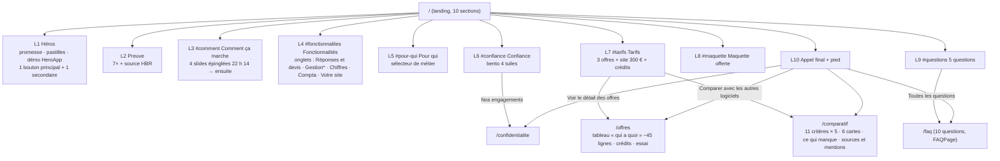
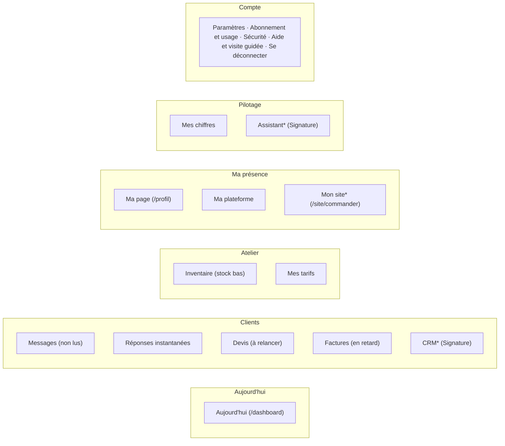

# Refonte 18/10 — Étape 2 : architecture de l'information

Avant tout visuel. Le contenu de chaque bloc et sa destination sont dans `INVENTAIRE-CONTENU.md` ; les mesures « avant » dans
`AUDIT.md`. Les drapeaux sont relus dans `lib/flags.ts` (HEAD `8ade943`) : **une fonctionnalité au drapeau baissé n'apparaît
nulle part** (ni onglet, ni slide, ni entrée de menu, ni carte « Découvrir »).

---

## 1. Plan du site public

`*` onglet « Gestion (assistant et CRM) » : affiché seulement si `FLAGS.assistant && FLAGS.crm` (vrais au 18/10), comme
`DemoGestion` aujourd'hui (`page.tsx:247`).

### 1.1 Les 10 sections

| # | Section | Absorbe (sections actuelles) | Forme | Comportement 1440 | Comportement 390 | Sans JS / mouvement réduit |
|---|---|---|---|---|---|---|
| L1 | Héros | 1 Héros, 2 Bande de mots, 3 Réassurance | promesse + 4 pastilles (Rapide, Fiable, Sécurisé, Sans carte) + démo produit **dans le premier écran** | 2 colonnes (texte, démo) | 1 colonne, démo sous les boutons | tout visible, démo en état final |
| L2 | Preuve | 4 Preuve | bande courte : 7× + phrase + source | 1 ligne | 2 lignes | compteur à sa valeur finale |
| L3 | Comment ça marche `#comment` | 5 Chaîne, 6 « 22 h 14 → 7 h 52 » (scènes 1-4) | **section épinglée** : le défilement avance 4 slides ; à gauche la frise horaire (heure, titre, texte), à droite la scène `DemoSequence` correspondante ; barre de progression ; touches ← → | épinglée sur ≈ 250 vh | **non épinglée** : stepper à 4 pastilles + précédent/suivant (glisser), 1 écran | les 4 étapes en liste, chacune avec sa capture |
| L4 | Fonctionnalités `#fonctionnalites` | 6 (scènes Signature, `DemoGestion`, `DemoSite`), 7 `#chiffres`, 8 `#compta` | **onglets** ARIA `tablist` : Réponses et devis · Gestion* · Chiffres · Compta · Votre site ; texte court à gauche, démo réelle à droite | onglets horizontaux | onglets défilants horizontalement, démo pleine largeur | tous les panneaux empilés (repli) |
| L5 | Pour qui `#pour-qui` | 9 | sélecteur de métier (4 pastilles) qui change la demande type | pastilles + carte | idem | les 4 métiers en liste |
| L6 | Confiance `#confiance` | 10 | bento 4 tuiles + phrase « C'est du code, et il refuse » + lien confidentialité | 4 colonnes | 2 × 2 | — |
| L7 | Tarifs `#tarifs` | 11 (sauf tableau), 12 site 300 € ; garde `id="comparatif"` sur le lien vers /comparatif | 3 cartes (4-5 lignes distinctives) + carte site 300 € + bandeau essai + accordéon crédits ; deux liens : « Détail des offres » → /offres, « Comparer avec les autres logiciels » → /comparatif | 4 cartes | cartes en carrousel horizontal **avec** précédent/suivant, l'offre Studio au centre | cartes empilées |
| L8 | Maquette `#maquette` | 13 | formulaire inchangé, mieux mis en scène (exemple de maquette à gauche) | 2 colonnes | 1 colonne | — |
| L9 | Questions `#questions` | 14 | accordéon de 5 questions + « Toutes les questions » | — | — | `
` natifs |
| L10 | Appel final + pied | 15, pied | — | — | — | — |

**Boutons « Essayer gratuitement »** : 3 au plus en bouton principal (L1, L7 offre mise en avant, L10). En-tête et pied :
lien ou bouton secondaire. Aujourd'hui : 11 appels.

### 1.2 Hauteur visée

Estimation par section en 390 px (en écrans de 844 px) : L1 1,6 · L2 0,4 · L3 1,4 · L4 1,8 · L5 0,8 · L6 1,0 · L7 3,0 ·
L8 1,5 · L9 0,9 · L10 + pied 1,4 → **≈ 13,8 écrans contre 34,5 (− 60 %)**, la cible étant − 40 % (≤ 20,7). Marge prise
volontairement : les estimations d'une maquette sous-estiment toujours. À mesurer par `scripts/refonte-avant-landing.mjs`
relancé sur la nouvelle composition (même script, même méthode). Sur ordinateur, la section épinglée L3 **ajoute** du
défilement (≈ 2,5 écrans pour 4 slides) : c'est voulu, elle remplace 6,2 écrans (sections 5 et 6 actuelles).

### 1.3 Ancres conservées

| Ancre actuelle | Où elle mène après |
|---|---|
| `#comment` | L3 |
| `#fonctionnalites` | L4 (premier onglet) |
| `#chiffres` | L4, onglet « Chiffres » ouvert (le composant d'onglets lit le hash) |
| `#compta` | L4, onglet « Compta » ouvert |
| `#pour-qui` | L5 |
| `#confiance` | L6 |
| `#tarifs` | L7 |
| `#comparatif` | bloc `id="comparatif"` dans L7 (lien vers /comparatif) — les liens externes vers `/#comparatif` atterrissent sur la phrase et le bouton, sans 404 |
| `#maquette` | L8 |
| `#questions` | L9 |

### 1.4 Pages dédiées

- **`/comparatif`** (nouvelle) : tout `ComparatifConcurrents` (tableau, 6 cartes, « Là où les autres sont devant », mention de
  date, précaution, 12 sources). Liée depuis L7, le pied et l'en-tête. Métadonnées propres, entrée dans `app/sitemap.ts`.
  `scripts/comparatif-qa.mjs` devra suivre le composant à sa nouvelle adresse (corrigé, jamais supprimé).
- **`/offres`** (nouvelle, voir §2.3 pour le nom) : cartes complètes (`OffreDetail` intégral), tableau `Comparatif` déplié,
  crédits, essai, site 300 €, paiement direct.
- **`/faq`** (existe, 200) : passe à 10 questions groupées (Produit · Essai et prix · Données et sécurité · IA), porte le
  `FAQPage` complet. La landing ne balise plus que ses 5 questions affichées.
- **`/confidentialite`** (existe) : cible du lien de L6.

### 1.5 Conflit d'adresse : `/tarifs`

Le prompt demande une page publique `/tarifs`. **Cette adresse est déjà l'écran console « Mes tarifs »** de l'artisan
(`app/tarifs/page.tsx`, monté dans `AppShell` ; sans session, il renvoie à `/login` — vérifié en production le 18/10). Options :

1. **`/offres`** pour la page publique (recommandé : aucun changement côté console, aucun lien d'artisan cassé, le mot est
   celui des cartes « offre Essentiel/Studio/Signature »).
2. `/prix` : même avantage, mot plus direct, mais « prix » désigne aussi les tarifs de l'artisan dans la console.
3. Déplacer la console vers `/mes-tarifs` et libérer `/tarifs` : touche aux liens internes, à l'aide, aux vidéos d'aide et
   aux suites e2e — coût et risque sans bénéfice pour le visiteur.

---

## 2. La console

### 2.1 Menu groupé

| Groupe | Entrée | Route | Condition d'affichage (inchangée) | Compteur | Pastille d'offre (présentation seule, le verrou reste `peut()` côté serveur) |
|---|---|---|---|---|---|
| — | **Aujourd'hui** | `/dashboard` | toujours | — | — |
| Clients | Messages | `/messages` | toujours | **demandes non lues** (requête existante, `AppShell.tsx:186-193`) | « Studio » si `!peut(plan,'plateforme.conversation')` |
| Clients | Réponses instantanées | `/outils` | toujours | — | « Studio » si `!peut(…,'plateforme.conversation')` |
| Clients | Devis | `/devis` | toujours | **devis à relancer** (règle existante : envoyé depuis plus de `SEUIL_RELANCE_JOURS` = 7 j et encore valide, `lib/tableau-de-bord/calculer.ts:115,306-309`) | — |
| Clients | Factures | `/factures` | toujours | **factures échues non payées** | — |
| Clients | CRM | `/crm` | `enEssai('crm')` (levé) | chantiers en retard (si le calcul existe côté CRM, sinon aucun) | « Signature » **seulement si l'offre ne l'inclut pas** (aujourd'hui affichée même à un compte Signature : défaut AUDIT §2.1) |
| Atelier | Inventaire | `/inventaire` | toujours | matériaux sous le seuil | — |
| Atelier | Mes tarifs | `/tarifs` | toujours | — | — |
| Ma présence | Ma page | `/profil` | toujours | — | — |
| Ma présence | Ma plateforme | `/plateforme` | toujours | — | « Studio » si `!peut(…,'plateforme.gestion')` |
| Ma présence | Mon site | `/site/commander` | `actif('siteCommandeVente')` (levé) | — | — |
| Pilotage | Mes chiffres | `/chiffres` | toujours | — | « Studio » si `!peut(…,'chiffres')` |
| Pilotage | Assistant | `/assistant` | `enEssai('assistant')` (levé) | — | « Signature » si l'offre ne l'inclut pas |
| Compte (menu du compte, en bas) | Paramètres, Abonnement et usage, Sécurité, **Aide et visite guidée** (`actif('aideCentre')`), Se déconnecter | | | crédits restants affichés sous le nom | — |
| Fondateur (si `is_founder`) | Poste de contrôle | `/controle` | inchangé | — | — |

Résultat : **12 entrées visibles en 5 groupes** + un menu de compte, contre 15 entrées à plat dans un groupe de 12. L'entrée
« Abonnement » en double disparaît du menu principal (elle vit dans le menu du compte et dans `/abonnement`, route conservée).
Après connexion, l'artisan arrive sur **Aujourd'hui** (aujourd'hui : `/outils`, `app/login/page.tsx:34`) — le paramètre
`retour=` garde la priorité.

### 2.2 Les briques transverses

- **Repli en icônes** (ordinateur) : 64 px, libellés en infobulle, état mémorisé par appareil (`localStorage`, avec repli).
  Raccourci `[`.
- **Palette Ctrl+K / ⌘K** reprise de `app/controle/Recherche.tsx` (sans animation d'ouverture : geste répété) :
  - *Aller à* : chaque entrée du menu (avec les mêmes conditions de drapeau et d'offre) ;
  - *Créer* : un devis, une facture, un matériau, un client (CRM, si levé) ;
  - *Chercher* : un client, un devis par numéro, une facture, un matériau (recherche serveur, comptes isolés comme aujourd'hui) ;
  - *Aide* : « Revoir la visite guidée », « C'est quoi, cet écran ? ».
- **Barre d'état** (en-tête, ordinateur) : état de synchronisation (temps réel déjà en place sur le CRM), crédits restants
  sur le total de l'offre, offre ; sur téléphone, dans le menu du compte.
- **Barre du bas** (téléphone, < 820 px) : **Aujourd'hui · Messages (compteur) · Devis · Factures · Plus** ; « Plus » ouvre
  une feuille avec les autres groupes. Le bouton « retour » de l'en-tête reste.
- **Raccourcis clavier affichés** : `N` nouveau (sur Devis, Factures), `/` chercher dans la liste, `J`/`K` parcourir,
  `Ctrl K`, `?` aide. Jamais actifs dans un champ de saisie.

### 2.3 Accueil « Aujourd'hui » (`/dashboard`)

Ordre, de haut en bas :
1. **Bonjour** + date + phrase qui compte les actions (« 3 choses à faire aujourd'hui » ; « Rien d'urgent » si 0). Le nom
   affiché est celui de l'artisan s'il est connu, sinon le nom d'entreprise **entier** (aujourd'hui « Bonjour Atelier »).
2. **Les 3 actions prioritaires**, tirées des vraies données : demandes à répondre (réponse préparée à relire), devis à
   relancer (règle des 7 jours), factures en retard. Chaque carte = un clic vers l'écran, ouvert au bon endroit.
3. **Chiffres du mois** (Facturé, Encaissé, En retard, Devis signés) calculés par `lib/tableau-de-bord/calculer.ts` — **le
   même calcul que Mes chiffres** (règle « deux chiffres, un écran ») ; « — » sans donnée ; masqués (remplacés par une carte
   « Disponible avec Studio ») si `!peut(plan,'chiffres')`.
4. **Fil d'activité** (demandes, réponses préparées, devis acceptés, stock bas).
5. **Panneau « Découvrir »** : carrousel (précédent, suivant, pause ; **jamais d'avance automatique sans contrôle**), une slide
   par fonctionnalité **levée** que l'artisan n'utilise pas encore ; inclus dans son offre → bouton qui y mène ; hors offre →
   « Disponible avec Studio/Signature » + la vraie différence lue dans `lib/plans.ts`. Jamais une fonctionnalité au drapeau
   baissé (`crmPieces`, `crmPlanning`, `inventaireOcr`, canaux…).
6. Le **lien de contact** (aujourd'hui en tête) descend dans une carte « Votre lien » repliable une fois copié.

### 2.4 Pages de liste et fiches (règle commune)

En-tête : titre à gauche, **une** action principale à droite ; filtres en pastilles (avec compteurs) ; tableau à lignes de
48 px, nombres en JetBrains Mono alignés à droite, dernière colonne = l'action de la ligne (Relire, Envoyer, Relancer,
Facturer) ; sur téléphone, cartes compactes. État vide utile (ce que fait la page + le premier geste), squelette au chargement,
confirmation (toast) de chaque action.

- **Devis** : filtres Tous · Brouillons · **À relancer** · Acceptés · Refusés ; colonnes Numéro, Client, Objet, Montant TTC,
  Statut, Dernier geste, Action.
- **Fiche devis** : **lecture** quand le devis est envoyé, accepté ou refusé (lignes, totaux, client, historique ; actions :
  Relancer / Facturer en principal, PDF, Dupliquer) ; **édition** seulement pour un brouillon. Aujourd'hui un devis envoyé reste
  un formulaire avec « Tout effacer & recommencer » (AUDIT défaut 5). La logique métier ne change pas ; seul l'écran choisit
  son mode.
- **Factures** : la liste d'abord ; les réglages des relances automatiques passent dans un panneau « Réglages des relances »
  (ou un onglet) — aujourd'hui 2,7 écrans avant la première facture ; statut « En retard » quand l'échéance est dépassée.

### 2.5 Visite guidée en slides (`Visite.tsx`, drapeau `aideVisites`)

4 à 5 écrans plein cadre à la première connexion : 1. Votre lien, 2. La demande et la réponse préparée, 3. Le devis sur vos
prix, 4. Vos chiffres, 5. Ctrl+K et la barre du bas. Passable (« Passer »), clavier (← →, Échap), relançable depuis « Aide et
visite guidée ». Mémoire inchangée (`artisans.aide_vues`, repli `localStorage`).

### 2.6 Ce qui ne change pas

Routes, verrous d'offre (`peut()`, `lib/plans.ts`), logique métier, prompts IA, drapeaux. Le Poste de contrôle `/controle`
prête sa palette et sa barre d'état, il n'est pas redessiné. Les surfaces artisan `/site/[slug]` et `/p/[slug]` ne reçoivent
aucun composant de la console. Tout passe derrière `consoleV2` et `landingV2` (à créer, baissés), visibles d'abord par le
compte fondateur via `ESSAI`/`lib/essais.ts`.
